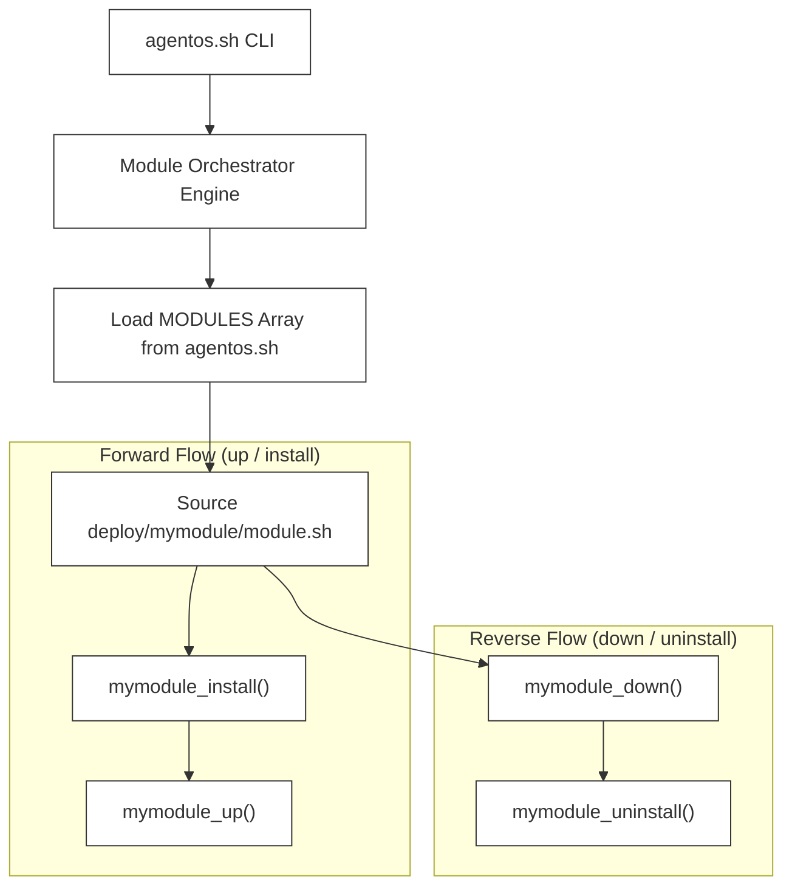
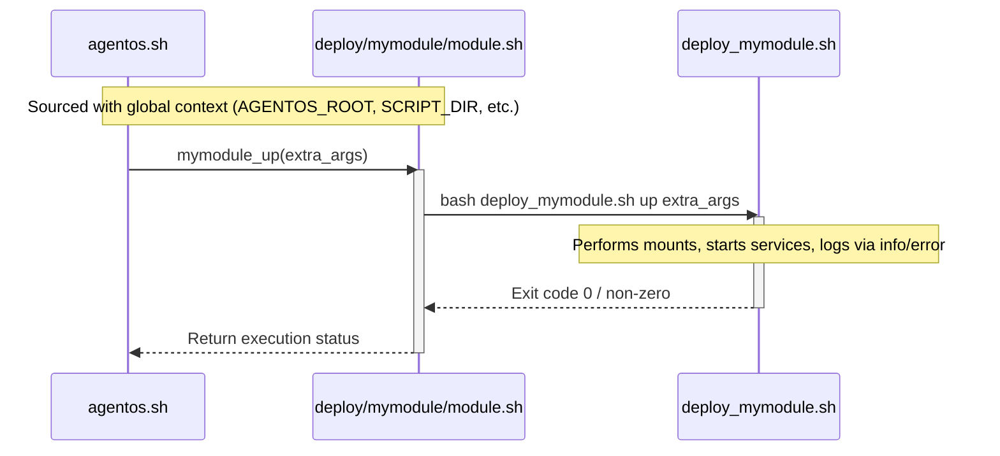

<!-- source: DeepWiki mcp.deepwiki.com · repo openJiuwen-ai/agentos-enterprise · page 3.5 Writing a New Deploy Module · fetched 2026-11-02 -->

# Writing a New Deploy Module

<details>
<summary>Relevant source files</summary>

The following files were used as context for generating this wiki page:

- [CONTRIBUTING.md](CONTRIBUTING.md)
- [deploy/moosefs/module.sh](deploy/moosefs/module.sh)
- [docs/en/how-to/add-deploy-module.md](docs/en/how-to/add-deploy-module.md)
- [docs/zh/how-to/add-deploy-module.md](docs/zh/how-to/add-deploy-module.md)

</details>


This page details the module hook convention (`_install`, `_up`, `_down`, `_uninstall`, `_status`) implemented in `deploy/agentos.sh` and outlines the exact steps required to integrate a new component into the AgentOS Enterprise deployment framework [docs/zh/how-to/add-deploy-module.md:1-3]().

---

## 1. Architectural Overview of Deploy Modules

AgentOS Enterprise relies on a "module registration + hook functions + scheduling engine" design pattern located inside `deploy/agentos.sh` [docs/zh/how-to/add-deploy-module.md:3](). Under this architecture, the central orchestrator requires zero modification when adding or removing secondary subsystems. Each distinct component provides an isolated directory containing a standard `module.sh` interface script [docs/zh/how-to/add-deploy-module.md:7]().

The orchestrator discovers these modules by sourcing each component's `module.sh` file and querying or executing its hook functions in a strict, deterministic sequence:
- **Forward execution order** (`install`, `up`): Modules are initialized from the first element in the registration array to the last [docs/zh/how-to/add-deploy-module.md:12-28,46-50]().
- **Reverse execution order** (`uninstall`, `down`): Modules are stopped and uninstalled from the last element down to the first [docs/zh/how-to/add-deploy-module.md:17-34,50]().


*Sources: [docs/zh/how-to/add-deploy-module.md:3-50](), [deploy/moosefs/module.sh:1-36]()*

---

## 2. Step-by-Step Integration Procedure

Adding a new component involves two primary tasks: creating the module definition structure and registering the module name with the orchestration array [docs/zh/how-to/add-deploy-module.md:3]().

### Step 1: Create the Module Directory and `module.sh`

Create a new directory under the `deploy/` path named with kebab-case (e.g., `deploy/mymodule/`), and place a `module.sh` file inside it [CONTRIBUTING.md:27](), [docs/zh/how-to/add-deploy-module.md:7](). 

The module must implement a subset of standard hook functions matching the naming convention `<module_name>_<hook>` [docs/zh/how-to/add-deploy-module.md:81](). Below is a fully realized reference implementation:

```bash
# deploy/mymodule/module.sh

# Internal helper pattern
_mymodule_run() {
    local script="${SCRIPT_DIR}/mymodule/deploy_mymodule.sh"
    if [ ! -f "${script}" ]; then
        error "deploy script not found: ${script}"
    fi
    bash "${script}" "$@"
}

# Start lifecycle hook (called in declaration order on up / restart)
mymodule_up() {
    _mymodule_run up "$@"
}

# Stop lifecycle hook (called in reverse order on down / restart)
mymodule_down() {
    _mymodule_run down "$@"
}

# Python package installation hook (called on install)
mymodule_install() {
    local found_whl
    found_whl=$(ls "${AGENTOS_ROOT}"/mymodule-*.whl 2>/dev/null || true)
    if [ -n "${found_whl}" ]; then
        bash -c "python${YR_PYTHON_VERSION} -m pip install '${found_whl}' --quiet"
    fi
}

# Python package uninstallation hook (called in reverse order on uninstall)
mymodule_uninstall() {
    bash -c "python${YR_PYTHON_VERSION} -m pip uninstall -y mymodule 2>/dev/null" || true
}

# Read-only status probe hook (returns pipe-delimited data for status tables)
mymodule_status() {
    echo "mymodule|mymodule.service|running|active"
}
```
*Sources: [docs/zh/how-to/add-deploy-module.md:9-40](), [deploy/moosefs/module.sh:1-36]()*

### Step 2: Register in the `MODULES` Array

Open `deploy/agentos.sh` and append your module string to the global `MODULES` array in the desired dependency order [docs/zh/how-to/add-deploy-module.md:42-48](). 

```bash
# Inside deploy/agentos.sh
MODULES=("moosefs" "jiuwenbox" "yuanrong" "agent-gateway" "jiuwenswarm" "mymodule")
```
*Sources: [docs/zh/how-to/add-deploy-module.md:46-48]()*

---

## 3. Hook Convention Contract

Every hook function operates under strict interface contracts. If a hook function is omitted, the framework gracefully skips it with a warning message without aborting execution—except for `status`, which falls back to a `"not supported"` placeholder row [docs/zh/how-to/add-deploy-module.md:62]().

| Hook Function | Invocation Trigger | Direction | Argument Handling | Primary Responsibility |
| :--- | :--- | :--- | :--- | :--- |
| `<module>_up` | `agentos.sh up` / `restart` | Forward | Passed through | Initialize resources, start systemd units or processes [docs/zh/how-to/add-deploy-module.md:56](). |
| `<module>_down` | `agentos.sh down` / `restart` | Reverse | Passed through | Gracefully stop processes and tear down volatile resources [docs/zh/how-to/add-deploy-module.md:57](). |
| `<module>_install` | `agentos.sh install` | Forward | Passed through | Discover and pip-install `.whl` files from the root package distribution [docs/zh/how-to/add-deploy-module.md:58](). |
| `<module>_uninstall`| `agentos.sh uninstall` | Reverse | Passed through | Remove installed Python assets and clean local configuration [docs/zh/how-to/add-deploy-module.md:59](). |
| `<module>_status` | `agentos.sh status` | Forward | None | Echo status string format: `module|service|state|detail` [docs/zh/how-to/add-deploy-module.md:60](). |

*Sources: [docs/zh/how-to/add-deploy-module.md:52-62]()*

### Status Output Formatting Contract
The `_status` hook must write a single formatted string to stdout [docs/zh/how-to/add-deploy-module.md:36](). The orchestrator parses this pipeline-delimited output to render the administrative summary table:

```
<module_name>|<service_identifier>|<state_keyword>|<detail_message>
```
Where `<state_keyword>` must evaluate to one of: `running`, `stopped`, `failed`, `disabled`, or `N/A` [docs/zh/how-to/add-deploy-module.md:60]().

---

## 4. Execution Data Flow and Context Variables

When `agentos.sh` executes a hook, it injects a set of pre-configured global variables and helper functions into the shell environment. These can be consumed directly inside `module.sh` or its associated shell scripts [docs/zh/how-to/add-deploy-module.md:64-67]().


*Sources: [docs/zh/how-to/add-deploy-module.md:12-40,64-77]*

### Environment Context Variables

- `SCRIPT_DIR`: Absolute path pointing directly to the `deploy/` workspace directory [docs/zh/how-to/add-deploy-module.md:70]().
- `AGENTOS_ROOT`: Absolute path of the main agentos distribution root, used for locating binary or wheel dependencies [docs/zh/how-to/add-deploy-module.md:71]().
- `YR_PYTHON_VERSION`: Target Python runtime version string (defaults to `3.11`) [docs/zh/how-to/add-deploy-module.md:72]().
- `BIND_IP`: Local binding IP address specified via `--ip` for multi-NIC environments (empty if dynamic auto-detection is preferred) [docs/zh/how-to/add-deploy-module.md:73]().
- `AGENTOS_SSH_KEY`: File path to the secure agent shell connection private key (defaults to `/root/.ssh/agent_key`) [docs/zh/how-to/add-deploy-module.md:74]().
- `AGENTOS_SSH_BACKEND_PUBLIC_DIR`: Directory path storing agent SSH public keys (defaults to `/root/.ssh/agent_pub`) [docs/zh/how-to/add-deploy-module.md:75]().
- Logging functions available in scope: `info`, `success`, `warning`, `error` [docs/zh/how-to/add-deploy-module.md:76]().

---

## 5. Development and Naming Conventions

To keep modules clean and maintainable, adhere to the following repository standards:

1. **Naming Conventions**:
   - Module folder names must use lowercase alphanumeric characters and hyphens (`kebab-case`, e.g., `agent-gateway`, `mymodule`) [CONTRIBUTING.md:27](), [docs/zh/how-to/add-deploy-module.md:80]().
   - Hook functions must be strictly prefixed with the module name: `<module_name>_<hook>` [docs/zh/how-to/add-deploy-module.md:81]().
   - Internal helper routines inside `module.sh` should be prefixed with an underscore (`_`) to prevent namespace collisions with other modules [docs/zh/how-to/add-deploy-module.md:82]().

2. **Shell Script Safety**:
   - All scripts should begin with `#!/usr/bin/env bash` and enforce strict error control options (`set -euo pipefail`) [CONTRIBUTING.md:26]().

3. **Validation**:
   - Before submitting changes, run system checks via `./ci/run_ci.sh` and perform a clean single-node deployment test [CONTRIBUTING.md:14-22]().

*Sources: [CONTRIBUTING.md:14-29](), [docs/zh/how-to/add-deploy-module.md:80-84]()*

---

