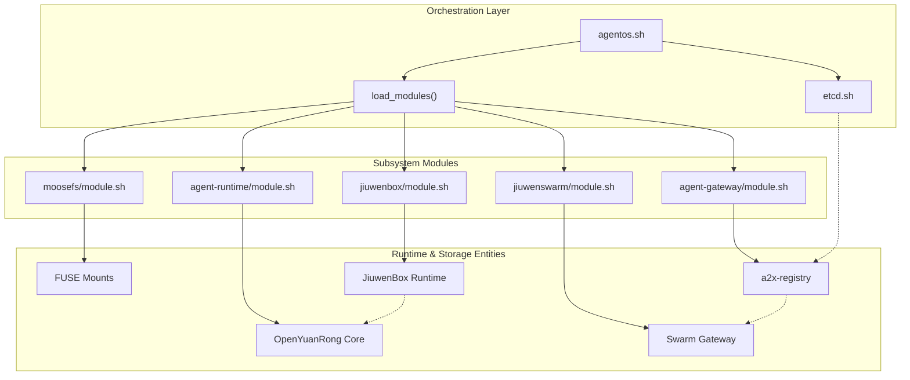

<!-- source: DeepWiki mcp.deepwiki.com · repo openJiuwen-ai/agentos-enterprise · page 4 Platform Components · fetched 2026-11-02 -->

# Platform Components

Relevant source files

The following files were used as context for generating this wiki page:

- [deploy/agentos.sh](deploy/agentos.sh)

This section provides a high-level overview of the deployed subsystems and architectural components that comprise AgentOS Enterprise. The platform follows a modular, pluggable architecture orchestrated by the deployment framework (`[deploy/agentos.sh:1-37]()`). Each component is managed via independent lifecycle scripts and systemd integrations.

For detailed technical references, configuration parameters, and deep dives, refer to the respective child pages:
- [etcd Coordination Store](#4.1)
- [MooseFS Distributed Storage](#4.2)
- [JiuwenSwarm Gateway and Web](#4.3)
- [JiuwenBox Sandbox Runtime](#4.4)
- [Agent Gateway (A2X Registry)](#4.5)
- [Agent Runtime and Conch](#4.6)

---

## 4.1 etcd Coordination Store

The etcd coordination store acts as the distributed key-value backbone for cluster state, service discovery, and configuration synchronization across AgentOS nodes. It is managed independently via `[deploy/etcd.sh]()`, which handles binary lifecycle management, systemd unit generation, health verification, and data cleanup routines.

For details, see [etcd Coordination Store](#4.1).

Sources: `[deploy/agentos.sh:32-33]()`, `[deploy/etcd.sh:1-50]()`

---

## 4.2 MooseFS Distributed Storage

MooseFS provides the distributed network file system layer required for shared agent state, file artifacts, and distributed workspace persistence. Deployed via `[deploy/moosefs_deploy.sh]()` and configured via `[deploy/moosefs.conf]()`, the subsystem provisions master, chunkserver, and client roles, establishing FUSE mounts and health monitoring timers.

For details, see [MooseFS Distributed Storage](#4.2).

Sources: `[deploy/agentos.sh:36]()`, `[deploy/moosefs_deploy.sh:1-40]()`

---

## 4.3 JiuwenSwarm Gateway and Web

JiuwenSwarm delivers the core multi-agent execution framework, management web interface, and workflow gateway. It is governed by `[deploy/jiuwenswarm/module.sh]()`, handling Python wheel installations, systemd services, tool sandbox prerequisites, and status probing.

For details, see [JiuwenSwarm Gateway and Web](#4.3).

Sources: `[deploy/agentos.sh:36]()`, `[deploy/jiuwenswarm/module.sh:1-50]()`

---

## 4.4 JiuwenBox Sandbox Runtime

JiuwenBox provides secure, isolated execution environments for agent-driven code and tool invocation. Managed via `[deploy/jiuwenbox/module.sh]()` and `[deploy/jiuwenbox_deploy.sh]()`, the runtime configures listener modes (UDS/HTTP), systemd drop-ins, and strict container or bubblewrap security policies.

For details, see [JiuwenBox Sandbox Runtime](#4.4).

Sources: `[deploy/agentos.sh:36]()`, `[deploy/jiuwenbox/module.sh:1-40]()`

---

## 4.5 Agent Gateway (A2X Registry)

The Agent Gateway (`a2x-registry`) handles agent routing, external protocol translation, and ingress master gating. Orchestrated by `[deploy/agent-gateway/module.sh]()`, it integrates with etcd for service discovery and enforces TLS/mTLS security validation.

For details, see [Agent Gateway (A2X Registry)](#4.5).

Sources: `[deploy/agentos.sh:36]()`, `[deploy/agent-gateway/module.sh:1-40]()`

---

## 4.6 Agent Runtime and Conch

The Agent Runtime component deploys the OpenYuanRong runtime environment required for agent reasoning and execution loops. Coupled with the Conch virtualization and storage utility modules, it is managed via `[deploy/agent-runtime/module.sh]()`.

For details, see [Agent Runtime and Conch](#4.6).

Sources: `[deploy/agentos.sh:36]()`, `[deploy/agent-runtime/module.sh:1-40]()`

---

## Subsystem Relationships and Architecture

The platform components interact in a structured sequence during orchestration. The orchestrator script `[deploy/agentos.sh]()` defines the execution order via the `MODULES` array: MooseFS storage initialization, JiuwenBox sandbox provisioning, Agent Runtime setup, Agent Gateway registration, and JiuwenSwarm deployment (`[deploy/agentos.sh:36]()`).

Title: "AgentOS Platform Component Relationships and Code Entities"

Sources: `[deploy/agentos.sh:32-37]()`, `[deploy/agentos.sh:103-114]()`

---

