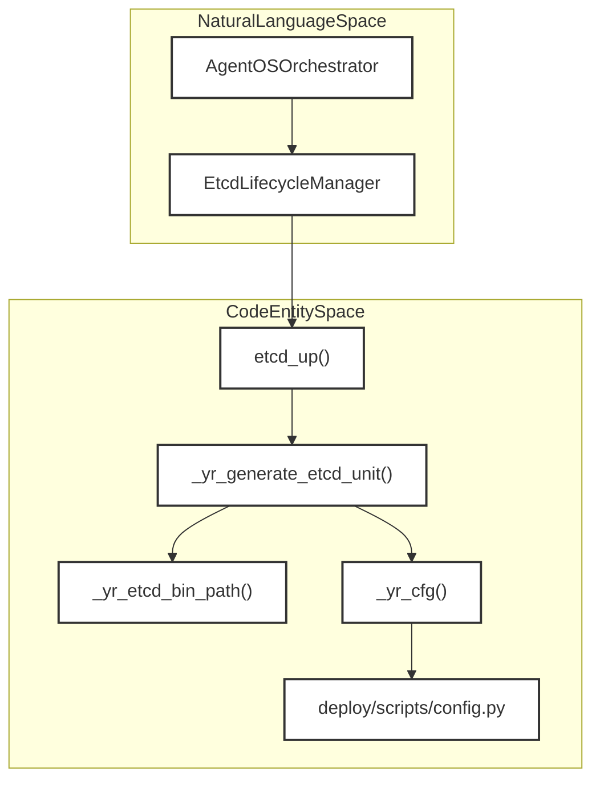

<!-- source: DeepWiki mcp.deepwiki.com · repo openJiuwen-ai/agentos-enterprise · page 4.1 etcd Coordination Store · fetched 2026-11-02 -->

# etcd Coordination Store

<details>
<summary>Relevant source files</summary>

The following files were used as context for generating this wiki page:

- [deploy/etcd.sh](deploy/etcd.sh)

</details>


## Purpose and Scope
The etcd Coordination Store subsystem manages the deployment, lifecycle, health monitoring, and cleanup of the distributed coordination store (`agentos-etcd`) used across AgentOS Enterprise `[deploy/etcd.sh:1-18]()`. It serves as the primary backbone for service discovery, leader election, and distributed metadata coordination for Jiuwen agent components `[deploy/etcd.sh:6-11]()`.

Sources: `[deploy/etcd.sh:1-18]()`

## etcd Script Lifecycle and Commands
The standalone script `deploy/etcd.sh` controls the etcd service lifecycle through explicit subcommands: `up`, `down`, `check`, and `clean` `[deploy/etcd.sh:13-18]()`. It determines node roles by querying cluster definitions parsed via `deploy/scripts/config.py` `[deploy/etcd.sh:10-10]()`, `[deploy/etcd.sh:23-23]()`.


*Figure 4.1-1: Lifecycle Control Flow and Code Mapping*

Sources: `[deploy/etcd.sh:1-18]`, `[deploy/etcd.sh:20-55]()`

## Binary Detection and Configuration Resolution
Before generating systemd units, `deploy/etcd.sh` resolves python interpreters, configuration wrappers, and etcd binaries:
- Python Interpreter (`_yr_python`): Locates `python3.11` or falls back to `python3` `[deploy/etcd.sh:41-45]()`.
- Configuration Wrapper (`_yr_cfg`): Invokes `deploy/scripts/config.py` with optional `BIND_IP` overrides `[deploy/etcd.sh:47-55]()`.
- etcd Binary Discovery (`_yr_etcd_bin_path`): Inspects `yr config dump` for `values.etcd.bin_path`, falling back to the python package's `third_party/etcd/etcd` path `[deploy/etcd.sh:57-82]()`.
- etcdctl Discovery (`_yr_etcdctl_path`): Resolves `etcdctl` via `PATH`, sibling directories to the etcd binary, or `third_party/etcd/etcdctl` `[deploy/etcd.sh:84-110]()`.

```mermaid
sequenceDiagram
    participant S as "etcd.sh"
    participant C as "_yr_cfg()"
    participant P as "deploy/scripts/config.py"
    participant B as "_yr_etcd_bin_path()"

    S->>C: "Request node topology and cluster parameters"
    C->>P: "Execute python parser with BIND_IP"
    P-->>C: "Return cluster topology values"
    C-->>S: "Return parameters"
    S->>B: "Locate etcd binary path"
    B-->>S: "Return absolute path to etcd executable"
    
    classDef default fill:#fff,stroke:#333,stroke-width:2px;
```
*Figure 4.1-2: Configuration and Binary Resolution Sequence*

Sources: `[deploy/etcd.sh:41-110]()`

## Systemd Unit Generation
On nodes designated within `etcd_nodes`, `_yr_generate_etcd_unit()` dynamically constructs `/etc/systemd/system/agentos-etcd.service` `[deploy/etcd.sh:9-10]()`, `[deploy/etcd.sh:24-25]()`, `[deploy/etcd.sh:124-178]()`. 

The unit generation logic checks whether `${AGENT_RUNTIME_ETCD_DATA_DIR}/member` exists to determine the `--initial-cluster-state` dynamically `[deploy/etcd.sh:134-140]()`:
- If `member/` exists, state is set to `existing` to enable smooth WAL recovery without data loss `[deploy/etcd.sh:134-136]()`.
- If absent, state is set to `new` for a clean cluster bootstrap `[deploy/etcd.sh:137-140]()`.

Key parameters injected into `ExecStart`:
- Client Listen URL: `http://0.0.0.0:32379` `[deploy/etcd.sh:163-163]()`
- Peer Listen URL: `http://0.0.0.0:32380` `[deploy/etcd.sh:165-165]()`
- Resource Quota: `--quota-backend-bytes=8589934592` (8GB) `[deploy/etcd.sh:157-157]()`
- Auto-compaction: revision-based with retention of 100,000 revisions `[deploy/etcd.sh:155-156]()`

Sources: `[deploy/etcd.sh:9-10]`, `[deploy/etcd.sh:24-25]`, `[deploy/etcd.sh:124-178]()`

## Health Checks and Data Cleaning
The subsystem defines operational hooks for cluster health verification and targeted data purging:
- Business Data Prefix Purging: When cleaning or tearing down without resetting cluster raft metadata, keys matching prefixes such as `"/datasystem/"`, `"/scheduler/"`, `"/sn/"`, and `"/yr/"` are cleared `[deploy/etcd.sh:112-116]()`.
- Health Probing: `_yr_health_check_retries` defaults to 30 attempts to verify reachability during startup `[deploy/etcd.sh:28-28]()`.

Sources: `[deploy/etcd.sh:28-28]`, `[deploy/etcd.sh:112-116]()`

---

