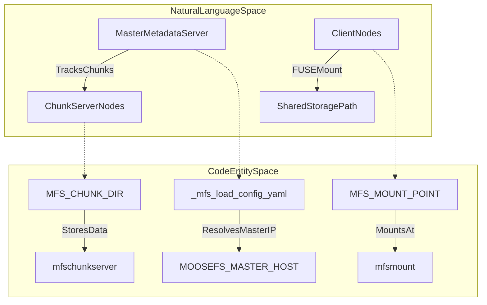
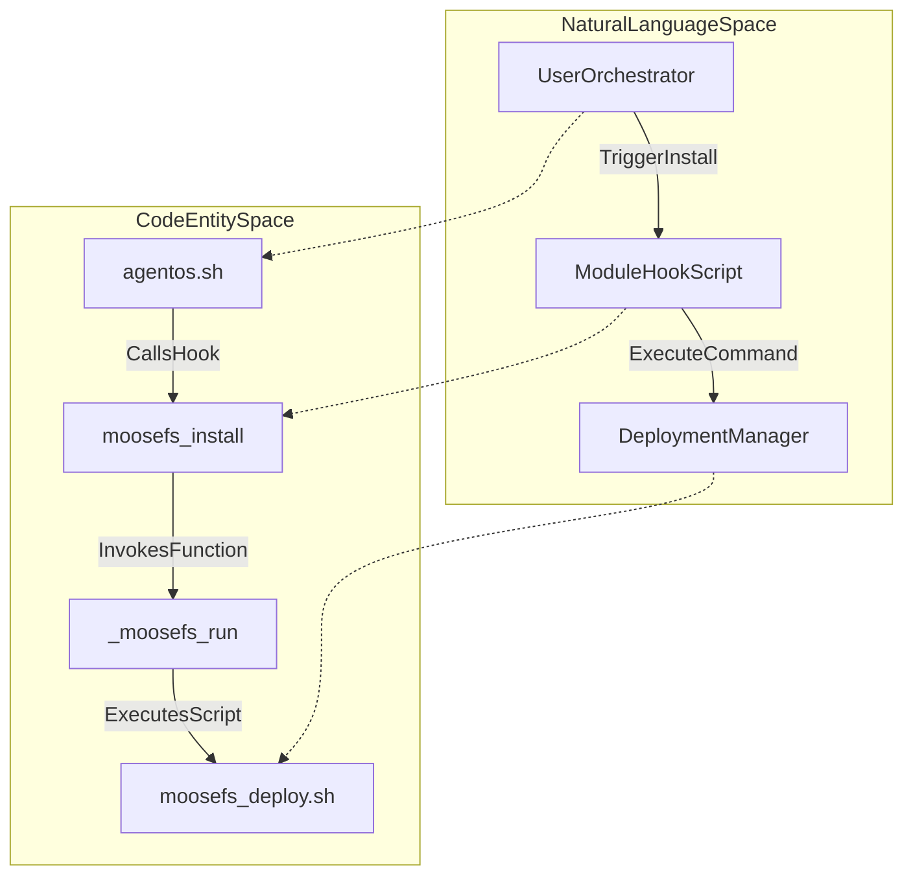

<!-- source: DeepWiki mcp.deepwiki.com · repo openJiuwen-ai/agentos-enterprise · page 4.2 MooseFS Distributed Storage · fetched 2026-11-02 -->

# MooseFS Distributed Storage

Relevant source files

The following files were used as context for generating this wiki page:

- [deploy/moosefs/README.zh.md](deploy/moosefs/README.zh.md)
- [deploy/moosefs/module.sh](deploy/moosefs/module.sh)
- [deploy/moosefs/moosefs.conf](deploy/moosefs/moosefs.conf)
- [deploy/moosefs/moosefs_deploy.sh](deploy/moosefs/moosefs_deploy.sh)

## Purpose and Scope

This section details the MooseFS distributed storage subsystem within AgentOS Enterprise, providing scalable shared storage across cluster nodes for user data, logs, and artifacts. The subsystem is managed via the orchestration script `deploy/moosefs/moosefs_deploy.sh`, configured through `deploy/moosefs/moosefs.conf`, and integrated into the broader deployment framework via `deploy/moosefs/module.sh` [deploy/moosefs/moosefs_deploy.sh:1-13](), [deploy/moosefs/moosefs.conf:1-70](), [deploy/moosefs/module.sh:1-36]().

---

## Component Roles and Cluster Architecture

MooseFS operates across three primary roles within the AgentOS cluster architecture:
1. **Master (`mfsmaster`)**: Manages file system metadata, directory trees, access control, and chunk locations. The master host address is dynamically resolved from `deploy/config.yaml` or defined via `MOOSEFS_MASTER_HOST` [deploy/moosefs/moosefs_deploy.sh:115-153](), [deploy/moosefs/moosefs.conf:7-10]().
2. **Chunkserver (`mfschunkserver`)**: Stores physical file blocks (chunks) on local disks under directories like `MFS_CHUNK_DIR` and listens on `MFS_CHUNK_PORT` (`9422`) [deploy/moosefs/moosefs.conf:26-33]().
3. **Client (`mfsmount`)**: Mounts the distributed namespace locally via FUSE at `MFS_MOUNT_POINT` (`/home/agentos/users`), communicating with the master on `MFS_MASTER_PORT` (`9420`) and client ports (`9421`) [deploy/moosefs/moosefs.conf:23-36]().

*Figure 1: MooseFS Architecture Mapping from Conceptual Roles to Configuration Entities.*

**Sources:** [deploy/moosefs/moosefs_deploy.sh:115-153](), [deploy/moosefs/moosefs.conf:7-36]()

---

## Configuration and Tuning (`moosefs.conf`)

The configuration parameters defined in `deploy/moosefs/moosefs.conf` govern network bindings, data directories, replication goals, and performance tuning flags [deploy/moosefs/moosefs.conf:1-70](). 

Key configuration keys parsed during initialization:
* `MOOSEFS_ENABLED`: Controls whether the distributed file system is enabled (`auto`/`yes`/`no`) [deploy/moosefs/moosefs.conf:12-15]().
* `MOOSEFS_USE_SYSTEMD`: Determines systemd service integration mode (`auto`/`yes`/`no`) [deploy/moosefs/moosefs.conf:17-21]().
* `MFS_GOAL`: Defines the default file replication factor (default `2` for multi-node, `1` for single-node) [deploy/moosefs/moosefs.conf:64-65]().
* `MFS_META_CACHE`: Enables FUSE metadata caching to reduce master RPC roundtrips under high concurrency [deploy/moosefs/moosefs.conf:38-43]().
* `MFS_FSYNC_MIN_TIME`: Minimum interval (seconds) between forced `fsync` operations on file close to optimize small-file write throughput [deploy/moosefs/moosefs.conf:48-53]().
* `MFS_WRITE_CACHE_SIZE`: Write cache buffer size in MiB [deploy/moosefs/moosefs.conf:55-58]().
* `MFS_MAX_IDLE_THREADS`: Upper bound for FUSE idle worker threads [deploy/moosefs/moosefs.conf:60-62]().

**Sources:** [deploy/moosefs/moosefs.conf:1-70]()

---

## Lifecycle Management (`moosefs_deploy.sh` & `module.sh`)

The lifecycle of the MooseFS subsystem is governed by `deploy/moosefs/moosefs_deploy.sh`, which exposes standard command actions: `install`, `up`, `down`, `uninstall`, and `status` [deploy/moosefs/moosefs_deploy.sh:8-13](). 

These commands are abstracted by `deploy/moosefs/module.sh`, allowing the higher-level AgentOS orchestrator (`agentos.sh`) to invoke module hooks such as `moosefs_up`, `moosefs_down`, `moosefs_install`, `moosefs_uninstall`, and `moosefs_status` [deploy/moosefs/module.sh:1-36]().

*Figure 2: Execution Flow from Orchestrator Hook Dispatch to Deployment Script.*

During startup configuration loading (`_mfs_load_config`), the script preserves explicit environment overrides while falling back to `deploy/config.yaml` parsing (`_mfs_load_config_yaml`) and `moosefs.conf` values [deploy/moosefs/moosefs_deploy.sh:115-200]().

**Sources:** [deploy/moosefs/moosefs_deploy.sh:8-13](), [deploy/moosefs/moosefs_deploy.sh:115-200](), [deploy/moosefs/module.sh:1-36]()

---

## Package Provisioning and Dependencies

MooseFS relies on native OS packages (`moosefs-master`, `moosefs-chunkserver`, `moosefs-client`) and the `fuse3` library (`libfuse3.so.3`) [deploy/moosefs/README.zh.md:1-23](). 

According to `deploy/moosefs/README.zh.md`, supported distributions include:
* **openEuler** (22.03-LTS-SP1/SP4, 24.03-LTS-SP1/SP4) using RPM packages from the official MooseFS EL9 repository [deploy/moosefs/README.zh.md:5-10](), [deploy/moosefs/README.zh.md:30-43]().
* **Ubuntu** (22.04 Jammy, 24.04 Noble) using DEB packages from the official MooseFS APT repository [deploy/moosefs/README.zh.md:5-12](), [deploy/moosefs/README.zh.md:111-131]().

The deployment script assumes these packages have been pre-installed via package managers (e.g., `dnf` or `apt-get`) before executing `moosefs_deploy.sh install` [deploy/moosefs/README.zh.md:1-4]().

**Sources:** [deploy/moosefs/README.zh.md:1-231]()

---

