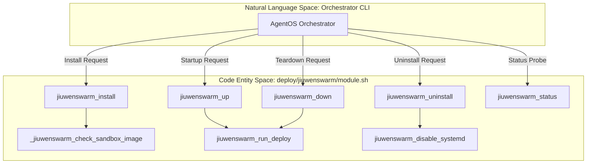
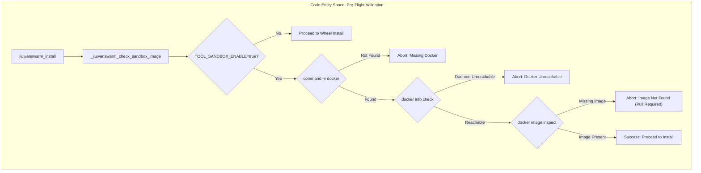

<!-- source: DeepWiki mcp.deepwiki.com · repo openJiuwen-ai/agentos-enterprise · page 4.3 JiuwenSwarm Gateway and Web · fetched 2026-11-02 -->

# JiuwenSwarm Gateway and Web

Relevant source files

The following files were used as context for generating this wiki page:

- [deploy/jiuwenbox/default-policy.yaml](deploy/jiuwenbox/default-policy.yaml)
- [deploy/jiuwenswarm/.env.custom](deploy/jiuwenswarm/.env.custom)
- [deploy/jiuwenswarm/module.sh](deploy/jiuwenswarm/module.sh)
- [deploy/requirements.txt](deploy/requirements.txt)

## Purpose and Scope

This page provides a high-level overview of the **JiuwenSwarm Gateway and Web** module within AgentOS Enterprise. The module encapsulates the JiuwenSwarm function runtime, API gateway, and frontend web server. It manages the component lifecycle through the `module.sh` orchestrator hook contract, handles Python wheel package installation, enforces tool sandbox prerequisites, configures systemd services, and handles status probing.

For detailed reference on environment variables, port configurations, concurrency settings, and manager resource allocations, see [JiuwenSwarm Environment Configuration](#4.3.1).

---

## 1. Module Lifecycle and Hook Dispatch

The JiuwenSwarm deployment integration relies on a set of standardized shell hooks defined in `deploy/jiuwenswarm/module.sh`. The orchestrator interacts with JiuwenSwarm by invoking hooks such as `jiuwenswarm_install`, `jiuwenswarm_up`, `jiuwenswarm_down`, `jiuwenswarm_status`, and `jiuwenswarm_uninstall`. 

Operations like `up` and `down` delegate execution to the internal deployment script (`deploy.sh`) located inside the unpacked submodule directory `deploy/jiuwenswarm/` [deploy/jiuwenswarm/module.sh:13-39](). Conversely, package registration and cleanup routines are executed directly on the host node.

*Figure 1: JiuwenSwarm module hook dispatch mapping orchestrator actions to internal shell routines.*

Sources: [deploy/jiuwenswarm/module.sh:1-168]()

---

## 2. Wheel Package Installation and Python Environment

During the installation phase (`jiuwenswarm_install`), the module searches the root installation directory (`${AGENTOS_ROOT}`) for the pre-built JiuwenSwarm distribution package (`jiuwenswarm-*-py3-none-any.whl`) [deploy/jiuwenswarm/module.sh:52-53](). 

If found, the wheel—which bundles both the core agent functions and the API gateway—is installed into the target Python environment specified by `YR_PYTHON_VERSION` with SSH extras enabled [deploy/jiuwenswarm/module.sh:57](). A verification check via `pip show` ensures the package has been correctly registered before concluding [deploy/jiuwenswarm/module.sh:58-63]().

Sources: [deploy/jiuwenswarm/module.sh:43-71]()

---

## 3. Tool Sandbox Prerequisites and Fail-Fast Validation

To secure tool execution, JiuwenSwarm supports an isolated execution backend governed by tool sandbox settings. Before any installation or deployment steps proceed, `_jiuwenswarm_check_sandbox_image` performs a strict fail-fast validation when `TOOL_SANDBOX_ENABLE=true` [deploy/jiuwenswarm/module.sh:89-111]().

*Figure 2: Pre-flight tool sandbox image validation workflow implemented prior to package installation.*

Sources: [deploy/jiuwenswarm/module.sh:89-140](), [deploy/jiuwenswarm/.env.custom:43-52]()

---

## 4. Systemd Services and Status Probing

JiuwenSwarm provisions and manages persistent systemd unit files on the host to maintain high availability for both the API gateway and the web frontend console. 

- **Gateway Service**: Listens on ports configured via environment parameters (e.g., `GATEWAY_PORT`) to route agent invocations [deploy/jiuwenswarm/.env.custom:35]().
- **Web Frontend Service**: Serves the user interface static assets and interacts with the gateway backend [deploy/jiuwenswarm/.env.custom:36-39]().

During uninstallation or teardown routines, `jiuwenswarm_disable_systemd` gracefully stops active services, disables autostart entries, purges temporary drop-in configurations, and reloads the systemd manager daemon [deploy/jiuwenswarm/module.sh:144-165]().

Sources: [deploy/jiuwenswarm/module.sh:144-165](), [deploy/jiuwenswarm/.env.custom:32-41]()

---

## 5. JiuwenSwarm Environment Configuration

All runtime parameters—including bind addresses, Python versions, concurrency throttles, manager resource limits (`MGR_CPU`, `MGR_MEMORY`), and tool sandbox image tags—are centrally defined in the `.env.custom` configuration file.

For the comprehensive reference of available variables and tuning guidelines, see the child page:
- **[JiuwenSwarm Environment Configuration](#4.3.1)**

Sources: [deploy/jiuwenswarm/.env.custom:1-52]()

---

