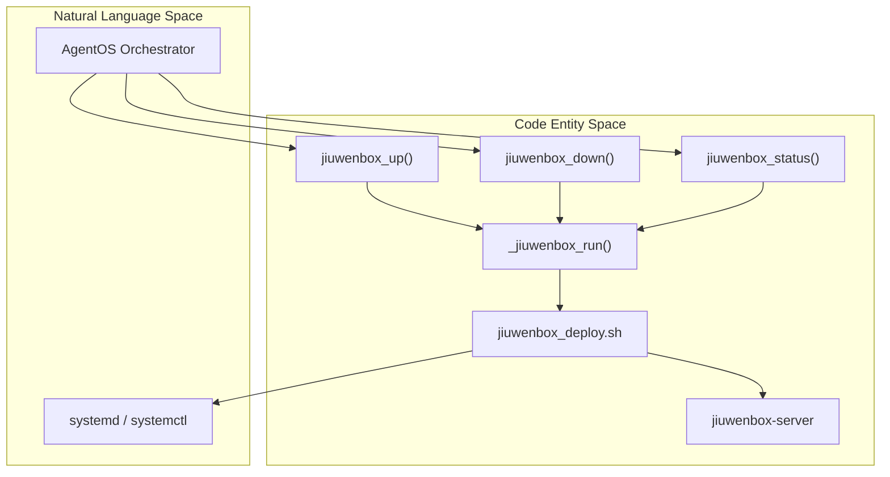
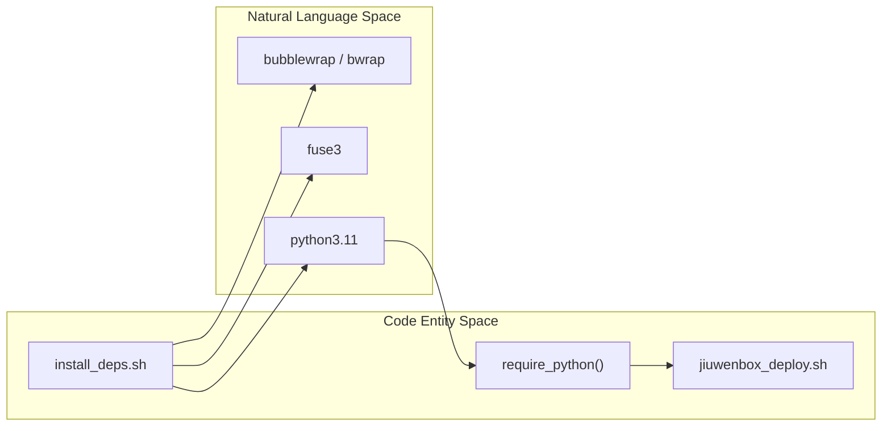

<!-- source: DeepWiki mcp.deepwiki.com · repo openJiuwen-ai/agentos-enterprise · page 4.4 JiuwenBox Sandbox Runtime · fetched 2026-11-02 -->

# JiuwenBox Sandbox Runtime

Relevant source files

The following files were used as context for generating this wiki page:

- [deploy/install_deps.sh](deploy/install_deps.sh)
- [deploy/jiuwenbox/jiuwenbox_deploy.sh](deploy/jiuwenbox/jiuwenbox_deploy.sh)
- [deploy/jiuwenbox/module.sh](deploy/jiuwenbox/module.sh)

## Purpose and Scope

JiuwenBox is the isolated execution environment responsible for running agent tools, code snippets, and pipelines securely within AgentOS Enterprise. Managed via `deploy/jiuwenbox/module.sh` [deploy/jiuwenbox/module.sh:1-40]() and orchestrated by `deploy/jiuwenbox/jiuwenbox_deploy.sh` [deploy/jiuwenbox/jiuwenbox_deploy.sh:1-889](), JiuwenBox leverages system primitives like bubblewrap, Landlock, and seccomp to enforce strict containment.

This is a parent page covering deployment orchestration, prerequisites, process supervision, listener modes, and systemd integration. For deep dives into filesystem mounts, namespaces, capabilities, and syscall filtering, see [Sandbox Security Policy](#4.4.1).

---

## 1. Module Lifecycle and Hook Conventions

The JiuwenBox subsystem integrates with the AgentOS deployment framework through standard module hook functions defined in `deploy/jiuwenbox/module.sh` [deploy/jiuwenbox/module.sh:1-40](). These hooks wrap `jiuwenbox_deploy.sh` [deploy/jiuwenbox/jiuwenbox_deploy.sh:1-889]() to manage the installation, startup, teardown, and status probing of the sandbox daemon.

*Figure 4.4.1: JiuwenBox Hook Dispatch Architecture.*

Sources: `deploy/jiuwenbox/module.sh:14-40` [deploy/jiuwenbox/module.sh:14-40](), `deploy/jiuwenbox/jiuwenbox_deploy.sh:51-83` [deploy/jiuwenbox/jiuwenbox_deploy.sh:51-83]()

---

## 2. Prerequisites and Environment Setup

Before launching JiuwenBox, host systems must provision necessary packages via `deploy/install_deps.sh` [deploy/install_deps.sh:1-544](). The runtime depends on:
- **Python >= 3.11**: Validated dynamically by `require_python()` in `jiuwenbox_deploy.sh` [deploy/jiuwenbox/jiuwenbox_deploy.sh:167-179]().
- **Sandbox Utilities**: `bubblewrap` (or `bwrap`), `fuse3`, and `iptables` [deploy/install_deps.sh:157-164]().
- **State & Run Directories**: Ephemeral runtime files reside in `/tmp/jiuwenbox`, persistent states in `/var/lib/jiuwenbox`, and logs in `/var/log/agentos` [deploy/jiuwenbox/jiuwenbox_deploy.sh:21-42]().

*Figure 4.4.2: Dependency Provisioning Flow.*

Sources: `deploy/install_deps.sh:157-164` [deploy/install_deps.sh:157-164](), `deploy/jiuwenbox/jiuwenbox_deploy.sh:21-42` [deploy/jiuwenbox/jiuwenbox_deploy.sh:21-42](), `deploy/jiuwenbox/jiuwenbox_deploy.sh:167-179` [deploy/jiuwenbox/jiuwenbox_deploy.sh:167-179]()

---

## 3. Listener Modes and Process Management

JiuwenBox supports dual listener communication modes configured via `JIUWENBOX_LISTEN` [deploy/jiuwenbox/jiuwenbox_deploy.sh:24-28]():
- **Unix Domain Socket (UDS)**: Default mode (`unix:///run/jiuwenbox/jiuwenbox.sock`) optimized for local inter-process communication [deploy/jiuwenbox/jiuwenbox_deploy.sh:24-25](). Stale sockets are automatically cleaned up if no server process holds the PID [deploy/jiuwenbox/jiuwenbox_deploy.sh:213-221]().
- **HTTP Mode**: Enabled via `http://` URIs for TCP-based transport [deploy/jiuwenbox/jiuwenbox_deploy.sh:203-204]().

Process supervision follows a preferred-systemd pattern:
1. **Systemd Integration**: Generates `/etc/systemd/system/jiuwenbox.service` with `Restart=on-failure` and environmental drop-ins located at `/etc/systemd/system/jiuwenbox.service.d/env.conf` [deploy/jiuwenbox/jiuwenbox_deploy.sh:34-42]().
2. **Fallback Mode**: If systemd is unavailable, falls back to background execution via `nohup` [deploy/jiuwenbox/jiuwenbox_deploy.sh:7-75]().

Sources: `deploy/jiuwenbox/jiuwenbox_deploy.sh:24-42` [deploy/jiuwenbox/jiuwenbox_deploy.sh:24-42](), `deploy/jiuwenbox/jiuwenbox_deploy.sh:73-75` [deploy/jiuwenbox/jiuwenbox_deploy.sh:73-75](), `deploy/jiuwenbox/jiuwenbox_deploy.sh:199-221` [deploy/jiuwenbox/jiuwenbox_deploy.sh:199-221]()

---

## 4. Policy Generation

JiuwenBox initializes security profiles from `default-policy.yaml` during deployment setup [deploy/jiuwenbox/jiuwenbox_deploy.sh:19](). Because runtime directories like `/tmp/jiuwenbox` are volatile, policies are persisted to `/var/lib/jiuwenbox` to ensure correct application across system reboots [deploy/jiuwenbox/jiuwenbox_deploy.sh:39-42]().

For detailed information on how security policies restrict filesystems, network interfaces, and system calls, see [Sandbox Security Policy](#4.4.1).

Sources: `deploy/jiuwenbox/jiuwenbox_deploy.sh:19-42` [deploy/jiuwenbox/jiuwenbox_deploy.sh:19-42]()

---

