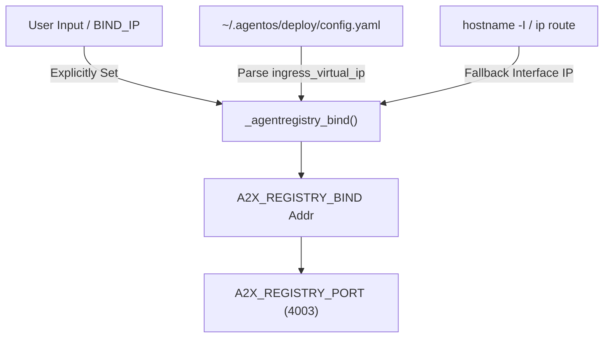
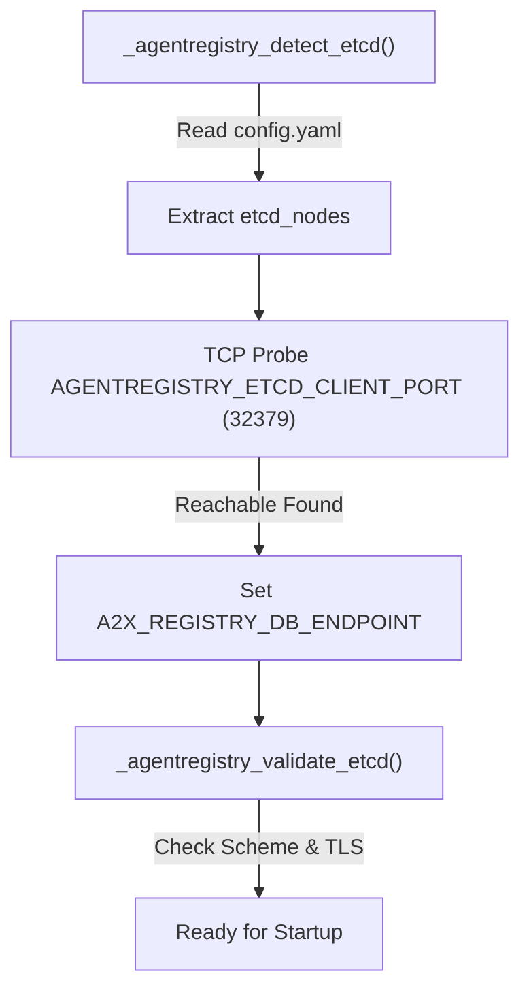

<!-- source: DeepWiki mcp.deepwiki.com · repo openJiuwen-ai/agentos-enterprise · page 4.5 Agent Gateway (A2X Registry) · fetched 2026-11-02 -->

# Agent Gateway (A2X Registry)

Relevant source files

The following files were used as context for generating this wiki page:

- [OPEN_SOURCE_SOFTWARE_NOTICE.md](OPEN_SOURCE_SOFTWARE_NOTICE.md)
- [deploy/agent-gateway/module.sh](deploy/agent-gateway/module.sh)
- [deploy/check-ingress-master.sh](deploy/check-ingress-master.sh)
- [deploy/conch/module.sh](deploy/conch/module.sh)

## Purpose and Scope
The Agent Gateway module (`deploy/agent-gateway/module.sh`) provisions, configures, and manages the A2X Registry service within AgentOS Enterprise. The A2X Registry acts as a coordination and registration service backed exclusively by `etcd`. This page details its implementation, including etcd service discovery, client and backend TLS/mTLS validation, ingress master gating (`deploy/check-ingress-master.sh`), and runtime health check mechanics.

---

## 1. Module Architecture and Configuration
The agent-gateway module defines core environment variables, ports, storage parameters, and systemd service descriptors. By default, the service listens on port `4003` (`A2X_REGISTRY_PORT`) and uses `/var/run/agentos` for runtime state and `/var/log/agentos` for logging [deploy/agent-gateway/module.sh:10-50]().

The binding address is determined dynamically via `_agentregistry_bind()`, which prioritizes explicit command-line flags (`BIND_IP`), falls back to the cluster `ingress_virtual_ip` parsed from `config.yaml`, and finally resorts to local interface probing (`hostname -I` or `ip route`) [deploy/agent-gateway/module.sh:95-124]().

*Diagram 1: Binding Address Resolution Flow*

Sources: `deploy/agent-gateway/module.sh:10-124`

---

## 2. Etcd Discovery and Validation
Because `etcd` serves as the sole storage backend for the A2X Registry, the module requires an active etcd cluster before starting [deploy/agent-gateway/module.sh:17-21](). 

The discovery function `_agentregistry_detect_etcd()` reads `cluster.etcd_nodes` from `~/.agentos/deploy/config.yaml` using Python's YAML parser and performs a TCP connection test against each node using `AGENTREGISTRY_ETCD_CLIENT_PORT` (default `32379`) [deploy/agent-gateway/module.sh:130-169](). Once a reachable etcd node is identified, `A2X_REGISTRY_DB_ENDPOINT` is automatically constructed [deploy/agent-gateway/module.sh:156-168]().

The validation function `_agentregistry_validate_etcd()` ensures that:
- `A2X_REGISTRY_DB_ENDPOINT` is explicitly set [deploy/agent-gateway/module.sh:68-69]().
- Etcd TLS certificates are either completely provided or entirely omitted (partial configurations trigger an error) [deploy/agent-gateway/module.sh:71-75]().
- The endpoint URL scheme matches the TLS state (`https://` if etcd mTLS is enabled; `http://` otherwise) [deploy/agent-gateway/module.sh:76-87]().

*Diagram 2: Etcd Discovery and Validation Workflow*

Sources: `deploy/agent-gateway/module.sh:67-88, 130-169`

---

## 3. TLS and mTLS Validation
The module supports dual-layer security: client-facing TLS on the registry API, and backend mTLS connecting to `etcd`.

- **Client TLS Validation**: `_agentregistry_tls_enabled()` verifies that `A2X_REGISTRY_TLS_CERTFILE`, `A2X_REGISTRY_TLS_KEYFILE`, and `A2X_REGISTRY_TLS_CA_CERTS` are all non-empty [deploy/agent-gateway/module.sh:57-60](). If all three are present, bi-directional TLS is activated; otherwise, plain HTTP is used [deploy/agent-gateway/module.sh:12]().
- **Etcd mTLS Validation**: `_agentregistry_etcd_tls_enabled()` checks `A2X_REGISTRY_ETCD_TLS_CA`, `A2X_REGISTRY_ETCD_TLS_CERT`, and `A2X_REGISTRY_ETCD_TLS_KEY` [deploy/agent-gateway/module.sh:63-65]().

Sources: `deploy/agent-gateway/module.sh:57-65`

---

## 4. Ingress Master Gating
To prevent split-brain scenarios or redundant gateway instances across a multi-node cluster, the agent-gateway systemd unit relies on an execution pre-check script: `deploy/check-ingress-master.sh` (installed to `/usr/local/bin/agentos-check-ingress-master`) [deploy/check-ingress-master.sh:1-73]().

When systemd attempts to start `agent-registry.service`, it invokes `ExecStartPre=agentos-check-ingress-master`. The script:
1. Parses `cluster.ingress_virtual_ip` from `~/.agentos/deploy/config.yaml` [deploy/check-ingress-master.sh:12-48]().
2. Bypasses checks (allows startup) if no VIP is configured, ensuring single-node backward compatibility [deploy/check-ingress-master.sh:14-18, 50-54]().
3. Validates IPv4 formatting of the VIP [deploy/check-ingress-master.sh:56-60]().
4. Queries local interfaces via `hostname -I` or `ip addr show` to verify whether the current node owns the VIP [deploy/check-ingress-master.sh:62-70]().
5. Exits with status `0` (allowing start) if the node is the master, or `1` (aborting start) if it is not [deploy/check-ingress-master.sh:63, 72]().

Sources: `deploy/check-ingress-master.sh:1-74`

---

## 5. Health Checks and Lifecycle Management
The module detects systemd availability via `_agentgw_has_systemd()` (checking for both `systemctl` and `/run/systemd/system`) [deploy/agent-gateway/module.sh:53-55](). 

It exposes standard deployment hooks used by `agentos.sh`:
- `agent-gateway_install`: Provisions directories, systemd service units, and copies `deploy/check-ingress-master.sh` to `/usr/local/bin/agentos-check-ingress-master`.
- `agent-gateway_up`: Invokes etcd discovery (`_agentregistry_detect_etcd`), validates configurations, and starts the service under systemd or `nohup`.
- `agent-gateway_down`: Stops the running registry process.
- `agent-gateway_uninstall`: Removes systemd unit files and binaries.
- `agent-gateway_status`: Probes process liveness and reports health metrics.

Sources: `deploy/agent-gateway/module.sh:4-6, 53-55`

---

