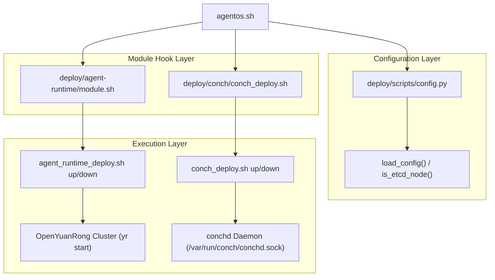
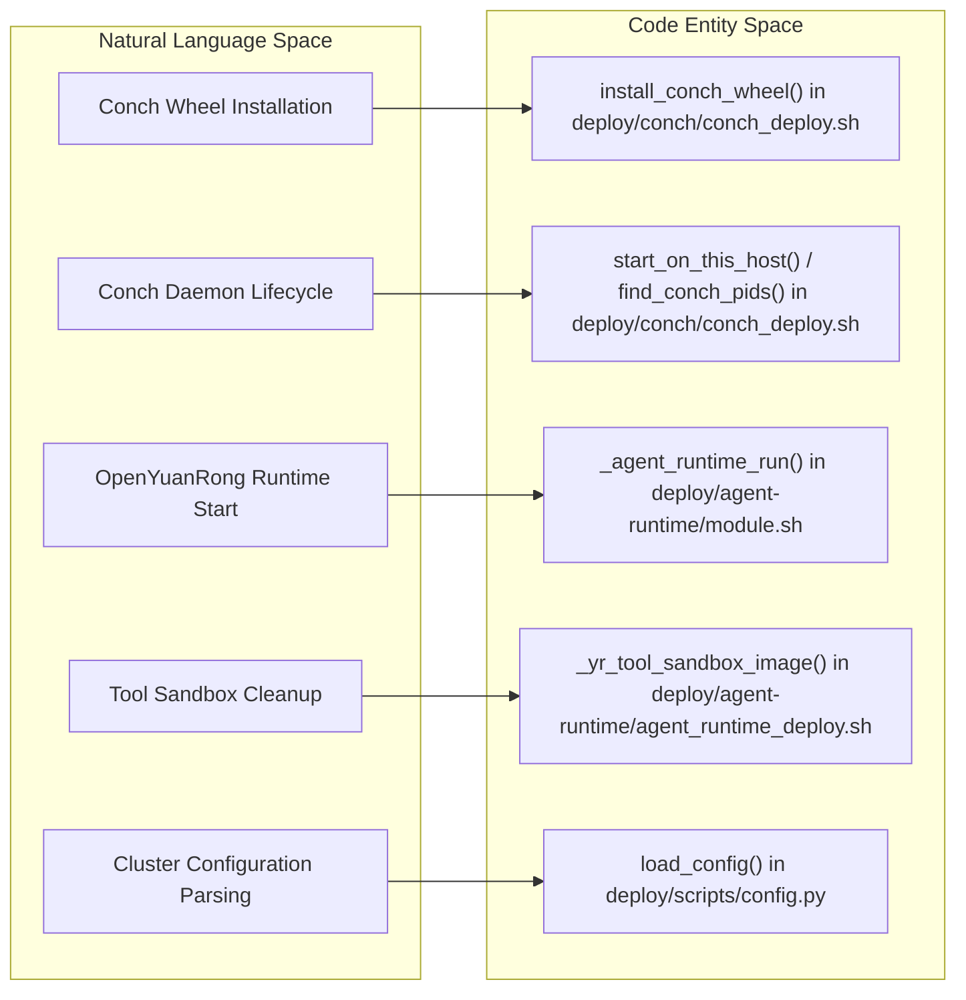

<!-- source: DeepWiki mcp.deepwiki.com · repo openJiuwen-ai/agentos-enterprise · page 4.6 Agent Runtime and Conch · fetched 2026-11-02 -->

# Agent Runtime and Conch

<details>
<summary>Relevant source files</summary>

The following files were used as context for generating this wiki page:

- [deploy/agent-runtime/agent_runtime_deploy.sh](deploy/agent-runtime/agent_runtime_deploy.sh)
- [deploy/agent-runtime/module.sh](deploy/agent-runtime/module.sh)
- [deploy/conch/conch_deploy.sh](deploy/conch/conch_deploy.sh)
- [deploy/scripts/config.py](deploy/scripts/config.py)

</details>


This page details the implementation and operational mechanics of the Agent Runtime subsystem (OpenYuanRong cluster deployment) and the Conch virtualization and storage utilities module within AgentOS Enterprise. These components form the distributed execution backbone for agent workflows, tool execution sandboxes, and low-level virtualization utilities.

---

## 1. Conch Virtualization and Storage Utilities Module

The Conch module manages the installation, lifecycle, and socket communication of the `conchd` daemon, which supplies virtualization and storage utilities for the agent platform [deploy/conch/conch_deploy.sh:5-24]().

### Installation and Wheel Packaging
Conch is distributed via RPM packages containing a bundled Python wheel [deploy/conch/conch_deploy.sh:32-51](). The installation procedure checks if the system RPM is present, extracts the embedded Python wheel, and installs it into the target Python environment (`python3.11` by default) [deploy/conch/conch_deploy.sh:34-64]():

* `install_rpm()`: Validates whether the `conch` RPM is registered via `rpm -q` and executes `rpm -ivh` if missing [deploy/conch/conch_deploy.sh:32-43]().
* `install_conch_wheel()`: Locates the wheel path inside the RPM file list, copies it to `AGENTOS_ROOT`, and installs it via `pip install` [deploy/conch/conch_deploy.sh:45-64]().

```bash
# Example wheel extraction and pip installation flow inside install_conch_wheel()
wheel_source=$(rpm -ql conch 2>/dev/null | awk '/\/wheels\/conch-[^/]+\.whl$/ { print; exit }')
python_bin="python${YR_PYTHON_VERSION:-3.11}"
"${python_bin}" -m pip install "${wheel_dest}" --quiet
```

### Service Lifecycle and Socket Management
`conch_deploy.sh` supports systemd-managed services with a fallback to direct background processes [deploy/conch/conch_deploy.sh:7-12](). 

* **Startup (`up`)**: Cleans up existing UNIX domain sockets (`/var/run/conch/conchd.sock`), checks process IDs via `find_conch_pids()`, and starts `conchd` either via `systemctl enable --now conchd.service` or by spawning a direct background job with output redirected to `/var/log/conchd.log` [deploy/conch/conch_deploy.sh:143-182]().
* **Readiness Probe**: Polls the UNIX socket file existence (`-S ${CONCH_SOCKET}`) up to `CONCH_READY_TIMEOUT` (default 300 seconds) at intervals defined by `CONCH_READY_POLL_INTERVAL` [deploy/conch/conch_deploy.sh:18-19, 183-197]().

Sources: [deploy/conch/conch_deploy.sh:1-198]()

---

## 2. Agent Runtime (OpenYuanRong Cluster) Deploy Scripts

The agent runtime module orchestrates the OpenYuanRong (`yr`) distributed runtime ecosystem [deploy/agent-runtime/agent_runtime_deploy.sh:5-13](). It controls cluster master nodes, executors, frontend endpoints, session logs, and tool sandbox containers.

### Component Architecture and Configuration
OpenYuanRong relies on fixed frontend port policies to guarantee deterministic endpoint registration with the Agent Gateway [deploy/agent-runtime/agent_runtime_deploy.sh:34-37]():
* `FRONTEND_PORT`: Defaults to `8888`. Enforces `--port-policy FIX` so startup fails fast on port conflicts rather than dynamically switching ports, preventing gateway routing breakages [deploy/agent-runtime/agent_runtime_deploy.sh:35-37]().
* `YR_LOG_DIR_PREFIX`: Defaults to `/var/log/agentos/yr_sessions`. Centralizes session directories, `latest` symlinks, `session.json`, `yr_current_master_info`, and component logs [deploy/agent-runtime/agent_runtime_deploy.sh:56-60]().

### SSH Key Management and Tool Sandbox Recovery
* **SSH Integration**: Uses shared keys (`AGENTOS_SSH_KEY`) for frontend host keys, backend nodes, and external clients [deploy/agent-runtime/agent_runtime_deploy.sh:42-53](). Public keys are injected into `/run/openyuanrong/ssh` with strict permission validation (`0644` for `authorized_keys`, `0755` for directories) to satisfy OpenSSH `StrictModes` [deploy/agent-runtime/agent_runtime_deploy.sh:48-53]().
* **Sandbox Container Cleanup (`_yr_tool_sandbox_image`)**: Because `yr stop --force` terminates runtime processes abruptly, Docker executor tool sandboxes can leak and continuously poll file systems [deploy/agent-runtime/agent_runtime_deploy.sh:73-77](). During `down` or `uninstall` routines, the script reads `TOOL_SANDBOX_IMAGE` from environment variables or `deploy/jiuwenswarm/.env.custom` to clean up dangling containers [deploy/agent-runtime/agent_runtime_deploy.sh:92-107]().

### Log Rotation and Global LRU Expiration
To prevent disk exhaustion on heavy workloads, the runtime deployment includes automated log maintenance loops:
* `RUNTIME_LOG_ROTATE_ENABLE`: Rotates log files exceeding `RUNTIME_LOG_ROTATE_MAX_SIZE_MB` (default 5MB) using `logrotate` copytruncate semantics up to `RUNTIME_LOG_ROTATE_MAX_FILES` archives [deploy/agent-runtime/agent_runtime_deploy.sh:63-68]().
* `LOG_EXPIRATION_ENABLE`: Global LRU file eviction bounded by `LOG_EXPIRATION_MAX_FILE_COUNT` (default 512 files) driven by `LOG_EXPIRATION_CLEANUP_INTERVAL` (default 15 seconds) [deploy/agent-runtime/agent_runtime_deploy.sh:69-71]().

Sources: [deploy/agent-runtime/agent_runtime_deploy.sh:1-174]()

---

## 3. Module Hook Conventions (`deploy/agent-runtime/module.sh`)

The agent-runtime subsystem exposes a standardized hook interface consumed by the `agentos.sh` orchestrator [deploy/agent-runtime/module.sh:1-6]().

### Hook Operations
The module wrapper (`deploy/agent-runtime/module.sh`) routes orchestrator requests directly to `agent_runtime_deploy.sh`:

| Hook Function | Underlying Action | Description |
| :--- | :--- | :--- |
| `agent-runtime_up` | `agent_runtime_deploy.sh up` | Initializes or starts the OpenYuanRong runtime nodes [deploy/agent-runtime/module.sh:19-21]() |
| `agent-runtime_down` | `agent_runtime_deploy.sh down` | Stops runtime components and reclaims sandbox resources [deploy/agent-runtime/module.sh:23-25]() |
| `agent-runtime_status` | `agent_runtime_deploy.sh status` | Probes active PIDs, port listeners, and systemd units [deploy/agent-runtime/module.sh:27-29]() |
| `agent-runtime_install` | `agent_runtime_deploy.sh install` | Sets up `YR_PKG_BASE` and installs distribution components [deploy/agent-runtime/module.sh:31-38]() |
| `agent-runtime_uninstall`| `agent_runtime_deploy.sh uninstall`| Purges packages and removes runtime state files [deploy/agent-runtime/module.sh:40-42]() |

Sources: [deploy/agent-runtime/module.sh:1-42]()

---

## 4. Architecture & Data Flow Diagrams

### Diagram 1: Deployment and Lifecycle Orchestration Flow
The following diagram illustrates how the `agentos.sh` orchestrator interacts with configuration utilities (`config.py`), module hooks (`module.sh`), and the underlying runtime/Conch deployment scripts.


Sources: [deploy/scripts/config.py:117-203](), [deploy/conch/conch_deploy.sh:1-24](), [deploy/agent-runtime/module.sh:1-42]()

### Diagram 2: Code Entity Space Mapping for Runtime & Conch
This diagram links high-level subsystem concepts to concrete class/function identifiers present in the codebase.


Sources: [deploy/conch/conch_deploy.sh:45-64](), [deploy/conch/conch_deploy.sh:143-198](), [deploy/agent-runtime/module.sh:11-17](), [deploy/agent-runtime/agent_runtime_deploy.sh:92-107](), [deploy/scripts/config.py:117-141]()

---

