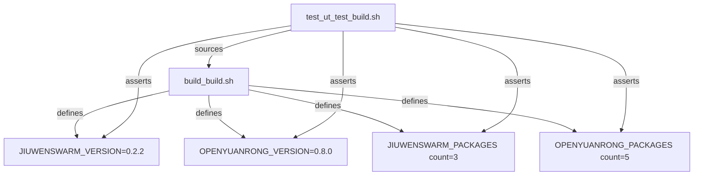
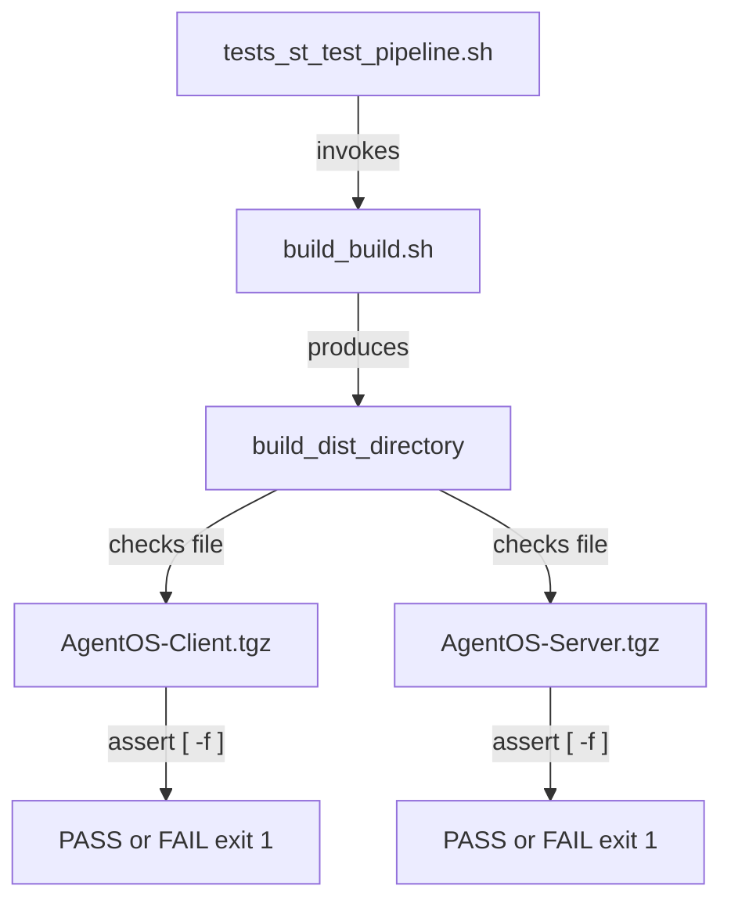

<!-- source: DeepWiki mcp.deepwiki.com · repo openJiuwen-ai/agentos-enterprise · page 5.1 Unit and System Tests · fetched 2026-11-02 -->

# Unit and System Tests

<details>
<summary>Relevant source files</summary>

The following files were used as context for generating this wiki page:

- [ci/run_ci.sh](ci/run_ci.sh)
- [tests/st/test_pipeline.sh](tests/st/test_pipeline.sh)
- [tests/ut/test_build.sh](tests/ut/test_build.sh)

</details>


## Purpose and Scope

The AgentOS Enterprise testing framework validates the build system configuration and ensures that packaging pipelines produce the expected deployment artifacts (`AgentOS-Client.tgz` and `AgentOS-Server.tgz`). Testing is divided into two main categories located under the `tests/` directory:
- **Unit Tests (UT)**: Lightweight static validation of core build constants, versions, and array structures defined in `build/build.sh`. Implemented in `tests/ut/test_build.sh`.
- **System Tests (ST)**: End-to-end integration checks that execute the complete build pipeline and verify the presence and integrity of final distribution tarballs. Implemented in `tests/st/test_pipeline.sh`.

Execution of both test suites is orchestrated locally or within continuous integration using `ci/run_ci.sh`.

Sources: `tests/ut/test_build.sh:1-14` [tests/ut/test_build.sh](), `tests/st/test_pipeline.sh:1-15` [tests/st/test_pipeline.sh](), `ci/run_ci.sh:1-64` [ci/run_ci.sh]()

---

## Unit Tests: `tests/ut/test_build.sh`

The unit test script `tests/ut/test_build.sh` sources the primary build script `build/build.sh` under a suppressed output stream to load environment variables, version strings, and dependency arrays into the test shell context. It then runs explicit assertions against these constants.

### Assertions Breakdown

The test suite asserts the following conditions:
1. **Component Version Checks**: Verifies that `JIUWENSWARM_VERSION` matches `0.2.2` and `OPENYUANRONG_VERSION` matches `0.8.0`.
2. **Dependency Array Lengths**: Ensures that packaging lists maintain the expected component count—specifically, `JIUWENSWARM_PACKAGES` contains exactly 3 packages, and `OPENYUANRONG_PACKAGES` contains exactly 5 packages.

```bash
# Sourcing build script to load constants
source "$(cd "$(dirname "${BASH_SOURCE[0]}")/../.." && pwd)/build/build.sh" >/dev/null 2>&1

[ "${JIUWENSWARM_VERSION}" = "0.2.2" ]   && echo "[PASS] JIUWENSWARM_VERSION"   || { echo "[FAIL] JIUWENSWARM_VERSION"; exit 1; }
[ "${OPENYUANRONG_VERSION}" = "0.8.0" ]  && echo "[PASS] OPENYUANRONG_VERSION" || { echo "[FAIL] OPENYUANRONG_VERSION"; exit 1; }
[ "${#JIUWENSWARM_PACKAGES[@]}" -eq 3 ]  && echo "[PASS] JIUWENSWARM_PACKAGES" || { echo "[FAIL] JIUWENSWARM_PACKAGES"; exit 1; }
[ "${#OPENYUANRONG_PACKAGES[@]}" -eq 5 ] && echo "[PASS] OPENYUANRONG_PACKAGES"|| { echo "[FAIL] OPENYUANRONG_PACKAGES"; exit 1; }
```

### Unit Test Data Flow Diagram


Sources: `tests/ut/test_build.sh:1-14` [tests/ut/test_build.sh]()

---

## System Tests: `tests/st/test_pipeline.sh`

The system test script `tests/st/test_pipeline.sh` validates the end-to-end packaging pipeline. It invokes the master build script directly and inspects the output directory `build/dist/` to confirm that required enterprise distribution archives are successfully generated.

### Execution Flow and Assertions

1. **Pipeline Execution**: Runs `bash "${PROJECT_ROOT}/build/build.sh"` to execute component compilation and tarball assembly.
2. **Artifact Verification**: Checks for the existence of:
   - `${DIST}/AgentOS-Client.tgz`
   - `${DIST}/AgentOS-Server.tgz`
3. **Error Handling**: If any target file is missing, the test logs `[FAIL]` and terminates immediately with exit code `1`.

```bash
PROJECT_ROOT="$(cd "$(dirname "${BASH_SOURCE[0]}")/../.." && pwd)"
DIST="${PROJECT_ROOT}/build/dist"

bash "${PROJECT_ROOT}/build/build.sh"

[ -f "${DIST}/AgentOS-Client.tgz" ] && echo "[PASS] AgentOS-Client.tgz" || { echo "[FAIL] AgentOS-Client.tgz"; exit 1; }
[ -f "${DIST}/AgentOS-Server.tgz" ] && echo "[PASS] AgentOS-Server.tgz" || { echo "[FAIL] AgentOS-Server.tgz"; exit 1; }
```

### System Test Pipeline Diagram


Sources: `tests/st/test_pipeline.sh:1-15` [tests/st/test_pipeline.sh]()

---

## Test Execution and CI Integration (`ci/run_ci.sh`)

To simplify developer workflows and continuous integration pipelines, `ci/run_ci.sh` serves as the primary test runner script. It processes command-line parameters to target specific testing scopes and configures execution parameters.

### CLI Options

| Option | Argument | Description |
| :--- | :--- | :--- |
| `--type` | `all`, `ut`, `st` | Specifies whether to run all tests, unit tests only, or system tests only. Default is `all`. |
| `--skip_build` | `0`, `1` | Controls whether environment build steps are skipped. Default is `1`. |

### Runner Implementation Details

The script resolves the workspace root, parses input arguments in a loop, and dispatches execution to `run_ut()` or `run_st()` based on the selected `--type`:

```bash
run_ut() {
  echo "==> UT"
  bash tests/ut/test_build.sh
}

run_st() {
  echo "==> ST"
  bash tests/st/test_pipeline.sh
}
```

### Usage Examples

```bash
# Run all tests (Unit + System Tests)
./ci/run_ci.sh

# Run unit tests exclusively
./ci/run_ci.sh --type=ut

# Run system tests exclusively
./ci/run_ci.sh --type=st
```

Sources: `ci/run_ci.sh:1-64` [ci/run_ci.sh]()

---

