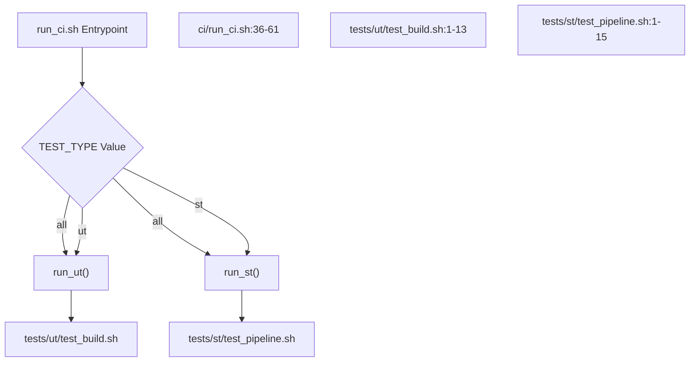
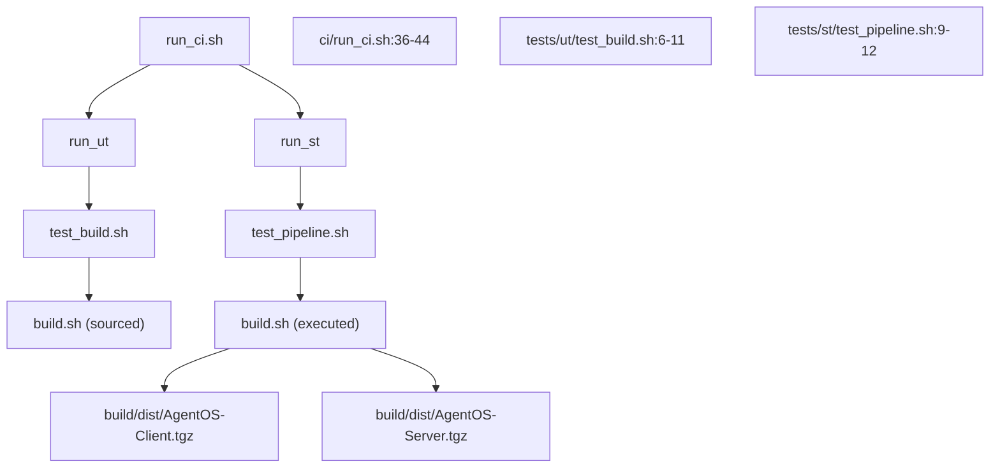

<!-- source: DeepWiki mcp.deepwiki.com · repo openJiuwen-ai/agentos-enterprise · page 5.2 CI Pipeline · fetched 2026-11-02 -->

# CI Pipeline

<details>
<summary>Relevant source files</summary>

The following files were used as context for generating this wiki page:

- [ci/run_ci.sh](ci/run_ci.sh)
- [tests/st/test_pipeline.sh](tests/st/test_pipeline.sh)
- [tests/ut/test_build.sh](tests/ut/test_build.sh)

</details>


## Purpose and Scope
The CI pipeline infrastructure provides automated developer self-testing and validation capabilities for AgentOS Enterprise. The entrypoint script `ci/run_ci.sh` coordinates test execution, supporting selective execution of unit tests (UT) and system tests (ST) [ci/run_ci.sh:1-63]().

Sources: [ci/run_ci.sh:1-63]()

---

## 1. CI Entrypoint (`ci/run_ci.sh`)
The `ci/run_ci.sh` script initializes the test environment, parses command-line arguments to configure execution parameters, and dispatches the appropriate testing routines [ci/run_ci.sh:1-61]().

### Argument Parsing and Initialization
The script supports two primary parameters:
- `--type=<all|ut|st>`: Determines which test stage to execute. Defaults to `all` [ci/run_ci.sh:14]().
- `--skip_build=<0|1>`: Controls whether build pre-checks or environment setup steps are bypassed. Defaults to `1` (skipped) [ci/run_ci.sh:15]().

Parameters are parsed iteratively through a loop over `*`:
```bash
for para in $*; do
  if [[ $para == --type* ]]; then
    TEST_TYPE=$(echo "${para#*=}")
  elif [[ $para == --skip_build* ]]; then
    SKIP_BUILD=$(echo "${para#*=}")
  fi
done
```
[ci/run_ci.sh:16-22]()

Sources: [ci/run_ci.sh:1-63]()

---

## 2. Test Stages and Execution Chaining
The pipeline defines two main execution functions: `run_ut()` and `run_st()`, dispatched via a `case` block based on `TEST_TYPE` [ci/run_ci.sh:36-61]().

| Stage Name | Function | Target Script | Description |
| :--- | :--- | :--- | :--- |
| **Unit Test (UT)** | `run_ut()` | `tests/ut/test_build.sh` | Validates build configuration constants and array sizes [tests/ut/test_build.sh:1-13](), [ci/run_ci.sh:36-39]() |
| **System Test (ST)** | `run_st()` | `tests/st/test_pipeline.sh` | Executes `build.sh` and verifies tarball outputs [tests/st/test_pipeline.sh:1-14](), [ci/run_ci.sh:41-44]() |


*Figure 1: Control Flow and Test Stage Dispatch in `ci/run_ci.sh`.*

Sources: [ci/run_ci.sh:36-61](), [tests/ut/test_build.sh:1-13](), [tests/st/test_pipeline.sh:1-14]()

---

## 3. Validation Scripts Implementation
The pipeline relies on two underlying test validation scripts.

### Unit Test: `tests/ut/test_build.sh`
The unit test script sources `build/build.sh` to load global configuration constants into the shell environment [tests/ut/test_build.sh:6](). It asserts specific version strings and array lengths:
- `JIUWENSWARM_VERSION` equals `0.2.2` [tests/ut/test_build.sh:8]()
- `OPENYUANRONG_VERSION` equals `0.8.0` [tests/ut/test_build.sh:9]()
- Length of `JIUWENSWARM_PACKAGES` equals `3` [tests/ut/test_build.sh:10]()
- Length of `OPENYUANRONG_PACKAGES` equals `5` [tests/ut/test_build.sh:11]()

### System Test: `tests/st/test_pipeline.sh`
The system test script invokes the main build process (`build/build.sh`) and checks for the existence of required distribution artifacts under `build/dist/` [tests/st/test_pipeline.sh:7-12]():
- `AgentOS-Client.tgz` [tests/st/test_pipeline.sh:11]()
- `AgentOS-Server.tgz` [tests/st/test_pipeline.sh:12]()


*Figure 2: Architectural relationship between `ci/run_ci.sh`, test scripts, and build artifacts.*

Sources: [tests/ut/test_build.sh:1-13](), [tests/st/test_pipeline.sh:1-14]()

---

