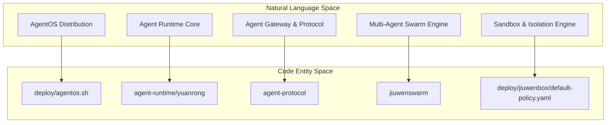
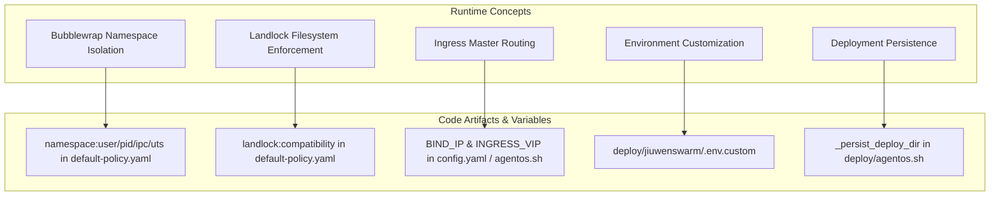

<!-- source: DeepWiki mcp.deepwiki.com · repo openJiuwen-ai/agentos-enterprise · page 6 Glossary · fetched 2026-11-02 -->

# Glossary

Relevant source files

The following files were used as context for generating this wiki page:

- [.gitmodules](.gitmodules)
- [README.md](README.md)
- [build/build.sh](build/build.sh)
- [deploy/agentos.sh](deploy/agentos.sh)
- [deploy/jiuwenbox/default-policy.yaml](deploy/jiuwenbox/default-policy.yaml)
- [deploy/jiuwenswarm/.env.custom](deploy/jiuwenswarm/.env.custom)

## Purpose and Scope

This document provides definitive technical definitions for key terms, subsystems, environment variables, and configuration flags specific to **AgentOS Enterprise**. It maps high-level architectural concepts (Natural Language Space) directly to their implementation artifacts, configuration files, and code entry points (Code Entity Space) across the repository.

Sources: `README.md:1-10`

---

## Core System Terms

### AgentOS
**AgentOS** is the top-level integration and delivery distribution repository for the openJiuwen agent infrastructure. It aggregates distributed runtimes, gateways, sandbox engines, and storage layers via Git submodules, providing a unified build script (`build/build.sh`) and a pluggable deployment orchestrator (`deploy/agentos.sh`).
- **Code Entity**: `README.md:1-14`, `deploy/agentos.sh:1-37`

Sources: `README.md:1-14`, `deploy/agentos.sh:1-37`

### JiuwenSwarm
**JiuwenSwarm** is the multi-agent orchestration gateway, web interface, and workflow engine in AgentOS. It handles agent scheduling, tool execution, session mapping, and exposes frontend/backend ports for users and clients.
- **Code Entity**: `jiuwenswarm` submodule, `deploy/jiuwenswarm/.env.custom:1-53`, `deploy/agentos.sh:36`

Sources: `README.md:9-9`, `.gitmodules:1-3`, `deploy/jiuwenswarm/.env.custom:1-53`

### JiuwenBox
**JiuwenBox** is the secure sandbox runtime orchestrator used by AgentOS to execute untrusted agent tools and code. It wraps execution using namespaces, seccomp filters, and Landlock filesystem rules derived from policy files.
- **Code Entity**: `deploy/jiuwenbox/default-policy.yaml:1-207`, `deploy/agentos.sh:36`

Sources: `deploy/jiuwenbox/default-policy.yaml:1-207`, `deploy/agentos.sh:36`

### OpenYuanRong
**OpenYuanRong** is the core distributed agent runtime (`agent-runtime/yuanrong`) that provides actor-based computation, function service routing, and lifecycle management for agent workloads.
- **Code Entity**: `agent-runtime/yuanrong` (`.gitmodules:14-16`), `build/build.sh:15-20`

Sources: `build/build.sh:15-20`, `.gitmodules:14-16`

### Conch
**Conch** is a secure lightweight virtualization and storage utility suite (`conch` submodule, Stratovirt, EROFS RPMs) integrated into AgentOS for container/sandbox backing and isolation.
- **Code Entity**: `conch` (`.gitmodules:4-6`), `build/build.sh:26-29`

Sources: `.gitmodules:4-6`, `build/build.sh:26-29`

### a2x_registry (Agent Gateway)
**a2x_registry** is the agent protocol and access gateway component (`agent-protocol` submodule) responsible for service discovery via `etcd`, TLS/mTLS validation, and ingress routing.
- **Code Entity**: `agent-protocol` (`.gitmodules:7-10`), `deploy/agent-gateway` (referenced in `deploy/agentos.sh:36`)

Sources: `README.md:9-9`, `.gitmodules:7-10`, `deploy/agentos.sh:36`

### MooseFS
**MooseFS** is the distributed network file system used in multi-node AgentOS deployments to share state across master, chunkserver, and client roles via FUSE mounts.
- **Code Entity**: `deploy/moosefs` (referenced in `deploy/agentos.sh:36`), `README.md:33-33`

Sources: `README.md:33-33`, `deploy/agentos.sh:36`

---

## Architectural Mapping Diagrams

The following diagrams bridge Natural Language Space concepts to Code Entity Space files and variables.

Sources: `README.md:1-14`, `deploy/agentos.sh:36`, `.gitmodules:1-16`, `deploy/jiuwenbox/default-policy.yaml:1-5`

Sources: `deploy/agentos.sh:39-45`, `deploy/jiuwenswarm/.env.custom:1-53`, `deploy/jiuwenbox/default-policy.yaml:74-115`, `deploy/agentos.sh:211-215`

---

## Security and Sandbox Terms

### bubblewrap
**bubblewrap** (`bwrap`) is a low-level unprivileged sandboxing tool used by JiuwenBox to create isolated Linux namespaces (user, PID, IPC, cgroup, UTS) and bind mounts for executing agent tools.
- **Code Entity**: `deploy/jiuwenbox/default-policy.yaml:74-100`, `README.md:31-31`

Sources: `README.md:31-31`, `deploy/jiuwenbox/default-policy.yaml:74-100`

### Landlock
**Landlock** is a Linux security module (LSM) sandbox feature enforced within JiuwenBox policies to restrict filesystem access (read-only and read-write paths) independently of traditional file permissions.
- **Code Entity**: `deploy/jiuwenbox/default-policy.yaml:110-115`

Sources: `deploy/jiuwenbox/default-policy.yaml:110-115`

---

## Configuration and Deployment Terms

### Ingress Master
The **Ingress Master** designates the primary node in a cluster deployment assigned to host the virtual IP (VIP) and route incoming client traffic to internal component ports.
- **Code Entity**: `deploy/agentos.sh:42-45`, `deploy/jiuwenswarm/.env.custom:34-36`

Sources: `README.md:12-12`, `deploy/agentos.sh:42-45`, `deploy/jiuwenswarm/.env.custom:34-36`

### Daily / Release Mode
**Daily Mode** vs **Release Mode** represent the two compilation and packaging strategies in `build/build.sh`. Daily mode fetches nightly artifacts from OBS indexes, whereas release mode pulls tagged git commits and release packages.
- **Code Entity**: `build/build.sh:12-25`, `build/build.sh:56-59`

Sources: `build/build.sh:12-25`, `build/build.sh:56-59`

### OBS (Huawei Cloud OBS)
**OBS** (Object Storage Service) is the remote object storage provider hosting precompiled AgentOS distribution tarballs, Python wheels, and Yuanrong daily/release binary artifacts.
- **Code Entity**: `build/build.sh:32-32`, `README.md:30-33`

Sources: `build/build.sh:32-32`, `README.md:30-33`

### YR_PYTHON_VERSION
**YR_PYTHON_VERSION** is an environment variable specifying the target Python runtime version (default `3.11`) required for compiling and executing all Yuanrong and AgentOS Python components.
- **Code Entity**: `deploy/agentos.sh:39-39`, `deploy/jiuwenswarm/.env.custom:4-4`, `README.md:28-28`

Sources: `deploy/agentos.sh:39-39`, `deploy/jiuwenswarm/.env.custom:4-4`, `README.md:28-28`

### .env.custom
**.env.custom** is the local configuration file for JiuwenSwarm defining instance names, concurrency levels, ports (`GATEWAY_PORT="19001"`, `WEB_PORT="19000"`), LLM API endpoints, and tool sandbox parameters.
- **Code Entity**: `deploy/jiuwenswarm/.env.custom:1-53`

Sources: `deploy/jiuwenswarm/.env.custom:1-53`

### PERSIST_DEPLOY_DIR (`_persist_deploy_dir`)
**PERSIST_DEPLOY_DIR** refers to the internal deployment state preservation routine (`_persist_deploy_dir`) in `deploy/agentos.sh` that copies the active `deploy/` directory to `~/.agentos/deploy` during installation so that subsequent cluster operations (`up`, `down`, `uninstall`) function after source packages are cleaned up.
- **Code Entity**: `deploy/agentos.sh:211-215`

Sources: `deploy/agentos.sh:211-215`