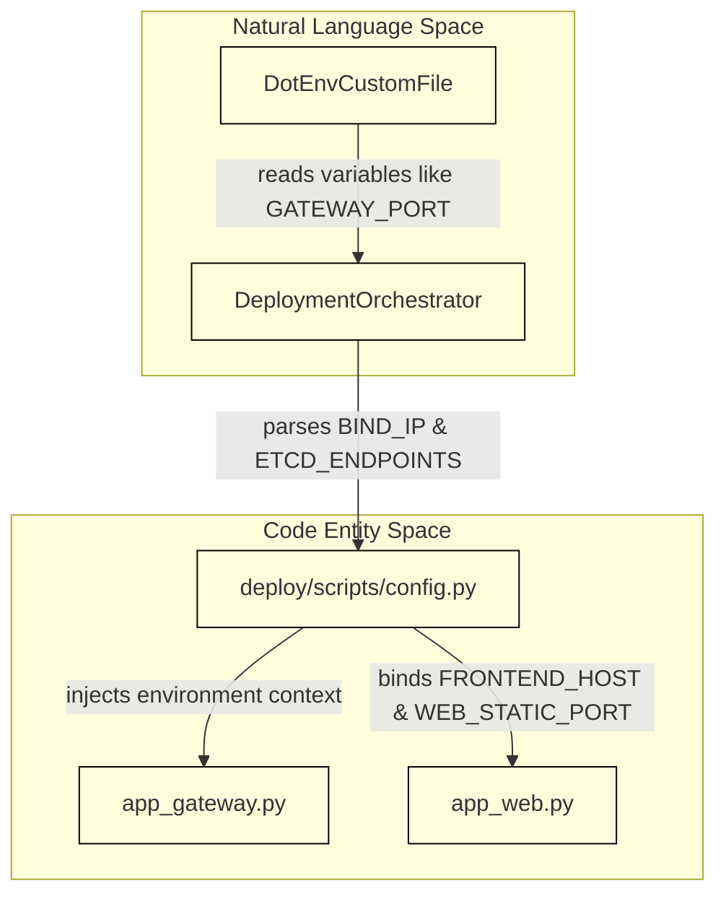
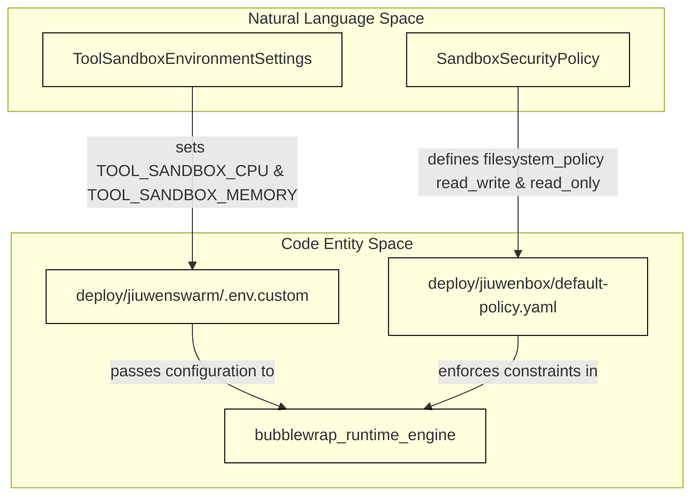

<!-- source: DeepWiki mcp.deepwiki.com · repo openJiuwen-ai/agentos-enterprise · extra page JiuwenSwarm Environment Configuration · fetched 2026-11-02 -->

# JiuwenSwarm Environment Configuration

Relevant source files

The following files were used as context for generating this wiki page:

- [deploy/jiuwenbox/default-policy.yaml](deploy/jiuwenbox/default-policy.yaml)
- [deploy/jiuwenswarm/.env.custom](deploy/jiuwenswarm/.env.custom)

## Purpose and Scope
This page serves as the technical reference for the JiuwenSwarm deployment environment configuration file, `.env.custom`. It governs runtime parameters, network binding, service ports, concurrency limits, manager resource allocations, etcd endpoints, and tool sandbox settings utilized during the deployment and execution of the JiuwenSwarm subsystem within AgentOS Enterprise.

Sources: `deploy/jiuwenswarm/.env.custom:1-53`()

---

## Environment Variable Reference

The `.env.custom` configuration file is partitioned into functional blocks controlling networking, gateway performance, model integration, coordinator endpoints, and tool execution isolation.

### Networking and Port Bindings

| Variable | Default / Example | Description |
| :--- | :--- | :--- |
| `BIND_IP` | `""` | Local IP address for multi-nic binding. Auto-detected if empty; overridden by CLI `--ip` flag. [deploy/jiuwenswarm/.env.custom:1-3]() |
| `MASTER_NODE_IP` | `""` | IP address of the master node in a clustered deployment setup. [deploy/jiuwenswarm/.env.custom:24-24]() |
| `GATEWAY_PORT` | `"19001"` | Listen port for the JiuwenSwarm gateway process (`app_gateway.py`). [deploy/jiuwenswarm/.env.custom:35-35]() |
| `WEB_PORT` | `"19000"` | Alternative port handled by gateway processes. [deploy/jiuwenswarm/.env.custom:36-36]() |
| `FRONTEND_HOST` | `"0.0.0.0"` | Bind address for the web frontend static server (`app_web.py`). [deploy/jiuwenswarm/.env.custom:38-38]() |
| `WEB_STATIC_PORT` | `"5173"` | Static asset server listen port for the UI frontend. [deploy/jiuwenswarm/.env.custom:39-39]() |
| `WEB_ENABLED` | `"yes"` | Toggle (`yes`/`no`) to control whether the web frontend starts during the `up` orchestration phase. [deploy/jiuwenswarm/.env.custom:40-41]() |

Sources: `deploy/jiuwenswarm/.env.custom:1-42`()

### Manager Resources and Concurrency

| Variable | Default / Example | Description |
| :--- | :--- | :--- |
| `GATEWAY_CONCURRENCY` | `1` | Concurrency worker multiplier or limit for gateway operations. [deploy/jiuwenswarm/.env.custom:7-7]() |
| `GATEWAY_INVOKE_TIMEOUT`| `60` | Execution timeout (in seconds) for remote procedure or gateway invocations. [deploy/jiuwenswarm/.env.custom:8-8]() |
| `GATEWAY_SESSION_MAP_SCOPE`| `"per_chat_bot_user"`| Scope granularity for session mapping (e.g., `per_chat_bot_user`). [deploy/jiuwenswarm/.env.custom:9-9]() |
| `MGR_CPU` | `300` | CPU allocation for the agent manager in millicores (`1000 = 1` core). [deploy/jiuwenswarm/.env.custom:12-12]() |
| `MGR_MEMORY` | `600` | Memory allocation limit (in MB) for the agent manager instance. [deploy/jiuwenswarm/.env.custom:13-13]() |
| `MGR_MIN_INSTANCE` | `1` | Minimum scaling boundary for manager replicas. [deploy/jiuwenswarm/.env.custom:14-14]() |
| `MGR_MAX_INSTANCE` | `10` | Maximum scaling boundary for manager replicas. [deploy/jiuwenswarm/.env.custom:15-15]() |
| `MGR_CONCURRENT_NUM` | `10` | Maximum concurrent tasks handled per manager instance. [deploy/jiuwenswarm/.env.custom:16-16]() |

Sources: `deploy/jiuwenswarm/.env.custom:7-16`()

### Model Provider and LLM Configuration

| Variable | Default / Example | Description |
| :--- | :--- | :--- |
| `MODEL_PROVIDER` | `""` | LLM inference provider identifier (e.g., OpenAI, YuanRong backend). [deploy/jiuwenswarm/.env.custom:17-17]() |
| `MODEL_NAME` | `""` | Specific model model name or deployment tag to target. [deploy/jiuwenswarm/.env.custom:18-18]() |
| `API_BASE` | `""` | Base URL endpoint for chat/completion API requests. [deploy/jiuwenswarm/.env.custom:19-19]() |
| `API_KEY` | `""` | Authentication key credential for the primary model provider API. [deploy/jiuwenswarm/.env.custom:20-20]() |
| `EMBED_API_KEY` | `""` | Dedicated API credential key for embedding model providers. [deploy/jiuwenswarm/.env.custom:21-21]() |
| `EMBED_API_BASE` | `""` | Base URL endpoint for embedding model API requests. [deploy/jiuwenswarm/.env.custom:22-22]() |
| `EMBED_MODEL` | `""` | Target model name used for vector embeddings. [deploy/jiuwenswarm/.env.custom:23-23]() |

Sources: `deploy/jiuwenswarm/.env.custom:17-23`()

### Runtime, Coordination, and Tool Sandbox Settings

| Variable | Default / Example | Description |
| :--- | :--- | :--- |
| `YR_PYTHON_VERSION` | `"3.11"` | Python interpreter version targeted by the YuanRong runtime environment. [deploy/jiuwenswarm/.env.custom:4-4]() |
| `ETCD_ENDPOINTS` | `""` | Comma-separated etcd cluster endpoints. If empty, populated automatically from `config.yaml`. [deploy/jiuwenswarm/.env.custom:28-30]() |
| `SANDBOX_TYPE` | `"supervisor"` | Core execution sandbox mechanism (e.g., `supervisor`). [deploy/jiuwenswarm/.env.custom:27-27]() |
| `TOOL_SANDBOX_ENABLE`| `"true"` | Boolean flag controlling whether tool execution uses isolated sandboxing. [deploy/jiuwenswarm/.env.custom:44-44]() |
| `TOOL_SANDBOX_TYPE` | `"yuanrong"` | Sandbox implementation backend for tools (e.g., `yuanrong`). [deploy/jiuwenswarm/.env.custom:43-43]() |
| `TOOL_SANDBOX_IMAGE` | `swr.cn-southwest-2...` | Container image reference for the isolated tool sandbox container. [deploy/jiuwenswarm/.env.custom:45-45]() |
| `TOOL_SANDBOX_EXECUTOR`| `"docker"` | Container runtime executor command interface (e.g., `docker`). [deploy/jiuwenswarm/.env.custom:46-46]() |
| `TOOL_SANDBOX_CPU` | `2000` | CPU limit for the tool sandbox container in millicores. [deploy/jiuwenswarm/.env.custom:47-48]() |
| `TOOL_SANDBOX_MEMORY` | `4096` | Memory limit for the tool sandbox in megabytes (MB). [deploy/jiuwenswarm/.env.custom:49-50]() |
| `TOOL_SANDBOX_USER` | `"agentos"` | System username assigned inside the tool sandbox environment. [deploy/jiuwenswarm/.env.custom:51-51]() |
| `TOOL_SANDBOX_GROUP` | `"agentos"` | System group identity assigned inside the tool sandbox environment. [deploy/jiuwenswarm/.env.custom:52-52]() |

Sources: `deploy/jiuwenswarm/.env.custom:4-30`, `deploy/jiuwenswarm/.env.custom:43-52`()

---

## Configuration Data Flow & Processing

The environment variables defined in `.env.custom` are ingested during module initialization scripts and parsed into process parameters consumed by python gateway components (`app_gateway.py` and `app_web.py`).

Sources: `deploy/jiuwenswarm/.env.custom:1-53`()

---

## Tool Sandbox Mapping & Security Policy

Tool execution parameters declared in `.env.custom` directly interface with runtime policy files such as `default-policy.yaml`. These configuration bindings determine resource constraints, isolation level, namespace options, and mount definitions enforced by the container or bubblewrap execution layers.

Sources: `deploy/jiuwenswarm/.env.custom:43-53`(), `deploy/jiuwenbox/default-policy.yaml:40-55`()

---

