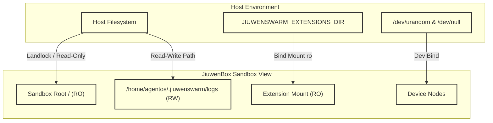
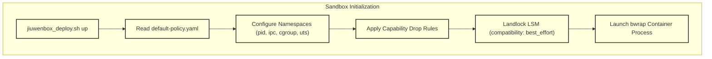
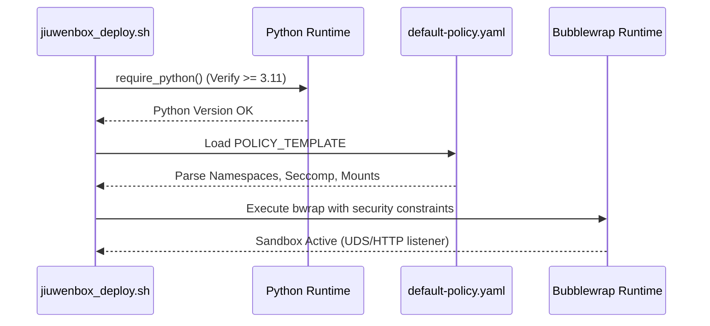

<!-- source: DeepWiki mcp.deepwiki.com · repo openJiuwen-ai/agentos-enterprise · extra page Sandbox Security Policy · fetched 2026-11-02 -->

# Sandbox Security Policy

Relevant source files

The following files were used as context for generating this wiki page:

- [deploy/jiuwenbox/default-policy.yaml](deploy/jiuwenbox/default-policy.yaml)
- [deploy/jiuwenbox/jiuwenbox_deploy.sh](deploy/jiuwenbox/jiuwenbox_deploy.sh)
- [deploy/jiuwenswarm/.env.custom](deploy/jiuwenswarm/.env.custom)

## Purpose and Scope

This section provides a deep dive into the default security and isolation policy configuration used by the JiuwenBox sandbox runtime within AgentOS Enterprise. Specifically, it analyzes `deploy/jiuwenbox/default-policy.yaml` and its orchestration via `deploy/jiuwenbox/jiuwenbox_deploy.sh`. JiuwenBox uses Bubblewrap (`bwrap`), Linux namespaces, Landlock LSM, and Seccomp filters to enforce strict multi-tenant isolation, process containment, and capability stripping for agent tool executions.

Sources: `deploy/jiuwenbox/default-policy.yaml:1-207`, `deploy/jiuwenbox/jiuwenbox_deploy.sh:1-50`

---

## Filesystem and Mount Policies

The filesystem policy governs sandbox-visible absolute paths, specifying what directories and files are dynamically provisioned, mounted read-only or read-write, or mapped from host devices. 

According to `deploy/jiuwenbox/default-policy.yaml`, the filesystem policy structure contains:
- **`directories` and `files`**: Empty by default in the static template (`[]`), populated dynamically by the server or runtime initialization logic for lifecycle tracking.
- **`read_only`**: Grants read permission within the sandbox, defaulting to the root `/` path [deploy/jiuwenbox/default-policy.yaml:36-37] along with dynamic OS directories populated by `generate_policy` [deploy/jiuwenbox/default-policy.yaml:38].
- **`read_write`**: Explicitly permits read-write access to specific internal paths, such as `/home/agentos/.jiuwenswarm/logs` [deploy/jiuwenbox/default-policy.yaml:40-43].
- **`bind_mounts`**: Integrates host paths into the sandbox view. It evaluates `__DYNAMIC_BIND_MOUNTS__` and maps `__JIUWENSWARM_EXTENSIONS_DIR__` as a read-only bind mount (`mode: "ro"`) [deploy/jiuwenbox/default-policy.yaml:51-55].
- **`device`**: Exposes essential minimal device nodes into the sandbox via `bwrap --dev-bind`, specifically `/dev/urandom` and `/dev/null` [deploy/jiuwenbox/default-policy.yaml:56-64].

Sources: `deploy/jiuwenbox/default-policy.yaml:11-65`, `deploy/jiuwenbox/jiuwenbox_deploy.sh:224-227`

---

## Process Identity and Namespace Isolation

JiuwenBox isolates the execution environment by configuring unprivileged execution identities and Linux kernel namespaces via Bubblewrap (`bwrap`).

### Process Identity
Processes inside the sandbox do not run as root. The policy explicitly defines the runtime user and group binding:
- `run_as_user`: `agentos` [deploy/jiuwenbox/default-policy.yaml:69]
- `run_as_group`: `agentos` [deploy/jiuwenbox/default-policy.yaml:72]
If these cannot be resolved, the runtime falls back to unprivileged `nobody`-style IDs.

### Namespace Isolation
The `namespace` block dictates which isolation boundaries are created [deploy/jiuwenbox/default-policy.yaml:75-99]:
- **`user`**: `false` (reuses the current user namespace) [deploy/jiuwenbox/default-policy.yaml:79]
- **`pid`**: `true` (creates a new PID namespace so sandbox processes cannot view host processes) [deploy/jiuwenbox/default-policy.yaml:84]
- **`ipc`**: `true` (isolates System V IPC and POSIX message queues) [deploy/jiuwenbox/default-policy.yaml:89]
- **`cgroup`**: `true` (isolates cgroup root view) [deploy/jiuwenbox/default-policy.yaml:94]
- **`uts`**: `true` (isolates hostname and NIS domain name) [deploy/jiuwenbox/default-policy.yaml:99]

Sources: `deploy/jiuwenbox/default-policy.yaml:66-100`

---

## Capabilities and Landlock Integration

To harden the execution runtime against privilege escalation, JiuwenBox combines capability dropping/addition rules with Landlock Linux Security Module (LSM) policies.

### Linux Capabilities
- **`add`**: Empty by default (`[]`), restricting any elevated capabilities [deploy/jiuwenbox/default-policy.yaml:104].
- **`drop`**: Configured to drop sensitive capabilities when supported [deploy/jiuwenbox/default-policy.yaml:107].

### Landlock Enforcement
Landlock LSM provides unprivileged access control. The policy defines:
- **`compatibility`**: Set to `best_effort`, meaning Landlock rules are applied when kernel support is present, while allowing startup to continue if unavailable [deploy/jiuwenbox/default-policy.yaml:110-115].

Sources: `deploy/jiuwenbox/default-policy.yaml:101-116`, `deploy/jiuwenbox/jiuwenbox_deploy.sh:1-25`

---

## Seccomp Syscall Filters

JiuwenBox blocks high-risk system calls across both `x86_64` and `arm64` (`aarch64`) architectures to prevent kernel-level exploits, container escapes, module injections, and host manipulation.

The blocked system call list includes:
- **Execution & System Control**: `kexec_load`, `kexec_file_load`, `reboot`, `pivot_root` [deploy/jiuwenbox/default-policy.yaml:122-125, 153-156]
- **Swap & Storage Management**: `swapon`, `swapoff`, `nfsservctl`, `mount`, `umount2` [deploy/jiuwenbox/default-policy.yaml:126-128, 131-132, 157-159, 162-163]
- **Debugging & Tracing**: `ptrace`, `perf_event_open` [deploy/jiuwenbox/default-policy.yaml:130, 136, 161, 167]
- **Namespaces & BPF**: `unshare`, `setns`, `userfaultfd`, `bpf` [deploy/jiuwenbox/default-policy.yaml:133-137, 164-168]
- **Key Management**: `add_key`, `request_key`, `keyctl` [deploy/jiuwenbox/default-policy.yaml:138-140, 169-171]
- **Async IO & Handles**: `io_uring_setup`, `io_uring_enter`, `io_uring_register`, `open_by_handle_at`, `name_to_handle_at` [deploy/jiuwenbox/default-policy.yaml:141-145, 172-176]
- **Kernel Modules**: `init_module`, `finit_module`, `delete_module`, `acct` [deploy/jiuwenbox/default-policy.yaml:146-149, 177-180]

Sources: `deploy/jiuwenbox/default-policy.yaml:117-181`

---

## Network Policy and Isolation

Network connectivity within the sandbox is controlled via dedicated network namespace policies.

- **`mode`**: Configured as `isolated`, which creates a dedicated network namespace and applies firewall and routing restrictions [deploy/jiuwenbox/default-policy.yaml:183-187].
- **`egress`**: Outbound traffic control defaults to `allow` unless restricted by rules in `allowed_domains`, `allowed_ips`, or `blocked_ports` [deploy/jiuwenbox/default-policy.yaml:189-199].
- **`ingress`**: Inbound traffic control defaults to `allow` [deploy/jiuwenbox/default-policy.yaml:201-207].

Sources: `deploy/jiuwenbox/default-policy.yaml:182-207`

---

## Integration with Deployment Orchestration

The deployment script `deploy/jiuwenbox/jiuwenbox_deploy.sh` manages state directories, logging paths, Unix Domain Socket (UDS) / HTTP listening options, and ensures Python >= 3.11 requirements are met before initializing the sandbox engine referencing `default-policy.yaml` [deploy/jiuwenbox/jiuwenbox_deploy.sh:17-42, 167-179].

Sources: `deploy/jiuwenbox/jiuwenbox_deploy.sh:14-42, 167-179`, `deploy/jiuwenbox/default-policy.yaml:1-207`

---

