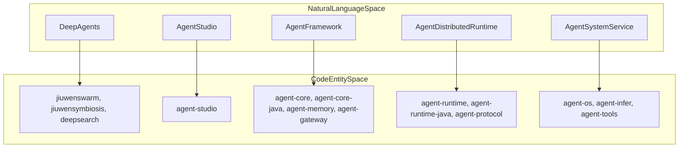
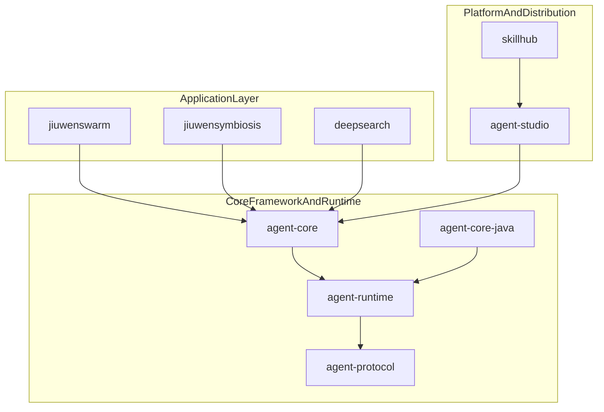

<!-- source: DeepWiki mcp.deepwiki.com · repo openJiuwen-ai/community · page 1 Overview · fetched 2026-11-02 -->

# Overview

Relevant source files

The following files were used as context for generating this wiki page:

- [Contribution_guidance_zh.md](Contribution_guidance_zh.md)
- [README.md](README.md)
- [README_CN.md](README_CN.md)

The openJiuwen community repository serves as the central coordination hub for the openJiuwen AI Agent platform. Its purpose is to define community governance, Special Interest Group (SIG) metadata, repository manifests, contribution guidelines, documentation standards, and security policies. As an open-source Agent platform, openJiuwen provides flexible, powerful, and easy-to-use AI Agent development and runtime capabilities [README.md:1-3] [Contribution_guidance_zh.md:1-3].

This parent page provides a high-level summary of the openJiuwen platform architecture, repository ecosystem, and community structure. For detailed deep-dives, please refer to the child pages:
- For architectural layers and execution models, see [openJiuwen Platform Architecture](#1.1).
- For ecosystem repositories, community entry points, and announcements, see [Repository Map & Community Entry Points](#1.2).

## Platform Architecture and Ecosystem Overview

openJiuwen implements a modular, layered architecture spanning the full lifecycle of AI Agents—from development and orchestration to distributed runtime execution and underlying system services [README.md:17-24] [Contribution_guidance_zh.md:5-12]. 

Below is an overview diagram bridging natural language capability layers to actual code entities and repositories within the ecosystem:

*Figure 1: Mapping Platform Capabilities to Code Entity Repositories*

Sources: [README.md:17-24](), [Contribution_guidance_zh.md:5-12]()

## Implementation and Module Layout

The codebase is organized into independent repositories under the `openJiuwen-ai` organization. These modules span application layers, skill distribution, visual orchestration, core SDKs, and runtime infrastructure [README.md:28-34] [Contribution_guidance_zh.md:16-22].

*Figure 2: Repository Dependency and Ecosystem Flow*

Sources: [README.md:34-80](), [Contribution_guidance_zh.md:22-92]()

## Child Page Reference

- **[openJiuwen Platform Architecture](#1.1)**: Details the five foundational layers (`DeepAgents`, `Agent Studio`, `Agent Framework`, `Agent Distributed Runtime`, and `Agent System Service`) alongside internal sequence and capability graphs located in `images/`.
- **[Repository Map & Community Entry Points](#1.2)**: Catalogs the complete inventory of community repositories (`jiuwenswarm`, `agent-core`, `agent-runtime`, `skillhub`, `agent-protocol`, etc.), mailing lists, forum guidelines, and release channels.

Sources: [README.md:1-80](), [Contribution_guidance_zh.md:1-100]()

---

