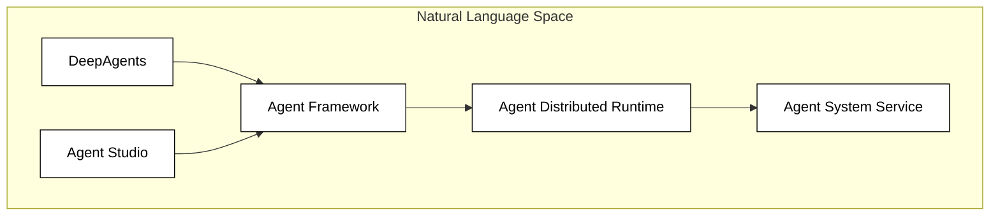
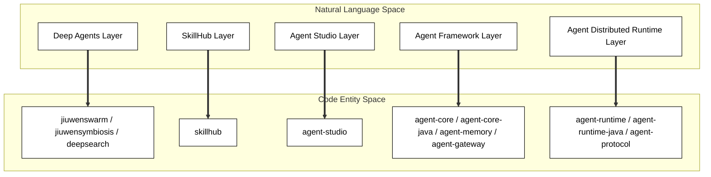
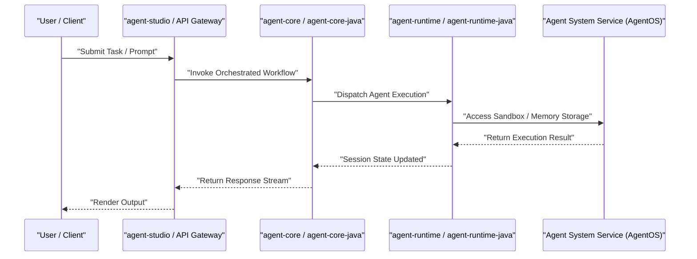

<!-- source: DeepWiki mcp.deepwiki.com · repo openJiuwen-ai/community · page 1.1 openJiuwen Platform Architecture · fetched 2026-11-02 -->

# openJiuwen Platform Architecture

Relevant source files

The following files were used as context for generating this wiki page:

- [Contribution_guidance_zh.md](Contribution_guidance_zh.md)
- [README.md](README.md)
- [README_CN.md](README_CN.md)

## Purpose and Scope

This document details the architectural design of the openJiuwen AI Agent platform [README.md:1-3](). The scope covers the five-layer platform architecture (**DeepAgents**, **Agent Studio**, **Agent Framework**, **Agent Distributed Runtime**, and **Agent System Service**) [README.md:17-27](), the implementation architecture via modular code repositories [README.md:30-33](), and the runtime data flow across components.

Sources: `README.md:1-3`, `README.md:17-33`

---

## 1. Five-Layer Platform Architecture

openJiuwen adopts a hierarchical layered architecture designed to cover the full lifecycle of AI Agents—from visual development and core execution to distributed deployment and foundational system services [README.md:17-24]().

*Figure 1: openJiuwen Capability Architecture Overview*

### Layer Breakdown
1. **DeepAgents**: Out-of-the-box complex agent applications tailored for distinct scenarios such as `jiuwenswarm`, `jiuwensymbiosis`, and `deepsearch` [README.md:20]().
2. **Agent Studio**: A low-code/no-code visual development environment supporting agent editing, workflow orchestration, prompt tuning, and online debugging [README.md:21]().
3. **Agent Framework**: The core execution engine providing multi-scenario interfaces for task planning, loop execution, tool invocation, context management, memory, and multi-agent collaboration [README.md:22]().
4. **Agent Distributed Runtime**: The distributed runtime foundation supporting low-code and high-code deployments with multi-tenant resource isolation, elastic scaling, and service discovery [README.md:23]().
5. **Agent System Service**: The underlying `AgentOS` system services providing security isolation sandboxes, persistent memory storage, native CLI tools, standardized agent file systems, and cross-agent communication buses [README.md:24]().

Sources: `README.md:17-27`, `Contribution_guidance_zh.md:5-14`

---

## 2. Implementation Architecture & Code Entity Mapping

The openJiuwen community maps its conceptual layers to concrete code repositories. This bridge connects the Natural Language Space to the Code Entity Space.

*Figure 2: Bridging Architecture Layers to Code Repositories*

### Repository Module Mapping Table

| Layer | Repository Code Entity | Description / Core Functions |
| :--- | :--- | :--- |
| **Deep Agents** | `jiuwenswarm` [README.md:53]() | Multi-agent collaboration framework and flagship application supporting complex task collaboration and Skill self-evolution [README.md:54](). |
| **Deep Agents** | `jiuwensymbiosis` [README.md:57]() | Embodied intelligence agent framework supporting capability reuse and safety control [README.md:58](). |
| **Deep Agents** | `deepsearch` [README.md:61]() | Knowledge-augmented deep retrieval and research agent for search and report generation [README.md:62](). |
| **SkillHub** | `skillhub` [README.md:66]() | Skill hosting and distribution platform supporting publishing, version management, and shared reuse [README.md:67](). |
| **Agent Studio** | `agent-studio` [README.md:71]() | Visual agent development platform supporting workflow orchestration and online debugging [README.md:72](). |
| **Agent Framework** | `agent-core` [README.md:80]() | Python Agent SDK providing orchestration, runtime, model, tool, and retrieval capabilities [Contribution_guidance_zh.md:69](). |
| **Agent Framework** | `agent-core-java` [Contribution_guidance_zh.md:72]() | Java Agent SDK providing equivalent capabilities for the Java ecosystem [Contribution_guidance_zh.md:73](). |
| **Agent Framework** | `agent-memory` [Contribution_guidance_zh.md:76]() | Long-term memory system supporting extraction, compression, hybrid retrieval, and evolution [Contribution_guidance_zh.md:77](). |
| **Agent Distributed Runtime** | `agent-runtime` [Contribution_guidance_zh.md:81]() | Python Agent Runtime for service-based execution, session management, and lifecycle control [Contribution_guidance_zh.md:82](). |
| **Agent Distributed Runtime** | `agent-runtime-java` [Contribution_guidance_zh.md:85]() | Java Agent Runtime based on Spring Boot for containerized/service deployment [Contribution_guidance_zh.md:86](). |
| **Agent Distributed Runtime** | `agent-protocol` [Contribution_guidance_zh.md:89]() | Interoperability protocol SDK providing MCP SDK, A2A SDK, and A2X Registry [Contribution_guidance_zh.md:90](). |

Sources: `README.md:34-100`, `Contribution_guidance_zh.md:22-94`

---

## 3. Data Flow and Component Interactions

The execution path traverses from client interaction down to system-level services.

*Figure 3: Runtime Data Flow & Component Interaction Sequence*

### Execution Flow Details
1. **Request Ingestion**: Users interact via `agent-studio` [README.md:71]() or external applications connected via `agent-gateway` [README.md:76]().
2. **Orchestration & Planning**: `agent-core` or `agent-core-java` processes prompt planning, tool routing, and memory retrieval (`agent-memory`) [Contribution_guidance_zh.md:77]().
3. **Distributed Execution**: The request is handed off to `agent-runtime` or `agent-runtime-java` for containerized or distributed execution [Contribution_guidance_zh.md:82]().
4. **Foundational Security & Storage**: Low-level operations interact directly with `Agent System Service` sandboxes and persistent storage [README.md:24]().

Sources: `README.md:17-24`, `README.md:71-80`, `Contribution_guidance_zh.md:68-90`

---

