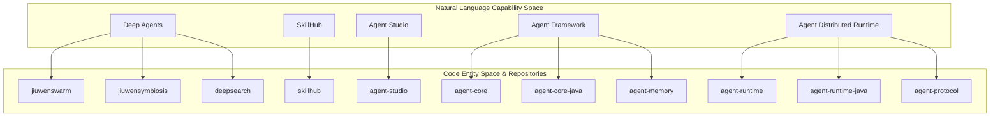
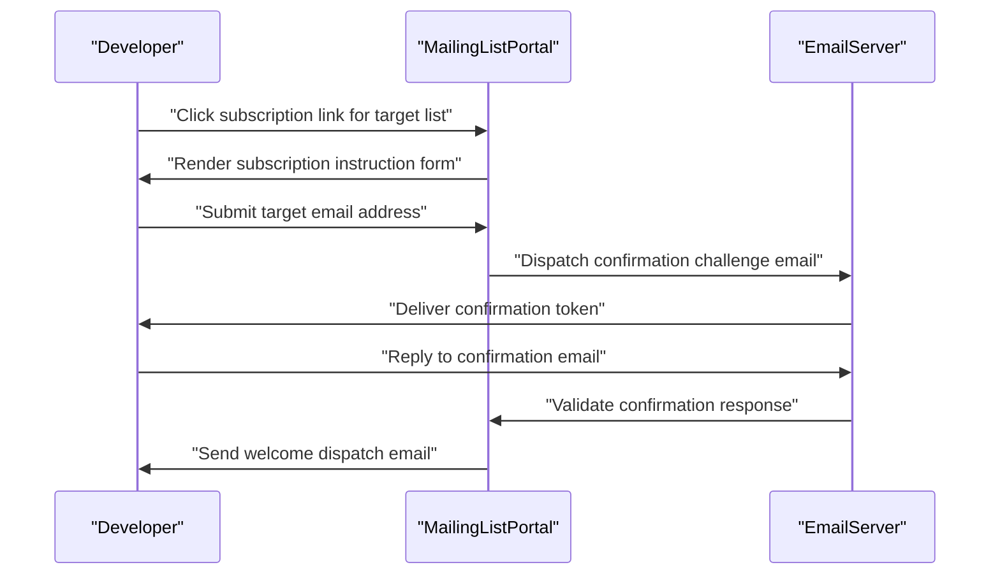

<!-- source: DeepWiki mcp.deepwiki.com · repo openJiuwen-ai/community · page 1.2 Repository Map & Community Entry Points · fetched 2026-11-02 -->

# Repository Map & Community Entry Points

Relevant source files

The following files were used as context for generating this wiki page:

- [README.md](README.md)
- [README_CN.md](README_CN.md)
- [maillist_zh.md](maillist_zh.md)
- [workshop/README.md](workshop/README.md)

## Purpose and Scope

This page catalogs the openJiuwen ecosystem repositories, community communication channels, mailing lists, forum guides, and workshop/release announcements. The openJiuwen platform is structured around a modular repository design [README.md:30-30]() that spans the entire AI Agent lifecycle—from high-level multi-agent orchestration and skill distribution to core framework execution and distributed service runtimes. 

Sources: `README.md:30-30()`, `maillist_zh.md:1-20()`

---

## Ecosystem Repositories Catalog

The openJiuwen codebase is partitioned into distinct modular repositories, each managed by dedicated Special Interest Groups (SIGs). The repositories are organized across five architectural layers: DeepAgents, SkillHub, Agent Studio, Agent Framework, and Agent Distributed Runtime [README.md:19-24]().

| Module | Repository | Description | Primary Code Entry / Package |
| :--- | :--- | :--- | :--- |
| **Deep Agents** | `jiuwenswarm` [README.md:53-53]() | Multi-agent collaboration framework and official flagship application, supporting complex task collaboration and Skill self-evolution. | `jiuwenswarm/` |
| **Deep Agents** | `jiuwensymbiosis` [README.md:57-57]() | Agent framework for embodied intelligence, supporting configuration-agnostic capability reuse and safety control. | `jiuwensymbiosis/` |
| **Deep Agents** | `deepsearch` [README.md:61-61]() | Knowledge-augmented deep retrieval and research Agent for search, reasoning, and report-generation scenarios. | `deepsearch/` |
| **SkillHub** | `skillhub` [README.md:66-66]() | Skill hosting and distribution platform, supporting Skill publishing, version management, search/download, and private deployment. | `skillhub/` |
| **Agent Studio** | `agent-studio` [README.md:71-71]() | One-stop visual Agent development platform supporting agent editing, workflow orchestration, prompt tuning, and online debugging. | `agent-studio/` |
| **Agent Framework** | `agent-gateway` [README.md:76-76]() | Unified access gateway providing channel management, message processing, scheduled tasks, and heartbeat (Opening Soon). | `agent-gateway/` |
| **Agent Framework** | `agent-core` [README.md:80-80]() | Python Agent SDK providing agent orchestration, runtime execution, model integration, tool calling, and retrieval/evaluation. | `agent-core/` |
| **Agent Framework** | `agent-core-java` [README.md:84-84]() | Java Agent SDK providing feature parity with the Python SDK for enterprise Java ecosystems. | `agent-core-java/` |
| **Agent Framework** | `agent-memory` [README.md:88-88]() | Agent long-term memory system supporting memory extraction, compression, hybrid retrieval, and self-evolution. | `agent-memory/` |
| **Distributed Runtime** | `agent-runtime` [README.md:93-93]() | Python Agent Runtime responsible for agent service-oriented execution, session handling, and lifecycle control. | `agent-runtime/` |
| **Distributed Runtime** | `agent-runtime-java` [README.md:97-97]() | Java Agent Runtime based on Spring Boot for containerized service execution and deployment. | `agent-runtime-java/` |
| **Distributed Runtime** | `agent-protocol` [README.md:101-101]() | Agent interoperability protocol SDK, providing MCP SDK, A2A SDK, and A2X Registry. | `agent-protocol/` |

Sources: `README.md:50-104()`

---

## Architecture to Code Entity Mapping

The following diagram bridges the high-level natural language capability layers of openJiuwen to their concrete repository implementations and package identifiers in the codebase.

Sources: `README.md:19-104()`

---

## Community Entry Points & Communication Channels

Community collaboration occurs across specific mailing lists, discussion forums, workshops, and release announcement boards.

### Mailing Lists Catalog

| Email Address | Scope / Category | Description |
| :--- | :--- | :--- |
| `contact@openjiuwen.com` [maillist_zh.md:16-16]() | Public Contact | Primary community public mailing list for general technical discussions and day-to-day coordination. |
| `cla@openjiuwen.com` [maillist_zh.md:17-17]() | CLA Submissions | Dedicated address for Developer Contribution Agreement (CLA) verification and inquiries. |
| `legal@openjiuwen.com` [maillist_zh.md:18-18]() | Legal & Compliance | Working group email for handling open-source compliance, licensing, and legal questions. |

Sources: `maillist_zh.md:12-19()`

### Subscription Procedure

To subscribe to any openJiuwen mailing list, developers follow the workflow outlined below [maillist_zh.md:1-10]():

Sources: `maillist_zh.md:1-11()`

### Workshops & Release Announcements

Community workshops, developer meetups, and version release announcements are organized under the `workshop/` [workshop/README.md:1-1]() and release documentation trees. Announcements include migration guides, API deprecation notices, and SIG meeting notes.

Sources: `workshop/README.md:1-1()`

---

