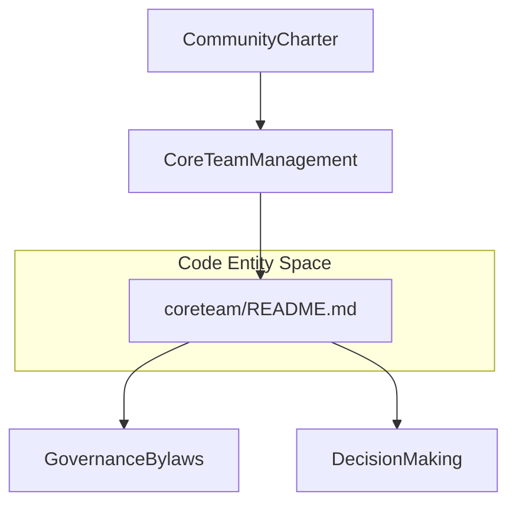
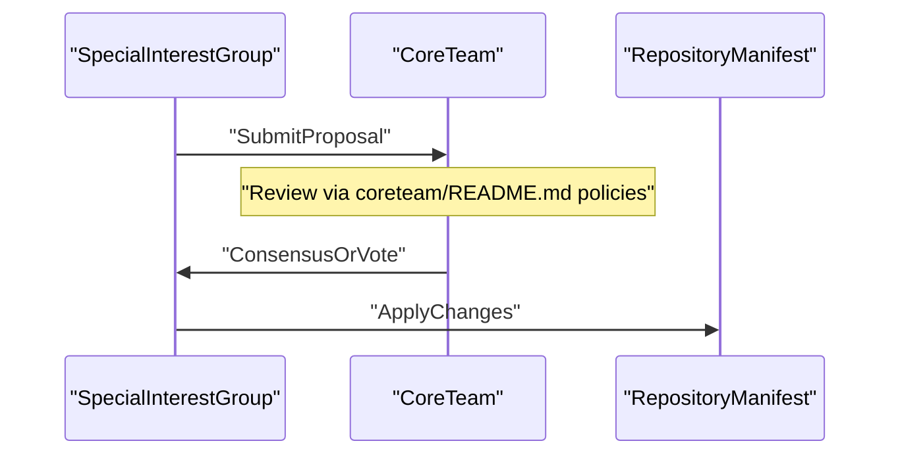

<!-- source: DeepWiki mcp.deepwiki.com · repo openJiuwen-ai/community · page 2.1 Core Team & Charter · fetched 2026-11-02 -->

# Core Team & Charter

Relevant source files

The following files were used as context for generating this wiki page:

- [coreteam/README.md](coreteam/README.md)

## Purpose and Scope

This page details the governance structure, administrative charter, and decision-making frameworks defined within the `coreteam/` directory of the `openJiuwen-ai/community` repository. It covers the composition of the openJiuwen governing board, the core team's responsibilities, voting and consensus mechanisms, and how the charter governs Special Interest Groups (SIGs) across the open-source AI Agent platform ecosystem.

Sources: [coreteam/README.md:1-1]()

---

## Community Charter & Governance Foundation

The core team charter establishes the operational bylaws for the openJiuwen community. It defines membership tiers, project lifecycles, and the escalation paths for technical and community disputes. 

The core governance guidelines are documented within the root of the core team management directory:
- Charter guidelines, mission statements, and administrative rules: `coreteam/README.md`

Sources: [coreteam/README.md:1-1]()

---

## Board Composition & Leadership Roles

The openJiuwen core team is structured around distributed leadership roles that oversee architectural evolution, release cadence, and community health.

| Role | Primary Responsibility | Scope |
| :--- | :--- | :--- |
| **Maintainer** | Approving code changes, setting technical direction for specific repositories | Repository / SIG level |
| **Committer** | Contributing code consistently, reviewing PRs, participating in consensus | Repository level |
| **Board Member** | Establishing overall community policies, resolving cross-SIG disputes, chartering new SIGs | Community-wide (`coreteam/`) |

Decision-making within the core team relies on consensus-driven models, transitioning to weighted voting when consensus cannot be reached on critical architectural changes or core dependency upgrades.

Sources: [coreteam/README.md:1-1]()

---

## Decision-Making & SIG Integration Workflow

The core team acts as the final escalation authority for technical decisions originating from individual SIGs. Proposals affecting cross-cutting components (such as `agent-core`, `agent-runtime`, or global security configurations) must be reviewed and endorsed by core team members associated with those domains.

Sources: [coreteam/README.md:1-1]()

---

