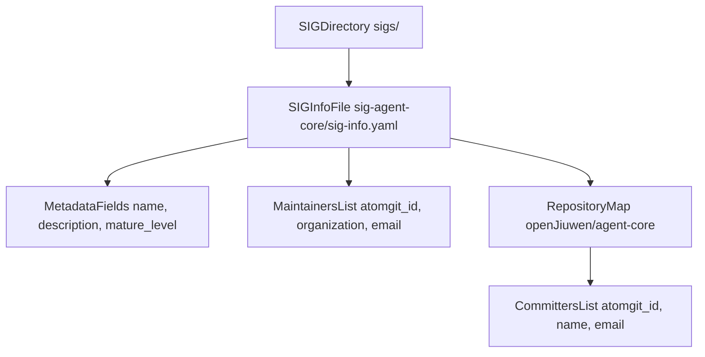
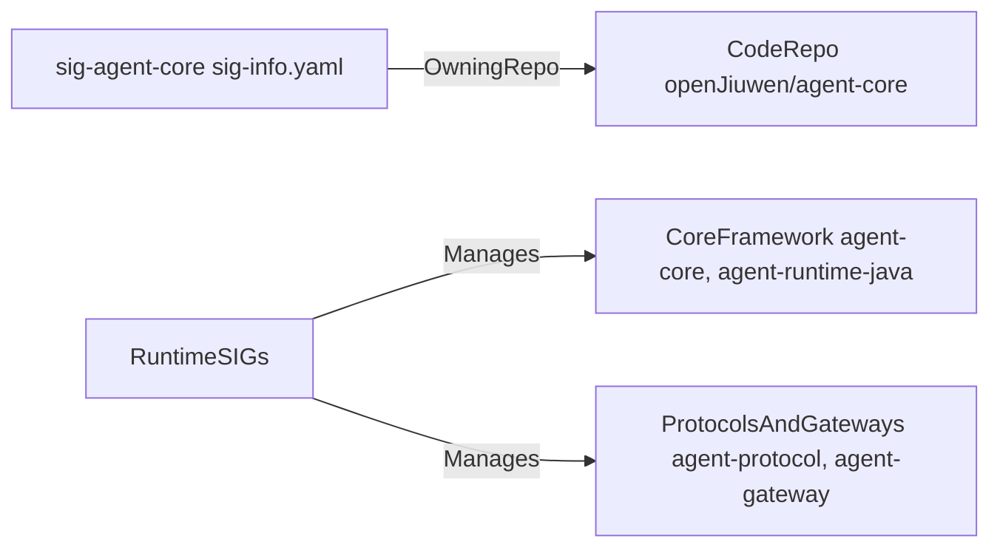
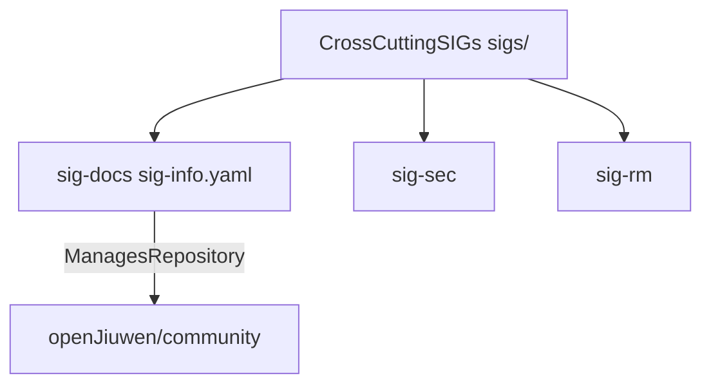

<!-- source: DeepWiki mcp.deepwiki.com · repo openJiuwen-ai/community · page 3 SIGs (Special Interest Groups) · fetched 2026-11-02 -->

# SIGs (Special Interest Groups)

Relevant source files

The following files were used as context for generating this wiki page:

- [sigs/README.md](sigs/README.md)
- [sigs/sig-agent-core/sig-info.yaml](sigs/sig-agent-core/sig-info.yaml)
- [sigs/sig-docs/sig-info.yaml](sigs/sig-docs/sig-info.yaml)

The `sigs/` directory governs the Special Interest Groups (SIGs) within the openJiuwen community. SIGs represent focused working groups responsible for specific technical domains, platform layers, repositories, and cross-cutting community services. Each SIG operates under defined metadata schemas, maintains specific code ownership boundaries, and coordinates through designated maintainers and committers.

For details on individual child topics, see the corresponding child pages linked below.

---

## 3.1. SIG Metadata Schema & Repository Manifests

Every SIG in the openJiuwen community is defined by a standard metadata structure stored in `sig-info.yaml` within its respective directory under `sigs/`. These files dictate the governance status, leadership, and repository ownership for the group.

- **SIG Metadata Fields**: Includes `name`, `description`, `mailing_list`, `meeting_url`, and `mature_level` (e.g., `startup`) [sigs/sig-agent-core/sig-info.yaml:1-5].
- **Leadership & Personnel**: Defines `maintainers` with their `atomgit_id`, `name`, `orgnization`, and `email` [sigs/sig-agent-core/sig-info.yaml:6-14].
- **Repository Scope**: Maps repositories under `openJiuwen/` and lists assigned `committers` with identical identification fields [sigs/sig-agent-core/sig-info.yaml:15-55].

For full details on metadata schemas and repository manifest rules, see [SIG Metadata Schema & Repository Manifests](#3.1).

### Diagram: SIG Metadata Schema Mapping

*Sources: [sigs/sig-agent-core/sig-info.yaml:1-55](), [sigs/sig-docs/sig-info.yaml:1-33]() *

---

## 3.2. Framework & Runtime SIGs

Framework and Runtime SIGs own the foundational execution environments, agent kernels, and communication primitives of the openJiuwen platform. These groups manage core repositories including `agent-core`, `agent-core-java`, `agent-memory`, `agent-runtime-java`, `agent-protocol`, `agent-gateway`, `agent-infer`, `agent-os`, and `agent-tools`.

For complete repository ownership details, architectural scopes, and contributor workflows, see [Framework & Runtime SIGs](#3.2).

### Diagram: Framework & Runtime SIG Scope

*Sources: [sigs/sig-agent-core/sig-info.yaml:15-17](), [sigs/README.md:1-1]() *

---

## 3.3. Application & Platform SIGs

Application and Platform SIGs focus on user-facing products, swarm intelligence systems, and high-level platform integrations. Their domain includes DeepAgents products and platforms such as `jiuwenswarm`, `jiuwensymbiosis`, `deepsearch`, `jiuwenicode`, `skillhub`, `agent-studio`, and `agent-solution`.

For detailed information on platform products, application architecture, and roadmap milestones, see [Application & Platform SIGs](#3.3).

---

## 3.4. Cross-Cutting SIGs (docs, sec, rm)

Cross-Cutting SIGs provide foundational horizontal services that support the entire openJiuwen community rather than a single repository or product line. 

- **sig-docs**: Manages community documentation, website resources, and contributor guides (e.g., `openJiuwen/community`) [sigs/sig-docs/sig-info.yaml:1-33].
- **sig-sec**: Oversees vulnerability handling, security disclosures, and compliance audits.
- **sig-rm**: Coordinates release management, versioning policies, and build pipelines.

For governance policies, documentation workflows, and security response processes, see [Cross-Cutting SIGs (docs, sec, rm)](#3.4).

### Diagram: Cross-Cutting SIG Structure

*Sources: [sigs/sig-docs/sig-info.yaml:1-33](), [sigs/README.md:1-1]() *

---

