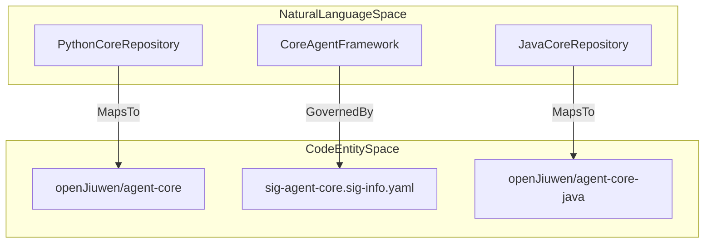
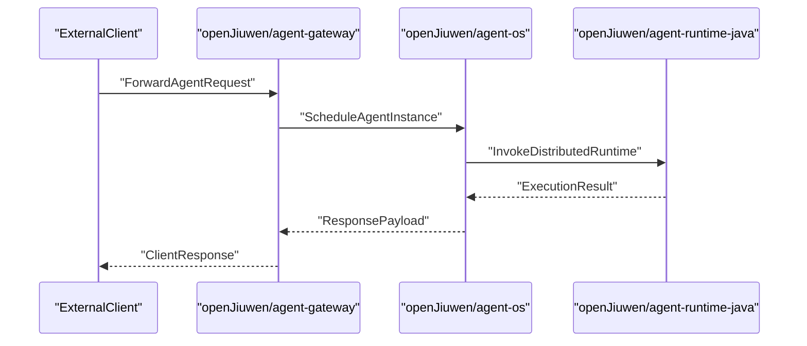

<!-- source: DeepWiki mcp.deepwiki.com · repo openJiuwen-ai/community · page 3.2 Framework & Runtime SIGs · fetched 2026-11-02 -->

# Framework & Runtime SIGs

Relevant source files

The following files were used as context for generating this wiki page:

- [sigs/sig-agent-core-java/openJiuwen/a/agent-core-java.yaml](sigs/sig-agent-core-java/openJiuwen/a/agent-core-java.yaml)
- [sigs/sig-agent-core-java/sig-info.yaml](sigs/sig-agent-core-java/sig-info.yaml)
- [sigs/sig-agent-core/sig-info.yaml](sigs/sig-agent-core/sig-info.yaml)
- [sigs/sig-agent-gateway/sig-info.yaml](sigs/sig-agent-gateway/sig-info.yaml)
- [sigs/sig-agent-infer/openJiuwen/a/agent-infer.yaml](sigs/sig-agent-infer/openJiuwen/a/agent-infer.yaml)
- [sigs/sig-agent-infer/sig-info.yaml](sigs/sig-agent-infer/sig-info.yaml)
- [sigs/sig-agent-memory/openJiuwen/a/agent-memory.yaml](sigs/sig-agent-memory/openJiuwen/a/agent-memory.yaml)
- [sigs/sig-agent-memory/sig-info.yaml](sigs/sig-agent-memory/sig-info.yaml)
- [sigs/sig-agent-os/openJiuwen/a/agent-os.yaml](sigs/sig-agent-os/openJiuwen/a/agent-os.yaml)
- [sigs/sig-agent-os/sig-info.yaml](sigs/sig-agent-os/sig-info.yaml)
- [sigs/sig-agent-protocol/openJiuwen/a/agent-protocol.yaml](sigs/sig-agent-protocol/openJiuwen/a/agent-protocol.yaml)
- [sigs/sig-agent-protocol/sig-info.yaml](sigs/sig-agent-protocol/sig-info.yaml)
- [sigs/sig-agent-runtime-java/openJiuwen/a/agent-runtime-java.yaml](sigs/sig-agent-runtime-java/openJiuwen/a/agent-runtime-java.yaml)
- [sigs/sig-agent-runtime-java/sig-info.yaml](sigs/sig-agent-runtime-java/sig-info.yaml)
- [sigs/sig-agent-tools/openJiuwen/a/agent-tools.yaml](sigs/sig-agent-tools/openJiuwen/a/agent-tools.yaml)
- [sigs/sig-agent-tools/sig-info.yaml](sigs/sig-agent-tools/sig-info.yaml)

## Purpose and Scope

This section details the Special Interest Groups (SIGs) responsible for the core infrastructure, execution engines, distributed runtimes, communication protocols, memory systems, inference wrappers, and tool integration layers of the openJiuwen AI Agent platform. These SIGs govern the foundational components utilized across both Python and Java ecosystems.

The scope encompasses nine core repositories and their respective governance metadata:
- `openJiuwen/agent-core` (`sig-agent-core`) [sigs/sig-agent-core/sig-info.yaml:1-55]()
- `openJiuwen/agent-memory` (`sig-agent-memory`) [sigs/sig-agent-memory/sig-info.yaml:1-55]()
- `openJiuwen/agent-tools` (`sig-agent-tools`) [sigs/sig-agent-tools/sig-info.yaml:1-31]()
- `openJiuwen/agent-protocol` (`sig-agent-protocol`) [sigs/sig-agent-protocol/sig-info.yaml:1-27]()
- `openJiuwen/agent-infer` (`sig-agent-infer`) [sigs/sig-agent-infer/sig-info.yaml:1-50]()
- `openJiuwen/agent-os` (`sig-agent-os`) [sigs/sig-agent-os/sig-info.yaml:1-39]()
- `openJiuwen/agent-gateway` (`sig-agent-gateway`) [sigs/sig-agent-gateway/sig-info.yaml:1-34]()
- `openJiuwen/agent-runtime-java` (`sig-agent-runtime-java`) [sigs/sig-agent-runtime-java/sig-info.yaml:1-30]()

Sources: [sigs/sig-agent-core/sig-info.yaml:1-55](), [sigs/sig-agent-memory/sig-info.yaml:1-55](), [sigs/sig-agent-tools/sig-info.yaml:1-31](), [sigs/sig-agent-protocol/sig-info.yaml:1-27](), [sigs/sig-agent-infer/sig-info.yaml:1-50](), [sigs/sig-agent-os/sig-info.yaml:1-39](), [sigs/sig-agent-gateway/sig-info.yaml:1-34](), [sigs/sig-agent-runtime-java/sig-info.yaml:1-30]()

---

## Core Framework SIGs (`sig-agent-core` & `sig-agent-core-java`)

The core framework SIGs manage the primary execution abstractions, agent state machines, tool-use loops, and contextual orchestration primitives. 

- **`sig-agent-core`**: Governs `openJiuwen/agent-core` under the startup maturity level, led by maintainers `xinyu-jiuwen` and `seanzhang_cn` [sigs/sig-agent-core/sig-info.yaml:1-15](). It oversees committers managing agent life-cycle execution flows [sigs/sig-agent-core/sig-info.yaml:16-55]().
- **`sig-agent-core-java`**: Manages the Java counterpart implementation for agent framework primitives, matching the Python core capabilities for enterprise environments.

### Framework Entity Relationship

Sources: [sigs/sig-agent-core/sig-info.yaml:1-55]()

---

## Memory & State Management (`sig-agent-memory`)

Managed by `sig-agent-memory` (`openJiuwen/agent-memory`), this subsystem provides memory libraries for agents, handling short-term working memory, long-term vector stores, and episodic context retrieval [sigs/sig-agent-memory/sig-info.yaml:1-21](), [sigs/sig-agent-memory/openJiuwen/a/agent-memory.yaml:1-10]().

### Repository Manifest & Branching Strategy
The repository configuration defines protected development and production branches to maintain stability for memory primitives [sigs/sig-agent-memory/openJiuwen/a/agent-memory.yaml:1-10]():
- `develop`: Protected integration branch [sigs/sig-agent-memory/openJiuwen/a/agent-memory.yaml:3-5]()
- `main`: Protected production branch [sigs/sig-agent-memory/openJiuwen/a/agent-memory.yaml:6-7]()
- `mem2.0`: Protected experimental/next-gen memory branch [sigs/sig-agent-memory/openJiuwen/a/agent-memory.yaml:8-9]()

Maintainers include `chenglinsong`, `li_zhonghua`, and `JingwenZhao` [sigs/sig-agent-memory/sig-info.yaml:6-18]().

Sources: [sigs/sig-agent-memory/sig-info.yaml:1-55](), [sigs/sig-agent-memory/openJiuwen/a/agent-memory.yaml:1-10]()

---

## Runtime, OS, & Gateway SIGs (`sig-agent-runtime-java`, `sig-agent-os`, `sig-agent-gateway`)

These SIGs provide distributed agent execution infrastructure, operational management platforms, and traffic routing gateways.

### Runtime and OS Components
- **`sig-agent-runtime-java`**: Manages `openJiuwen/agent-runtime-java`, providing the Java implementation for distributed agent runtimes across `develop` and `main` protected branches [sigs/sig-agent-runtime-java/openJiuwen/a/agent-runtime-java.yaml:1-7](), led by `fujilie` and `LucioIT` [sigs/sig-agent-runtime-java/sig-info.yaml:1-15]().
- **`sig-agent-os`**: Governs `openJiuwen/agent-os`, serving as an Agent OS platform for managing and deploying AI agents under maintainers `liufangchao`, `xinyu-jiuwen`, and `hekefeng` [sigs/sig-agent-os/sig-info.yaml:1-19](), [sigs/sig-agent-os/openJiuwen/a/agent-os.yaml:1-6]().
- **`sig-agent-gateway`**: Governs `openJiuwen/agent-gateway` led by `YiyangShao` and `mingo007` [sigs/sig-agent-gateway/sig-info.yaml:1-15](), routing agent-to-agent and external client requests.

### Distributed Execution Data Flow

Sources: [sigs/sig-agent-os/openJiuwen/a/agent-os.yaml:1-6](), [sigs/sig-agent-os/sig-info.yaml:1-39](), [sigs/sig-agent-gateway/sig-info.yaml:1-34](), [sigs/sig-agent-runtime-java/sig-info.yaml:1-30]()

---

## Protocol, Inference, & Tools SIGs (`sig-agent-protocol`, `sig-agent-infer`, `sig-agent-tools`)

These groups manage interface standards, vLLM-based model inference integrations, and tool execution libraries.

### Overview of Repositories
- **`sig-agent-protocol`**: Governs `openJiuwen/agent-protocol` under maintainers `YiyangShao` and `xinyu-jiuwen` [sigs/sig-agent-protocol/sig-info.yaml:1-15]().
- **`sig-agent-infer`**: Governs `openJiuwen/agent-infer`, providing a vLLM-based inference framework optimized for agentic workloads with `develop` and `main` protected branches [sigs/sig-agent-infer/sig-info.yaml:1-25](), [sigs/sig-agent-infer/openJiuwen/a/agent-infer.yaml:1-8](). Maintainers include `hsliu_ustc`, `wuhang91`, `m0_37369840`, and `zengchuang_personal` [sigs/sig-agent-infer/sig-info.yaml:6-23]().
- **`sig-agent-tools`**: Governs `openJiuwen/agent-tools` under maintainers `seanzhang_cn` and `xinyu-jiuwen` [sigs/sig-agent-tools/sig-info.yaml:1-15]().

Sources: [sigs/sig-agent-protocol/sig-info.yaml:1-27](), [sigs/sig-agent-infer/sig-info.yaml:1-50](), [sigs/sig-agent-infer/openJiuwen/a/agent-infer.yaml:1-8](), [sigs/sig-agent-tools/sig-info.yaml:1-31]()

---

## Summary of Framework & Runtime Repositories

| SIG Name | Repository | Maturity Level | Primary Maintainers | Key Branch Structure |
| :--- | :--- | :--- | :--- | :--- |
| `sig-agent-core` | `openJiuwen/agent-core` | startup [sigs/sig-agent-core/sig-info.yaml:5]() | `xinyu-jiuwen`, `seanzhang_cn` [sigs/sig-agent-core/sig-info.yaml:7-12]() | Not specified |
| `sig-agent-memory` | `openJiuwen/agent-memory` | startup [sigs/sig-agent-memory/sig-info.yaml:5]() | `chenglinsong`, `li_zhonghua`, `JingwenZhao` [sigs/sig-agent-memory/sig-info.yaml:7-18]() | `develop`, `main`, `mem2.0` [sigs/sig-agent-memory/openJiuwen/a/agent-memory.yaml:3-9]() |
| `sig-agent-runtime-java` | `openJiuwen/agent-runtime-java` | startup [sigs/sig-agent-runtime-java/sig-info.yaml:5]() | `fujilie`, `LucioIT` [sigs/sig-agent-runtime-java/sig-info.yaml:7-14]() | `develop`, `main` [sigs/sig-agent-runtime-java/openJiuwen/a/agent-runtime-java.yaml:3-7]() |
| `sig-agent-infer` | `openJiuwen/agent-infer` | startup [sigs/sig-agent-infer/sig-info.yaml:5]() | `hsliu_ustc`, `wuhang91`, `m0_37369840`, `zengchuang_personal` [sigs/sig-agent-infer/sig-info.yaml:6-22]() | `develop`, `main` [sigs/sig-agent-infer/openJiuwen/a/agent-infer.yaml:3-7]() |
| `sig-agent-os` | `openJiuwen/agent-os` | startup [sigs/sig-agent-os/sig-info.yaml:5]() | `liufangchao`, `xinyu-jiuwen`, `hekefeng` [sigs/sig-agent-os/sig-info.yaml:7-18]() | `main` [sigs/sig-agent-os/openJiuwen/a/agent-os.yaml:3-5]() |
| `sig-agent-gateway` | `openJiuwen/agent-gateway` | startup [sigs/sig-agent-gateway/sig-info.yaml:5]() | `YiyangShao`, `mingo007` [sigs/sig-agent-gateway/sig-info.yaml:7-14]() | Not specified |

Sources: [sigs/sig-agent-core/sig-info.yaml:1-55](), [sigs/sig-agent-memory/sig-info.yaml:1-55](), [sigs/sig-agent-memory/openJiuwen/a/agent-memory.yaml:1-10](), [sigs/sig-agent-runtime-java/sig-info.yaml:1-30](), [sigs/sig-agent-runtime-java/openJiuwen/a/agent-runtime-java.yaml:1-7](), [sigs/sig-agent-infer/sig-info.yaml:1-50](), [sigs/sig-agent-infer/openJiuwen/a/agent-infer.yaml:1-8](), [sigs/sig-agent-os/sig-info.yaml:1-39](), [sigs/sig-agent-os/openJiuwen/a/agent-os.yaml:1-6](), [sigs/sig-agent-gateway/sig-info.yaml:1-34]()

---

