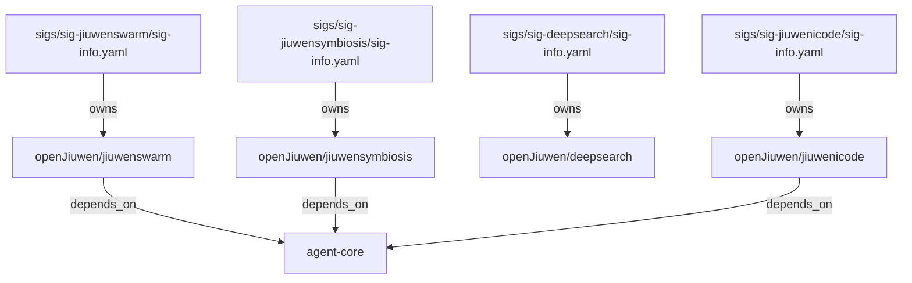
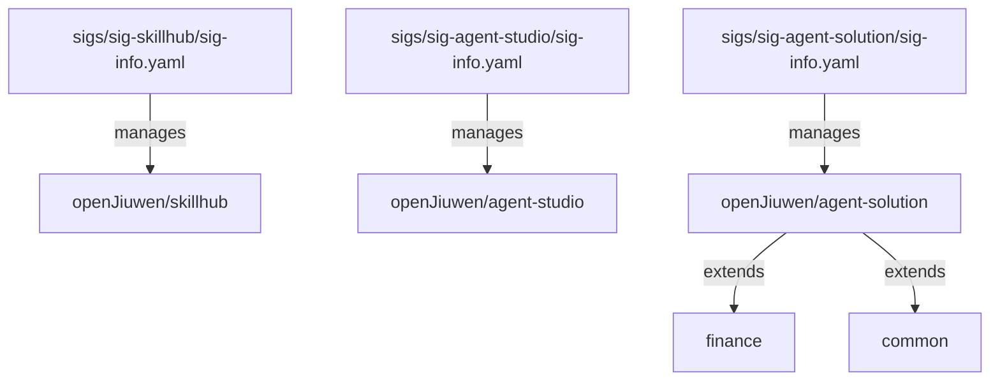

<!-- source: DeepWiki mcp.deepwiki.com · repo openJiuwen-ai/community · page 3.3 Application & Platform SIGs · fetched 2026-11-02 -->

# Application & Platform SIGs

<details>
<summary>Relevant source files</summary>

The following files were used as context for generating this wiki page:

- [sigs/sig-agent-solution/openJiuwen/a/agent-solution.yaml](sigs/sig-agent-solution/openJiuwen/a/agent-solution.yaml)
- [sigs/sig-agent-solution/sig-info.yaml](sigs/sig-agent-solution/sig-info.yaml)
- [sigs/sig-agent-studio/sig-info.yaml](sigs/sig-agent-studio/sig-info.yaml)
- [sigs/sig-deepsearch/openJiuwen/a/deepsearch.yaml](sigs/sig-deepsearch/openJiuwen/a/deepsearch.yaml)
- [sigs/sig-deepsearch/sig-info.yaml](sigs/sig-deepsearch/sig-info.yaml)
- [sigs/sig-jiuwenicode/openJiuwen/a/jiuwenicode.yaml](sigs/sig-jiuwenicode/openJiuwen/a/jiuwenicode.yaml)
- [sigs/sig-jiuwenicode/sig-info.yaml](sigs/sig-jiuwenicode/sig-info.yaml)
- [sigs/sig-jiuwenswarm/openJiuwen/a/jiuwenswarm.yaml](sigs/sig-jiuwenswarm/openJiuwen/a/jiuwenswarm.yaml)
- [sigs/sig-jiuwenswarm/sig-info.yaml](sigs/sig-jiuwenswarm/sig-info.yaml)
- [sigs/sig-jiuwensymbiosis/openJiuwen/a/jiuwensymbiosis.yaml](sigs/sig-jiuwensymbiosis/openJiuwen/a/jiuwensymbiosis.yaml)
- [sigs/sig-jiuwensymbiosis/sig-info.yaml](sigs/sig-jiuwensymbiosis/sig-info.yaml)
- [sigs/sig-skillhub/openJiuwen/a/skillhub.yaml](sigs/sig-skillhub/openJiuwen/a/skillhub.yaml)
- [sigs/sig-skillhub/sig-info.yaml](sigs/sig-skillhub/sig-info.yaml)

</details>


## Purpose and Scope

The Application & Platform Special Interest Groups (SIGs) within the openJiuwen community are responsible for managing, developing, and maintaining user-facing applications, DeepAgents, and platform products built on top of the `agent-core` framework. These SIGs span domain-specific assistants, physical AI integrations, search agents, coding assistants, skill ecosystems, studios, and industrial solutions.

The scope encompasses seven primary SIGs and their corresponding repositories:
* `sig-jiuwenswarm`: `openJiuwen/jiuwenswarm` [sigs/sig-jiuwenswarm/sig-info.yaml:1-13]()
* `sig-jiuwensymbiosis`: `openJiuwen/jiuwensymbiosis` [sigs/sig-jiuwensymbiosis/sig-info.yaml:1-17]()
* `deepsearch`: `openJiuwen/deepsearch` [sigs/sig-deepsearch/sig-info.yaml:1-13]()
* `sig-jiuwenicode`: `openJiuwen/jiuwenicode` [sigs/sig-jiuwenicode/sig-info.yaml:1-17]()
* `sig-skillhub`: `openJiuwen/skillhub` [sigs/sig-skillhub/sig-info.yaml:1-17]()
* `sig-agent-studio`: `openJiuwen/agent-studio` [sigs/sig-agent-studio/sig-info.yaml:1-17]()
* `sig-agent-solution`: `openJiuwen/agent-solution` [sigs/sig-agent-solution/sig-info.yaml:1-17]()

---

## 1. DeepAgents and Assistant Products

Application SIGs deliver specialized AI assistants and autonomous agent platforms. Each SIG maintains explicit metadata configurations via `sig-info.yaml` files defining maintainers, committers, and repository structures.

### JiuwenSwarm and JiuwenSymbiosis
* **`sig-jiuwenswarm`**: Managed by maintainer `douran` [sigs/sig-jiuwenswarm/sig-info.yaml:6-10](), with a large cohort of committers [sigs/sig-jiuwenswarm/sig-info.yaml:14-82](). The repository `openJiuwen/jiuwenswarm` [sigs/sig-jiuwenswarm/sig-info.yaml:11-13]() is built on the `agent-core` framework to deliver multi-agent swarm capabilities [sigs/sig-jiuwenswarm/openJiuwen/a/jiuwenswarm.yaml:1-3]().
* **`sig-jiuwensymbiosis`**: Managed by maintainers `zhangjiahui998` and `yyyamal` [sigs/sig-jiuwensymbiosis/sig-info.yaml:6-10](). The `openJiuwen/jiuwensymbiosis` repository [sigs/sig-jiuwensymbiosis/sig-info.yaml:15-17]() provides a Physical AI assistant built upon `agent-core` [sigs/sig-jiuwensymbiosis/openJiuwen/a/jiuwensymbiosis.yaml:1-3]().

### DeepSearch and JiuwenICode
* **`deepsearch`**: Headed by maintainer `li_zhonghua` [sigs/sig-deepsearch/sig-info.yaml:6-10](), overseeing the `openJiuwen/deepsearch` repository [sigs/sig-deepsearch/sig-info.yaml:11-13]() with committers specializing in advanced search intelligence [sigs/sig-deepsearch/sig-info.yaml:14-34]().
* **`sig-jiuwenicode`**: Managed by maintainers `xinyu-jiuwen` and `zhongykau` [sigs/sig-jiuwenicode/sig-info.yaml:6-14](). The `openJiuwen/jiuwenicode` repository [sigs/sig-jiuwenicode/sig-info.yaml:15-17]() provides an AI coding assistant powered by `agent-core` [sigs/sig-jiuwenicode/openJiuwen/a/jiuwenicode.yaml:1-3]().


*Sources: [sigs/sig-jiuwenswarm/sig-info.yaml:1-13](), [sigs/sig-jiuwensymbiosis/sig-info.yaml:1-17](), [sigs/sig-deepsearch/sig-info.yaml:1-13](), [sigs/sig-jiuwenicode/sig-info.yaml:1-17](), [sigs/sig-jiuwenicode/openJiuwen/a/jiuwenicode.yaml:1-3]()*

---

## 2. Platform Products and Ecosystem Tooling

Platform SIGs provide the underlying tooling, extension libraries, skill registries, and low-code visual environments required to build and deploy agent solutions.

### SkillHub, Agent Studio, and Agent Solution
* **`sig-skillhub`**: Maintained by `caozhenhua0000` and `xiaowenzihwl` [sigs/sig-skillhub/sig-info.yaml:6-14](). It manages `openJiuwen/skillhub` [sigs/sig-skillhub/sig-info.yaml:15-17]() to establish a comprehensive skill ecosystem [sigs/sig-skillhub/openJiuwen/a/skillhub.yaml:1-3]().
* **`sig-agent-studio`**: Maintained by `seanzhang_cn` and `xinyu-jiuwen` [sigs/sig-agent-studio/sig-info.yaml:6-14](). It manages `openJiuwen/agent-studio` [sigs/sig-agent-studio/sig-info.yaml:15-17]().
* **`sig-agent-solution`**: Maintained by `LucioIT` and `xingchao_ml` [sigs/sig-agent-solution/sig-info.yaml:6-14](). It manages `openJiuwen/agent-solution` [sigs/sig-agent-solution/sig-info.yaml:15-17](), delivering industry-specific solutions across finance, manufacturing, electric power, transportation, and public utilities [sigs/sig-agent-solution/openJiuwen/a/agent-solution.yaml:1-3]().


*Sources: [sigs/sig-skillhub/sig-info.yaml:1-17](), [sigs/sig-agent-studio/sig-info.yaml:1-17](), [sigs/sig-agent-solution/sig-info.yaml:1-17](), [sigs/sig-skillhub/openJiuwen/a/skillhub.yaml:1-3](), [sigs/sig-agent-solution/openJiuwen/a/agent-solution.yaml:1-9]()*

---

## 3. Repository Manifests and Branch Protection Rules

Application and platform repositories maintain explicit configuration manifests under `sigs/<sig-name>/openJiuwen/a/<repo>.yaml`. These define repository visibility, description, and protected branches.

| Repository | SIG Name | Visibility | Protected Branches | Source Manifest |
| :--- | :--- | :--- | :--- | :--- |
| `jiuwenswarm` | `sig-jiuwenswarm` | public [sigs/sig-jiuwenswarm/openJiuwen/a/jiuwenswarm.yaml:8-8]() | `develop`, `main` [sigs/sig-jiuwenswarm/openJiuwen/a/jiuwenswarm.yaml:3-7]() | `sigs/sig-jiuwenswarm/openJiuwen/a/jiuwenswarm.yaml` |
| `jiuwensymbiosis` | `sig-jiuwensymbiosis` | public [sigs/sig-jiuwensymbiosis/openJiuwen/a/jiuwensymbiosis.yaml:8-8]() | `develop`, `main` [sigs/sig-jiuwensymbiosis/openJiuwen/a/jiuwensymbiosis.yaml:3-7]() | `sigs/sig-jiuwensymbiosis/openJiuwen/a/jiuwensymbiosis.yaml` |
| `jiuwenicode` | `sig-jiuwenicode` | public [sigs/sig-jiuwenicode/openJiuwen/a/jiuwenicode.yaml:8-8]() | `develop`, `main` [sigs/sig-jiuwenicode/openJiuwen/a/jiuwenicode.yaml:3-7]() | `sigs/sig-jiuwenicode/openJiuwen/a/jiuwenicode.yaml` |
| `skillhub` | `sig-skillhub` | public [sigs/sig-skillhub/openJiuwen/a/skillhub.yaml:6-6]() | `main` [sigs/sig-skillhub/openJiuwen/a/skillhub.yaml:3-5]() | `sigs/sig-skillhub/openJiuwen/a/skillhub.yaml` |
| `agent-solution` | `sig-agent-solution` | public [sigs/sig-agent-solution/openJiuwen/a/agent-solution.yaml:10-10]() | `main`, `common`, `finance` [sigs/sig-agent-solution/openJiuwen/a/agent-solution.yaml:3-9]() | `sigs/sig-agent-solution/openJiuwen/a/agent-solution.yaml` |

*Sources: [sigs/sig-jiuwenswarm/openJiuwen/a/jiuwenswarm.yaml:1-8](), [sigs/sig-jiuwensymbiosis/openJiuwen/a/jiuwensymbiosis.yaml:1-8](), [sigs/sig-jiuwenicode/openJiuwen/a/jiuwenicode.yaml:1-8](), [sigs/sig-skillhub/openJiuwen/a/skillhub.yaml:1-6](), [sigs/sig-agent-solution/openJiuwen/a/agent-solution.yaml:1-10]()*

---

## 4. Organizational Structure and Roles

Every Application & Platform SIG follows the community governance model defined in `sig-info.yaml`. Each group maintains a startup mature level [sigs/sig-jiuwenswarm/sig-info.yaml:5-5](), with designated maintainers holding review and merge privileges, and committers contributing code to the repositories.

```yaml
# Example Structure from sigs/sig-agent-studio/sig-info.yaml
name: sig-agent-studio
description: The sig-agent-studio team is responsible for manage agent-studio
mature_level: startup
maintainers:
  - atomgit_id: seanzhang_cn
    name: zhangxiang
    orgnization: Huawei
    email: zhangxiang144@huawei.com
repositories:
  - repo:
    - openJiuwen/agent-studio
```
*Sources: [sigs/sig-agent-studio/sig-info.yaml:1-18](), [sigs/sig-skillhub/sig-info.yaml:1-18](), [sigs/sig-deepsearch/sig-info.yaml:1-13]()*

---

