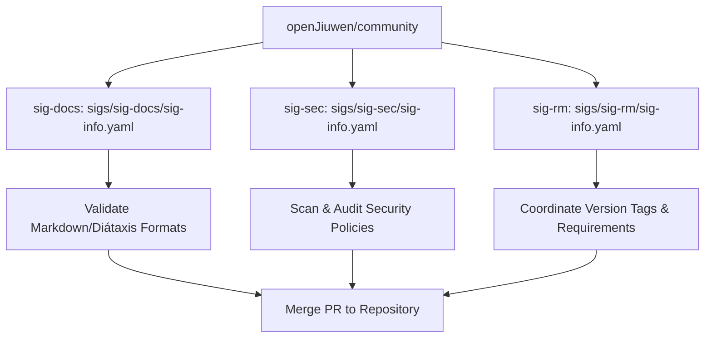

<!-- source: DeepWiki mcp.deepwiki.com · repo openJiuwen-ai/community · page 3.4 Cross-Cutting SIGs (docs, sec, rm) · fetched 2026-11-02 -->

# Cross-Cutting SIGs (docs, sec, rm)

<details>
<summary>Relevant source files</summary>

The following files were used as context for generating this wiki page:

- [sigs/sig-docs/sig-info.yaml](sigs/sig-docs/sig-info.yaml)
- [sigs/sig-rm/sig-info.yaml](sigs/sig-rm/sig-info.yaml)
- [sigs/sig-sec/sig-info.yaml](sigs/sig-sec/sig-info.yaml)

</details>


## Purpose and Scope

This page details the cross-cutting Special Interest Groups (SIGs) within the openJiuwen community: `sig-docs` (documentation), `sig-sec` (security), and `sig-rm` (release management). Unlike component-specific SIGs that govern isolated runtime layers or frameworks, cross-cutting SIGs span the entire ecosystem repository infrastructure, enforcing community-wide standards for documentation quality, user security management, version control, and release lifecycles.

Sources: `sigs/sig-docs/sig-info.yaml:1-33` [sigs/sig-docs/sig-info.yaml:1-33](), `sigs/sig-rm/sig-info.yaml:1-25` [sigs/sig-rm/sig-info.yaml:1-24](), `sigs/sig-sec/sig-info.yaml:1-26` [sigs/sig-sec/sig-info.yaml:1-25]()

---

## 1. Documentation SIG (`sig-docs`)

The `sig-docs` group manages documentation infrastructure, guides, and content structures across the community repositories [sigs/sig-docs/sig-info.yaml:1-2](). 

### Configuration & Membership Metadata
Defined in `sigs/sig-docs/sig-info.yaml` [sigs/sig-docs/sig-info.yaml:1-33](), the SIG operates under the following parameters:
- **Name:** `sig-docs` [sigs/sig-docs/sig-info.yaml:1-1]()
- **Description:** Responsible for managing community documentation and core repositories [sigs/sig-docs/sig-info.yaml:2-2]()
- **Mature Level:** `startup` [sigs/sig-docs/sig-info.yaml:5-5]()
- **Managed Repositories:** `openJiuwen/community` [sigs/sig-docs/sig-info.yaml:6-8]()
- **Committers:** 
  - `yuzengjie01` (Huawei) [sigs/sig-docs/sig-info.yaml:10-13]()
  - `zhangmingyang_zz` (Huawei) [sigs/sig-docs/sig-info.yaml:14-17]()
  - `huguangzheng` (Huawei) [sigs/sig-docs/sig-info.yaml:18-21]()
  - `renquanjia` (Huawei) [sigs/sig-docs/sig-info.yaml:22-25]()
  - `lixiaofeng6` (Huawei) [sigs/sig-docs/sig-info.yaml:26-29]()
  - `zhangfuzhi` (Huawei) [sigs/sig-docs/sig-info.yaml:30-33]()

Sources: `sigs/sig-docs/sig-info.yaml:1-33` [sigs/sig-docs/sig-info.yaml:1-33]()

---

## 2. Release Management SIG (`sig-rm`)

The `sig-rm` group handles release coordination, version governance, and requirement tracking across openJiuwen components [sigs/sig-rm/sig-info.yaml:1-2]().

### Configuration & Membership Metadata
Defined in `sigs/sig-rm/sig-info.yaml` [sigs/sig-rm/sig-info.yaml:1-24](), the structure includes:
- **Name:** `sig-rm` [sigs/sig-rm/sig-info.yaml:1-1]()
- **Description:** Dedicated to version management and requirement management [sigs/sig-rm/sig-info.yaml:2-2]()
- **Mature Level:** `startup` [sigs/sig-rm/sig-info.yaml:5-5]()
- **Maintainers:**
  - `ryanw22` / `wanghongbo` (Huawei) [sigs/sig-rm/sig-info.yaml:6-10]()
  - `z00430070` / `zhuxushen` (Huawei) [sigs/sig-rm/sig-info.yaml:11-14]()
- **Committers:**
  - `shiruifeng1116` / `shiruifeng` (Huawei) [sigs/sig-rm/sig-info.yaml:16-19]()
  - `huguangzheng` / `huguangzheng` (Huawei) [sigs/sig-rm/sig-info.yaml:20-23]()

Sources: `sigs/sig-rm/sig-info.yaml:1-25` [sigs/sig-rm/sig-info.yaml:1-24]()

---

## 3. Security SIG (`sig-sec`)

The `sig-sec` group governs user security management, vulnerability response policies, and compliance standards across the ecosystem [sigs/sig-sec/sig-info.yaml:1-2]().

### Configuration & Membership Metadata
Defined in `sigs/sig-sec/sig-info.yaml` [sigs/sig-sec/sig-info.yaml:1-25](), the structure includes:
- **Name:** `sig-sec` [sigs/sig-sec/sig-info.yaml:1-1]()
- **Description:** Dedicated to user security management [sigs/sig-sec/sig-info.yaml:2-2]()
- **Mature Level:** `startup` [sigs/sig-sec/sig-info.yaml:5-5]()
- **Maintainers:**
  - `yyuse` / `杨渊` (Huawei) [sigs/sig-sec/sig-info.yaml:6-10]()
  - `seanzhang_cn` / `zhangxiang` (Huawei) [sigs/sig-sec/sig-info.yaml:11-14]()
- **Committers:**
  - `maxmadmax` / `chengkun12` (Huawei) [sigs/sig-sec/sig-info.yaml:16-19]()
  - `zhaozixuan` / `zhaozixuan2` (Huawei) [sigs/sig-sec/sig-info.yaml:20-23]()

Sources: `sigs/sig-sec/sig-info.yaml:1-26` [sigs/sig-sec/sig-info.yaml:1-25]()

---

## 4. Cross-Cutting SIG Architecture & Code Entity Mapping

To bridge natural language community requirements (documentation updates, security patches, release milestones) with actual code structures, cross-cutting SIGs manage specific YAML manifests stored under the `sigs/` directory [sigs/sig-docs/sig-info.yaml:1-33]().

### Diagram: Natural Language Space to Code Entity Space (SIG Metadata Mapping)

```mermaid
graph TD
    NaturalLanguageDocs[""Natural Language: Documentation Governance & Guides""] --> SigDocsYAML[""sigs/sig-docs/sig-info.yaml"#sig-docs""]
    NaturalLanguageSec[""Natural Language: Vulnerability & Security Management""] --> SigSecYAML[""sigs/sig-sec/sig-info.yaml"#sig-sec""]
    NaturalLanguageRM[""Natural Language: Version & Release Planning""] --> SigRmYAML[""sigs/sig-rm/sig-info.yaml"#sig-rm""]

    SigDocsYAML --> CommitterListDocs[""Committers: yuzengjie01, zhangmingyang_zz, huguangzheng, renquanjia, lixiaofeng6, zhangfuzhi""]
    SigSecYAML --> MaintainerListSec[""Maintainers: yyuse, seanzhang_cn & Committers: maxmadmax, zhaozixuan""]
    SigRmYAML --> MaintainerListRm[""Maintainers: ryanw22, z00430070 & Committers: shiruifeng1116, huguangzheng""]
```
Sources: `sigs/sig-docs/sig-info.yaml:1-33` [sigs/sig-docs/sig-info.yaml:1-33](), `sigs/sig-rm/sig-info.yaml:1-25` [sigs/sig-rm/sig-info.yaml:1-24](), `sigs/sig-sec/sig-info.yaml:1-26` [sigs/sig-sec/sig-info.yaml:1-25]()

### Diagram: Cross-Cutting Responsibilities & Dataflow


Sources: `sigs/sig-docs/sig-info.yaml:1-33` [sigs/sig-docs/sig-info.yaml:1-33](), `sigs/sig-rm/sig-info.yaml:1-25` [sigs/sig-rm/sig-info.yaml:1-24](), `sigs/sig-sec/sig-info.yaml:1-26` [sigs/sig-sec/sig-info.yaml:1-25]()

---

