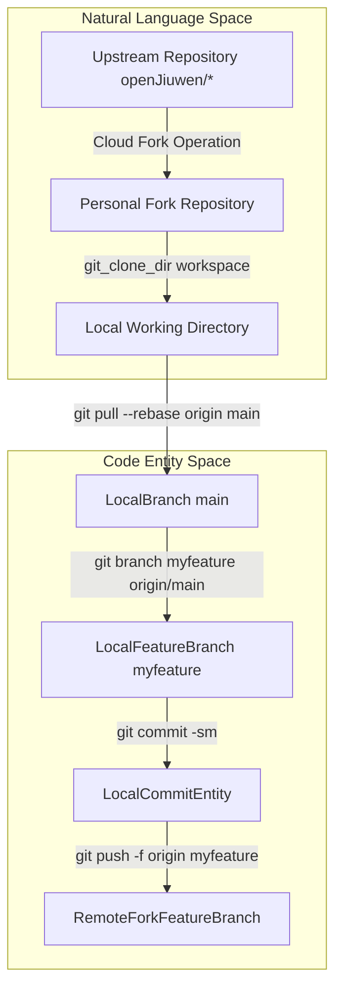
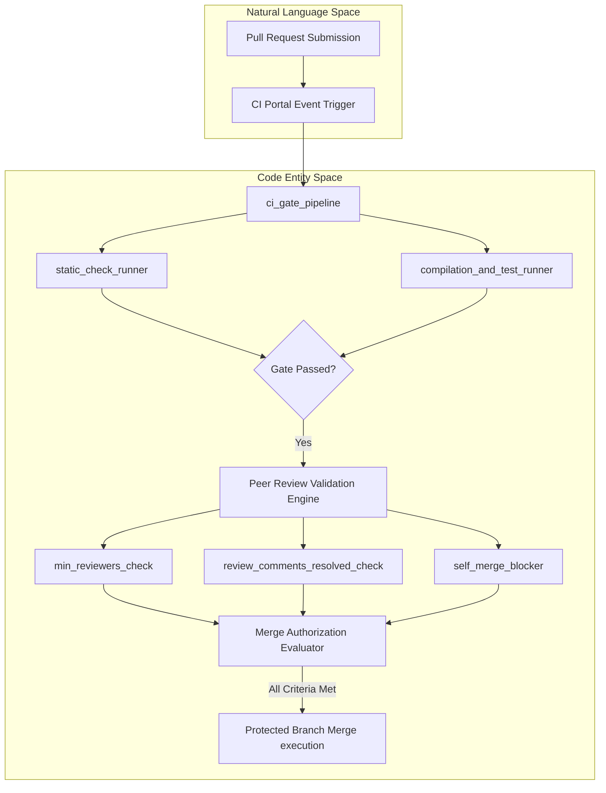

<!-- source: DeepWiki mcp.deepwiki.com · repo openJiuwen-ai/community · page 4.1 Contribution Workflow & Commit Conventions · fetched 2026-11-02 -->

# Contribution Workflow & Commit Conventions

<details>
<summary>Relevant source files</summary>

The following files were used as context for generating this wiki page:

- [CONTRIBUTING_zh.md](CONTRIBUTING_zh.md)
- [Contribution_guidance_zh.md](Contribution_guidance_zh.md)
- [README.md](README.md)
- [README_CN.md](README_CN.md)
- [sigs/sig-agent-protocol/openJiuwen/a/agent-protocol.yaml](sigs/sig-agent-protocol/openJiuwen/a/agent-protocol.yaml)
- [sigs/sig-agent-protocol/sig-info.yaml](sigs/sig-agent-protocol/sig-info.yaml)

</details>


## Purpose and Scope
This page defines the formal contribution workflow, branching model, commit message specifications, sign-off requirements, issue-to-PR linkage policies, and automated CI quality gates for the openJiuwen community repositories. It applies to all contributors submitting patches to core frameworks, runtimes, agents, and platform modules.

Sources: `[CONTRIBUTING_zh.md:1-16]()`, `[README_CN.md:1-115]()`

---

## 1. Fork, Clone, and Branching Workflow

Contributing code to openJiuwen requires a standard Fork-and-Pull-Request workflow hosted on the community platform. Developers must fork the target repository to their personal namespace before cloning it to a local working environment.

### Local Environment Setup and Branching
1. **Create a local working directory** and clone the forked remote repository using its remote link (`$remote_link`) `[CONTRIBUTING_zh.md:49-76]()`:
   ```bash
   mkdir -p ${your_working_dir}
   cd ${your_working_dir}
   git clone $remote_link
   ```
2. **Synchronize local `main` branch** against the remote repository to ensure a clean base `[CONTRIBUTING_zh.md:84-89]()`:
   ```bash
   git remote add origin $remote_link
   git fetch origin
   git checkout main
   git pull --rebase
   ```
3. **Create a dedicated feature or fix branch** (`myfeature`) derived from `origin/main` `[CONTRIBUTING_zh.md:94-96]()`:
   ```bash
   git branch myfeature origin/main
   git checkout myfeature
   ```
4. **Push the feature branch** to your personal fork when ready for review `[CONTRIBUTING_zh.md:124-126]()`:
   ```bash
   git push -f origin myfeature
   ```

### Diagram: Git Fork, Clone, and Feature Branch Workflow


Sources: `[CONTRIBUTING_zh.md:38-127]()`

---

## 2. Commit Conventions and Sign-Off

To maintain a clean, parsable commit history and comply with legal governance policies, openJiuwen enforces structured commit messages and developer sign-offs.

### Conventional Commits Format
All commit messages must adhere to the [Conventional Commits](https://www.conventionalcommits.org/) specification (`feat`, `fix`, `docs`, `style`, `refactor`, `test`, `chore`) `[CONTRIBUTING_zh.md:107-118]()`. 

A standard commit structure includes a typed header, an optional detailed body, and issue references (`Refs: #ID`):
```text
feat: add memory subsystem persistence layer

Implement vector index caching and hybrid retrieval for agent-memory.
Supports multi-tenant isolation and compression hooks.

Refs: #12
```

### Developer Sign-Off (`-sm`)
Every commit must include a cryptographic sign-off to certify the Developer Certificate of Origin (DCO). Developers must pass the `-s` and `-m` flags during commit creation to attach their sign-off email `[CONTRIBUTING_zh.md:104]`:
```bash
git add .
git commit -sm "feat: implement agent-core execution loop"
```

Sources: `[CONTRIBUTING_zh.md:100-118]()`

---

## 3. Issue Tracking and PR-Issue Linkage

Code contributions must be traceable to tracked requirements or bug reports. 

1. **Create an Issue**: Navigate to the target repository's Issues tab on the code hosting platform and create a dedicated task description before submitting code `[CONTRIBUTING_zh.md:137-142]()`.
2. **Link PR to Issue**: When creating or editing a Pull Request, include the hash symbol followed by the 5-digit Issue ID (e.g., `#12345` or `Refs: #12345`) in the PR description box to automatically bind the PR to the tracking lifecycle `[CONTRIBUTING_zh.md:115,144]()`.

Sources: `[CONTRIBUTING_zh.md:115,137-145]()`

---

## 4. CI Gates and Merge Rules

Automated Continuous Integration (CI) pipelines and strict peer-review governance protect protected branches (`main`, `develop`) against regression and unstable code integration `[sigs/sig-agent-protocol/openJiuwen/a/agent-protocol.yaml:3-7]()`.

### CI Gate Execution
When a PR is opened or updated, the `ci_gate_pipeline` triggers automated code checks `[CONTRIBUTING_zh.md:158-164]`:
- **Static Analysis**: Linter checks, style validation, and security scans.
- **Compilation & Build**: Multi-language builds across Python SDK (`agent-core`) and Java SDK (`agent-core-java`).
- **Functional Testing**: Automated unit and integration test suites.

### Merge Constraints and Governance Rules
Merging a Pull Request into a protected branch requires satisfying strict platform constraints `[CONTRIBUTING_zh.md:146-151]`:
- **Minimum Reviewers**: Must meet the threshold of required peer approvals defined in repository governance manifests.
- **Comment Resolution**: All code review comments and blocking discussions must be fully resolved.
- **Self-Merge Prohibition**: Contributors are strictly prohibited from merging Pull Requests they authored themselves.
- **Pipeline Success**: The `ci_gate_pipeline` must report a successful execution status prior to merge authorization.

### Diagram: CI Gate and Merge Verification Pipeline


Sources: `[CONTRIBUTING_zh.md:146-164]()`, `[sigs/sig-agent-protocol/openJiuwen/a/agent-protocol.yaml:3-7]()`

---

