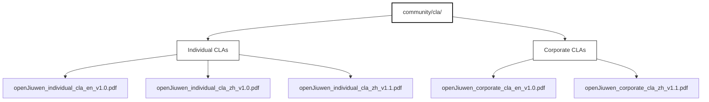
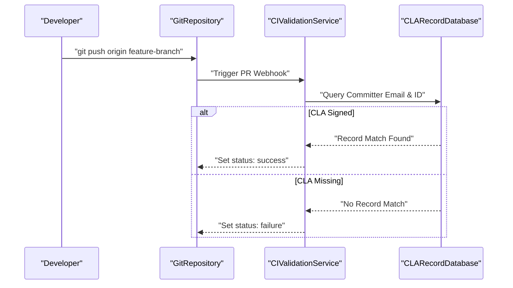

<!-- source: DeepWiki mcp.deepwiki.com · repo openJiuwen-ai/community · page 4.2 CLA Signing · fetched 2026-11-02 -->

# CLA Signing

<details>
<summary>Relevant source files</summary>

The following files were used as context for generating this wiki page:

- [cla/openJiuwen_corporate_cla_en_v1.0.pdf](cla/openJiuwen_corporate_cla_en_v1.0.pdf)
- [cla/openJiuwen_corporate_cla_zh_v1.1.pdf](cla/openJiuwen_corporate_cla_zh_v1.1.pdf)
- [cla/openJiuwen_individual_cla_en_v1.0.pdf](cla/openJiuwen_individual_cla_en_v1.0.pdf)
- [cla/openJiuwen_individual_cla_zh_v1.0.pdf](cla/openJiuwen_individual_cla_zh_v1.0.pdf)
- [cla/openJiuwen_individual_cla_zh_v1.1.pdf](cla/openJiuwen_individual_cla_zh_v1.1.pdf)
- [contribute/style-guide/figures/heading-edit-style.png](contribute/style-guide/figures/heading-edit-style.png)
- [contribute/style-guide/figures/heading-preview-style.png](contribute/style-guide/figures/heading-preview-style.png)
- [zh/content/image/cla_fail.png](zh/content/image/cla_fail.png)
- [zh/content/image/cla_success.png](zh/content/image/cla_success.png)
- [zh/content/image/commit_author_email.png](zh/content/image/commit_author_email.png)
- [zh/content/image/fork_pr.png](zh/content/image/fork_pr.png)

</details>


## Purpose and Scope
This page details the Contributor License Agreement (Sm) governance framework within the openJiuwen community repository (`https://github.com/openJiuwen-ai/community`). It covers the taxonomy of Individual and Corporate CLA documents located in the `cla/` directory across English (`en`) and Chinese (`zh`) languages in versions `v1.0` and `v1.1`, outlines the operational workflow for signing and validation, and provides diagnostic procedures for troubleshooting automated CLA check failures utilizing community UI artifacts (`zh/content/image/cla_fail.png`, `zh/content/image/cla_success.png`).

---

## 1. CLA Document Taxonomy & Structure

The openJiuwen community enforces legal intellectual property protections through distinct CLA documents stored in the repository's root `cla/` directory. Contributors must execute either an Individual CLA or a Corporate CLA depending on their contribution capacity.

### Individual vs. Corporate CLA Variants
* **Individual CLA (v1.0 & v1.1)**: Designed for natural persons contributing on their own behalf. 
  * `[cla/openJiuwen_individual_cla_en_v1.0.pdf:1-15]()`
  * `[cla/openJiuwen_individual_cla_zh_v1.0.pdf:1-10]()`
  * `[cla/openJiuwen_individual_cla_zh_v1.1.pdf:1-10]()`
* **Corporate CLA (v1.0 & v1.1)**: Designed for entities whose employees contribute code on behalf of the organization, binding corporate intellectual property rights.
  * `[cla/openJiuwen_corporate_cla_en_v1.0.pdf:1-5]()`
  * `[cla/openJiuwen_corporate_cla_zh_v1.1.pdf:1-10]()`


*Figure 1: Directory mapping of legal CLA assets from Natural Language Space to repository code structures.*

Sources: `[cla/openJiuwen_individual_cla_zh_v1.1.pdf:1-10]`, `[cla/openJiuwen_corporate_cla_en_v1.0.pdf:1-5]()`

---

## 2. CLA Usage & Verification Workflow

When a pull request is submitted via `[zh/content/image/fork_pr.png:1-10]`, the automated continuous integration (CI) gate triggers a CLA verification service. This service inspects the commit author metadata (`[zh/content/image/commit_author_email.png:1-10]()`) against the registered database of signed CLA records.


*Figure 2: Data flow and execution path for automated CLA validation checks.*

Sources: `[zh/content/image/fork_pr.png:1-10]`, `[zh/content/image/commit_author_email.png:1-10]()`

---

## 3. Troubleshooting CLA Check Failures

If a contributor fails the automated CLA verification, the PR status check displays a failure indicator as captured in `[zh/content/image/cla_fail.png:1-10]()`. Successful validation yields the status shown in `[zh/content/image/cla_success.png:1-10]()`.

### Common Failure Modes and Remediation

1. **Unsigned Status**: The submitter has not executed the required CLA document (`[cla/openJiuwen_individual_cla_zh_v1.1.pdf:1-10]()`).
   * *Fix*: Complete the online portal registration matching either individual or corporate terms.
2. **Commit Email Mismatch**: The email address configured in local git settings (`user.email`) does not match the email registered during CLA signing (`[zh/content/image/commit_author_email.png:1-10]()`).
   * *Fix*: Update local git config and amend previous commits:
     ```bash
     git config user.name "Your Name"
     git config user.email "registered@example.com"
     git commit --amend --reset-author
     git push --force-with-lease
     ```
3. **Corporate Authorization Pending**: The contributor's corporate domain has not been added to the approved whitelist under the corporate CLA (`[cla/openJiuwen_corporate_cla_zh_v1.1.pdf:1-10]()`).
   * *Fix*: Contact the corporate CLA administrator to append the employee email domain to the entity manifest.

Sources: `[zh/content/image/cla_fail.png:1-10]`, `[zh/content/image/cla_success.png:1-10]`, `[zh/content/image/commit_author_email.png:1-10]()`

---

