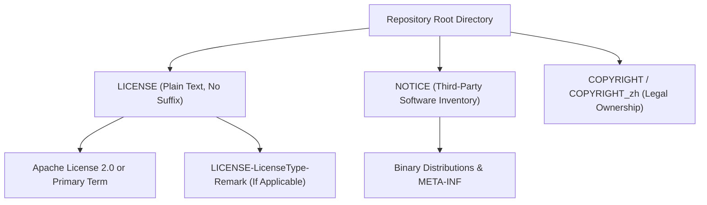
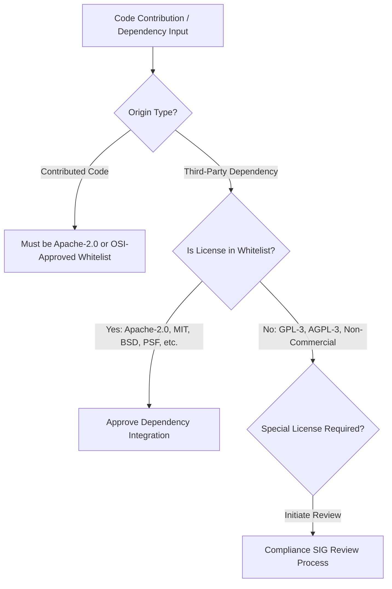
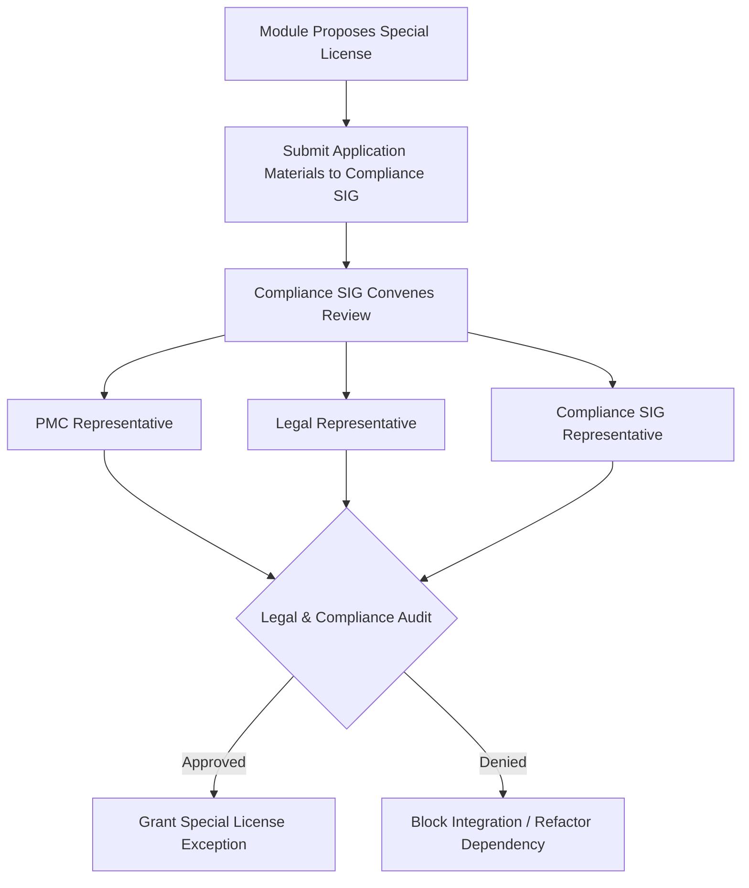
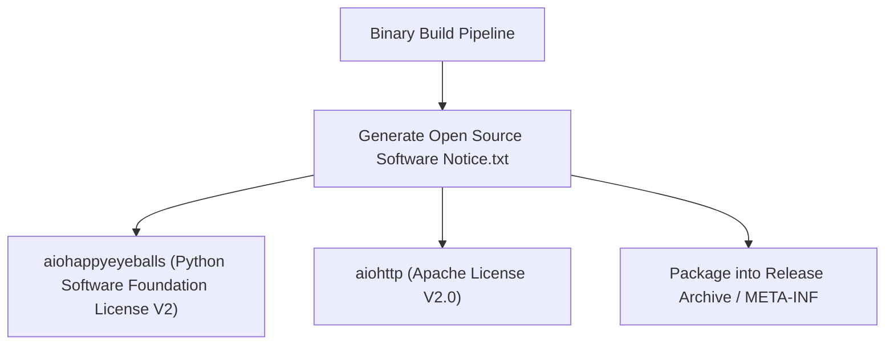

<!-- source: DeepWiki mcp.deepwiki.com · repo openJiuwen-ai/community · page 4.3 Licensing & Copyright Policy · fetched 2026-11-02 -->

# Licensing & Copyright Policy

<details>
<summary>Relevant source files</summary>

The following files were used as context for generating this wiki page:

- [COPYRIGHT](COPYRIGHT)
- [COPYRIGHT_zh](COPYRIGHT_zh)
- [LICENSE](LICENSE)
- [Open Source Software Notice.txt](Open Source Software Notice.txt)
- [contribute/License-and-Copyright-Guidelines.md](contribute/License-and-Copyright-Guidelines.md)
- [contribute/License-and-Special-License-Review-Guidelines.md](contribute/License-and-Special-License-Review-Guidelines.md)
- [contribute/README.md](contribute/README.md)
- [contribute/style-guide/openJiuwen-JavaScript-coding-style-guide.md](contribute/style-guide/openJiuwen-JavaScript-coding-style-guide.md)
- [contribute/the_open_source_definition_zh.md](contribute/the_open_source_definition_zh.md)
- [openJiuwen-Community-Code-of-Conduct.md](openJiuwen-Community-Code-of-Conduct.md)

</details>


## Purpose & Scope

The openJiuwen community enforces strict licensing and copyright governance to ensure that all core repositories, contributed code, and third-party dependencies comply with open-source definitions and legal standards. These guidelines govern repository root files, source code headers, third-party dependency whitelists, and special license review procedures.

The scope of this policy covers all code repositories hosted within the openJiuwen community hosting address (`https://gitcode.com/openJiuwen`) [contribute/License-and-Special-License-Review-Guidelines.md:13-16] and distributed project code or third-party dependencies [contribute/License-and-Copyright-Guidelines.md:9-10], [contribute/License-and-Special-License-Review-Guidelines.md:8-10]. It does not apply to external end-product development or standalone third-party software distribution [contribute/License-and-Copyright-Guidelines.md:9-10].

Sources:
- `contribute/License-and-Copyright-Guidelines.md:1-11`
- `contribute/License-and-Special-License-Review-Guidelines.md:3-16`

---

## 1. Repository Structure & Core Compliance Files

Every open-source repository in the openJiuwen community must contain standardized compliance files in its root directory [contribute/License-and-Copyright-Guidelines.md:17-27]. 

* **`LICENSE` File**: Must be in plain-text format, placed in the repository root directory without any suffix (such as `.md` or `.txt`) [contribute/License-and-Copyright-Guidelines.md:17-19]. Repositories typically adopt the Apache License 2.0 (e.g., `agent-core`) [contribute/License-and-Copyright-Guidelines.md:18]. If multiple licenses apply to internal components, the primary license resides in `LICENSE`, while additional licenses are named `LICENSE-LicenseType-Remark` [contribute/License-and-Copyright-Guidelines.md:20].
* **`NOTICE` File**: Required when distributed binary files contain third-party open-source software [contribute/License-and-Copyright-Guidelines.md:24-25]. It must list the software names, versions, rights-holder statements, and license information [contribute/License-and-Copyright-Guidelines.md:25]. In Java archives (`.jar`), this is typically placed in the `META-INF` directory [contribute/License-and-Copyright-Guidelines.md:22,26].
* **`COPYRIGHT` / `COPYRIGHT_zh` Files**: Establish the legal copyright ownership for the repository assets (e.g., `Copyright (c) Huawei Technologies Co., Ltd. 2025. All rights reserved.` / `版权所有 (c) 华为技术有限公司 2025。保留一切权利。`) [COPYRIGHT:1-1], [COPYRIGHT_zh:1-1].


*Sources: `contribute/License-and-Copyright-Guidelines.md:17-27`, `LICENSE:1-10`, `COPYRIGHT:1-1`, `COPYRIGHT_zh:1-1`*

---

## 2. Copyright and License Headers

Source code files across openJiuwen repositories must include explicit copyright and license headers, with specific exceptions [contribute/License-and-Copyright-Guidelines.md:29-34]:
1. **Exemptions**: Files where headers disrupt syntax (e.g., JSON files), auto-generated files containing tool metadata, and short user documentation files (e.g., `README.md`) [contribute/License-and-Copyright-Guidelines.md:30-33].
2. **Copyright Statement Format**: 
   ```text
   Copyright (C) [Year of first release]-[Year of current version release] [Copyright owner]
   ```
   *Note: For first-time releases, only the release year is required; subsequent versions use the range format [contribute/License-and-Copyright-Guidelines.md:37-41,88]. The copyright owner must be a legal entity or company representing the contributor [contribute/License-and-Copyright-Guidelines.md:90].*
3. **License Header Format**: Apache License 2.0 or BSD-3-Clause headers must be explicitly embedded at the top of source files following the templates defined in guidelines [contribute/License-and-Copyright-Guidelines.md:42-84].

Sources:
- `contribute/License-and-Copyright-Guidelines.md:29-93`

---

## 3. Contributed Code & Third-Party License Whitelists

The openJiuwen community adheres strictly to the Open Source Definition (OSD) [contribute/License-and-Special-License-Review-Guidelines.md:3-5], encompassing principles such as free redistribution, source code accessibility, derived works integrity, and technological neutrality [contribute/the_open_source_definition_zh.md:8-48].

### Contributed Code Whitelist
All contributed code must be provided in source-code form and licensed under OSI-approved licenses, prioritizing [contribute/License-and-Special-License-Review-Guidelines.md:21-29]:
* **Apache License 2.0 (Apache-2.0)** [contribute/License-and-Special-License-Review-Guidelines.md:29]

### Third-Party Dependency Whitelist & Restricted Licenses
Third-party dependencies must have a clear upstream community and avoid license incompatibility issues [contribute/License-and-Special-License-Review-Guidelines.md:33].
* **Accepted Whitelist Examples**: Apache-2.0, MIT, BSD (2-clause/3-clause), BSL-1.0, Python Software Foundation License V2, Zlib/libpng, ISC, UPL-1.0, etc. [contribute/License-and-Special-License-Review-Guidelines.md:35-110].
* **Non-Recommended / Prohibited Licenses**: Licenses restricting commercial use or introducing unreasonable obligations are rejected, including GNU GPL 3, GNU AGPL 3, Commons Clause v1.0, Server Side Public License variants, and non-commercial Creative Commons licenses [contribute/License-and-Special-License-Review-Guidelines.md:111-134].


*Sources: `contribute/License-and-Special-License-Review-Guidelines.md:21-134`, `contribute/the_open_source_definition_zh.md:1-54`*

---

## 4. Special License Review Process

When a software module or dependency requires a license outside the established whitelists (a "special license"), it must undergo a formalized review workflow organized by community governance bodies [contribute/License-and-Special-License-Review-Guidelines.md:135-151].

### Review Organization & Participants
* **Organizer**: `Compliance_SIG` (openJiuwen Compliance Special Interest Group) [contribute/License-and-Special-License-Review-Guidelines.md:145-146].
* **Mandatory Representatives**: 
  - `PMC_Representative` (Project Management Committee) [contribute/License-and-Special-License-Review-Guidelines.md:145-146]
  - `Legal_Representative` (Legal Counsel) [contribute/License-and-Special-License-Review-Guidelines.md:145-146]
  - `Compliance_SIG_Representative` [contribute/License-and-Special-License-Review-Guidelines.md:145-146]


*Sources: `contribute/License-and-Special-License-Review-Guidelines.md:135-152`*

---

## 5. Third-Party Notices & Binary Distribution

Binary distributions generated within openJiuwen must bundle comprehensive third-party open-source notices (`Open Source Software Notice.txt`) [Open Source Software Notice.txt:1-4]. These notices override internal end-user agreements and detail individual component licenses, copyright holders, and software versions (e.g., `aiohappyeyeballs`, `aiohttp`) [Open Source Software Notice.txt:3,9-28].


*Sources: `Open Source Software Notice.txt:1-44`, `contribute/License-and-Copyright-Guidelines.md:21-27`*

---

