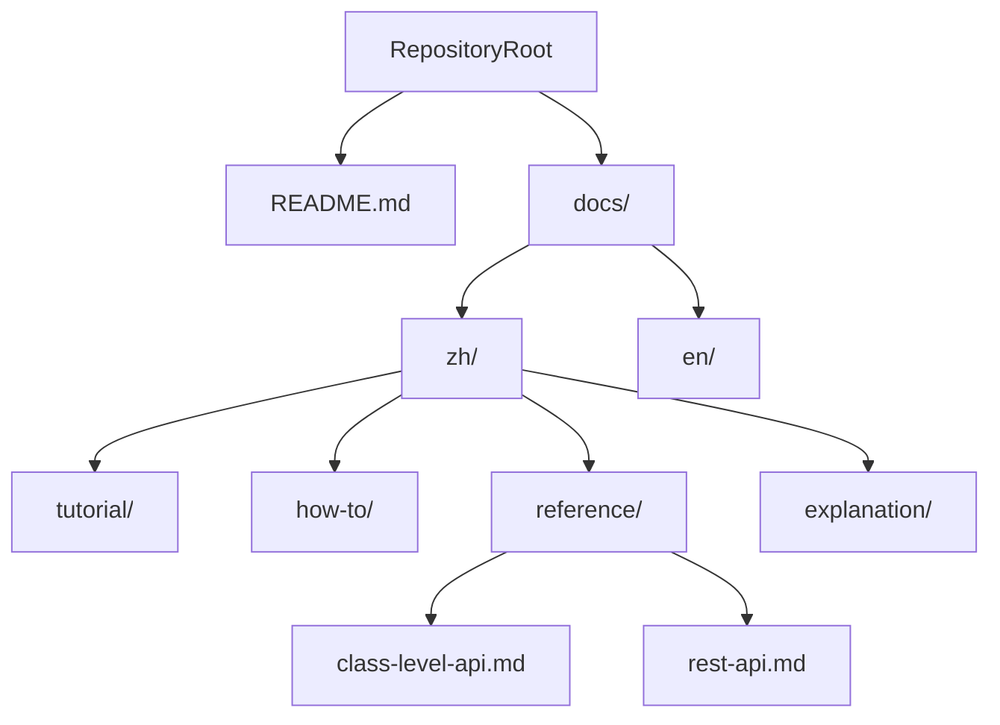
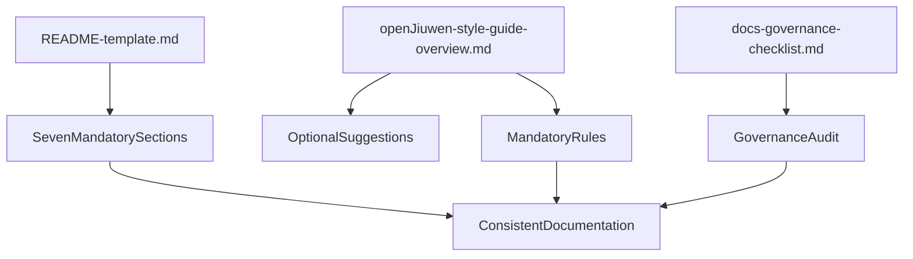

<!-- source: DeepWiki mcp.deepwiki.com · repo openJiuwen-ai/community · page 5 Documentation Standards · fetched 2026-11-02 -->

# Documentation Standards

Relevant source files

The following files were used as context for generating this wiki page:

- [contribute/style-guide/openJiuwen-style-guide-overview.md](contribute/style-guide/openJiuwen-style-guide-overview.md)
- [contribute/template/README-template.md](contribute/template/README-template.md)
- [contribute/template/docs-directory-structure.md](contribute/template/docs-directory-structure.md)
- [contribute/template/docs-governance-checklist.md](contribute/template/docs-governance-checklist.md)

The documentation standards framework for the openJiuwen community governs repository documentation quality, structure, and style across all project repositories. By establishing uniform requirements—such as the mandatory seven-section `README.md` structure [contribute/template/README-template.md:1-74](), the Diátaxis-based `docs/` layout [contribute/template/docs-directory-structure.md:1-58](), and comprehensive style guides [contribute/style-guide/openJiuwen-style-guide-overview.md:1-23]()—the community ensures that users and contributors can easily navigate, understand, and extend the openJiuwen AI Agent platform.

For detailed instructions, rules, and self-inspection tools, refer to the child pages:
- [Docs Structure & Governance Checklist](#5.1) — Covers the seven-section README template, `docs/zh` & `docs/en` Diátaxis directory rules, SDK versus service reference layouts, and the governance self-inspection checklist.
- [Style Guides](#5.2) — Covers openJiuwen style guides, language styles, content elements, document structure, and governance rules.

---

## 5.1 Docs Structure & Governance Checklist

Documentation governance in openJiuwen relies on rigorous structural consistency. Every repository must maintain a standardized root `README.md` containing seven essential sections: project identity/positioning, core features, related links, environment requirements, installation guide, quick start, and license declarations [contribute/template/README-template.md:1-74](). 

For user-facing documentation, repositories adopt the Diátaxis framework under `docs/zh/` (as the authoritative Chinese source) and `docs/en/` (as the symmetric English translation) [contribute/template/docs-directory-structure.md:24-54](). The directory structure splits content into four distinct categories:
- `tutorial/`: Learning-oriented guides with numeric prefixes (e.g., `01-quick-start.md`) [contribute/template/docs-directory-structure.md:28-31]().
- `how-to/`: Task-oriented guides with semantic naming (e.g., `configure-mcp.md`) [contribute/template/docs-directory-structure.md:33-38]().
- `reference/`: Information-oriented technical specs and API references [contribute/template/docs-directory-structure.md:39-43]().
- `explanation/`: Understanding-oriented architectural overviews and design decisions [contribute/template/docs-directory-structure.md:44-47]().

Furthermore, reference layouts differ between SDK repositories (which emphasize class-level API breakdowns under `docs/zh/reference/{package-name}/`) and service repositories (which emphasize REST endpoints and OpenAPI specs) [contribute/template/docs-directory-structure.md:66-87](). SIGs use the governance self-inspection checklist to audit compliance across minimum closure, README sections, Diátaxis categories, and navigation rules [contribute/template/docs-governance-checklist.md:1-102]().

For detailed templates and audit rules, see [Docs Structure & Governance Checklist](#5.1).

Title: Documentation Structure and Diátaxis Mapping

Sources: [contribute/template/README-template.md:1-74](), [contribute/template/docs-directory-structure.md:1-87]()

---

## 5.2 Style Guides

The openJiuwen style guides govern language style, terminology, document structure, and content elements to maintain a professional, consistent documentation ecosystem [contribute/style-guide/openJiuwen-style-guide-overview.md:1-5](). The guide distinguishes between mandatory **Rules** (must be followed) and optional **Suggestions** (recommended practices) [contribute/style-guide/openJiuwen-style-guide-overview.md:16-22](). 

Contributors are encouraged to select the most appropriate writing templates from the openJiuwen documentation repository and adhere to continuous revision guidelines that update terminology, clarity standards, and formatting constraints [contribute/style-guide/openJiuwen-style-guide-overview.md:10-28]().

For detailed language rules and formatting specifications, see [Style Guides](#5.2).

Title: Documentation Governance and Style Framework

Sources: [contribute/style-guide/openJiuwen-style-guide-overview.md:1-28](), [contribute/template/docs-governance-checklist.md:1-102]()

---

