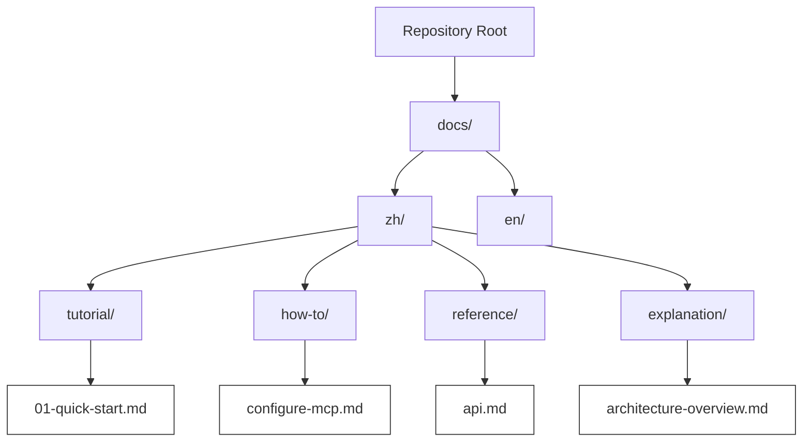
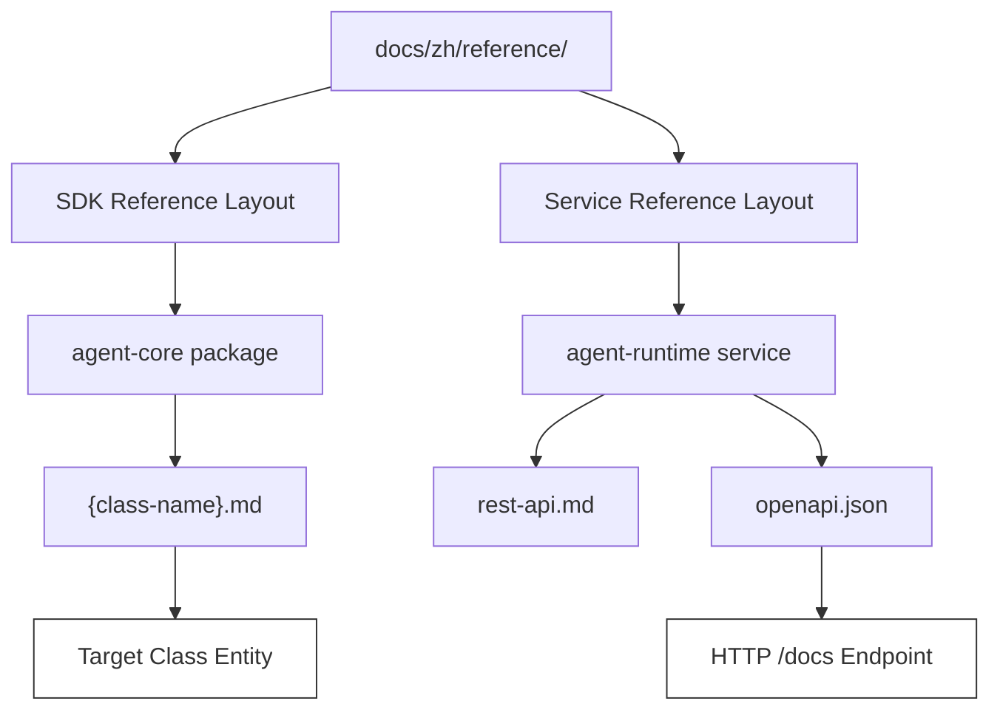

<!-- source: DeepWiki mcp.deepwiki.com · repo openJiuwen-ai/community · page 5.1 Docs Structure & Governance Checklist · fetched 2026-11-02 -->

# Docs Structure & Governance Checklist

<details>
<summary>Relevant source files</summary>

The following files were used as context for generating this wiki page:

- [contribute/template/README-template.md](contribute/template/README-template.md)
- [contribute/template/docs-directory-structure.md](contribute/template/docs-directory-structure.md)
- [contribute/template/docs-governance-checklist.md](contribute/template/docs-governance-checklist.md)

</details>


This page defines the documentation governance standards, directory layouts, and inspection checklists for all repositories within the openJiuwen AI Agent platform community. It covers the mandatory seven-section `README.md` template, the Diátaxis-based `docs/` directory rules for Chinese (`docs/zh`) and English (`docs/en`) parity, structural differences between SDK and service reference layouts, and the community's governance self-inspection checklist.

Sources: [contribute/template/README-template.md:1-93](), [contribute/template/docs-directory-structure.md:1-109](), [contribute/template/docs-governance-checklist.md:1-102]()

---

## 1. README Seven-Section Template

Every repository in the openJiuwen ecosystem must maintain a standardized `README.md` at the root directory. Chinese (`README.md` or `README_zh.md`) serves as the authoritative source, with English following symmetrically. Both must maintain exact version and parameter alignment [contribute/template/README-template.md:3-8].

The template mandates seven core sections alongside optional expansion modules:

1. **Project Title & One-Line Positioning**: Clear statement of what the repository is in under one line [contribute/template/README-template.md:1-10].
2. **Core Characteristics (`## 核心特性`)**: 3 to 5 bullet points highlighting primary capabilities [contribute/template/README-template.md:12-18].
3. **Related Documentation (`## 相关文档`)**: Minimal link section pointing strictly to internal repository paths (`docs/`, `examples/`, `CHANGELOG.md`) rather than external websites [contribute/template/README-template.md:20-28].
4. **Environment Requirements (`## 环境要求`)**: Dependency matrix specifying operating system, language runtime versions (matching build files like `pom.xml`, `pyproject.toml`, or `package.json`), and external library constraints [contribute/template/README-template.md:29-39].
5. **Installation Guide (`## 安装指南`)**: Minimal install commands (`pip install`, `mvn install`, `docker pull`) and source clone/build workflows [contribute/template/README-template.md:40-53].
6. **Quick Start (`## Quick Start`)**: Copy-pasteable runnable example code with configuration blocks commented for parameter substitution (e.g., API keys) and expected outputs [contribute/template/README-template.md:54-68].
7. **License (`## License`)**: Explicit open-source licensing declaration referencing [Apache License 2.0](LICENSE) [contribute/template/README-template.md:69-72].

Optional expansion modules include Badges, Architecture Design summaries, Configuration details, and Contribution entry points [contribute/template/README-template.md:75-94].

Sources: [contribute/template/README-template.md:1-93]()

---

## 2. Diátaxis Documentation Directory Layout

To prevent unstructured documentation sprawling, openJiuwen mandates the **Diátaxis** framework across all repository `docs/` directories. Documentation is strictly categorized into four quadrants: **Tutorials**, **How-to Guides**, **Reference**, and **Explanation** [contribute/template/docs-directory-structure.md:1-48].

```
RepositoryRoot/
├── README.md
├── LICENSE
├── CHANGELOG.md
├── CONTRIBUTING.md
├── examples/                  # Runnable sample projects
│   └── {example-name}/
├── docs/                      # User documentation (Diátaxis 4 quadrants)
│   ├── README.md              # Documentation entry portal & navigation
│   ├── zh/                    # Authoritative Chinese source
│   │   ├── tutorial/          # "I want to learn" (Numeric prefixed: 01-, 02-)
│   │   ├── how-to/            # "I want to do" (Semantic names, unnumbered)
│   │   ├── reference/         # "I want to look up" (Semantic names, unnumbered)
│   │   └── explanation/       # "I want to understand" (Semantic names, unnumbered)
│   └── en/                    # English translation (Symmetric structure)
└── design/                    # Optional internal development design drafts
```

* **Tutorials (`tutorial/`)**: Learning-oriented step-by-step lessons for beginners, strictly using numeric prefixes (e.g., `01-quick-start.md`, `02-first-agent.md`) to establish reading order [contribute/template/docs-directory-structure.md:28-31].
* **How-to Guides (`how-to/`)**: Problem-oriented practical recipes (e.g., `configure-llm.md`, `configure-mcp.md`, `deploy-service.md`) using semantic, unnumbered names [contribute/template/docs-directory-structure.md:33-38].
* **Reference (`reference/`)**: Information-oriented technical descriptions (API specs, configuration tables, error codes) using unnumbered semantic names [contribute/template/docs-directory-structure.md:39-43].
* **Explanation (`explanation/`)**: Understanding-oriented theoretical analysis (architecture overviews, design decisions, key concepts) [contribute/template/docs-directory-structure.md:44-47].

Sources: [contribute/template/docs-directory-structure.md:1-65]()

### Diagram: Repository Documentation Structure Mapping
This diagram maps the natural language documentation intent to the concrete file entity space in an openJiuwen repository.


Sources: [contribute/template/docs-directory-structure.md:24-54]()

---

## 3. SDK Reference vs. Service Reference Layouts

The `reference/` directory layout bifurcates depending on whether the repository is a client-side SDK library or a backend service runtime [contribute/template/docs-directory-structure.md:66-91].

### SDK Repositories (`agent-core`, `agent-core-java`, `agent-memory`)
SDK reference directories organize technical specifications by package and class hierarchies, documenting method signatures, parameters, and return types [contribute/template/docs-directory-structure.md:70-78]:
```
docs/zh/reference/
├── {package-name}/
│   ├── README.md
│   └── {class-name}.md       # Class-level API spec (signatures, params, returns)
└── config-params.md          # Configuration parameter table
```

### Service Repositories (`agent-runtime`, `agent-runtime-java`, `agent-studio`)
Service reference directories utilize dual-track reporting: a concise Markdown REST API summary stored in documentation, complemented by automated OpenAPI specifications generated by the runtime service endpoints [contribute/template/docs-directory-structure.md:80-91]:
```
docs/zh/reference/
├── rest-api.md               # Concise REST API reference with typical request/response
├── openapi.json              # OpenAPI machine-readable specification export
└── error-codes.md            # System error code dictionary
```

Sources: [contribute/template/docs-directory-structure.md:66-91]()

### Diagram: SDK vs Service Reference Code Entity Mapping
This diagram bridges the conceptual API reference models to their respective code entity generation paths in SDK and service codebases.


Sources: [contribute/template/docs-directory-structure.md:66-91]()

---

## 4. Governance Self-Inspection Checklist

SIG maintainers use a structured self-inspection checklist (`docs-governance-checklist.md`) divided into seven validation dimensions. Items are flagged as either mandatory rules (`【规则】`) or optional recommendations (`【建议】`) [contribute/template/docs-governance-checklist.md:1-8]:

| Dimension | Scope & Key Rules |
| :--- | :--- |
| **1. Minimum Closure** | Installation guide exists (`1.1`), Quick Start runnable code exists (`1.2`), `examples/` project exists (`1.3`), new user 30-minute benchmark test (`1.4`) [contribute/template/docs-governance-checklist.md:8-16]. |
| **2. README Seven Sections** | All 7 structural blocks present (`2.1`–`2.7`), version synchronization across build manifests (`2.8`), bilingual parameter alignment (`2.9`), internal documentation links (`2.10`), valid Quick Start scripts (`2.11`) [contribute/template/docs-governance-checklist.md:17-33]. |
| **3. Diátaxis Four Quadrants** | `tutorial`, `how-to`, `reference`, and `explanation` directories present (`3.1`–`3.4`), single category allocation (`3.5`), strict numeric prefixing for tutorials (`3.6`) [contribute/template/docs-governance-checklist.md:34-47]. |
| **4. Directory Rules** | kebab-case naming conventions (`4.3`), one file per topic (`4.4`), symmetric bilingual directory trees (`4.5`), root `LICENSE` placement (`4.6`) [contribute/template/docs-governance-checklist.md:48-60]. |
| **5. Documentation Navigation**| `docs/README.md` portal present and route-verified (`5.1`–`5.2`), zero temporary build artifacts (`5.3`) [contribute/template/docs-governance-checklist.md:61-68]. |
| **6. Quality Enhancements** | Reasonable byte sizing (`6.1`), API documentation coverage $\ge 80\%$ (`6.2`), update latency under 30 days (`6.3`) [contribute/template/docs-governance-checklist.md:69-77]. |
| **7. Governance Infrastructure** | `CHANGELOG.md` or Release management (`7.1`), `CONTRIBUTING.md` present (`7.2`), example README files (`7.3`), CI code-PR documentation enforcement (`7.5`) [contribute/template/docs-governance-checklist.md:78-88]. |

Sources: [contribute/template/docs-governance-checklist.md:1-102]()

---

