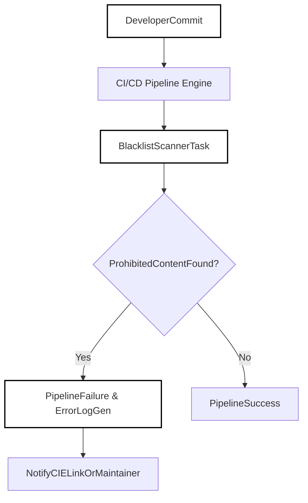
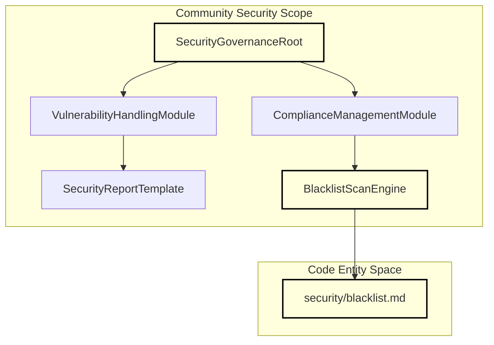

<!-- source: DeepWiki mcp.deepwiki.com · repo openJiuwen-ai/community · page 6 Security & Compliance · fetched 2026-11-02 -->

# Security & Compliance

Relevant source files

The following files were used as context for generating this wiki page:

- [security/blacklist.md](security/blacklist.md)

The Security & Compliance framework of the openJiuwen community establishes the security policies, vulnerability management protocols, secure development lifecycles, and compliance governance required across all repositories and agent platforms. This page serves as a high-level overview of community security processes, linking to detailed child pages for incident response and compliance workflows.

---

## 6.1 Vulnerability Handling & Disclosure

The openJiuwen community enforces a structured vulnerability handling and disclosure policy to ensure that security issues are reported, triaged, patched, and publicly disclosed safely. The process covers incident management, embargo periods, security advisory generation, and standardized reporting templates. 

For full details on the reporting workflow, severity classification, and disclosure templates, see the child page: [Vulnerability Handling & Disclosure](#6.1).

Sources: `[security/blacklist.md:1-47]()`

---

## 6.2 Blacklist & Compliance Management

The openJiuwen community maintains strict automated and manual controls to prevent the introduction of prohibited content, credentials, or licensing non-compliance issues into any repository or branch `[security/blacklist.md:9-20]()`. The community enforces a **blacklist scan** within CI/CD pipelines to catch policy violations, restricted terms, and confidential data `[security/blacklist.md:21-24]`.

### Pipeline Blacklist Verification Flow

*Figure 1: Pipeline integration of the blacklist scanning workflow.*

Sources: `[security/blacklist.md:21-46]()`

### Compliance & Prohibited Content Rules

1. **No Plaintext Prohibited Content**: Any repository or branch `[security/blacklist.md:10-14]` is strictly prohibited from containing plaintext political, pornographic, or violent content `[security/blacklist.md:11-13]`, LLM safety prompt lists, or compliance blacklist dictionaries `[security/blacklist.md:13]`.
2. **Confidential Information Protection**: Uploading internal corporate secrets, private keys, third-party NDAs, or proprietary domain names is forbidden `[security/blacklist.md:17-20]`.
3. **Failure Resolution**: If the automated pipeline scan fails, contributors must inspect the error log and coordinate with the repository CIE (Community Integration Engineer) or designated point of contact `[security/blacklist.md:23-24]`.

For complete details on compliance review, third-party software usage, and blacklist remediation, see the child page: [Blacklist & Compliance Management](#6.2).

Sources: `[security/blacklist.md:1-47]()`

---

## Security Governance Architecture

*Figure 2: Mapping community security governance elements to codebase entities.*

Sources: `[security/blacklist.md:1-47]()`

---

