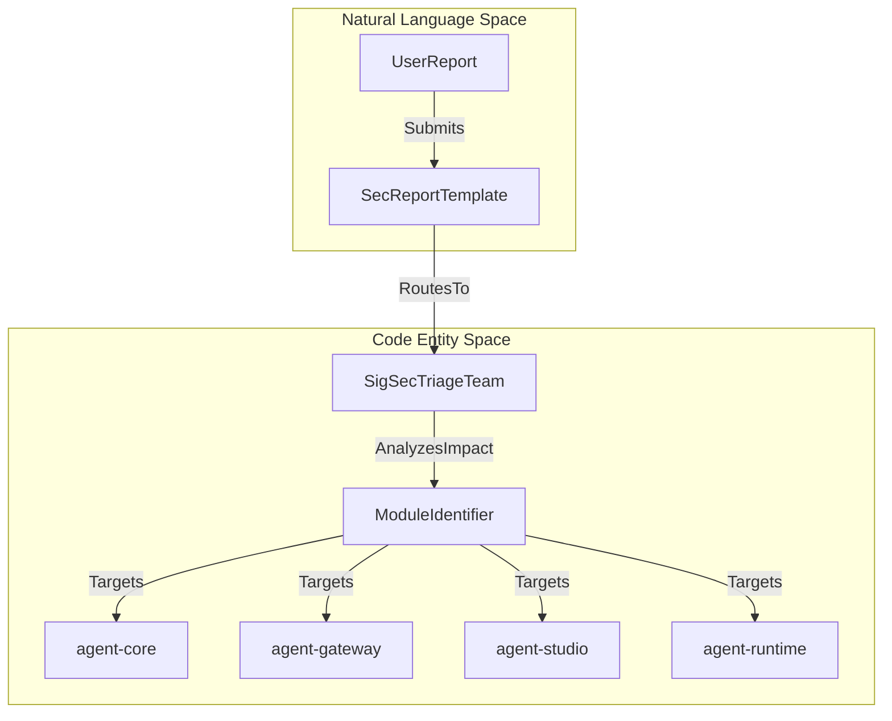
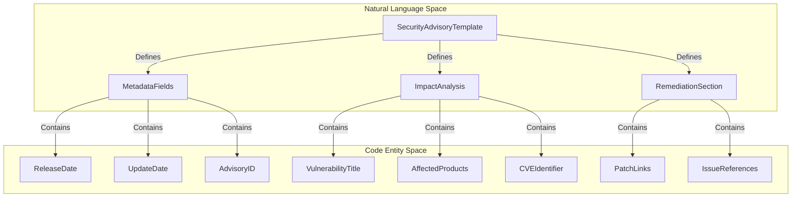

<!-- source: DeepWiki mcp.deepwiki.com · repo openJiuwen-ai/community · page 6.1 Vulnerability Handling & Disclosure · fetched 2026-11-02 -->

# Vulnerability Handling & Disclosure

Relevant source files

The following files were used as context for generating this wiki page:

- [contribute/template/sec-report-template_zh_cn.md](contribute/template/sec-report-template_zh_cn.md)
- [maillist.md](maillist.md)
- [security/disclosure.md](security/disclosure.md)
- [security/disclosure_Template.md](security/disclosure_Template.md)

The purpose of this section is to define the security vulnerability governance, reporting workflow, incident management, and disclosure policies for the openJiuwen AI Agent platform community. This document outlines how security researchers, maintainers, and users report, triage, patch, and publicly disclose vulnerabilities affecting community repositories and runtime components.

---

## 1. Vulnerability Reporting & Intake Workflow

The openJiuwen community maintains a standardized reporting mechanism for suspected security vulnerabilities. Reporters are requested to provide comprehensive context utilizing the official security report template to accelerate triage by the security response team (`sig-sec`).

The intake process ingests structured fields covering the reporter identity, environment, affected modules (such as core runtime or agent services), severity level, and technical reproduction steps.

### Security Reporting Template Structure

The security report template (`contribute/template/sec-report-template_zh_cn.md`) defines the following mandatory and optional data points required during initial intake:

| Field Name | Description & Expected Information |
| :--- | :--- |
| Reporter (`上报人`) | Name or handle of the individual reporting the issue. |
| Contact (`联系方式`) | Email or communication handle for secure correspondence. |
| Organization (`组织信息`) | Affiliation (Personal / Team / Company). |
| Version (`版本信息`) | Specific openJiuwen version or commit hash where the vulnerability was observed. |
| Severity (`问题级别`) | Categorized as Fatal (`致命问题`), Severe (`严重问题`), or General (`一般问题`). |
| Description (`问题描述`) | Concise summary of the vulnerability behavior. |
| Environment (`发生场景`) | Operating system, deployment mode, or runtime business context. |
| Affected Scope (`影响范围`) | Precise module identification (e.g., `agent-core`, `agent-gateway`, `agent-studio`). |
| Technical Details (`详细信息`) | CVE identifier if known; otherwise, attack methodology, proof-of-concept code, logs, and stack traces. |
| Remediation (`修复建议`) | Optional mitigation or patch recommendations proposed by the reporter. |

Sources: `contribute/template/sec-report-template_zh_cn.md:1-15`

### Vulnerability Intake to Module Mapping

Sources: `contribute/template/sec-report-template_zh_cn.md:1-15`, `security/disclosure.md:1-3`

---

## 2. Incident Management & Triage

Once a vulnerability report is received via private community channels, the security response team executes a structured incident management lifecycle:

1. **Receipt & Acknowledgement**: The security team acknowledges the report within a defined SLA window and verifies the authenticity of the claims.
2. **Severity Assessment**: Vulnerabilities are graded based on potential impact to confidentiality, integrity, and availability within distributed agent systems:
   * **Fatal (`致命问题`)**: Remote code execution (RCE) in `agent-runtime` or unauthorized administrative escalation across `agent-gateway`.
   * **Severe (`严重问题`)**: Denial of service (DoS) affecting multi-agent consensus or memory leakage in `agent-memory`.
   * **General (`一般问题`)**: Information disclosure with limited operational exposure.
3. **Internal Patch Development**: Maintainers develop and test fixes in a private fork before merging into protected branches.
4. **Coordinated Disclosure**: A security advisory and patched versions are simultaneously published.

Sources: `contribute/template/sec-report-template_zh_cn.md:1-15`, `security/disclosure.md:1-3`

---

## 3. Security Disclosure Policy & Templates

The openJiuwen community practices coordinated vulnerability disclosure. Security advisories are published under the `security/` directory using a standardized template structure to maintain clarity for downstream consumers.

### Advisory Template Architecture

The advisory template (`security/disclosure_Template.md`) establishes the required metadata format for all published security bulletins (`openJiuwenSA-20xx:xxxx`):

Sources: `security/disclosure_Template.md:1-25`, `security/disclosure.md:1-3`

### Security Advisory Schema (`security/disclosure_Template.md`)

When a vulnerability is resolved, an advisory document is structured as follows:

* **Header**: Advisory identifier (e.g., `openJiuwenSA-20xx:xxxx`), Release Date, and Update Date.
* **Title**: Concise summary of component and vulnerability type.
* **Description**: Technical explanation of the flaw and conditions required for exploitation.
* **Affected Products**: Enumeration of impacted packages and modules (e.g., `agent-core`, `agent-studio`, `agent-runtime-java`).
* **Patch Information**: Direct links to commits or pull requests resolving the issue.
* **CVE Reference**: Linked Common Vulnerabilities and Exposures record.
* **References**: Issue tracker links and auxiliary discussion threads.

Sources: `security/disclosure_Template.md:1-25`

---

## 4. Communication Channels & Contact Points

Secure and efficient communication is critical for vulnerability handling. The community designates specific mailboxes for security, legal, and operational coordination, as outlined in the community maillist configuration (`maillist.md`).

| Channel / Email | Role / Purpose | Operational Scope |
| :--- | :--- | :--- |
| `contact@openjiuwen.com` | Public Email | General community inquiries and daily communication. |
| `cla@openjiuwen.com` | CLA Related | Inquiries regarding Individual and Corporate Contributor License Agreements. |
| `legal@openjiuwen.com` | Legal Affairs WG | Compliance issues, licensing questions, and legal reporting. |

Sources: `maillist.md:1-18`

---

