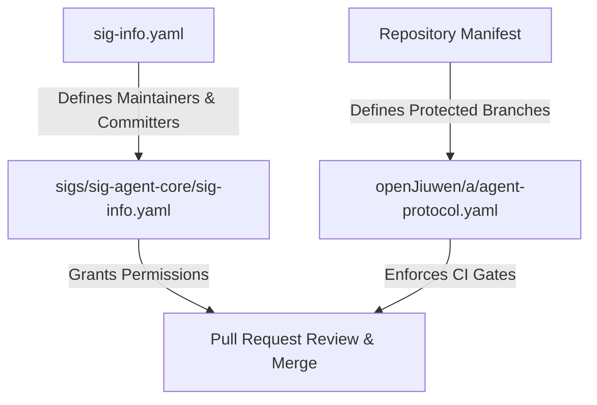
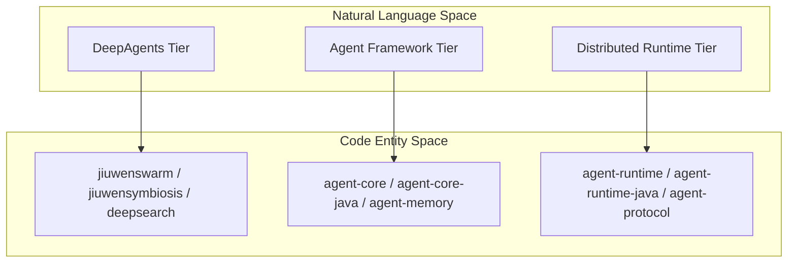
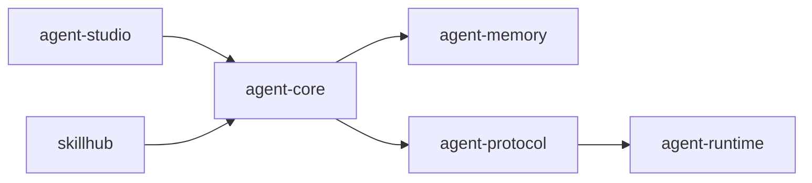

<!-- source: DeepWiki mcp.deepwiki.com · repo openJiuwen-ai/community · page 7 Glossary · fetched 2026-11-02 -->

# Glossary

Relevant source files

The following files were used as context for generating this wiki page:

- [README.md](README.md)
- [README_CN.md](README_CN.md)
- [contribute/template/README-template.md](contribute/template/README-template.md)
- [contribute/template/docs-directory-structure.md](contribute/template/docs-directory-structure.md)
- [contribute/template/docs-governance-checklist.md](contribute/template/docs-governance-checklist.md)
- [sigs/sig-agent-core/sig-info.yaml](sigs/sig-agent-core/sig-info.yaml)
- [sigs/sig-agent-protocol/openJiuwen/a/agent-protocol.yaml](sigs/sig-agent-protocol/openJiuwen/a/agent-protocol.yaml)
- [sigs/sig-agent-protocol/sig-info.yaml](sigs/sig-agent-protocol/sig-info.yaml)

## Purpose and Scope
This page defines core codebase-specific terminology, architectural components, governance structures, and operational standards used across the openJiuwen AI Agent platform ecosystem. It serves as a technical reference linking high-level conceptual terms to concrete code entities, metadata schemas, repository structures, and configuration manifests.

---

## 1. Community Governance & SIG Terminology

This section covers terms related to community organization, repository governance, metadata definitions, and contributor permissions.

* **SIG (Special Interest Group)**: A self-organized working group focused on a specific sub-project, architectural tier, or cross-cutting concern within the openJiuwen community. SIGs own specific repositories and manage their lifecycles.
* **sig-info.yaml**: A structured YAML metadata manifest located in each SIG directory (`sigs/`) that declares the group's scope, maturity level, maintainers, owned repositories, and committers [sigs/sig-agent-core/sig-info.yaml:1-55].
* **mature_level**: An indicator of a SIG's or module's production readiness and stability within the community lifecycle (e.g., `startup`) [sigs/sig-agent-core/sig-info.yaml:5].
* **atomgit_id**: The unique user handle assigned to community members on the AtomGit platform, utilized for access control and role assignments in `sig-info.yaml` [sigs/sig-agent-core/sig-info.yaml:7].
* **maintainer**: A community leader with administrative and merging privileges over a SIG's repositories, responsible for architectural oversight and roadmap direction [sigs/sig-agent-core/sig-info.yaml:6-14].
* **committer**: A trusted contributor authorized to review code and merge pull requests within specific repositories owned by a SIG [sigs/sig-agent-core/sig-info.yaml:18-22].
* **protected branch**: A Git branch configuration (such as `main` or `develop`) enforced via repository manifests (`openJiuwen/a/<repo>.yaml`) that requires status checks, signed commits, and pull request reviews before merging [sigs/sig-agent-protocol/openJiuwen/a/agent-protocol.yaml:3-7].
* **CLA (Contributor License Agreement)**: A legal agreement that contributors must execute via the `osinfra.cn` portal (`https://clasign.osinfra.cn/sign/68ee0908765718ad08bab9ee`) prior to contributing code to openJiuwen repositories [README_CN.md:112-118].

### Diagram: SIG Metadata to Repository Enforcement Flow

Sources: [sigs/sig-agent-core/sig-info.yaml:1-55](), [sigs/sig-agent-protocol/openJiuwen/a/agent-protocol.yaml:1-8]()

---

## 2. Platform Architecture & Modules

This section defines the architectural layers, repositories, and interoperability protocols that compose the openJiuwen AI Agent platform.

* **DeepAgents**: The top-level platform tier providing ready-to-use, complex multi-agent applications designed for specific scenarios such as swarm intelligence and deep research [README.md:20].
* **jiuwenswarm**: The flagship multi-agent collaboration framework and application repository supporting complex task collaboration and skill self-evolution [README.md:53-55].
* **jiuwensymbiosis**: An agent framework dedicated to embodied intelligence, supporting configuration-agnostic capability reuse and safety controls [README.md:57-59].
* **deepsearch**: A knowledge-augmented deep retrieval and research agent specialized in search, reasoning, and automated report generation [README.md:61-63].
* **skillhub**: A centralized skill hosting and distribution platform supporting skill publishing, version management, search, shared reuse, and private deployments [README.md:66-68].
* **agent-core**: The core Python Agent SDK providing multi-scenario interfaces for agent orchestration, task planning, loop execution, tool invocation, and context management [README.md:22, README_CN.md:81].
* **agent-memory**: The long-term memory subsystem supporting memory extraction, compression, hybrid retrieval, and autonomous evolution [README.md:88-90].
* **agent-runtime**: The Python-based distributed Agent runtime handling service-like execution, session tracking, and full lifecycle management [README.md:93-95].
* **agent-protocol**: An interoperability protocol SDK providing Model Context Protocol (MCP) bindings, Agent-to-Agent (A2A) communication primitives, and the A2X Registry [README_CN.md:101-103].
* **MCP (Model Context Protocol)**: Standardized protocol integration for external tool and context providers configured via documentation guidelines [contribute/template/docs-directory-structure.md:35].
* **A2A (Agent-to-Agent)**: Communication protocol enabling direct, structured message exchanges between autonomous agents across clusters [contribute/template/docs-directory-structure.md:37].
* **A2X Registry**: A unified registration and discovery component for cross-agent and service connections [README_CN.md:102].
* **AgentOS**: The underlying system service layer providing system-level security isolation sandboxes, global memory persistence, CLI system tools, and cross-agent communication buses [README.md:24].

### Diagram: Natural Language Architecture to Code Entity Space

Sources: [README.md:20-24](), [README_CN.md:52-103]()

### Diagram: Component Dependency & Interoperability Flow

Sources: [README.md:53-103]()

---

## 3. Documentation, Governance & Workflow

This section covers standards for documentation layout, verification checklists, commit conventions, and repository governance.

* **Diátaxis**: A systematic documentation framework dividing docs into four distinct modes: tutorials, how-to guides, reference documents, and explanations [contribute/template/docs-directory-structure.md:6].
* **minimum closure**: The foundational requirement that a repository must contain a complete, functional minimal set of files (e.g., a standard README, installation guide, Quick Start, and LICENSE) to be considered compliant [contribute/template/docs-governance-checklist.md:8].
* **Conventional Commits**: A standardized convention for commit message formatting (using prefixes like `feat:`, `fix:`, `docs:`) to automate release notes and versioning.
* **community bot commands**: Automated chatOps commands parsed in pull requests and issues (such as `/retest`, `/lgtm`, `/approve`) to drive CI gates and review workflows.

### Sources
Sources: [contribute/template/docs-directory-structure.md:1-60](), [contribute/template/docs-governance-checklist.md:1-102]()