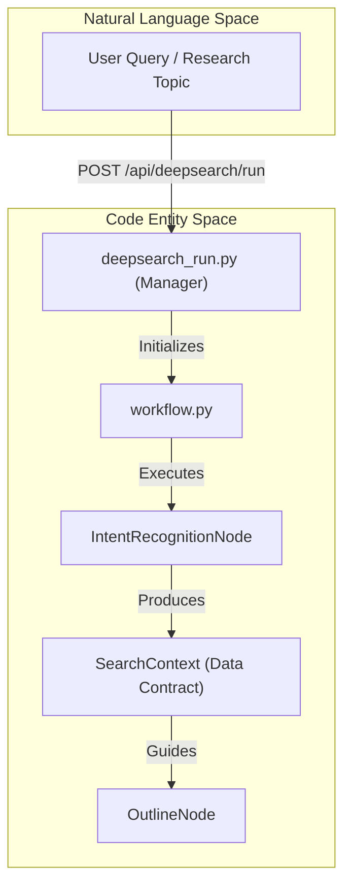
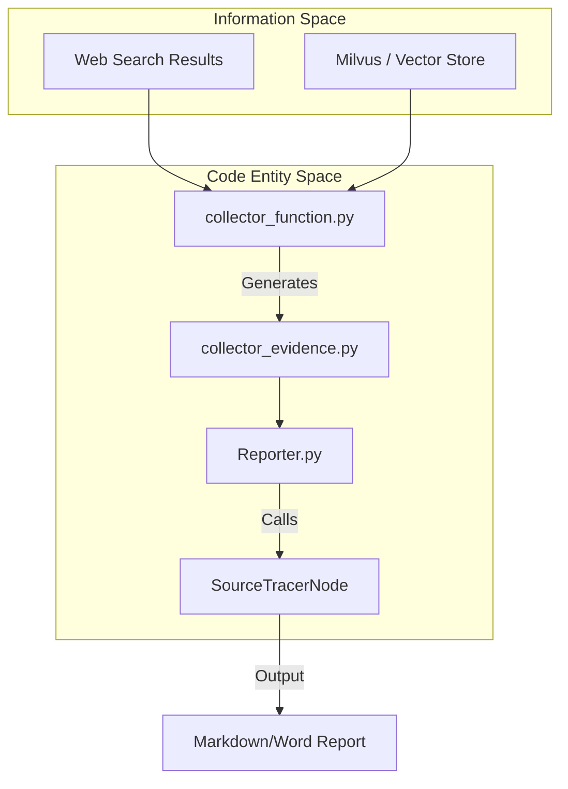

<!-- source: DeepWiki mcp.deepwiki.com · repo openJiuwen-ai/deepsearch · page 1 Overview · fetched 2026-11-02 -->

# Overview

Relevant source files

The following files were used as context for generating this wiki page:

- [README.md](README.md)
- [README_zh.md](README_zh.md)
- [deepsearch/README.md](deepsearch/README.md)
- [deepsearch/README_zh.md](deepsearch/README_zh.md)

**openJiuwen-DeepSearch** is a knowledge-augmented, high-performance deep retrieval and research engine [README.md:3-5](). It leverages the **openJiuwen agent-core** framework to coordinate a multi-agent system designed for complex reasoning, multi-step workflows, and professional report generation [README.md:5-9]().

The system is designed to bridge the gap between simple web searches and enterprise-grade research by integrating local knowledge bases with real-time web retrieval, all while maintaining rigorous segment-level provenance [README.md:20-32]().

## Key Capabilities

DeepSearch provides a suite of advanced features for technical and professional research:

*   **Example-driven Research**: Users can provide existing reports (PDF, Word, HTML, etc.) to extract structures and generate similar research documents [README.md:16-18]().
*   **Hybrid Retrieval**: Combines local vector/keyword/graph search with live web search to ensure comprehensive data coverage [README.md:20-23]().
*   **Human-in-the-Loop (HITL)**: Allows natural-language interaction during the planning phase to refine research outlines and intents [README.md:25-27]().
*   **Rich Visualization**: Automatically generates charts and figures within reports using VLM (Vision Language Model) pipelines [README.md:34-36]().
*   **Deep Provenance**: Every claim is backed by validated citations with segment-level traceability [README.md:29-31]().

Sources: [README.md:14-37](), [README_zh.md:12-34]()

## System Architecture

The architecture is built on the **openJiuwen agent-core** and is divided into several major functional layers. At its center is the **Manager**, which orchestrates agents across the research lifecycle [README.md:40-46]().

### High-Level Subsystems

| Subsystem | Responsibility |
| :--- | :--- |
| **Manager** | Agent creation, workflow orchestration, and state management [README.md:46](). |
| **Query Planning** | Intent recognition, task decomposition, and structural planning [README.md:47](). |
| **Knowledge Retrieval** | Hybrid search (local + web) and offline knowledge construction [README.md:48](). |
| **Analysis** | Evaluation, refinement, and fusion of retrieved information [README.md:49](). |
| **Generation** | Report synthesis, interactive editing, and provenance tracing [README.md:50](). |

For a deep dive into the framework and orchestration logic, see **[System Architecture and Key Concepts (#1.1)]**.

Sources: [README.md:38-50](), [README_zh.md:36-46]()

## Code Entity Mapping

The following diagrams illustrate how high-level research concepts map to specific code entities and data structures within the repository.

### From Intent to Workflow Execution
This diagram shows how a user's natural language query is processed by the core system components.

Sources: [README.md:46-47](), [README_zh.md:42-43]()

### Knowledge Retrieval and Synthesis
This diagram bridges the gap between raw information sources and the structured report generation components.

Sources: [README.md:48-50](), [README_zh.md:44-46]()

## Operational Context

DeepSearch is typically deployed as part of the **openJiuwen Studio** platform, which provides the UI and management layer [README.md:52](). Developers can also interact with the system via the **DeepSearch SDK** or the CLI [README.md:79]().

*   **Studio**: End-to-end platform for managing models, tools, and knowledge.
*   **DeepSearch SDK**: The core logic and API for integration into other applications.
*   **openJiuwen Ops**: Observability and tuning platform for the agents.

To learn how to set up and run the system, see **[Getting Started and CLI Usage (#1.2)]**.

Sources: [README.md:52-59](), [README_zh.md:48-55]()

---

