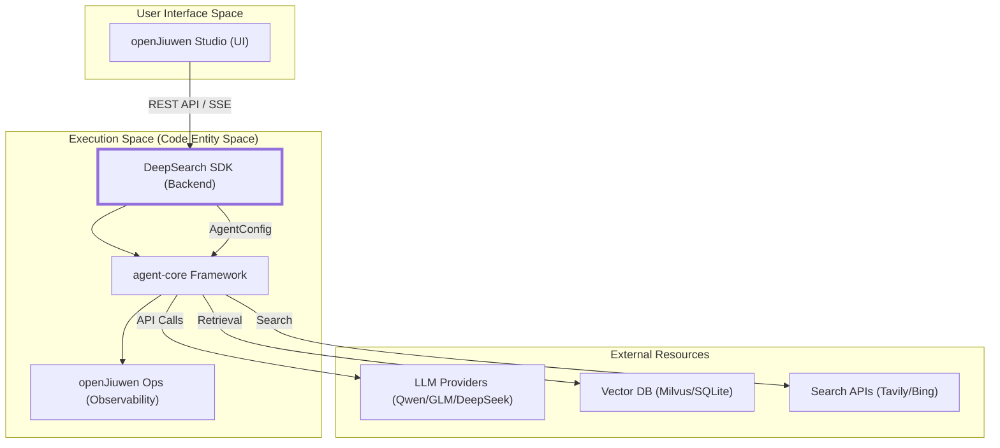
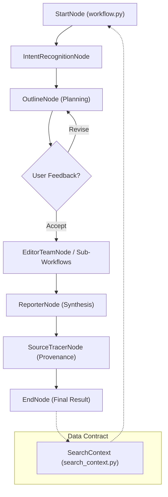

<!-- source: DeepWiki mcp.deepwiki.com · repo openJiuwen-ai/deepsearch · page 1.1 System Architecture and Key Concepts · fetched 2026-11-02 -->

# System Architecture and Key Concepts

Relevant source files

The following files were used as context for generating this wiki page:

- [README.md](README.md)
- [README_zh.md](README_zh.md)
- [deepsearch/docs/feature/framework/search-context.md](deepsearch/docs/feature/framework/search-context.md)
- [deepsearch/openjiuwen_deepsearch/framework/openjiuwen/agent/search_context.py](deepsearch/openjiuwen_deepsearch/framework/openjiuwen/agent/search_context.py)

This page describes the overall multi-agent architecture of openJiuwen-DeepSearch. It covers the framework's core components, the coordination between specialized agents, and the data contracts that enable complex research workflows.

## Multi-Agent Architecture Overview

openJiuwen-DeepSearch is built upon the **openJiuwen agent-core** framework [README.md:5-5]() [README.md:40-40](). It employs a hierarchical multi-agent design where a central **Manager** orchestrates specialized agents to perform query planning, information gathering, reasoning, and report generation [README.md:42-46]().

### Core Subsystems

The system is logically divided into five functional areas:
1.  **Manager**: Handles agent creation, workflow orchestration, and configuration management [README.md:46-46]().
2.  **Query Planning**: Responsible for intent recognition, task decomposition, and structural planning [README.md:47-47]().
3.  **Knowledge Retrieval**: Manages offline knowledge construction (parsing/indexing) and online hybrid retrieval (web + local KB) [README.md:48-48]().
4.  **Understanding & Analysis**: Evaluates and refines retrieved information to reduce noise and context costs [README.md:49-49]().
5.  **Result Generation**: Produces the final report with validated citations and visual charts [README.md:50-50]().

### System Component Relationship
The following diagram illustrates how the DeepSearch SDK interacts with the broader openJiuwen ecosystem.

**System Integration Diagram**

Sources: [README.md:40-59](), [deepsearch/docs/feature/framework/search-context.md:15-22]()

---

## Search Modes

DeepSearch supports three distinct execution modes tailored for different user needs:

| Mode | Description | Primary Use Case |
| :--- | :--- | :--- |
| **Research** | Full multi-agent workflow including planning, parallel/dependency-driven writing, and VLM chart generation. | Professional reports, financial analysis, academic research. |
| **Search** | Optimized for high-speed retrieval and direct answering using a search-specific agent. | Quick fact-finding, real-time news retrieval. |
| **React** | An iterative "Reason-Act" loop where the agent dynamically chooses tools to solve a query. | Complex tool-use tasks, multi-step calculations. |

Sources: [README.md:9-12](), [deepsearch/docs/feature/framework/search-context.md:15-22]()

---

## The Manager and Workflow Orchestration

The `workflow.py` file defines the execution logic of the system, while `AgentFactory` is responsible for instantiating the specific agents required for a given task.

### Manager Pattern
The Manager coordinates the lifecycle of a request:
1.  **Initialization**: `StartNode` creates the initial `SearchContext` and stores it in the global state [deepsearch/docs/feature/framework/search-context.md:36-36]().
2.  **Orchestration**: The workflow traverses nodes defined in `main_graph_nodes.py`, such as `IntentRecognitionNode` and `OutlineNode` [deepsearch/docs/feature/framework/search-context.md:27-27]().
3.  **State Management**: Progress is persisted via a `Session` object, allowing for Human-in-the-Loop (HITL) interruptions and resumptions [deepsearch/docs/feature/framework/search-context.md:11-12]().

**Workflow Logic Diagram**

Sources: [deepsearch/docs/feature/framework/search-context.md:36-40](), [deepsearch/openjiuwen_deepsearch/framework/openjiuwen/agent/search_context.py:158-172]()

---

## Data Contract: SearchContext

The `SearchContext` class is the central data structure (Pydantic model) that maintains the state of a research task across all nodes and sub-workflows [deepsearch/openjiuwen_deepsearch/framework/openjiuwen/agent/search_context.py:7-172]().

### Key Data Structures

*   **`SearchContext`**: The root object containing the user query, `ResearchIntent`, `Outline`, and the final `Report` [deepsearch/docs/feature/framework/search-context.md:15-19]().
*   **`ResearchIntent`**: Captures task type, comparison objects, temporal scopes, and domain constraints [deepsearch/openjiuwen_deepsearch/framework/openjiuwen/agent/search_context.py:51-57]().
*   **`Outline` & `Section`**: Represents the structured plan. Each `Section` contains `section_focus` and `focus_dimensions` to prevent redundancy between agents [deepsearch/openjiuwen_deepsearch/framework/openjiuwen/agent/search_context.py:65-100]().
*   **`FinalResult`**: The terminal state containing the `response_content`, `citation_messages` (provenance), and `chart_messages` (VLM visuals) [deepsearch/openjiuwen_deepsearch/framework/openjiuwen/agent/search_context.py:158-172]().

### Section Local Contract
To ensure consistency in parallel writing, the system generates a "Section Local Contract" for each sub-workflow using `Section.section_focus` and `focus_dimensions`. This restricts each agent to a specific analytical boundary [deepsearch/docs/feature/framework/search-context.md:50-50]().

| Field | Type | Description |
| :--- | :--- | :--- |
| `response_content` | `str` | The final Markdown report text. |
| `citation_messages` | `dict` | Global source tracing and citation data. |
| `infer_messages` | `List[Dict]` | Data for the inference-chain visualization. |
| `chart_messages` | `List[Dict]` | Metadata for VLM-generated charts. |

Sources: [deepsearch/openjiuwen_deepsearch/framework/openjiuwen/agent/search_context.py:158-172](), [deepsearch/docs/feature/framework/search-context.md:42-58]()

---

