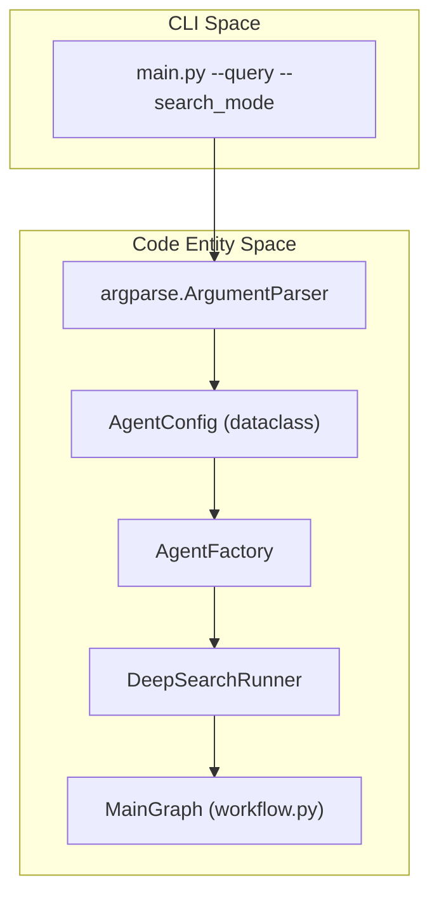
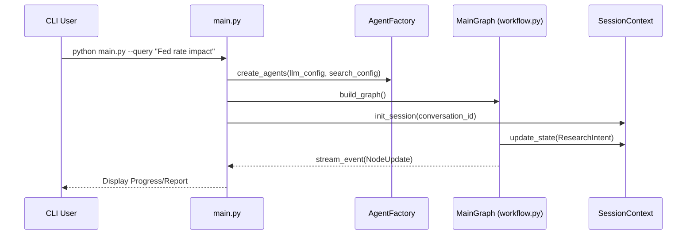

<!-- source: DeepWiki mcp.deepwiki.com · repo openJiuwen-ai/deepsearch · page 1.2 Getting Started and CLI Usage · fetched 2026-11-02 -->

# Getting Started and CLI Usage

Relevant source files

The following files were used as context for generating this wiki page:

- [README.md](README.md)
- [README_zh.md](README_zh.md)
- [deepsearch/README.md](deepsearch/README.md)

This page details how to execute the openJiuwen-DeepSearch system via the command-line interface (CLI) using `main.py`. It covers the configuration of LLMs, search engines, and vector databases, as well as the different operation modes and the internal question routing mechanism.

## CLI Entry Point and Arguments

The primary entry point for the DeepSearch SDK is `deepsearch/main.py`. It utilizes the `argparse` module to handle a comprehensive set of configuration parameters required for the multi-agent research workflow.

### Core Arguments

| Argument | Description | Default |
| :--- | :--- | :--- |
| `--query` | The research question or search query to process. | `None` |
| `--search_mode` | The research strategy to employ. Options: `research`, `search`, `react`. | `research` |
| `--execution_method` | Workflow orchestration style. Options: `parallel`, `dependency_driving`. | `parallel` |
| `--mode` | Operation mode. Options: `query`, `template`, `all`. | `query` |

### LLM Configuration

DeepSearch supports flexible LLM provider configuration. These arguments map to the `LLMConfig` used by the `AgentFactory` to instantiate model clients.

*   **`--llm_api_key`**: API key for the primary LLM provider.
*   **`--llm_base_url`**: Base URL for the LLM API (e.g., OpenAI-compatible endpoints).
*   **`--llm_model_name`**: The specific model identifier (e.g., `qwen-max`, `gpt-4o`).
*   **`--llm_provider`**: The provider type (e.g., `openai`, `dashscope`).

### Web Search and Milvus Configuration

To facilitate information gathering, the CLI allows configuring external search engines and local vector stores:

*   **`--search_api_key`**: API key for the web search provider (e.g., Bing, Google).
*   **`--search_engine`**: The search engine to use (e.g., `bing`, `google`, `duckduckgo`).
*   **`--milvus_uri` / `--milvus_token`**: Connection details for the Milvus vector database, used for local knowledge base retrieval.

**Sources:** `deepsearch/main.py` [deepsearch/main.py:1-50](), `deepsearch/agent_factory.py` [deepsearch/agent_factory.py:1-30]()

---

## Operation Modes

The `--mode` argument determines the primary behavior of the `main.py` execution script.

### 1. Query Mode (`query`)
This is the standard execution path. The system takes a natural language `--query`, identifies the intent, plans a research outline, collects evidence, and generates a structured report.

### 2. Template Mode (`template`)
In this mode, the system focuses on processing report templates. It can extract structures from existing documents (Markdown, PDF, DOCX) to guide future research generations, ensuring consistent formatting across different topics.

### 3. All Mode (`all`)
A combination mode typically used for testing or batch processing where both template extraction and query-based research are performed sequentially.

**Sources:** `deepsearch/main.py` [deepsearch/main.py:60-85](), `deepsearch/algorithm/report_template/template_generator.py` [deepsearch/algorithm/report_template/template_generator.py:1-40]()

---

## Question Router and Search Modes

When a query is submitted, the system determines the best execution path based on the `--search_mode`. The `question_model_router` utility is responsible for selecting the appropriate model and prompt parameters based on the complexity of the task.

### Search Mode Comparison

| Mode | Target Use Case | Implementation Logic |
| :--- | :--- | :--- |
| **`research`** | Deep, multi-step professional reports. | Uses the `MainGraph` workflow with intent recognition, outliners, and editor teams. |
| **`search`** | Quick information retrieval with summaries. | Uses the `SearchAgent` with a simplified tool-calling loop focused on immediate answers. |
| **`react`** | Complex tool-use and reasoning tasks. | Employs a ReAct (Reason + Act) loop via the `SearchAgent` state machine. |

### Data Flow: CLI to Agent Execution

The following diagram illustrates how CLI arguments are transformed into a running research session.

**CLI to Code Entity Mapping**

**Sources:** `deepsearch/main.py` [deepsearch/main.py:40-100](), `deepsearch/workflow.py` [deepsearch/workflow.py:1-50](), `deepsearch/utils/question_model_router.py` [deepsearch/utils/question_model_router.py:1-35]()

---

## Execution Workflow

When `main.py` is executed, it initializes the `DeepSearchRunner`, which orchestrates the interaction between the `AgentFactory` and the `workflow.py` graph.

### Execution Sequence

1.  **Initialization**: `main.py` parses arguments and populates an `AgentConfig` object.
2.  **Factory Setup**: `AgentFactory` is initialized with LLM and Search configurations.
3.  **Workflow Instantiation**: The `MainGraph` (or `SearchAgent` graph) is built using `langgraph`.
4.  **Session Start**: A `Session` object is created to track state, including the `conversation_id`.
5.  **Streaming Output**: The system begins execution, streaming events (e.g., `IntentRecognition`, `OutlineGeneration`) to the console or log.

**System Data Flow: CLI Input to Workflow State**

**Sources:** `deepsearch/main.py` [deepsearch/main.py:100-150](), `deepsearch/workflow.py` [deepsearch/workflow.py:50-120](), `deepsearch/agent_factory.py` [deepsearch/agent_factory.py:40-80]()

---

