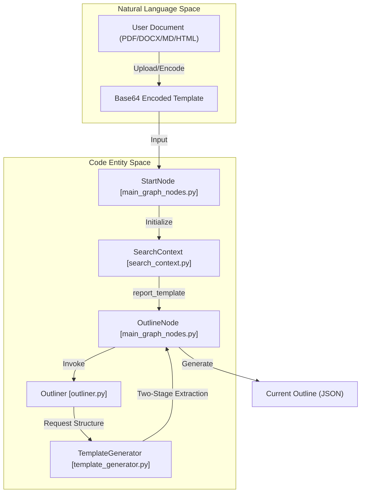
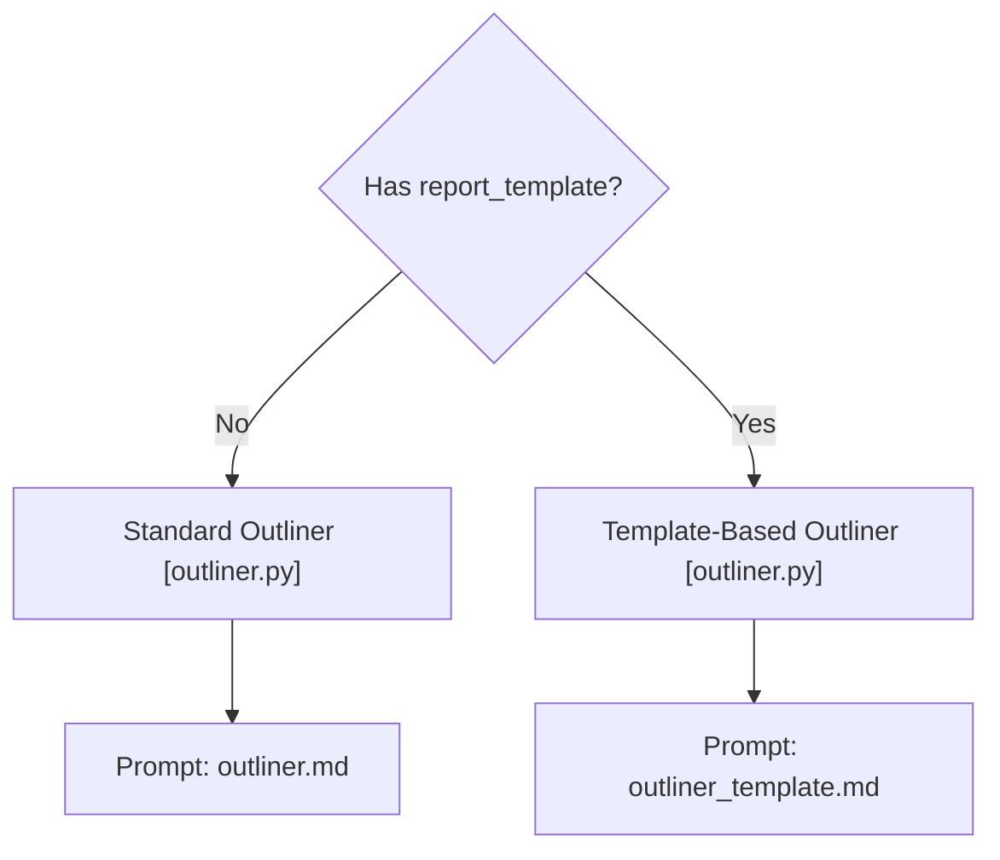

<!-- source: DeepWiki mcp.deepwiki.com · repo openJiuwen-ai/deepsearch · page 10 Report Templates · fetched 2026-11-02 -->

# Report Templates

Relevant source files

The following files were used as context for generating this wiki page:

- [deepsearch/docs/en/4.Developer Guide/API Reference/main_nodes.md](deepsearch/docs/en/4.Developer Guide/API Reference/main_nodes.md)
- [deepsearch/docs/feature/framework/research-workflow.md](deepsearch/docs/feature/framework/research-workflow.md)
- [deepsearch/openjiuwen_deepsearch/framework/openjiuwen/agent/main_graph_nodes.py](deepsearch/openjiuwen_deepsearch/framework/openjiuwen/agent/main_graph_nodes.py)
- [deepsearch/tests/node/test_agent_node.py](deepsearch/tests/node/test_agent_node.py)

The report template system allows users to guide the deep research process by providing existing documents or specific structural requirements. The system supports multiple file formats (PDF, DOCX, MD, HTML) and employs a two-stage LLM extraction process to derive both the structural skeleton and the semantic requirements of a template.

## System Overview

The template system is integrated into the `research` workflow. When a `report_template` is provided during the initial request, the system bypasses standard outline generation in favor of a template-constrained approach.

### Key Components
*   **`TemplateGenerator`**: The core logic for parsing uploaded files and generating structured templates for the LLM.
*   **`OutlineNode`**: Consumes the processed template to generate a research outline that adheres to the user-provided structure.
*   **`is_template` Flag**: A boolean flag used in the search context to signal that the research should strictly follow the provided template rather than generating a new one from scratch.

## Data Flow and Architecture

The following diagram illustrates how a report template moves from a raw file input to a structured research plan within the "Code Entity Space".

### Template Processing Pipeline
Title: Template Processing and Integration

**Sources:** [deepsearch/openjiuwen_deepsearch/framework/openjiuwen/agent/main_graph_nodes.py:181-189](), [deepsearch/docs/feature/framework/research-workflow.md:20-25](), [deepsearch/docs/en/4.Developer Guide/API Reference/main_nodes.md:31-36]()

## Template Extraction Logic

The system processes templates in two distinct stages to ensure both the "skeleton" (headers) and the "soul" (specific requirements per section) are captured.

### 1. Structure Extraction
The system parses the document (using format-specific parsers for PDF, Word, or Markdown) to extract the heading hierarchy. This forms the `Outline` structure.

### 2. Semantic Extraction
For each identified section, the LLM analyzes the original text to extract:
*   **Focus Dimensions**: Specific topics or data points mentioned in the template that must be covered.
*   **Style Constraints**: Tone and formatting requirements derived from the example text.

### Implementation Details
The `StartNode` initializes the `SearchContext` with the `report_template` string. If the string is base64 encoded, the system attempts to decode it; otherwise, it treats it as plain text [deepsearch/docs/feature/framework/research-workflow.md:20-21]().

| Feature | Description |
| :--- | :--- |
| **Format Support** | PDF, DOCX, MD, HTML [deepsearch/docs/feature/framework/research-workflow.md:20-21]() |
| **Input Format** | Base64 encoded string or raw text [deepsearch/openjiuwen_deepsearch/framework/openjiuwen/agent/main_graph_nodes.py:186-187]() |
| **Node Handling** | `OutlineNode` switches prompts to `outliner_template` when a template is detected [deepsearch/docs/en/4.Developer Guide/API Reference/main_nodes.md:35-36]() |

## Consumption in the Research Workflow

The `OutlineNode` is the primary consumer of the template data.

### Workflow Integration
1.  **Detection**: In `StartNode.invoke`, the `report_template` is stored in the `SearchContext` [deepsearch/openjiuwen_deepsearch/framework/openjiuwen/agent/main_graph_nodes.py:181-189]().
2.  **Branching**: In `OutlineNode`, the presence of a template triggers a specialized prompt logic. Instead of the standard `outliner` prompt, it uses the `outliner_template` prompt [deepsearch/docs/en/4.Developer Guide/API Reference/main_nodes.md:35-36]().
3.  **Constraint Enforcement**: The `Outliner` uses the extracted template structure to populate the `sections` of the `Outline` object, ensuring that the research agents only gather information relevant to the user's predefined structure [deepsearch/openjiuwen_deepsearch/framework/openjiuwen/agent/search_context.py:33-37]().

### Template vs. Standard Outline
Title: Outline Generation Decision Logic

**Sources:** [deepsearch/docs/en/4.Developer Guide/API Reference/main_nodes.md:31-36](), [deepsearch/docs/feature/framework/research-workflow.md:49-51]()

## Storage and API Interaction

Templates can be persisted via the Server API. While the `DeepSearch SDK` handles the runtime execution, the `Server API` provides endpoints for managing a library of templates.

*   **API Storage**: Templates are stored in the database (MySQL/SQLite) via the `server/` layer [deepsearch/docs/en/4.Developer Guide/API Reference/main_nodes.md:1-5]().
*   **Base64 Output**: When exporting or retrieving templates for the frontend, the system often uses base64 encoding to preserve document formatting and binary integrity [deepsearch/docs/feature/framework/research-workflow.md:20-21]().

**Sources:**
* `deepsearch/openjiuwen_deepsearch/framework/openjiuwen/agent/main_graph_nodes.py`
* `deepsearch/docs/en/4.Developer Guide/API Reference/main_nodes.md`
* `deepsearch/docs/feature/framework/research-workflow.md`
* `deepsearch/openjiuwen_deepsearch/framework/openjiuwen/agent/search_context.py`

---

