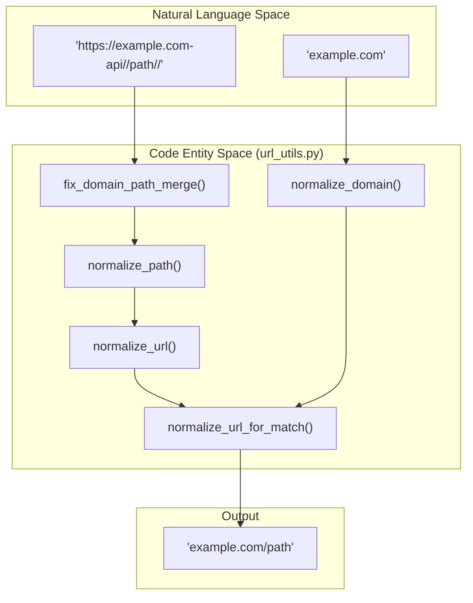
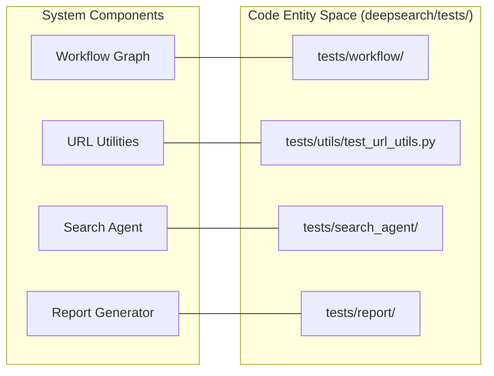

<!-- source: DeepWiki mcp.deepwiki.com · repo openJiuwen-ai/deepsearch · page 12 Utilities, Observability, and Testing · fetched 2026-11-02 -->

# Utilities, Observability, and Testing

Relevant source files

The following files were used as context for generating this wiki page:

- [deepsearch/openjiuwen_deepsearch/utils/common_utils/url_utils.py](deepsearch/openjiuwen_deepsearch/utils/common_utils/url_utils.py)
- [deepsearch/tests/utils/test_url_utils.py](deepsearch/tests/utils/test_url_utils.py)

This section provides an overview of the cross-cutting infrastructure that supports the DeepSearch system. It covers essential utility modules for data handling and security, observability tools for monitoring system execution, and the comprehensive testing framework used to ensure system reliability.

## System Utilities and Observability

The `utils/` module provides a suite of tools for handling common technical tasks such as URL normalization, input validation, and rate limiting. These utilities ensure that the system operates securely and efficiently across different research modes.

Key components include:
*   **Logging and Telemetry**: Centralized logging via `LogManager` which supports sensitive data masking and log rotation. Execution events are tracked using `RunTelemetryConfig` to monitor workflow progress.
*   **URL Handling**: Robust URL normalization and sanitization to handle "hallucinated" URLs generated by LLMs and to strip tracking parameters.
*   **Validation and Security**: Sanitization of user inputs and safe directory checks to prevent path traversal or injection attacks.
*   **Routing**: The `question_model_router` directs queries to the appropriate search models based on the complexity and intent of the user request.

For details, see [Utilities: Logging, Rate Limiting, Validation, and URL Handling](#12.1).

### Natural Language to URL Utility Mapping

The following diagram illustrates how the system processes natural language URLs and domains into normalized, safe code entities.

**URL Normalization Pipeline**

**Sources:**
* `deepsearch/openjiuwen_deepsearch/utils/common_utils/url_utils.py:6-15`()
* `deepsearch/openjiuwen_deepsearch/utils/common_utils/url_utils.py:96-123`()
* `deepsearch/openjiuwen_deepsearch/utils/common_utils/url_utils.py:163-179`()
* `deepsearch/openjiuwen_deepsearch/utils/common_utils/url_utils.py:223-245`()

---

## Testing Infrastructure

DeepSearch employs a multi-layered testing strategy organized under the `tests/` directory. The test suite is categorized by system modules (e.g., `algorithm`, `node`, `report`, `server`) to allow for targeted verification of specific features.

Key testing patterns include:
*   **Mocking**: Extensive use of `pytest` fixtures to mock LLM responses and network calls, ensuring tests are deterministic and do not incur API costs.
*   **Session Context**: Tests simulate the `SearchContext` and `Session` state to verify workflow transitions within the `MainGraph`.
*   **Sensitive Mode Testing**: Specific patterns to ensure that PII (Personally Identifiable Information) is correctly handled or masked in logs and outputs.
*   **Execution**: Tests are managed using `uv`, providing a consistent environment for running `pytest` across different platforms.

For details, see [Testing Infrastructure and Test Patterns](#12.2).

### Test Suite Organization

The following diagram maps the high-level system components to their corresponding test suites in the codebase.

**Test Suite Mapping**

**Sources:**
* `deepsearch/tests/utils/test_url_utils.py:6-15`()
* `deepsearch/tests/utils/test_url_utils.py:27-46`()
* `deepsearch/tests/utils/test_url_utils.py:143-162`()

---

## Utility Function Summary

The system relies on several core utility functions to maintain data integrity, especially when dealing with external web content.

| Function | File Path | Purpose |
| :--- | :--- | :--- |
| `normalize_url` | `url_utils.py` | Fixes LLM-generated URL hallucinations and redundant slashes. |
| `is_url_blocked` | `url_utils.py` | Checks if a URL matches the user-provided exclusion list. |
| `validate_url_scheme` | `url_utils.py` | Restricts URLs to `http` and `https` for security. |
| `are_similar_urls` | `url_utils.py` | Compares two URLs based on a similarity threshold to identify duplicate sources. |
| `normalize_path` | `url_utils.py` | Ensures paths are formatted correctly and within length limits. |

**Sources:**
* `deepsearch/openjiuwen_deepsearch/utils/common_utils/url_utils.py:59-94`()
* `deepsearch/openjiuwen_deepsearch/utils/common_utils/url_utils.py:182-195`()
* `deepsearch/openjiuwen_deepsearch/utils/common_utils/url_utils.py:198-221`()
* `deepsearch/tests/utils/test_url_utils.py:143-162`()

---

