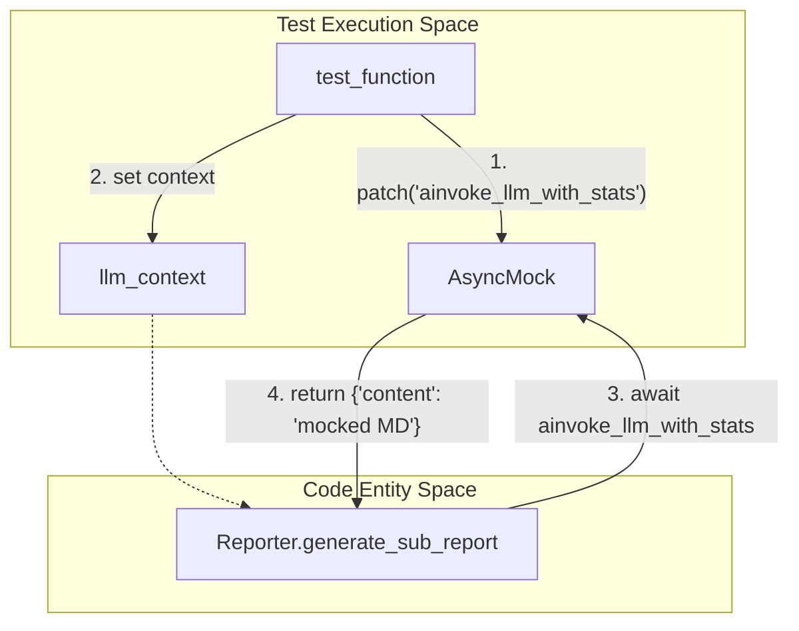
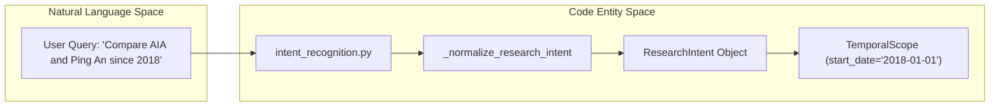

<!-- source: DeepWiki mcp.deepwiki.com · repo openJiuwen-ai/deepsearch · page 12.2 Testing Infrastructure and Test Patterns · fetched 2026-11-02 -->

# Testing Infrastructure and Test Patterns

<details>
<summary>Relevant source files</summary>

The following files were used as context for generating this wiki page:

- [deepsearch/tests/algorithm/query_understanding/test_research_intent_contract.py](deepsearch/tests/algorithm/query_understanding/test_research_intent_contract.py)
- [deepsearch/tests/info_collector/algorithm/test_collector_function.py](deepsearch/tests/info_collector/algorithm/test_collector_function.py)
- [deepsearch/tests/report/test_sub_report.py](deepsearch/tests/report/test_sub_report.py)
- [deepsearch/tests/tools/test_runtime_api.py](deepsearch/tests/tools/test_runtime_api.py)

</details>


This page details the testing architecture of the openJiuwen-DeepSearch system. The test suite is designed to validate complex multi-agent workflows, ensure the reliability of information collection pipelines, and verify the integrity of report generation logic.

## Test Suite Organization

The test suite is located in the `deepsearch/tests/` directory and is categorized by system components to ensure granular validation.

### Test Categories

| Category | Description | Key Components Tested |
| :--- | :--- | :--- |
| `algorithm` | Core logic for research and analysis | Query understanding, intent recognition, outliner logic. |
| `info_collector` | Evidence gathering pipelines | Web search (Tavily/Google), local KB retrieval, tool execution. |
| `node` | Individual workflow graph nodes | `StartNode`, `ReporterNode`, `EditorTeamNode`, etc. |
| `report` | Report synthesis and formatting | Markdown assembly, table captioning, Mermaid chart detection. |
| `search_agent` | Search/React mode state machines | Action space sampling, tool calling loops. |
| `server` | API and backend infrastructure | FastAPI routes, database persistence, SSE streaming. |
| `source_tracer` | Provenance and citation logic | Global source matching, inference-chain HTML generation. |
| `tools` | External tool integrations | Runtime API wrappers, sandbox execution for charts. |
| `workflow` | End-to-end graph orchestration | `main_graph` execution, state transitions. |

Sources: [deepsearch/tests/report/test_sub_report.py:1-23](), [deepsearch/tests/info_collector/algorithm/test_collector_function.py:1-14]()

## Execution and Environment

Tests are executed using `pytest` within the `uv` environment to manage dependencies and virtual environments consistently.

### Running Tests
To run the full test suite:
```bash
uv run pytest deepsearch/tests/
```

To run a specific category (e.g., report generation):
```bash
uv run pytest deepsearch/tests/report/
```

### Context Management
DeepSearch utilizes `ContextVars` for managing session and LLM state. Tests must frequently mock these contexts to simulate active research sessions.
- `session_context`: Manages the current `Session` object. [deepsearch/tests/report/test_sub_report.py:22-22]()
- `llm_context`: Manages the LLM configuration and stats tracking. [deepsearch/tests/report/test_sub_report.py:22-22]()

## Key Test Patterns

### 1. Mocking LLM Responses
Since the system is LLM-heavy, tests use `unittest.mock.AsyncMock` to simulate LLM outputs without incurring API costs or latency.

**Diagram: LLM Mocking Pattern**

Sources: [deepsearch/tests/report/test_sub_report.py:149-184]()

### 2. Research Intent Contract Validation
Tests for `query_understanding` verify that the `ResearchIntent` Pydantic model correctly normalizes user input and preserves task constraints like `temporal_scope`.

**Data Flow: Intent Normalization**

Sources: [deepsearch/tests/algorithm/query_understanding/test_research_intent_contract.py:18-53]()

### 3. Tool Execution and Result Processing
Tests in `info_collector` validate the `process_tool_call` logic, ensuring that multiple tool calls are handled (typically taking the last one) and results are correctly formatted into messages.

| Function | Test Focus |
| :--- | :--- |
| `check_agent_input` | Ensures missing keys in `agent_input` (e.g., `web_page_search_record`) are initialized as empty lists. |
| `execute_tool` | Validates dispatching to specific search engines (Tavily, Google, Local). |
| `filter_search_results` | Verifies domain/URL exclusion logic and temporal filtering. |

Sources: [deepsearch/tests/info_collector/algorithm/test_collector_function.py:107-145](), [deepsearch/tests/info_collector/algorithm/test_collector_function.py:193-205]()

## Specialized Infrastructure

### Runtime API Testing
The system supports dynamic tool integration via `RuntimeApiTool`. Tests use `httpx` mocking to verify that tool requests are correctly split into `header`, `query`, and `body` parameters based on the tool definition.
Sources: [deepsearch/tests/tools/test_runtime_api.py:36-91]()

### Report Content Detection
Tests for the `Reporter` class use parameterized inputs to verify regex-based detection of specialized content, such as Mermaid diagrams, within LLM-generated strings. This ensures that the system correctly identifies when to trigger the Mermaid rendering pipeline.
Sources: [deepsearch/tests/report/test_sub_report.py:46-62]()

### Sensitive Mode Patterns
DeepSearch includes a sensitive mode for handling private data. The `LogManager` is tested to ensure that sensitive fields (like API keys or private URLs) are redacted in logs while remaining available for execution.
Sources: [deepsearch/tests/report/test_sub_report.py:94-136]() (Illustrates data exclusion in compact info helpers).

Sources:
- `deepsearch/tests/report/test_sub_report.py`
- `deepsearch/tests/algorithm/query_understanding/test_research_intent_contract.py`
- `deepsearch/tests/info_collector/algorithm/test_collector_function.py`
- `deepsearch/tests/tools/test_runtime_api.py`

---

