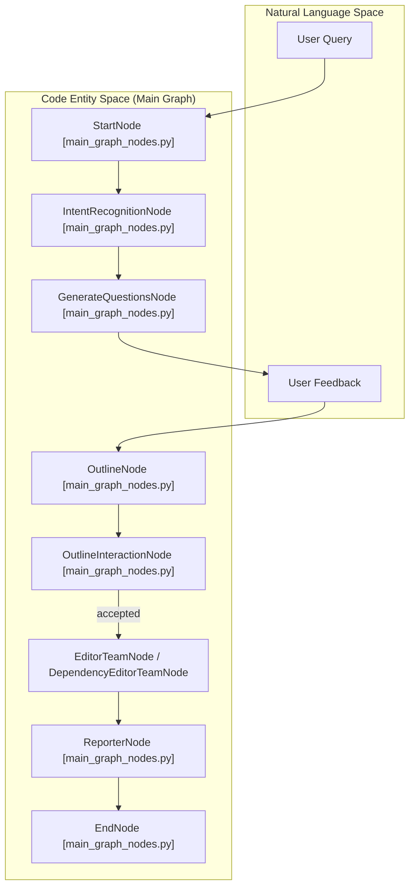
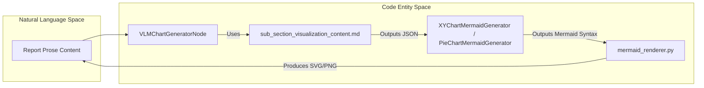

<!-- source: DeepWiki mcp.deepwiki.com · repo openJiuwen-ai/deepsearch · page 13 Glossary · fetched 2026-11-02 -->

# Glossary

Relevant source files

The following files were used as context for generating this wiki page:

- [README.md](README.md)
- [README_zh.md](README_zh.md)
- [deepsearch/docs/en/4.Developer Guide/API Reference/main_nodes.md](deepsearch/docs/en/4.Developer Guide/API Reference/main_nodes.md)
- [deepsearch/docs/feature/algorithm/research-collector.md](deepsearch/docs/feature/algorithm/research-collector.md)
- [deepsearch/docs/feature/framework/research-workflow.md](deepsearch/docs/feature/framework/research-workflow.md)
- [deepsearch/openjiuwen_deepsearch/algorithm/prompts/chart_compliance_validate.md](deepsearch/openjiuwen_deepsearch/algorithm/prompts/chart_compliance_validate.md)
- [deepsearch/openjiuwen_deepsearch/algorithm/prompts/sub_report_markdown.md](deepsearch/openjiuwen_deepsearch/algorithm/prompts/sub_report_markdown.md)
- [deepsearch/openjiuwen_deepsearch/algorithm/prompts/sub_section_visualization_content.md](deepsearch/openjiuwen_deepsearch/algorithm/prompts/sub_section_visualization_content.md)
- [deepsearch/openjiuwen_deepsearch/algorithm/report/report.py](deepsearch/openjiuwen_deepsearch/algorithm/report/report.py)
- [deepsearch/openjiuwen_deepsearch/algorithm/report/report_utils.py](deepsearch/openjiuwen_deepsearch/algorithm/report/report_utils.py)
- [deepsearch/openjiuwen_deepsearch/framework/openjiuwen/agent/main_graph_nodes.py](deepsearch/openjiuwen_deepsearch/framework/openjiuwen/agent/main_graph_nodes.py)
- [deepsearch/tests/algorithm/query_understanding/test_research_intent_contract.py](deepsearch/tests/algorithm/query_understanding/test_research_intent_contract.py)
- [deepsearch/tests/algorithm/report_export/test_mermaid_renderer.py](deepsearch/tests/algorithm/report_export/test_mermaid_renderer.py)
- [deepsearch/tests/node/test_agent_node.py](deepsearch/tests/node/test_agent_node.py)

This glossary defines technical terms, domain concepts, and architectural components specific to the **openJiuwen-DeepSearch** codebase.

## Core System Terms

### agent-core
The foundational multi-agent framework upon which DeepSearch is built. It provides the graph execution engine, session management, and node lifecycle hooks used by the system [README.md:5-5]().

### SearchContext
The primary data contract and state container for a research session. It encapsulates the user query, conversation history, generated outlines, collected evidence, and the final report. It is initialized in `StartNode` and persisted throughout the workflow [deepsearch/framework/openjiuwen/agent/main_graph_nodes.py:181-187]().
*   **Key Fields**: `original_query`, `current_outline`, `messages`, `search_mode`, and `final_result`.

### ResearchIntent
A structured representation of the user's research goals, identified during the intent recognition phase. It includes the `task_type` (e.g., comparison, trend judgment), `temporal_scope`, and `required_dimensions` [deepsearch/framework/openjiuwen/agent/search_context.py:98-98]().
*   **Sources**: [deepsearch/tests/algorithm/query_understanding/test_research_intent_contract.py:10-15](), [deepsearch/openjiuwen_deepsearch/framework/openjiuwen/agent/main_graph_nodes.py:98-98]()

### HITL (Human-in-the-Loop)
Interaction points where the workflow pauses to request user input. DeepSearch implements two main HITL stages:
1.  **Query Clarification**: Handled by `GenerateQuestionsNode` and `FeedbackHandlerNode` [deepsearch/docs/en/4.Developer Guide/API Reference/main_nodes.py:19-29]().
2.  **Outline Revision**: Handled by `OutlineInteractionNode`, allowing users to `accept`, `revise_comment`, or `revise_outline` [deepsearch/docs/en/4.Developer Guide/API Reference/main_nodes.py:43-56]().

---

## Workflow & Execution Concepts

### Execution Method
Determines how the research report is constructed.
*   **Parallel**: Sections are researched and written independently in parallel.
*   **Dependency Driving**: Sections are executed in layers based on logical dependencies (e.g., Chapter 2 requires insights from Chapter 1) [deepsearch/docs/feature/framework/research-workflow.md:24-25]().
*   **Hybrid**: A router LLM dynamically decides between Parallel and Dependency Driving based on the query complexity [deepsearch/docs/feature/framework/research-workflow.md:47-48]().

### Section Local Contract
A specialized context passed to sub-workflows (Editor Teams) that constrains the research focus for a specific chapter. It includes `section_focus`, `allowed_dimensions`, and flags like `is_final_decision_section` [deepsearch/tests/algorithm/query_understanding/test_research_intent_contract.py:196-210]().

### Main Graph Architecture
The high-level orchestration of nodes that transform a query into a finished report.

**Sources**: [deepsearch/framework/openjiuwen/agent/main_graph_nodes.py:164-1380](), [deepsearch/docs/en/4.Developer Guide/API Reference/main_nodes.md:7-140]()

---

## Content & Visualization Terms

### ChapterSidecar
A data structure used during report generation to carry "Background Knowledge" from previous chapters to the current chapter's LLM prompt, ensuring narrative continuity [deepsearch/algorithm/report/report.py:54-58]().

### Checked Citation
A validated reference marker in the format `[checked_citation:id]`. Unlike raw tool citations, these have been verified by the `SourceTracerNode` to ensure the referenced document actually supports the claim [deepsearch/docs/en/4.Developer Guide/API Reference/main_nodes.md:105-105]().

### Visualization Pipeline
The process of extracting numeric data from report text and rendering it as charts.

| Term | Definition | Code Pointer |
| :--- | :--- | :--- |
| **Extraction Schema** | The JSON structure (`image_title`, `image_type`, `records`) extracted from prose. | [deepsearch/openjiuwen_deepsearch/algorithm/report/report_utils.py:30-38]() |
| **XYChartMermaidGenerator** | Generates Mermaid `xychart-beta` code for bar and line charts. | [deepsearch/openjiuwen_deepsearch/algorithm/report/report.py:43-43]() |
| **Mermaid Renderer** | Service that converts Mermaid code into SVG or PNG for export. | [deepsearch/tests/algorithm/report_export/test_mermaid_renderer.py:20-23]() |

### Chart Generation Logic

**Sources**: [deepsearch/openjiuwen_deepsearch/algorithm/report/report_utils.py:156-220](), [deepsearch/openjiuwen_deepsearch/algorithm/prompts/sub_section_visualization_content.md:1-88](), [deepsearch/openjiuwen_deepsearch/algorithm/report/report.py:40-50]()

---

## System Abbreviations
*   **OBS**: Object Storage Service (used for knowledge base file persistence) [README.md:89-89]().
*   **VLM**: Vision Language Model (used for iterative chart refinement and validation) [deepsearch/docs/en/4.Developer Guide/API Reference/main_nodes.md:82-86]().
*   **SSE**: Server-Sent Events (the streaming protocol used by the `/run` API) [deepsearch/docs/feature/framework/research-workflow.md:18-18]().
*   **HITL**: Human-in-the-Loop [deepsearch/docs/en/4.Developer Guide/API Reference/main_nodes.md:23-23]().

**Sources**:
- [README.md:1-111]()
- [deepsearch/openjiuwen_deepsearch/algorithm/report/report.py:1-205]()
- [deepsearch/openjiuwen_deepsearch/framework/openjiuwen/agent/main_graph_nodes.py:1-190]()
- [deepsearch/openjiuwen_deepsearch/algorithm/report/report_utils.py:1-200]()
- [deepsearch/docs/en/4.Developer Guide/API Reference/main_nodes.md:1-140]()
- [deepsearch/docs/feature/framework/research-workflow.md:1-93]()