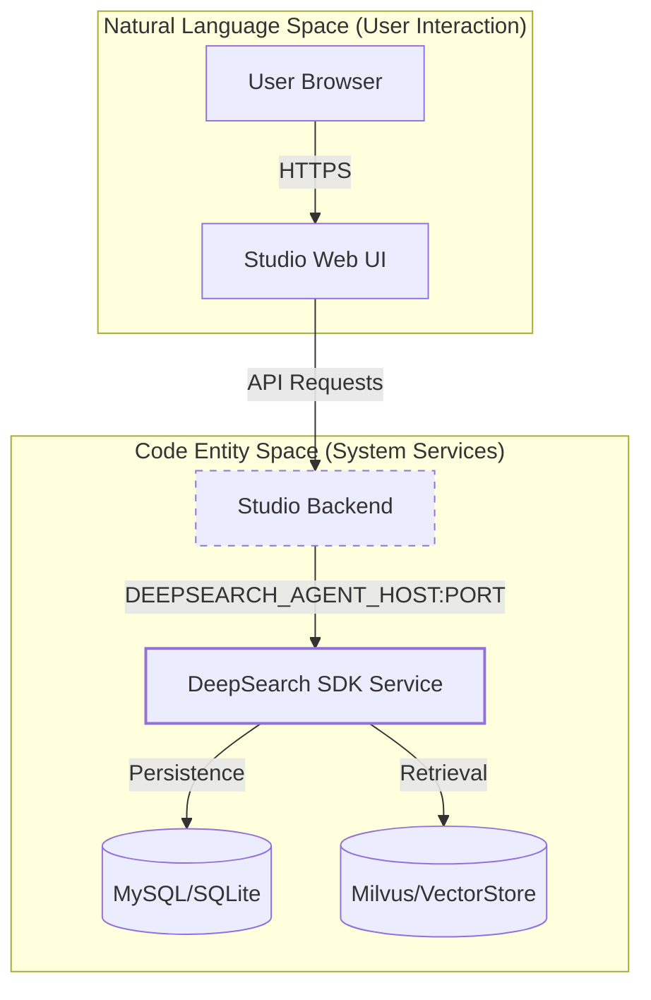
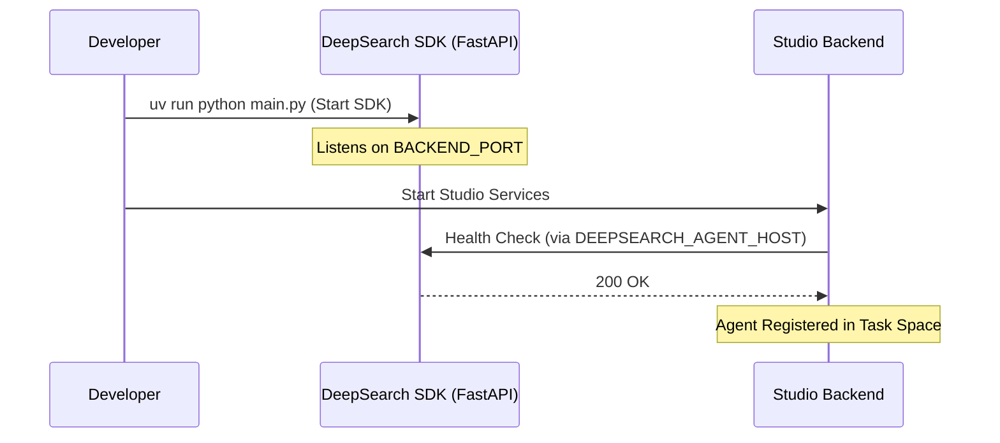

<!-- source: DeepWiki mcp.deepwiki.com · repo openJiuwen-ai/deepsearch · page 2.1 DeepSearch Full Edition Installation · fetched 2026-11-02 -->

# DeepSearch Full Edition Installation

Relevant source files

The following files were used as context for generating this wiki page:

- [deepsearch/docs/en/2.Installation Guide/DeepSearch Full Edition/Linux Installation.md](deepsearch/docs/en/2.Installation Guide/DeepSearch Full Edition/Linux Installation.md)
- [deepsearch/docs/en/2.Installation Guide/DeepSearch Full Edition/README.md](deepsearch/docs/en/2.Installation Guide/DeepSearch Full Edition/README.md)
- [deepsearch/docs/en/2.Installation Guide/DeepSearch Full Edition/Windows Installation.md](deepsearch/docs/en/2.Installation Guide/DeepSearch Full Edition/Windows Installation.md)
- [deepsearch/docs/en/2.Installation Guide/DeepSearch Full Edition/macOS Installation.md](deepsearch/docs/en/2.Installation Guide/DeepSearch Full Edition/macOS Installation.md)

The DeepSearch Full Edition represents the complete product suite, integrating the **Studio** (Web UI and backend management) with the **DeepSearch SDK** (the core research engine). This installation path is intended for users who require the full collaborative research environment, including task management, knowledge base indexing, and interactive report generation.

### System Components Overview

The full edition deployment bridges two primary systems:
1.  **Studio**: Handles user authentication, task space management, knowledge base file storage, and the frontend interface.
2.  **DeepSearch SDK**: Executes the multi-agent research workflows, handles web searching, and generates the final reports.

The communication between these two systems is established via an environment variable bridge.

### Bridge Configuration
For the Studio to communicate with the SDK, the following environment variables must be aligned in their respective `.env` files:

| Variable | System | Description |
| :--- | :--- | :--- |
| `DEEPSEARCH_AGENT_HOST` | Studio | The IP address or hostname where the SDK is running. |
| `DEEPSEARCH_AGENT_PORT` | Studio | The port exposed by the SDK (matches SDK `BACKEND_PORT`). |
| `HOST` | SDK | The listening address for the SDK service. |
| `BACKEND_PORT` | SDK | The listening port for the SDK service. |

**Sources:** [deepsearch/docs/en/2.Installation Guide/DeepSearch Full Edition/README.md:23-26]()

---

## 1. Docker Installation (Recommended)

Docker is the preferred method for quick deployment, as it containerizes all dependencies including databases (MySQL/SQLite), vector stores (Milvus), and the sandbox execution environment.

### 1.1 Hardware and Software Prerequisites

| Requirement | Minimum | Recommended |
| :--- | :--- | :--- |
| **CPU** | 2 Cores | 4+ Cores |
| **RAM** | 4 GB | 8 GB+ |
| **Docker Engine** | 20.10+ | Latest |
| **Docker Compose** | v2.19.1+ | Latest |

**Sources:** [deepsearch/docs/en/2.Installation Guide/DeepSearch Full Edition/Linux Installation.md:7-27](), [deepsearch/docs/en/2.Installation Guide/DeepSearch Full Edition/Windows Installation.md:7-15]()

### 1.2 Deployment Workflow

The deployment tool (`deployTool`) automates the orchestration of containers using a `service.sh` script.

#### Deployment Architecture Diagram
The following diagram illustrates how the `service.sh` script orchestrates the connection between the Studio UI and the SDK Agent core.

**Sources:** [deepsearch/docs/en/2.Installation Guide/DeepSearch Full Edition/README.md:3-4](), [deepsearch/docs/en/2.Installation Guide/DeepSearch Full Edition/README.md:26]()

### 1.3 OS-Specific Execution

#### Linux (Ubuntu 22.04+)
1.  Download the `deployTool` zip for your architecture (AMD64/ARM64).
2.  Extract and navigate to the directory.
3.  Configure your local IP in `.env.custom`: `IP=<local_machine_ip>`.
4.  Run `./service.sh up`.

**Sources:** [deepsearch/docs/en/2.Installation Guide/DeepSearch Full Edition/Linux Installation.md:40-87]()

#### Windows (10/11)
1.  **Install WSL 2**: Run `wsl --install` in PowerShell as Administrator.
2.  **Docker Desktop**: Enable "Use WSL 2 instead of Hyper-V".
3.  **File Sharing**: Add your installation path to Docker Desktop -> Settings -> Resources -> File sharing.
4.  **Git Bash**: Open Git Bash in the extracted folder and run `./service.sh up`.

**Sources:** [deepsearch/docs/en/2.Installation Guide/DeepSearch Full Edition/Windows Installation.md:21-87]()

#### macOS (14.0+)
1.  **Docker Desktop**: Install the `.dmg` and ensure Docker Engine is running.
2.  **Homebrew**: Install Git and updated Bash (`brew install bash`).
3.  **Terminal**: Run `./service.sh up`.

**Sources:** [deepsearch/docs/en/2.Installation Guide/DeepSearch Full Edition/macOS Installation.md:14-64]()

---

## 2. Manual Installation (Development Path)

Manual installation is intended for developers who wish to modify the source code or contribute to the project. This requires setting up the Python environment for both the Studio and the SDK separately.

### 2.1 Component Inter-dependency
When installing manually, the developer must ensure that the `DeepSearch SDK` is started before the `Studio` backend attempts to register the agent.

**Sources:** [deepsearch/docs/en/2.Installation Guide/DeepSearch Full Edition/README.md:21-26]()

### 2.2 Manual Setup Steps
For each OS, the process follows a "Method 2: Full manual installation" pattern found in the documentation:

1.  **Environment Isolation**: Use `conda` or `venv` to manage dependencies.
2.  **SDK Setup**:
    *   Clone the `deepsearch` repository.
    *   Install dependencies: `pip install -r requirements.txt`.
    *   Configure `.env` with LLM keys and Search API keys.
3.  **Studio Setup**:
    *   Clone the `agent-studio` repository.
    *   Install frontend dependencies (`npm install`) and backend dependencies.
4.  **Cross-Configuration**: Ensure the Studio's `.env` points to the SDK's host and port.

**Sources:** [deepsearch/docs/en/2.Installation Guide/DeepSearch Full Edition/README.md:31-38]()

---

## 3. Post-Installation Verification

Once the service is started (via Docker or Manual), the following checks verify a successful installation:

1.  **Local Access**: Navigate to the URL provided by the script (typically `https://localhost` or the configured IP).
2.  **Privacy Warning**: Accept the self-signed certificate (Advanced -> Proceed).
3.  **Agent Selection**: In the Studio **Task Space**, ensure the "DeepSearch" agent is visible and selectable. If it is missing, check the `DEEPSEARCH_AGENT_HOST` configuration.

**Sources:** [deepsearch/docs/en/2.Installation Guide/DeepSearch Full Edition/Linux Installation.md:97-101](), [deepsearch/docs/en/2.Installation Guide/DeepSearch Full Edition/Windows Installation.md:97-101]()

---

