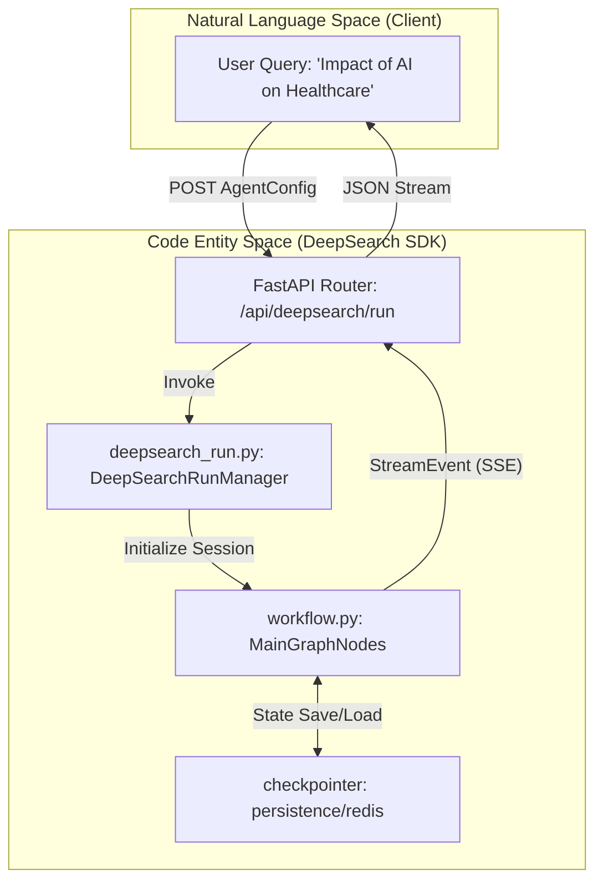
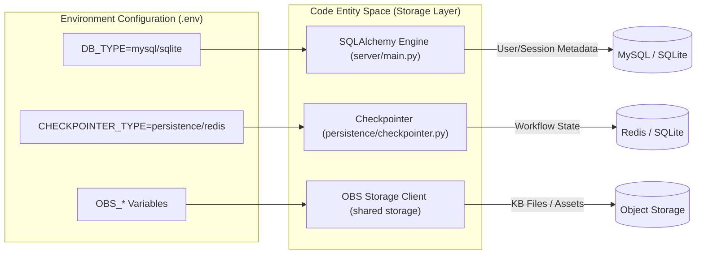

<!-- source: DeepWiki mcp.deepwiki.com · repo openJiuwen-ai/deepsearch · page 2.2 DeepSearch SDK Standalone Installation · fetched 2026-11-02 -->

# DeepSearch SDK Standalone Installation

<details>
<summary>Relevant source files</summary>

The following files were used as context for generating this wiki page:

- [deepsearch/docs/en/2.Installation Guide/DeepSearch_SDK/Docker Installation/Linux Installation.md](deepsearch/docs/en/2.Installation Guide/DeepSearch_SDK/Docker Installation/Linux Installation.md)
- [deepsearch/docs/en/2.Installation Guide/DeepSearch_SDK/Docker Installation/Windows Installation.md](deepsearch/docs/en/2.Installation Guide/DeepSearch_SDK/Docker Installation/Windows Installation.md)
- [deepsearch/docs/en/2.Installation Guide/DeepSearch_SDK/Docker Installation/macOS Installation.md](deepsearch/docs/en/2.Installation Guide/DeepSearch_SDK/Docker Installation/macOS Installation.md)

</details>


This page details the standalone installation of the DeepSearch SDK backend service using Docker. The standalone SDK mode is intended for developers who wish to integrate DeepSearch capabilities into their own applications or who prefer to run the agentic backend without the DeepSearch Studio frontend.

## 1. Overview and Use Cases

The DeepSearch SDK provides the core reasoning, search, and report generation engines. Standalone installation is recommended when:
*   Integrating DeepSearch as a microservice within an existing enterprise architecture.
*   Developing custom frontends or CLI tools that consume the FastAPI-based [9.2. DeepSearch Run API and Streaming]().
*   Running high-throughput automated research tasks where the Studio GUI is not required.

### System Components and Ports
The SDK container encapsulates two primary HTTP services:
1.  **DeepResearch Service (Port 8000)**: Handles complex, long-running research workflows (`search_mode=research`) [deepsearch/docs/en/2.Installation Guide/DeepSearch_SDK/Docker Installation/Linux Installation.md:104-113]().
2.  **DeepSearch/Telemetry Service (Port 8089)**: Handles real-time search queries (`search_mode=search`) and telemetry data collection [deepsearch/docs/en/2.Installation Guide/DeepSearch_SDK/Docker Installation/Linux Installation.md:116-120]().

**Sources:**
*   [deepsearch/docs/en/2.Installation Guide/DeepSearch_SDK/Docker Installation/Linux Installation.md:88-90]()
*   [deepsearch/docs/en/2.Installation Guide/DeepSearch_SDK/Docker Installation/Linux Installation.md:104-120]()

---

## 2. Environment Preparation

### Hardware Requirements
| Resource | Minimum | Recommended |
| :--- | :--- | :--- |
| **CPU** | 2 Cores | 4+ Cores |
| **RAM** | 4 GB | 8 GB+ |

### Software Prerequisites
*   **Docker & Docker Compose**: Required for all platforms.
*   **Git**: For cloning configuration files or repositories.
*   **WSL 2 (Windows Only)**: Must be enabled for Docker Desktop [deepsearch/docs/en/2.Installation Guide/DeepSearch_SDK/Docker Installation/Windows Installation.md:19-32]().

**Sources:**
*   [deepsearch/docs/en/2.Installation Guide/DeepSearch_SDK/Docker Installation/Linux Installation.md:7-17]()
*   [deepsearch/docs/en/2.Installation Guide/DeepSearch_SDK/Docker Installation/Windows Installation.md:7-15]()
*   [deepsearch/docs/en/2.Installation Guide/DeepSearch_SDK/Docker Installation/macOS Installation.md:7-11]()

---

## 3. Deployment Steps

### 3.1 Pulling the Image
Images are provided for both x86_64 (AMD64) and ARM64 (Apple Silicon) architectures.

```bash
# x86_64 / AMD64
docker pull swr.cn-north-4.myhuaweicloud.com/openjiuwen/deepsearch-studio-server-amd64:0.1.9

# ARM64 (Apple Silicon / EulerOS ARM)
docker pull swr.cn-north-4.myhuaweicloud.com/openjiuwen/deepsearch-studio-server-arm64:0.1.9
```

### 3.2 Running the Container
A basic deployment using SQLite for development/testing:

```bash
docker run \
  -p 8000:8000 \
  -p 8089:8089 \
  -e LLM_SSL_VERIFY=False \
  -e DB_TYPE=sqlite \
  swr.cn-north-4.myhuaweicloud.com/openjiuwen/deepsearch-studio-server-amd64:0.1.9
```

**Sources:**
*   [deepsearch/docs/en/2.Installation Guide/DeepSearch_SDK/Docker Installation/Linux Installation.md:63-86]()
*   [deepsearch/docs/en/2.Installation Guide/DeepSearch_SDK/Docker Installation/Windows Installation.md:86-109]()
*   [deepsearch/docs/en/2.Installation Guide/DeepSearch_SDK/Docker Installation/macOS Installation.md:63-86]()

---

## 4. Configuration and .env Parameters

The SDK is configured via environment variables passed to the Docker container.

### 4.1 Database Configuration (`DB_TYPE`)
The system supports two database backends:
*   **SQLite**: Recommended for single-user dev/test. Data is stored in `data/databases/agent.db` by default [deepsearch/docs/en/2.Installation Guide/DeepSearch_SDK/Docker Installation/Linux Installation.md:172-173]().
*   **MySQL**: Required for production and high-concurrency environments.

#### Connecting to Host-Based MySQL
When the database is running on the host machine rather than in a container, use the following network mapping:
*   **Linux**: Add `--add-host=host.docker.internal:host-gateway` to the `docker run` command [deepsearch/docs/en/2.Installation Guide/DeepSearch_SDK/Docker Installation/Linux Installation.md:150-155]().
*   **Windows/macOS**: Use `host.docker.internal` as the `DB_HOST` [deepsearch/docs/en/2.Installation Guide/DeepSearch_SDK/Docker Installation/Windows Installation.md:174-175]().

### 4.2 Checkpointer Configuration (`CHECKPOINTER_TYPE`)
The Checkpointer manages the `Session` state, allowing workflows to be paused and resumed (HITL).

| Type | Description |
| :--- | :--- |
| `in_memory` | Default. State lost on restart. |
| `persistence` | Uses SQLite or Shelve to persist state to disk [deepsearch/docs/en/2.Installation Guide/DeepSearch_SDK/Docker Installation/Linux Installation.md:182-187](). |
| `redis` | Required for distributed multi-instance deployments. Must be paired with `OBS` storage for Knowledge Base files [deepsearch/docs/en/2.Installation Guide/DeepSearch_SDK/Docker Installation/Linux Installation.md:189-198](). |

### 4.3 Shared Storage (OBS)
When `CHECKPOINTER_TYPE=redis` is used, the system requires S3-compatible Object Storage (OBS) to share Knowledge Base (KB) files across SDK instances. Variables include `OBS_SERVER`, `OBS_BUCKET`, `OBS_ACCESS_KEY_ID`, and `OBS_SECRET_ACCESS_KEY` [deepsearch/docs/en/2.Installation Guide/DeepSearch_SDK/Docker Installation/Linux Installation.md:198-207]().

**Sources:**
*   [deepsearch/docs/en/2.Installation Guide/DeepSearch_SDK/Docker Installation/Linux Installation.md:134-207]()
*   [deepsearch/docs/en/2.Installation Guide/DeepSearch_SDK/Docker Installation/Windows Installation.md:158-235]()
*   [deepsearch/docs/en/2.Installation Guide/DeepSearch_SDK/Docker Installation/macOS Installation.md:108-156]()

---

## 5. Architecture and Data Flow

The following diagrams illustrate how the SDK service maps natural language inputs to internal code entities and how data flows through the standalone service.

### Diagram 1: SDK Request Handling
This diagram bridges the external HTTP request to the internal `deepsearch_run.py` manager and the `MainGraphNodes` workflow.


**Sources:**
*   [deepsearch/docs/en/2.Installation Guide/DeepSearch_SDK/Docker Installation/Linux Installation.md:104-116]()
*   [deepsearch/docs/en/2.Installation Guide/DeepSearch_SDK/Docker Installation/Windows Installation.md:200-206]()

### Diagram 2: Database and Persistence Mapping
This diagram maps the environment configuration to the internal storage classes.


**Sources:**
*   [deepsearch/docs/en/2.Installation Guide/DeepSearch_SDK/Docker Installation/Linux Installation.md:134-150]()
*   [deepsearch/docs/en/2.Installation Guide/DeepSearch_SDK/Docker Installation/Linux Installation.md:175-198]()
*   [deepsearch/docs/en/2.Installation Guide/DeepSearch_SDK/Docker Installation/macOS Installation.md:211-213]()

---

