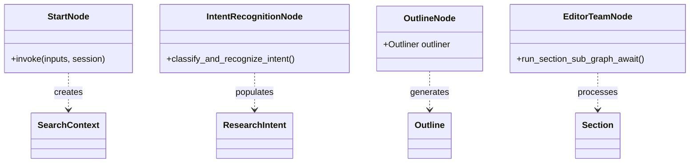

<!-- source: DeepWiki mcp.deepwiki.com · repo openJiuwen-ai/deepsearch · page 3 Research Workflow Orchestration · fetched 2026-11-02 -->

# Research Workflow Orchestration

<details>
<summary>Relevant source files</summary>

The following files were used as context for generating this wiki page:

- [deepsearch/docs/en/4.Developer Guide/API Reference/main_nodes.md](deepsearch/docs/en/4.Developer Guide/API Reference/main_nodes.md)
- [deepsearch/docs/feature/framework/research-workflow.md](deepsearch/docs/feature/framework/research-workflow.md)
- [deepsearch/openjiuwen_deepsearch/framework/openjiuwen/agent/main_graph_nodes.py](deepsearch/openjiuwen_deepsearch/framework/openjiuwen/agent/main_graph_nodes.py)
- [deepsearch/tests/node/test_agent_node.py](deepsearch/tests/node/test_agent_node.py)

</details>


The Research Workflow is the core orchestration layer of the `research` mode. It transforms a user query into a structured report through a multi-stage pipeline involving intent recognition, outline planning, human-in-the-loop (HITL) refinement, parallelized section writing, and final report synthesis with source tracing.

The orchestration is managed by the `DeepresearchAgent` [deepsearch/framework/openjiuwen/agent/workflow.py:165-170](), which assembles a graph of `MainGraphNodes`. The workflow maintains state via a `SearchContext` object stored in the session [deepsearch/framework/openjiuwen/agent/search_context.py:343-350]().

### Workflow Overview Diagram

The following diagram illustrates the transition from the Natural Language user query to the internal Code Entity Space of nodes and state transitions.

**Title: Research Workflow Logic Flow**
```mermaid
graph TD
    UserQuery["User Query (Natural Language)"] --> StartNode["StartNode [main_graph_nodes.py]"]
    StartNode --> IntentNode["IntentRecognitionNode [main_graph_nodes.py]"]
    
    subgraph "Query Understanding & HITL"
        IntentNode -->|Recognize Intent| IntentResult["ResearchIntent (Code Object)"]
        IntentResult --> HITL_Check{HITL Enabled?}
        HITL_Check -->|Yes| QuesNode["GenerateQuestionsNode"]
        QuesNode --> FeedNode["FeedbackHandlerNode"]
        FeedNode --> OutlineNode["OutlineNode"]
        HITL_Check -->|No| OutlineNode
    end

    subgraph "Planning & Execution"
        OutlineNode --> OutlineObj["Outline (Code Object)"]
        OutlineObj --> OutlineInt["OutlineInteractionNode"]
        OutlineInt -->|Accepted| ModeRouter{Execution Method?}
        
        ModeRouter -->|Parallel| EditorNode["EditorTeamNode [editor_team_manager_node.py]"]
        ModeRouter -->|Dependency| DepEditorNode["DependencyEditorTeamNode"]
    end

    subgraph "Synthesis & Refinement"
        EditorNode --> ReporterNode["ReporterNode"]
        DepEditorNode --> ReporterNode
        ReporterNode --> TracerNode["SourceTracerNode"]
        TracerNode --> VLMNode["VLMChartGeneratorNode"]
        VLMNode --> FeedbackNode["UserFeedbackProcessorNode"]
    end

    FeedbackNode --> EndNode["EndNode"]
    EndNode --> FinalReport["Final Markdown Report"]

    Sources: [deepsearch/framework/openjiuwen/agent/main_graph_nodes.py:164-1100](), [deepsearch/docs/feature/framework/research-workflow.md:42-55]()
```

---

### Main Graph Nodes and Workflow Lifecycle
The workflow is composed of specialized nodes inheriting from `BaseNode`. Each node follows a lifecycle of `_pre_handle`, `_do_invoke`, and `_post_handle` to manage state transitions and streaming outputs [deepsearch/framework/openjiuwen/agent/base_node.py:30-45]().

*   **StartNode**: Initializes the `SearchContext`, sets the `session_id`, and merges configurations [deepsearch/framework/openjiuwen/agent/main_graph_nodes.py:164-189]().
*   **ReporterNode**: Orchestrates the final synthesis of sub-sections into a cohesive Markdown document [deepsearch/framework/openjiuwen/agent/main_graph_nodes.py:840-850]().
*   **SourceTracerNode**: Executes global citation verification and inserts `[checked_citation:id]` markers [deepsearch/framework/openjiuwen/agent/main_graph_nodes.py:925-940]().

For details on node internals and error routing, see [Main Graph Nodes and Workflow Lifecycle](#3.1).

---

### Query Understanding: Intent, Outline, and Planning
Before writing begins, the system must understand the user's domain and temporal requirements. 
*   **Intent Recognition**: Uses `classify_and_recognize_intent` to determine language and report type [deepsearch/algorithm/query_understanding/intent_recognition.py:300-315]().
*   **Outline Generation**: The `Outliner` generates a structured plan. If `execution_method` is set to `hybrid`, a router determines whether to use a standard parallel outline or a dependency-driven one [deepsearch/algorithm/query_understanding/outline_mode_router.py:20-35]().

For details on normalization and prompt templates, see [Query Understanding: Intent, Outline, and Planning](#3.2).

---

### Human-in-the-Loop (HITL) Interactions
The workflow provides two primary points for human intervention to ensure the research stays on track:
1.  **Clarifying Questions**: If the query is ambiguous, `GenerateQuestionsNode` prompts the user for more details [deepsearch/framework/openjiuwen/agent/main_graph_nodes.py:320-330]().
2.  **Outline Refinement**: `OutlineInteractionNode` allows users to `accepted`, `revise_comment`, or `revise_outline`. The workflow pauses and resumes via `interrupt_feedback` [deepsearch/framework/openjiuwen/agent/main_graph_nodes.py:580-610]().

For details on the feedback cycle, see [Human-in-the-Loop (HITL) Interactions](#3.3).

---

### Section Reasoning and Writing Sub-Workflows
The actual research and writing are delegated to "Editor Teams". These are sub-graphs that handle information collection and synthesis for individual sections.
*   **EditorTeamNode**: Executes sections in parallel using the `reasoning_writing_graph` [deepsearch/framework/openjiuwen/agent/editor_team_manager_node.py:150-170]().
*   **DependencyEditorTeamNode**: Manages sections with inter-dependencies, ensuring that "Layer N" reasoning has access to "Layer N-1" content [deepsearch/framework/openjiuwen/agent/editor_team_manager_node.py:300-320]().

For details on `SectionContext` and local contracts, see [Section Reasoning and Writing Sub-Workflows](#3.4).

---

### System Entity Mapping

This table maps the conceptual workflow phases to the specific code entities that implement them.

| Phase | Main Node (Code Entity) | Key Algorithm / Function | Data Structure |
| :--- | :--- | :--- | :--- |
| **Initialization** | `StartNode` | `SearchContext.__init__` | `SearchContext` |
| **Intent** | `IntentRecognitionNode` | `classify_and_recognize_intent` | `ResearchIntent` |
| **Planning** | `OutlineNode` | `Outliner.generate_outline` | `Outline` |
| **HITL** | `OutlineInteractionNode` | `session.interact` | `OutlineInteraction` |
| **Writing** | `EditorTeamNode` | `build_editor_team_workflow` | `SectionContext` |
| **Synthesis** | `ReporterNode` | `Reporter.generate_report` | `final_result` |

**Title: Node to Class Mapping**


Sources: [deepsearch/framework/openjiuwen/agent/main_graph_nodes.py:1-1100](), [deepsearch/docs/en/4.Developer Guide/API Reference/main_nodes.md:1-140](), [deepsearch/docs/feature/framework/research-workflow.md:1-93]()

---

