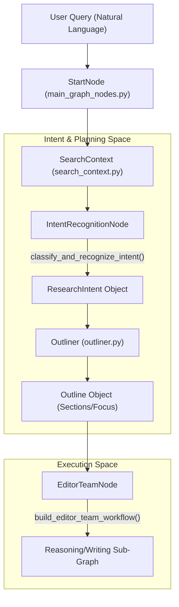
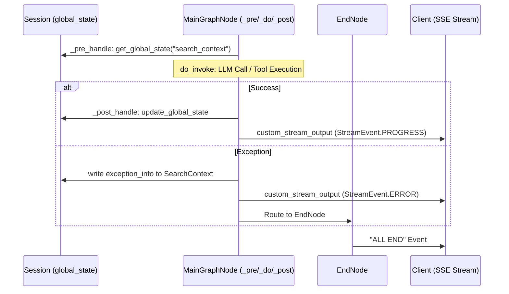

<!-- source: DeepWiki mcp.deepwiki.com · repo openJiuwen-ai/deepsearch · page 3.1 Main Graph Nodes and Workflow Lifecycle · fetched 2026-11-02 -->

# Main Graph Nodes and Workflow Lifecycle

Relevant source files

The following files were used as context for generating this wiki page:

- [deepsearch/docs/en/4.Developer Guide/API Reference/main_nodes.md](deepsearch/docs/en/4.Developer Guide/API Reference/main_nodes.md)
- [deepsearch/docs/feature/framework/research-workflow.md](deepsearch/docs/feature/framework/research-workflow.md)
- [deepsearch/docs/feature/framework/search-context.md](deepsearch/docs/feature/framework/search-context.md)
- [deepsearch/openjiuwen_deepsearch/framework/openjiuwen/agent/main_graph_nodes.py](deepsearch/openjiuwen_deepsearch/framework/openjiuwen/agent/main_graph_nodes.py)
- [deepsearch/tests/node/test_agent_node.py](deepsearch/tests/node/test_agent_node.py)

This page provides a deep dive into the core orchestration layer of the DeepSearch research workflow. It details the lifecycle of `MainGraphNodes` and how they manage state, handle user interactions (HITL), and route execution based on intent and dependencies.

## Workflow Lifecycle and Node Pattern

Every node in the DeepSearch main graph inherits from `BaseNode` [deepsearch/openjiuwen_deepsearch/framework/openjiuwen/agent/base_node.py:25-27](), which enforces a standardized lifecycle for execution, state management, and streaming.

### The Lifecycle Methods
Nodes implement their logic by overriding the following internal methods:
1.  **`_pre_handle`**: Extracts necessary data from the `Session` global state and `SearchContext`.
2.  **`_do_invoke`**: Executes the core business logic (e.g., calling an LLM, searching the web, or invoking a sub-workflow).
3.  **`_post_handle`**: Persists results back to the `SearchContext` in the `Session` and emits stream events to the frontend.

### State Management via Session
The `Session` object acts as the shared memory for the graph [openjiuwen/core/session/node.py:16-16](). Nodes interact with it primarily through the `SearchContext` model [deepsearch/openjiuwen_deepsearch/framework/openjiuwen/agent/search_context.py:100-100]().

| Feature | Description | Code Reference |
| :--- | :--- | :--- |
| **Global State** | Stores `search_context`, `agent_config`, and `service_config`. | [deepsearch/openjiuwen_deepsearch/framework/openjiuwen/agent/main_graph_nodes.py:189-204]() |
| **SearchContext** | A Pydantic model tracking query, intent, outline, report, and final results. | [deepsearch/openjiuwen_deepsearch/framework/openjiuwen/agent/search_context.py:100-100]() |
| **Telemetry** | Every state transition is emitted for observability. | [deepsearch/openjiuwen_deepsearch/framework/openjiuwen/agent/main_graph_nodes.py:133-138]() |

**Sources:** [deepsearch/openjiuwen_deepsearch/framework/openjiuwen/agent/main_graph_nodes.py:164-210](), [deepsearch/docs/feature/framework/search-context.md:34-40]()

---

## Core Node Deep Dive

### 1. Initialization and Intent
*   **StartNode**: Initializes the `SearchContext`. It captures the `original_query`, `search_mode`, and merges `agent_config` with service defaults [deepsearch/openjiuwen_deepsearch/framework/openjiuwen/agent/main_graph_nodes.py:164-210]().
*   **IntentRecognitionNode**: Detects query language and research intent. If the execution method is `hybrid`, it calls `route_outline_execution_method` to decide between parallel or dependency-driven workflows [deepsearch/openjiuwen_deepsearch/framework/openjiuwen/agent/main_graph_nodes.py:238-335]().

### 2. Planning and Interaction (HITL)
*   **GenerateQuestionsNode**: If Human-in-the-Loop (HITL) is enabled, this node generates clarifying questions to resolve ambiguity in the query [deepsearch/openjiuwen_deepsearch/framework/openjiuwen/agent/main_graph_nodes.py:365-412]().
*   **OutlineNode / DependencyOutlineNode**: Generates the report structure. `DependencyOutlineNode` identifies logical dependencies between sections (e.g., Section A must be written before Section B) [deepsearch/openjiuwen_deepsearch/framework/openjiuwen/agent/main_graph_nodes.py:650-705]().
*   **OutlineInteractionNode**: Pauses execution to allow users to `accept`, `revise_comment`, or `revise_outline`. It manages the `outline_interactions` history in the context [deepsearch/openjiuwen_deepsearch/framework/openjiuwen/agent/main_graph_nodes.py:708-834]().

### 3. Execution Teams
*   **EditorTeamNode**: Orchestrates the `reasoning_writing_graph` for all sections in parallel [deepsearch/openjiuwen_deepsearch/framework/openjiuwen/agent/editor_team_manager_node.py:13-15]().
*   **DependencyEditorTeamNode**: A specialized version that executes sections in "layers" based on their dependency graph, ensuring prerequisite information is available for subsequent sections [deepsearch/openjiuwen_deepsearch/framework/openjiuwen/agent/main_graph_nodes.py:70-74]().

### 4. Synthesis and Enrichment
*   **ReporterNode**: Aggregates all section sub-reports into a final cohesive document, generating the abstract, conclusion, and table of contents [deepsearch/openjiuwen_deepsearch/framework/openjiuwen/agent/main_graph_nodes.py:898-953]().
*   **SourceTracerNode**: Performs global citation verification, inserting `[checked_citation:id]` markers into the text [deepsearch/openjiuwen_deepsearch/framework/openjiuwen/agent/main_graph_nodes.py:956-1008]().
*   **VLMChartGeneratorNode**: Identifies data points suitable for visualization and uses a Vision-Language Model (VLM) to generate Mermaid or Python-based charts [deepsearch/openjiuwen_deepsearch/framework/openjiuwen/agent/main_graph_nodes.py:1053-1107]().

### 5. Post-Processing and Feedback
*   **UserFeedbackProcessorNode**: Enables the "Chat-with-Report" feature. It handles actions like `expand`, `shorten`, `polish`, or `truth_verification` on specific spans of the generated report [deepsearch/openjiuwen_deepsearch/framework/openjiuwen/agent/main_graph_nodes.py:1161-1317]().
*   **EndNode**: Appends the AI-generation disclaimer and emits the `ALL END` event to close the stream [deepsearch/openjiuwen_deepsearch/framework/openjiuwen/agent/main_graph_nodes.py:1367-1422]().

**Sources:** [deepsearch/openjiuwen_deepsearch/framework/openjiuwen/agent/main_graph_nodes.py:1-1422](), [deepsearch/docs/en/4.Developer Guide/API Reference/main_nodes.md:5-139]()

---

## Technical Workflow Diagrams

### Natural Language to Code Entity Space: Query Handling
This diagram illustrates how a natural language query is transformed into structured code entities within the main graph.

**Sources:** [deepsearch/openjiuwen_deepsearch/framework/openjiuwen/agent/main_graph_nodes.py:238-335](), [deepsearch/openjiuwen_deepsearch/framework/openjiuwen/agent/search_context.py:92-103]()

### Workflow Lifecycle and Error Routing
This diagram maps the node lifecycle to the internal exception handling and streaming mechanisms.

**Sources:** [deepsearch/openjiuwen_deepsearch/framework/openjiuwen/agent/main_graph_nodes.py:1367-1422](), [deepsearch/openjiuwen_deepsearch/utils/common_utils/stream_utils.py:114-119]()

---

## State Transition Table

The following table describes how key `SearchContext` fields are updated across the node lifecycle.

| Node | Input Fields | Output Fields |
| :--- | :--- | :--- |
| `IntentRecognitionNode` | `original_query` | `research_intent`, `language` |
| `OutlineNode` | `research_intent`, `report_template` | `current_outline` |
| `OutlineInteractionNode` | `interrupt_feedback` | `outline_interactions` |
| `EditorTeamNode` | `current_outline` | `sub_report_content` |
| `ReporterNode` | `sub_report_content` | `current_report` |
| `SourceTracerNode` | `current_report` | `final_result.citation_messages` |
| `UserFeedbackProcessorNode` | `user_feedback` | `rewrite_history`, `final_result.response_content` |

**Sources:** [deepsearch/docs/feature/framework/search-context.md:14-22](), [deepsearch/openjiuwen_deepsearch/framework/openjiuwen/agent/main_graph_nodes.py:1161-1317]()

---

