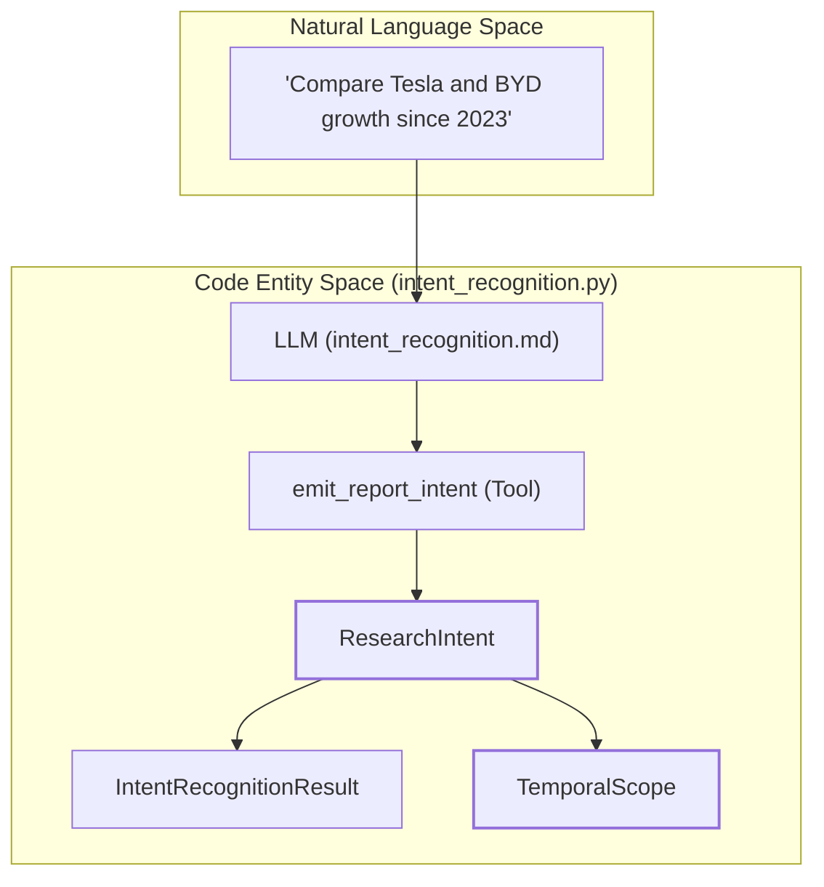
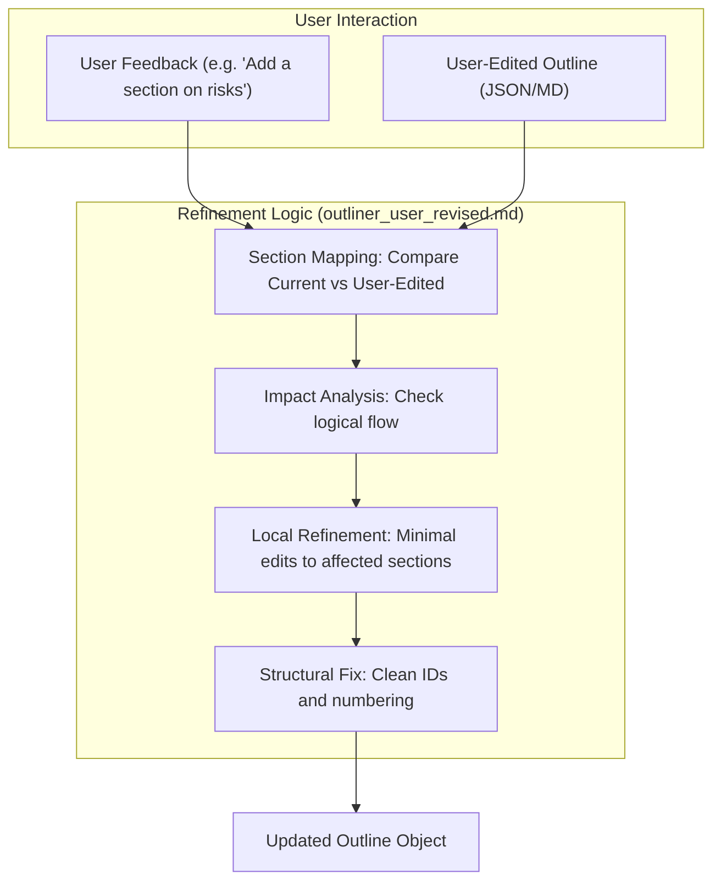

<!-- source: DeepWiki mcp.deepwiki.com · repo openJiuwen-ai/deepsearch · page 3.2 Query Understanding: Intent, Outline, and Planning · fetched 2026-11-02 -->

# Query Understanding: Intent, Outline, and Planning

Relevant source files

The following files were used as context for generating this wiki page:

- [deepsearch/docs/feature/algorithm/query-understanding.md](deepsearch/docs/feature/algorithm/query-understanding.md)
- [deepsearch/docs/feature/framework/info-collector-subgraph.md](deepsearch/docs/feature/framework/info-collector-subgraph.md)
- [deepsearch/docs/feature/framework/search-tool-registration.md](deepsearch/docs/feature/framework/search-tool-registration.md)
- [deepsearch/openjiuwen_deepsearch/algorithm/prompts/collector_gen_query.md](deepsearch/openjiuwen_deepsearch/algorithm/prompts/collector_gen_query.md)
- [deepsearch/openjiuwen_deepsearch/algorithm/prompts/collector_supervisor.md](deepsearch/openjiuwen_deepsearch/algorithm/prompts/collector_supervisor.md)
- [deepsearch/openjiuwen_deepsearch/algorithm/prompts/dep_driving_outliner.md](deepsearch/openjiuwen_deepsearch/algorithm/prompts/dep_driving_outliner.md)
- [deepsearch/openjiuwen_deepsearch/algorithm/prompts/dep_driving_outliner_interaction.md](deepsearch/openjiuwen_deepsearch/algorithm/prompts/dep_driving_outliner_interaction.md)
- [deepsearch/openjiuwen_deepsearch/algorithm/prompts/intent_recognition.md](deepsearch/openjiuwen_deepsearch/algorithm/prompts/intent_recognition.md)
- [deepsearch/openjiuwen_deepsearch/algorithm/prompts/intent_recognition_entry.md](deepsearch/openjiuwen_deepsearch/algorithm/prompts/intent_recognition_entry.md)
- [deepsearch/openjiuwen_deepsearch/algorithm/prompts/outliner.md](deepsearch/openjiuwen_deepsearch/algorithm/prompts/outliner.md)
- [deepsearch/openjiuwen_deepsearch/algorithm/prompts/outliner_interaction.md](deepsearch/openjiuwen_deepsearch/algorithm/prompts/outliner_interaction.md)
- [deepsearch/openjiuwen_deepsearch/algorithm/prompts/outliner_user_revised.md](deepsearch/openjiuwen_deepsearch/algorithm/prompts/outliner_user_revised.md)
- [deepsearch/openjiuwen_deepsearch/algorithm/query_understanding/intent_recognition.py](deepsearch/openjiuwen_deepsearch/algorithm/query_understanding/intent_recognition.py)
- [deepsearch/openjiuwen_deepsearch/algorithm/research_collector/collector_evidence.py](deepsearch/openjiuwen_deepsearch/algorithm/research_collector/collector_evidence.py)
- [deepsearch/tests/algorithm/query_understanding/test_intent_recognition.py](deepsearch/tests/algorithm/query_understanding/test_intent_recognition.py)
- [deepsearch/tests/algorithm/query_understanding/test_research_intent_contract.py](deepsearch/tests/algorithm/query_understanding/test_research_intent_contract.py)

The `query_understanding` module is the entry point of the research workflow. Its purpose is to transform a raw natural language query into a structured research plan that downstream agents can execute. This involves identifying the user's core intent, detecting constraints (temporal, source-specific), and generating a hierarchical or dependency-driven outline with corresponding information collection steps.

Sources: [deepsearch/docs/feature/algorithm/query-understanding.md:9-12](), [deepsearch/openjiuwen_deepsearch/algorithm/query_understanding/intent_recognition.py:78-87]()

---

## 1. Intent Recognition and Normalization

Intent recognition is handled by the `IntentRecognitionNode` (within the main graph) which calls `classify_and_recognize_intent`. This process extracts the core research topic, language, and structural constraints.

### 1.1. Data Structures
The system uses specialized Pydantic models to ensure data integrity across the workflow:
*   **`ResearchIntent`**: Captures `task_type` (e.g., `comparison`, `evaluation`), `required_dimensions`, `comparison_targets`, and report styling (`audience_role`, `tone`). [deepsearch/openjiuwen_deepsearch/framework/openjiuwen/agent/search_context.py:15-15](), [deepsearch/openjiuwen_deepsearch/algorithm/query_understanding/intent_recognition.py:166-203]()
*   **`TemporalScope`**: Normalizes time constraints into `source_date` (publication time) or `content_date` (fact occurrence). [deepsearch/openjiuwen_deepsearch/framework/openjiuwen/agent/search_context.py:16-16](), [deepsearch/openjiuwen_deepsearch/algorithm/query_understanding/intent_recognition.py:149-164]()
*   **`IntentRecognitionResult`**: The final output containing the `original_query`, a cleaned `research_query` for initial search, and the `ResearchIntent`. [deepsearch/openjiuwen_deepsearch/algorithm/query_understanding/intent_recognition.py:78-87]()

### 1.2. Normalization Logic
The system applies strict normalization to LLM outputs to prevent downstream failures:
*   **Task Type Aliases**: Maps variants like "classify" or "categorization" to a standard `classification` enum. [deepsearch/openjiuwen_deepsearch/algorithm/query_understanding/intent_recognition.py:135-146]()
*   **Temporal Normalization**: Vague terms like "year-end" are converted to specific dates (e.g., Dec 31). [deepsearch/openjiuwen_deepsearch/algorithm/prompts/intent_recognition.md:43-45](), [deepsearch/docs/feature/algorithm/query-understanding.md:24-25]()
*   **Domain Extraction**: If a user provides a specific `include_url`, the system automatically extracts and adds the domain to `include_domains`. [deepsearch/openjiuwen_deepsearch/algorithm/query_understanding/intent_recognition.py:204-208]()

### Intent Extraction Data Flow
Title: Intent Extraction from Natural Language to Code Entities

Sources: [deepsearch/openjiuwen_deepsearch/algorithm/query_understanding/intent_recognition.py:27-27](), [deepsearch/openjiuwen_deepsearch/algorithm/prompts/intent_recognition.md:19-47]()

---

## 2. Outline Generation (Outliner)

The `Outliner` class generates a structured plan for the report. It supports three primary modes to balance speed and logical depth.

### 2.1. Generation Modes
| Mode | Logic | Use Case |
| :--- | :--- | :--- |
| **Parallel** | Sections are independent and can be researched simultaneously. | Standard reports with broad coverage. |
| **Dependency Driving** | Sections have explicit parent-child relationships (e.g., `Framework Support`, `Information Integration`). | Complex analytical reports where conclusions in one section impact others. |
| **Hybrid** | A mix of parallel and dependent sections. | Default for high-complexity research. |

Sources: [deepsearch/docs/feature/algorithm/query-understanding.md:21-30](), [deepsearch/openjiuwen_deepsearch/algorithm/prompts/dep_driving_outliner.md:145-160]()

### 2.2. Section Contract
Every section generated must adhere to a strict contract defined in the prompt templates (`outliner.md`, `dep_driving_outliner.md`):
*   **`description`**: Contains substantive research scope, questions, and analytical dimensions. [deepsearch/openjiuwen_deepsearch/algorithm/prompts/dep_driving_outliner.md:31-32]()
*   **`format_requirements`**: A list of specific constraints like "Markdown table with columns X, Y, Z" or "Source restrictions". [deepsearch/openjiuwen_deepsearch/algorithm/prompts/dep_driving_outliner.md:33-34]()
*   **`section_focus` / `focus_dimensions`**: Non-empty fields used to guide the `Collector` and `Reporter` agents. [deepsearch/openjiuwen_deepsearch/algorithm/prompts/dep_driving_outliner.md:37-37]()

Sources: [deepsearch/docs/feature/algorithm/query-understanding.md:27-30]()

---

## 3. Planning and Step Generation

Once the outline is established, the `Planner` generates specific execution steps for each section.

### 3.1. Planner Logic
The `Planner` (implemented in `planner.py`) breaks down a section's `description` into actionable items. In **Dependency Driving** mode, steps also include `parent_ids` and `relationship` descriptions to ensure the research collector follows a logical sequence.

Sources: [deepsearch/docs/feature/algorithm/query-understanding.md:21-21](), [deepsearch/docs/feature/algorithm/query-understanding.md:68-68]()

### 3.2. Entry Search Integration
Before generating the outline, the system may perform an **Entry Search** (initial web search). The results are passed into the `outliner` prompts via the `entry_search_results` variable to ground the outline in current real-world data.

Sources: [deepsearch/docs/feature/algorithm/query-understanding.md:17-17](), [deepsearch/openjiuwen_deepsearch/algorithm/prompts/outliner.md:13-18]()

---

## 4. Prompt Templates and Interaction

The `query_understanding` module relies on a set of specialized Jinja2 templates located in `algorithm/prompts/`.

### 4.1. Primary Templates
*   **`intent_recognition.md`**: Used for initial parsing of the query. [deepsearch/openjiuwen_deepsearch/algorithm/prompts/intent_recognition.md:5-78]()
*   **`outliner.md`**: Standard parallel outline generation. [deepsearch/openjiuwen_deepsearch/algorithm/prompts/outliner.md:5-110]()
*   **`dep_driving_outliner.md`**: Generates outlines with logical dependencies. [deepsearch/openjiuwen_deepsearch/algorithm/prompts/dep_driving_outliner.md:5-160]()

### 4.2. Human-in-the-Loop (HITL) Interaction
If a user provides feedback on an outline, the system uses "Interaction" templates (`outliner_interaction.md`, `dep_driving_outliner_interaction.md`). These prompts emphasize **incremental refinement** over complete regeneration, ensuring that previous structural decisions are respected unless explicitly changed.

Sources: [deepsearch/openjiuwen_deepsearch/algorithm/prompts/outliner_interaction.md:130-134](), [deepsearch/openjiuwen_deepsearch/algorithm/prompts/dep_driving_outliner_interaction.md:162-173]()

### Outline Refinement Workflow
Title: Outline Interaction and Refinement Process

Sources: [deepsearch/openjiuwen_deepsearch/algorithm/prompts/outliner_user_revised.md:118-174]()

---

## 5. Summary of Key Implementation Files

| File Path | Description |
| :--- | :--- |
| `intent_recognition.py` | Main logic for intent parsing, normalization, and tool calling. |
| `outliner.py` | Logic for generating and validating `Outline` and `Section` objects. |
| `planner.py` | Logic for generating research `Plan` and `Step` objects. |
| `search_context.py` | Defines the data contracts (`ResearchIntent`, `TemporalScope`). |

Sources: [deepsearch/docs/feature/algorithm/query-understanding.md:32-37](), [deepsearch/openjiuwen_deepsearch/algorithm/query_understanding/intent_recognition.py:13-17]()

---

