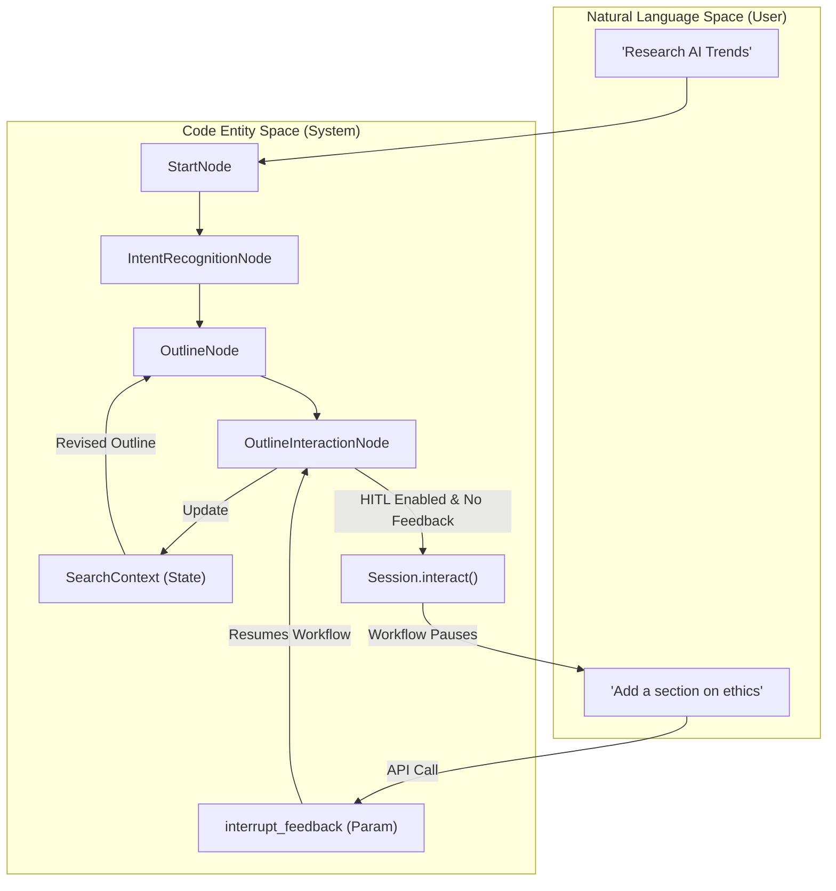
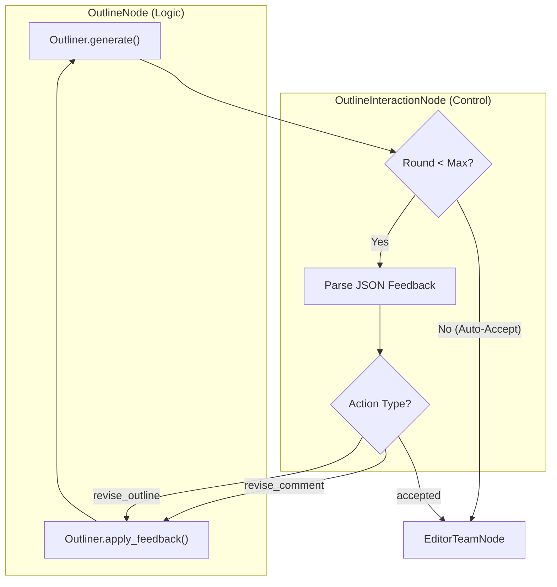

<!-- source: DeepWiki mcp.deepwiki.com · repo openJiuwen-ai/deepsearch · page 3.3 Human-in-the-Loop (HITL) Interactions · fetched 2026-11-02 -->

# Human-in-the-Loop (HITL) Interactions

Relevant source files

The following files were used as context for generating this wiki page:

- [deepsearch/docs/en/4.Developer Guide/API Reference/main_nodes.md](deepsearch/docs/en/4.Developer Guide/API Reference/main_nodes.md)
- [deepsearch/docs/feature/framework/research-workflow.md](deepsearch/docs/feature/framework/research-workflow.md)
- [deepsearch/openjiuwen_deepsearch/framework/openjiuwen/agent/main_graph_nodes.py](deepsearch/openjiuwen_deepsearch/framework/openjiuwen/agent/main_graph_nodes.py)
- [deepsearch/tests/node/test_agent_node.py](deepsearch/tests/node/test_agent_node.py)

Human-in-the-Loop (HITL) interactions are critical synchronization points in the DeepSearch workflow where the agent pauses execution to solicit user input. These interactions ensure that the research direction aligns with user expectations before committing heavy computational resources to information collection and report writing.

The system implements two primary HITL interaction points:
1.  **Clarifying Questions**: Generated immediately after intent recognition to resolve ambiguities in the initial query.
2.  **Outline Interaction**: Generated after the research plan is structured, allowing the user to approve or modify the report's skeleton.

## Interaction Architecture and Resumption

HITL interactions leverage the `interrupt_feedback` mechanism. When the workflow reaches an interaction node, it checks if `workflow_human_in_the_loop` is enabled in the `AgentConfig` [deepsearch/openjiuwen_deepsearch/framework/openjiuwen/agent/main_graph_nodes.py:191-201](). If enabled and no feedback is present, the node triggers a session interruption via `session.interact()` [deepsearch/openjiuwen_deepsearch/framework/openjiuwen/agent/main_graph_nodes.py:273-278]().

The workflow resumes when the `/api/deepsearch/run` endpoint is called with the same `conversation_id` and a non-empty `interrupt_feedback` string [deepsearch/openjiuwen_deepsearch/docs/en/4.Developer Guide/API Reference/main_nodes.md:11-12]().

### HITL Logic Flow (Natural Language to Code)

The following diagram illustrates how the abstract "Interaction Request" is realized through specific code entities and state transitions.

**Diagram: HITL Resumption and State Mapping**

**Sources:** [deepsearch/openjiuwen_deepsearch/framework/openjiuwen/agent/main_graph_nodes.py:179-205](), [deepsearch/openjiuwen_deepsearch/docs/feature/framework/research-workflow.md:42-55]()

---

## Clarifying Question Generation

The first HITL point occurs via `GenerateQuestionsNode` and `FeedbackHandlerNode`. This phase is designed to minimize research drift by asking the user to specify the scope, depth, or specific focus areas.

### Implementation Details
*   **GenerateQuestionsNode**: Uses the `query_interpreter` to analyze the query and generate a list of questions [deepsearch/openjiuwen_deepsearch/docs/en/4.Developer Guide/API Reference/main_nodes.md:19-23](). The number of retries is controlled by `workflow_max_gen_question_retry_num`.
*   **FeedbackHandlerNode**: Manages the reception of user answers. If the user provides a `FINISH_TASK` command, the workflow terminates early [deepsearch/openjiuwen_deepsearch/docs/en/4.Developer Guide/API Reference/main_nodes.md:25-29]().
*   **Storage**: Questions are stored in `search_context.questions` and user responses in `search_context.user_feedback` [deepsearch/openjiuwen_deepsearch/framework/openjiuwen/agent/search_context.py:140-141]().

---

## Outline Interaction Cycle

The `OutlineInteractionNode` (and its variant `DependencyOutlineInteractionNode`) manages the most complex HITL cycle. It allows users to review the `Outline` object before the `EditorTeamNode` begins the multi-agent writing process.

### Feedback Actions
The system accepts three specific feedback types in the `interrupt_feedback` field:

| Action | Description | Resulting Transition |
| :--- | :--- | :--- |
| `accepted` | User approves the outline as is. | Transitions to `EditorTeamNode`. |
| `revise_comment` | User provides natural language suggestions. | Transitions back to `OutlineNode` for regeneration. |
| `revise_outline` | User provides a full JSON outline to use. | Transitions back to `OutlineNode` to apply the structure. |

### Configuration and Limits
*   **Max Rounds**: Controlled by `outline_interaction_max_rounds`. If reached, the workflow proceeds with the current outline regardless of feedback [deepsearch/openjiuwen_deepsearch/docs/en/4.Developer Guide/API Reference/main_nodes.md:47-57]().
*   **History**: Every interaction round is recorded in `search_context.outline_interactions` as an `OutlineInteraction` object [deepsearch/openjiuwen_deepsearch/framework/openjiuwen/agent/search_context.py:97-103]().

### Outline Interaction Data Flow

This diagram maps the `OutlineInteractionNode` logic to the `SearchContext` state and the retry loop.

**Diagram: Outline Interaction Loop**

**Sources:** [deepsearch/openjiuwen_deepsearch/docs/en/4.Developer Guide/API Reference/main_nodes.md:43-62](), [deepsearch/openjiuwen_deepsearch/framework/openjiuwen/agent/main_graph_nodes.py:97-103]()

---

## Technical Summary Table

| Code Entity | File Path | Role |
| :--- | :--- | :--- |
| `GenerateQuestionsNode` | `main_graph_nodes.py` | Generates clarifying questions using `query_interpreter`. |
| `FeedbackHandlerNode` | `main_graph_nodes.py` | Captures user responses to questions and updates context. |
| `OutlineInteractionNode` | `main_graph_nodes.py` | Orchestrates the outline approval/revision loop. |
| `OutlineInteraction` | `search_context.py` | Data class for storing a single round of outline feedback. |
| `interrupt_feedback` | `deepsearch_run.py` | The API parameter used to resume a paused session. |

**Sources:** [deepsearch/openjiuwen_deepsearch/framework/openjiuwen/agent/main_graph_nodes.py:19-67](), [deepsearch/openjiuwen_deepsearch/framework/openjiuwen/agent/search_context.py:92-103](), [deepsearch/openjiuwen_deepsearch/docs/feature/framework/research-workflow.md:58-64]()

---

