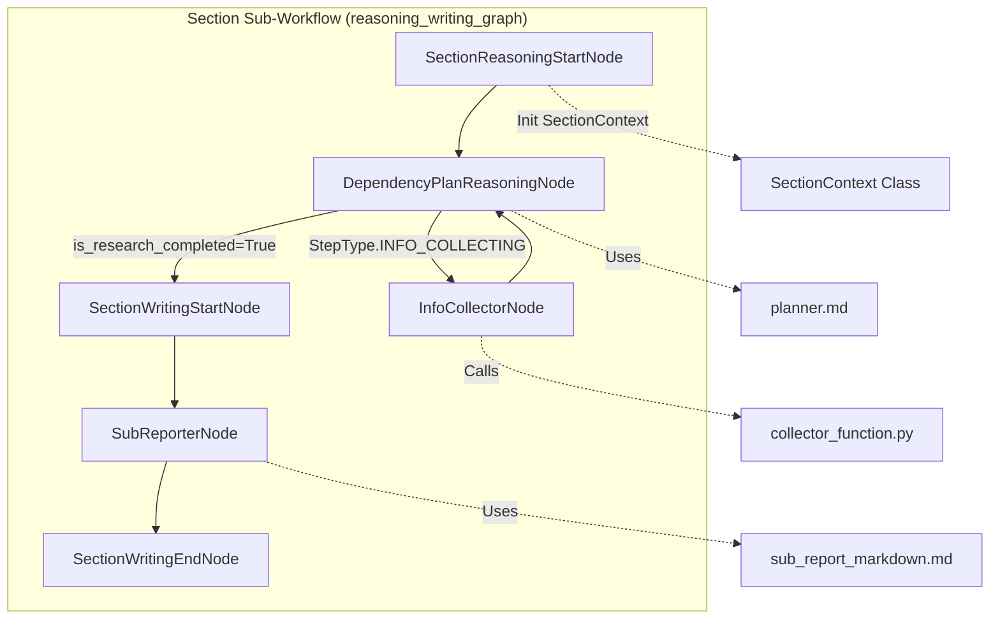
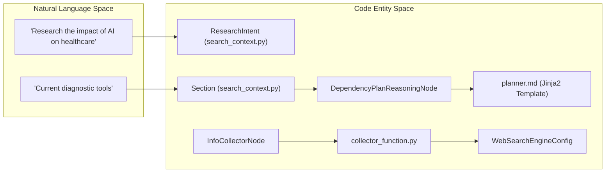

<!-- source: DeepWiki mcp.deepwiki.com · repo openJiuwen-ai/deepsearch · page 3.4 Section Reasoning and Writing Sub-Workflows · fetched 2026-11-02 -->

# Section Reasoning and Writing Sub-Workflows

Relevant source files

The following files were used as context for generating this wiki page:

- [deepsearch/docs/en/4.Developer Guide/API Reference/main_nodes.md](deepsearch/docs/en/4.Developer Guide/API Reference/main_nodes.md)
- [deepsearch/docs/feature/framework/research-workflow.md](deepsearch/docs/feature/framework/research-workflow.md)
- [deepsearch/openjiuwen_deepsearch/framework/openjiuwen/agent/main_graph_nodes.py](deepsearch/openjiuwen_deepsearch/framework/openjiuwen/agent/main_graph_nodes.py)
- [deepsearch/tests/node/test_agent_node.py](deepsearch/tests/node/test_agent_node.py)
- [deepsearch/tests/workflow/test_dependency_reasoning_nodes.py](deepsearch/tests/workflow/test_dependency_reasoning_nodes.py)

This page details the sub-workflow orchestration for individual report sections. Once an outline is finalized, the system transitions from global planning to granular execution, where each section undergoes independent reasoning, information collection, and drafting. The orchestration supports both massive parallelization and dependency-aware sequential execution.

## Sub-Workflow Overview

The research process delegates section-level tasks to specialized sub-graphs. These sub-graphs encapsulate the logic for planning research steps, invoking the **Research Collector**, and synthesizing sub-reports.

### Key Components

*   **EditorTeamNode**: The manager node in the main graph responsible for spawning and monitoring section sub-workflows [deepsearch/openjiuwen_deepsearch/framework/openjiuwen/agent/editor_team_manager_node.py:64-66]().
*   **SectionContext**: A specialized state container that isolates a section's data (collected evidence, local plans, writing progress) from the global `SearchContext` [deepsearch/openjiuwen_deepsearch/framework/openjiuwen/agent/search_context.py:348-350]().
*   **Reasoning-Writing Graph**: The actual executable workflow logic for a single section, defined in `reasoning_writing_graph/editor_team_nodes.py` [deepsearch/openjiuwen_deepsearch/framework/openjiuwen/agent/reasoning_writing_graph/editor_team_nodes.py:30-31]().

---

## Editor Team Orchestration Modes

DeepSearch provides two primary execution methods for sections, determined by the `execution_method` configuration or the `IntentRecognitionNode` router.

### 1. Parallel Execution (`EditorTeamNode`)
In this mode, all sections in the outline are executed concurrently. This is the default for standard research queries where sections do not strictly depend on the findings of previous chapters.

*   **Implementation**: It uses `asyncio.gather` to invoke sub-graphs for every section in the `search_context.current_outline.sections` list [deepsearch/openjiuwen_deepsearch/framework/openjiuwen/agent/editor_team_manager_node.py:160-162]().
*   **Data Flow**: Each sub-graph receives a `SectionContext` containing the `section_local_contract` (title, description, and core status) [deepsearch/openjiuwen_deepsearch/framework/openjiuwen/agent/editor_team_manager_node.py:108-112]().

### 2. Dependency-Driving Execution (`DependencyEditorTeamNode`)
Used for complex analytical reports where later sections require data or conclusions from earlier ones (e.g., a "Conclusion" section requiring "Market Analysis" results).

*   **Layering Logic**: Sections are grouped by their dependency level. The system executes one layer at a time.
*   **Pipelining**: While the current layer is undergoing "Reasoning" (planning and collection), the previous layer's "Writing" phase is executed in parallel to optimize throughput [deepsearch/openjiuwen_deepsearch/framework/openjiuwen/agent/editor_team_manager_node.py:218-225]().
*   **Background Knowledge**: Results from completed steps in parent sections are passed into the `SectionReasoningStartNode` as `parent_section_steps`, which populates `plan_background_knowledge` for the current section's LLM planner [deepsearch/tests/workflow/test_dependency_reasoning_nodes.py:53-56]().

---

## The Reasoning and Writing Sub-Graph

The sub-graph is a loop that iterates between reasoning (planning) and action (collecting/writing) until the section is complete.

### Data Contract: SectionContext
When a section sub-workflow starts, it initializes a `SectionContext`. Key fields include:
*   `section_local_contract`: The specific segment of the outline this node is responsible for [deepsearch/openjiuwen_deepsearch/framework/openjiuwen/agent/editor_team_manager_node.py:108-112]().
*   `focus_dimensions`: Specific areas of interest extracted from the user query to guide the collector.
*   `history_plans`: A log of all planning iterations for this section.

### Diagram: Sub-Workflow Logic Flow
This diagram maps the logical states to the internal node classes used in the reasoning-writing sub-graph.

**Sources**: [deepsearch/openjiuwen_deepsearch/framework/openjiuwen/agent/reasoning_writing_graph/editor_team_nodes.py:30-60](), [deepsearch/tests/workflow/test_dependency_reasoning_nodes.py:11-15](), [deepsearch/openjiuwen_deepsearch/framework/openjiuwen/agent/search_context.py:348-350]().

---

## Key Sub-Workflow Nodes

### Section Reasoning Nodes
These nodes handle the "thinking" phase where the agent decides what information is missing.

*   **SectionReasoningStartNode**: Extracts background knowledge from previous sections (if in dependency mode) and sets up the local state [deepsearch/tests/workflow/test_dependency_reasoning_nodes.py:24-30]().
*   **DependencyPlanReasoningNode**: The brain of the sub-workflow. It generates a `Plan` consisting of multiple `Steps`. If the plan indicates more information is needed, it routes to the collector [deepsearch/tests/workflow/test_dependency_reasoning_nodes.py:128-130]().
*   **SectionReasoningEndNode**: Finalizes the reasoning phase and prepares the collected evidence for the writing phase [deepsearch/tests/workflow/test_dependency_reasoning_nodes.py:92-95]().

### Section Writing Nodes
Once reasoning is complete, these nodes transform evidence into Markdown.

*   **SectionWritingStartNode**: Prepares the prompt context for the LLM, including all collected documents and the section's specific requirements.
*   **SubReporterNode**: Invokes the `Reporter.generate_sub_report` method. It ensures the output follows the "Flat Heading" contract (only H1 and H2) and prohibits Mermaid charts at this stage (charts are handled by the `VLMChartGeneratorNode` later) [deepsearch/docs/en/4.Developer Guide/API Reference/main_nodes.md:77-80]().
*   **SectionWritingEndNode**: Captures the generated Markdown and stores it in the `search_context.sub_report_content` buffer.

---

## Entity Association: Code to Workflow

The following diagram bridges the high-level research concepts to the specific Python classes and prompt files used during the Section Reasoning phase.

**Sources**: [deepsearch/openjiuwen_deepsearch/framework/openjiuwen/agent/search_context.py:98-100](), [deepsearch/openjiuwen_deepsearch/framework/openjiuwen/agent/reasoning_writing_graph/dependency_reasoning_team_nodes.py:11-13](), [deepsearch/openjiuwen_deepsearch/config/config.py:88-90]().

---

## Error Handling and Retries

The sub-workflows include built-in resilience:
1.  **Planner Retries**: If the `DependencyPlanReasoningNode` fails to produce a valid plan, it retries up to `planner_max_retry_num` times [deepsearch/tests/workflow/test_dependency_reasoning_nodes.py:184-185]().
2.  **Writing Validation**: The `SubReporterNode` checks for forbidden content (e.g., Mermaid code or H3 headers). If found, it triggers a retry with a feedback prompt explaining the violation [deepsearch/docs/en/4.Developer Guide/API Reference/main_nodes.md:77-80]().
3.  **Exception Propagation**: Any terminal failure in a section sub-workflow is captured in `section_context.exception_infos` and reported back to the `EditorTeamNode`, which aggregates warnings for the final report [deepsearch/tests/workflow/test_dependency_reasoning_nodes.py:125-126]().

**Sources**:
*   `deepsearch/openjiuwen_deepsearch/framework/openjiuwen/agent/editor_team_manager_node.py`
*   `deepsearch/openjiuwen_deepsearch/framework/openjiuwen/agent/reasoning_writing_graph/editor_team_nodes.py`
*   `deepsearch/openjiuwen_deepsearch/framework/openjiuwen/agent/reasoning_writing_graph/dependency_reasoning_team_nodes.py`
*   `deepsearch/openjiuwen_deepsearch/framework/openjiuwen/agent/search_context.py`
*   `deepsearch/docs/en/4.Developer Guide/API Reference/main_nodes.md`
*   `deepsearch/tests/workflow/test_dependency_reasoning_nodes.py`

---

