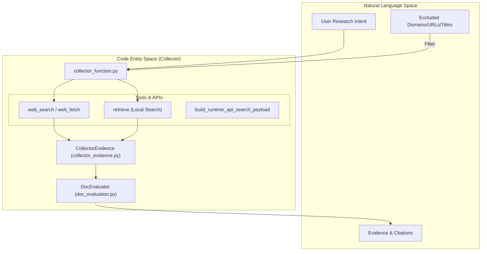
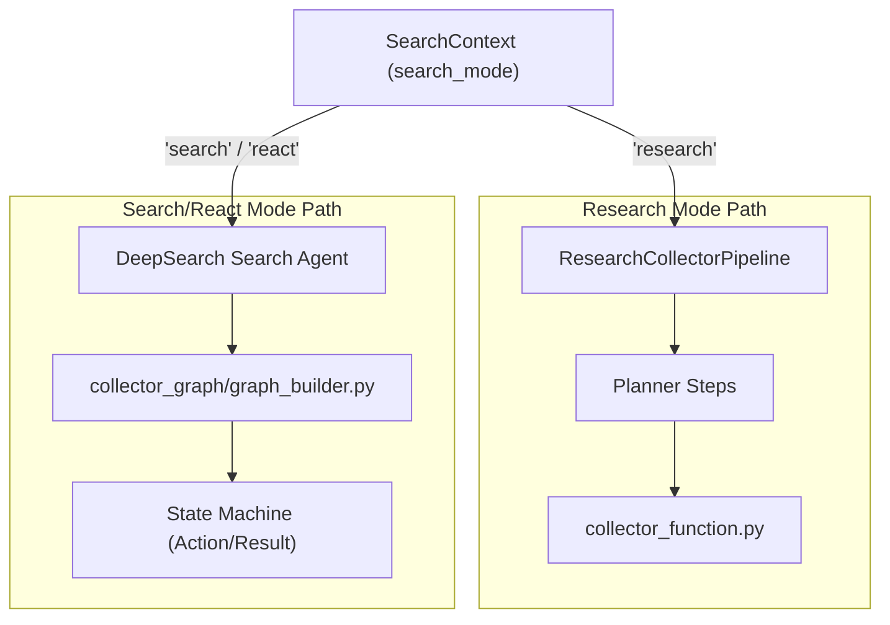

<!-- source: DeepWiki mcp.deepwiki.com · repo openJiuwen-ai/deepsearch · page 4 Information Collection (Research Collector) · fetched 2026-11-02 -->

# Information Collection (Research Collector)

Relevant source files

The following files were used as context for generating this wiki page:

- [deepsearch/docs/feature/algorithm/research-collector.md](deepsearch/docs/feature/algorithm/research-collector.md)
- [deepsearch/openjiuwen_deepsearch/algorithm/research_collector/collector_function.py](deepsearch/openjiuwen_deepsearch/algorithm/research_collector/collector_function.py)

The Information Collection system is responsible for gathering, filtering, and normalizing evidence from disparate sources—including web search engines, local knowledge bases, and runtime APIs—to provide high-quality data for report synthesis. It operates primarily through two distinct mechanisms: the **Research Collector Pipeline** (used for comprehensive report generation) and the **DeepSearch Search Agent** (used for interactive search and ReAct modes).

## System Overview

Information collection transforms raw tool outputs into structured evidence records. It handles the lifecycle of a search query from tool selection to document evaluation.

### Research vs. Search Modes
The system employs different strategies based on the `search_mode` defined in the `SearchContext`:
*   **Research Mode**: Uses a structured pipeline to execute planned steps, normalize results, and score documents for long-form report generation.
*   **Search/React Mode**: Uses an autonomous agent with a state machine to iteratively find and run actions until the query is answered.

### Code-to-Entity Mapping: Collector Architecture

The following diagram maps high-level collection concepts to their specific implementations in the codebase.

**Sources:** [deepsearch/openjiuwen_deepsearch/algorithm/research_collector/collector_function.py:188-193](), [deepsearch/docs/feature/algorithm/research-collector.md:9-20]()

## Key Subsystems

### 1. Research Collector Pipeline
The research collector is a specialized pipeline designed to process high volumes of information for the `EditorTeamNode`. It focuses on normalization and quality control.

*   **Filtering Logic**: It applies `exclude_domains`, `exclude_url`, and `exclude_titles` constraints specifically to web results to avoid prohibited sources [deepsearch/openjiuwen_deepsearch/algorithm/research_collector/collector_function.py:21-58]().
*   **Normalization**: It strips aggregator suffixes (e.g., "| MDPI") from titles to ensure accurate duplicate detection [deepsearch/openjiuwen_deepsearch/algorithm/research_collector/collector_function.py:77-83]().
*   **Evidence Structure**: Every piece of data is assigned a stable `doc_id` and `source_id` for downstream provenance [deepsearch/docs/feature/algorithm/research-collector.md:69-74]().
*   **Evaluation**: Documents are scored based on `authority`, `relevance`, `answerability`, and `data_density` using the `info_evaluator_doc.md` prompt [deepsearch/docs/feature/algorithm/research-collector.md:29-35]().

For details, see [Research Collector Pipeline](#4.1).

### 2. DeepSearch Search Agent (Search/React Modes)
For direct queries or interactive tasks, the system uses a ReAct-style agent. Unlike the research collector, this agent maintains a state machine to decide its next action dynamically.

*   **State Machine**: Tracks the `State`, `Action`, and `Result` loop to determine if further searching is required [deepsearch/docs/feature/algorithm/search-agent.md:15-25]().
*   **Action Space**: The agent samples from a pool of actions (e.g., `web_search`, `web_fetch`, `retrieve`) via the `FindActionSpaceNode` [deepsearch/docs/feature/algorithm/search-agent.md:40-50]().
*   **Context Management**: Implements strategies to handle context limit reaches during iterative searching.

For details, see [DeepSearch Search Agent (search/react modes)](#4.2).

## Data Flow and Normalization

The system ensures that regardless of the source, the output follows a strict data contract.

| Component | Responsibility | Code Reference |
| :--- | :--- | :--- |
| **Tool Normalization** | Converts raw JSON from Tavily, Google, or Milvus into a standard record. | `collector_function.py` |
| **ID Generation** | Creates hashes for `doc_id` and `source_id` to prevent redundant processing. | `collector_evidence.py` |
| **URL Cleaning** | Removes tracking parameters from URLs while preserving the original for citation. | `url_utils.py` |
| **Scoring** | LLM-based assessment of document quality before passing to the Reporter. | `doc_evaluation.py` |

### Search Mode Execution Flow

The following diagram illustrates how the `SearchContext` drives the selection between the collector pipeline and the search agent.

**Sources:** [deepsearch/docs/feature/algorithm/research-collector.md:47-56](), [deepsearch/docs/feature/algorithm/search-agent.md:9-13]()

## Child Pages
*   [Research Collector Pipeline](#4.1): Detailed breakdown of `collector_function.py`, filtering algorithms, and document evaluation metrics.
*   [DeepSearch Search Agent (search/react modes)](#4.2): Deep dive into the ReAct state machine, action sampling, and the `collector_graph` implementation.

---

