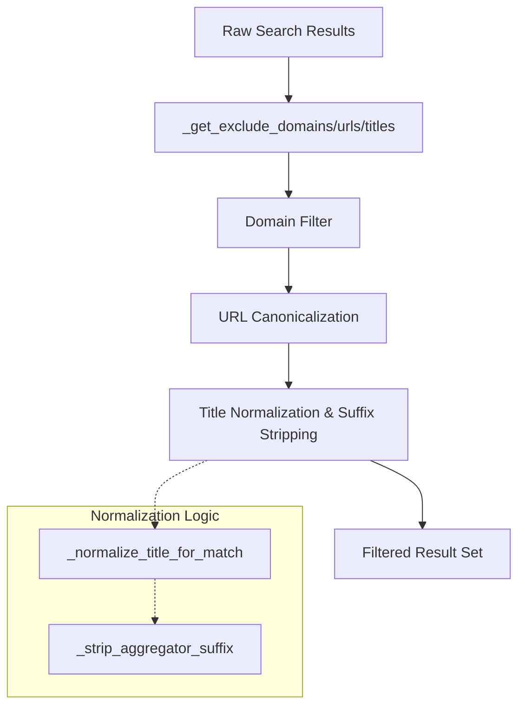
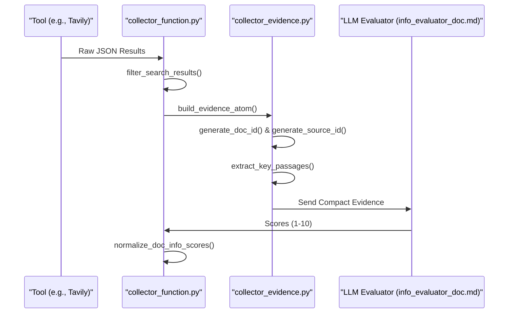

<!-- source: DeepWiki mcp.deepwiki.com · repo openJiuwen-ai/deepsearch · page 4.1 Research Collector Pipeline · fetched 2026-11-02 -->

# Research Collector Pipeline

Relevant source files

The following files were used as context for generating this wiki page:

- [deepsearch/docs/feature/algorithm/research-collector.md](deepsearch/docs/feature/algorithm/research-collector.md)
- [deepsearch/docs/feature/framework/info-collector-subgraph.md](deepsearch/docs/feature/framework/info-collector-subgraph.md)
- [deepsearch/docs/feature/framework/search-tool-registration.md](deepsearch/docs/feature/framework/search-tool-registration.md)
- [deepsearch/openjiuwen_deepsearch/algorithm/prompts/collector_gen_query.md](deepsearch/openjiuwen_deepsearch/algorithm/prompts/collector_gen_query.md)
- [deepsearch/openjiuwen_deepsearch/algorithm/prompts/collector_supervisor.md](deepsearch/openjiuwen_deepsearch/algorithm/prompts/collector_supervisor.md)
- [deepsearch/openjiuwen_deepsearch/algorithm/prompts/intent_recognition_entry.md](deepsearch/openjiuwen_deepsearch/algorithm/prompts/intent_recognition_entry.md)
- [deepsearch/openjiuwen_deepsearch/algorithm/research_collector/collector_evidence.py](deepsearch/openjiuwen_deepsearch/algorithm/research_collector/collector_evidence.py)
- [deepsearch/openjiuwen_deepsearch/algorithm/research_collector/collector_function.py](deepsearch/openjiuwen_deepsearch/algorithm/research_collector/collector_function.py)
- [deepsearch/openjiuwen_deepsearch/algorithm/research_collector/tool_log.py](deepsearch/openjiuwen_deepsearch/algorithm/research_collector/tool_log.py)
- [deepsearch/tests/info_collector/algorithm/test_collector_evidence.py](deepsearch/tests/info_collector/algorithm/test_collector_evidence.py)
- [deepsearch/tests/info_collector/algorithm/test_collector_function.py](deepsearch/tests/info_collector/algorithm/test_collector_function.py)
- [deepsearch/tests/info_collector/algorithm/test_tool_log.py](deepsearch/tests/info_collector/algorithm/test_tool_log.py)
- [deepsearch/tests/info_collector/test_collector_query_prompts.py](deepsearch/tests/info_collector/test_collector_query_prompts.py)
- [deepsearch/tests/info_collector/test_info_collector.py](deepsearch/tests/info_collector/test_info_collector.py)

The **Research Collector Pipeline** is responsible for transforming raw search results from web engines, local knowledge bases, and runtime APIs into structured, evaluated evidence. It handles normalization, aggressive filtering based on user intent, stable ID generation, and multi-dimensional document scoring to ensure only high-quality information reaches the report generation stage.

## 1. Pipeline Overview

The collector operates as a loop within the information collection subgraph, managed by the `CollectorExecutionService` [deepsearch/docs/feature/framework/info-collector-subgraph.md:17-18](). It coordinates between LLM-driven query generation and tool execution to fill information gaps identified in the research plan.

### Core Objectives
*   **Normalization**: Standardize results from diverse sources (Tavily, Google, Local KB, etc.) into a unified schema [deepsearch/docs/feature/algorithm/research-collector.md:15-16]().
*   **Constraint Enforcement**: Filter results based on `exclude_domains`, `exclude_url`, and `exclude_titles` [deepsearch/algorithm/research_collector/collector_function.py:142-151]().
*   **Evidence Structuring**: Generate stable `doc_id` and `source_id` for consistent citation and deduplication [deepsearch/algorithm/research_collector/collector_evidence.py:171-208]().
*   **Evaluation**: Score documents based on Authority, Relevance, Answerability, and Data Density [deepsearch/algorithm/research_collector/collector_evidence.py:22-23]().

### Natural Language to Code Entity Mapping

| System Concept | Code Entity / Implementation |
| :--- | :--- |
| **Collector Logic** | `collector_function.py` [deepsearch/algorithm/research_collector/collector_function.py:1-208]() |
| **Evidence Schema** | `CollectorSourceStore`, `CollectorEvidence` [deepsearch/algorithm/research_collector/collector_evidence.py:26-33]() |
| **Tool Execution** | `execute_tool`, `process_tool_call` [deepsearch/algorithm/research_collector/collector_function.py:188-208]() |
| **Result Filtering** | `filter_search_results_by_exclude_urls` [deepsearch/algorithm/research_collector/collector_function.py:142-151]() |
| **Document Scoring** | `doc_evaluation.py`, `SCORE_KEYS` [deepsearch/algorithm/research_collector/collector_evidence.py:22-23]() |

Sources: [deepsearch/docs/feature/algorithm/research-collector.md:9-27](), [deepsearch/algorithm/research_collector/collector_function.py:1-208](), [deepsearch/algorithm/research_collector/collector_evidence.py:1-225]()

---

## 2. Tool Call Normalization and Execution

The pipeline uses a unified interface to handle tool calls from the LLM. The `process_tool_call` function acts as the entry point, ensuring inputs are validated and results are correctly routed to the session state.

### Execution Flow
1.  **Input Validation**: `check_agent_input` ensures the session state contains necessary record lists (`web_page_search_record`, `local_text_search_record`, etc.) [deepsearch/algorithm/research_collector/collector_function.py:190-191]().
2.  **Tool Routing**: `execute_tool` dispatches the call to the appropriate engine (e.g., `web_search_jiuwen` for web, or `process_local_search_result` for KBs) [deepsearch/tests/info_collector/algorithm/test_collector_function.py:193-208]().
3.  **Result Processing**: Results are normalized using `_normalize_web_search_item`, which extracts metadata like publication dates and snippets [deepsearch/tests/info_collector/algorithm/test_collector_function.py:11-12]().

### Logging and Security
All tool interactions are wrapped with the `get_logged_tool` factory [deepsearch/algorithm/research_collector/tool_log.py:29-38]().
*   **Sensitive Data Masking**: Keys like `api_key`, `token`, and `url` are redacted in logs [deepsearch/algorithm/research_collector/tool_log.py:22-26]().
*   **Result Truncation**: Overly long tool responses are truncated to 100 characters in standard logs to maintain readability [deepsearch/algorithm/research_collector/tool_log.py:64-67]().

Sources: [deepsearch/algorithm/research_collector/collector_function.py:188-208](), [deepsearch/algorithm/research_collector/tool_log.py:22-67](), [deepsearch/tests/info_collector/algorithm/test_collector_function.py:107-145]()

---

## 3. Filtering and Domain Constraints

A critical phase of the collector is enforcing user-defined exclusions to prevent biased or low-quality sources from entering the report.

### Exclusion Mechanisms
*   **Domain Filtering**: `filter_search_results_by_exclude_domains` removes results matching specific domains or their subdomains [deepsearch/algorithm/research_collector/collector_function.py:115-139]().
*   **URL Normalization**: URLs are stripped of tracking parameters (e.g., `utm_`, `spm`, `fbclid`) using `canonicalize_url` before matching [deepsearch/algorithm/research_collector/collector_evidence.py:136-168]().
*   **Title Blocking**: `is_title_blocked` uses a normalization strategy that ignores punctuation and case. It also strips common aggregator suffixes (e.g., "| MDPI", "- ProQuest") to catch mirror sites of the same paper [deepsearch/algorithm/research_collector/collector_function.py:61-82]().

### Implementation Diagram: Result Filtering
Title: "Collector Filtering Pipeline"

Sources: [deepsearch/algorithm/research_collector/collector_function.py:21-105](), [deepsearch/algorithm/research_collector/collector_evidence.py:136-168]()

---

## 4. Evidence Construction and ID Generation

To maintain traceability across the multi-agent workflow, the system generates stable identifiers for every piece of information.

### Identity Generation
*   **doc_id**: Generated via `generate_doc_id` by hashing the canonical URL. For local files, it uses the local dataset path. IDs are prefixed with `web_` or `local_` [deepsearch/algorithm/research_collector/collector_evidence.py:171-185]().
*   **source_id**: Represents a specific snippet within a document. Generated via `generate_source_id` using the `doc_id` and a hash of the snippet content [deepsearch/algorithm/research_collector/collector_evidence.py:187-208]().

### Data Structures
*   **CollectorSourceStore**: A session-scoped storage for original full-text content, mapped by `source_id` [deepsearch/algorithm/research_collector/collector_evidence.py:26-33]().
*   **Compact Evidence**: A lightweight representation used in LLM prompts, containing `key_passages`, `scores`, and a `content_ref` instead of the full text to save tokens [deepsearch/algorithm/research_collector/collector_evidence.py:210-225]().

Sources: [deepsearch/algorithm/research_collector/collector_evidence.py:26-225](), [deepsearch/tests/info_collector/algorithm/test_collector_evidence.py:21-88]()

---

## 5. Document Evaluation and Scoring

The `doc_evaluation.py` module (referenced in [deepsearch/docs/feature/algorithm/research-collector.md:26]()) performs multi-dimensional assessment of each evidence atom.

### Scoring Dimensions
1.  **Authority**: Credibility of the source (e.g., official site vs. blog).
2.  **Relevance**: How well the document matches the research query.
3.  **Answerability**: Does the document contain concrete facts that answer the research question?
4.  **Data Density**: The concentration of hard data, metrics, or verifiable facts [deepsearch/algorithm/research_collector/collector_evidence.py:22-23]().

### Workflow Integration Diagram
Title: "Evidence Lifecycle: From Tool to Evaluator"

Sources: [deepsearch/algorithm/research_collector/collector_evidence.py:187-225](), [deepsearch/docs/feature/algorithm/research-collector.md:47-56](), [deepsearch/docs/feature/framework/info-collector-subgraph.md:43-56]()

---

## 6. Prompt Engineering

The collector relies on a specialized set of prompts to manage the search lifecycle:

*   **collector_gen_query.md**: Instructs the LLM to identify missing evidence and generate targeted search queries (up to 5 keywords per query) [deepsearch/openjiuwen_deepsearch/algorithm/prompts/collector_gen_query.md:1-81]().
*   **collector_supervisor.md**: Acts as the "judge" to decide if current evidence is sufficient (`is_sufficient`) or if more search loops are required (`should_continue`) [deepsearch/openjiuwen_deepsearch/algorithm/prompts/collector_supervisor.md:1-92]().
*   **intent_recognition_entry.md**: Normalizes the initial user query into a `research_query` and extracts `temporal_scope` constraints [deepsearch/openjiuwen_deepsearch/algorithm/prompts/intent_recognition_entry.md:5-24]().

Sources: [deepsearch/openjiuwen_deepsearch/algorithm/prompts/collector_gen_query.md:1-81](), [deepsearch/openjiuwen_deepsearch/algorithm/prompts/collector_supervisor.md:1-92](), [deepsearch/openjiuwen_deepsearch/algorithm/prompts/intent_recognition_entry.md:1-35]()

---

