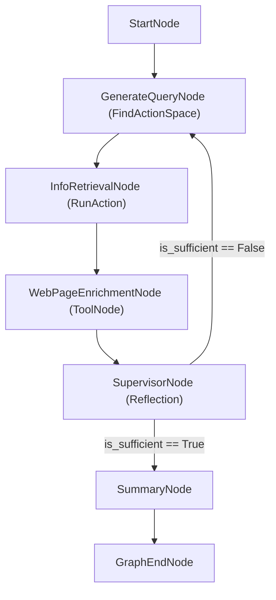
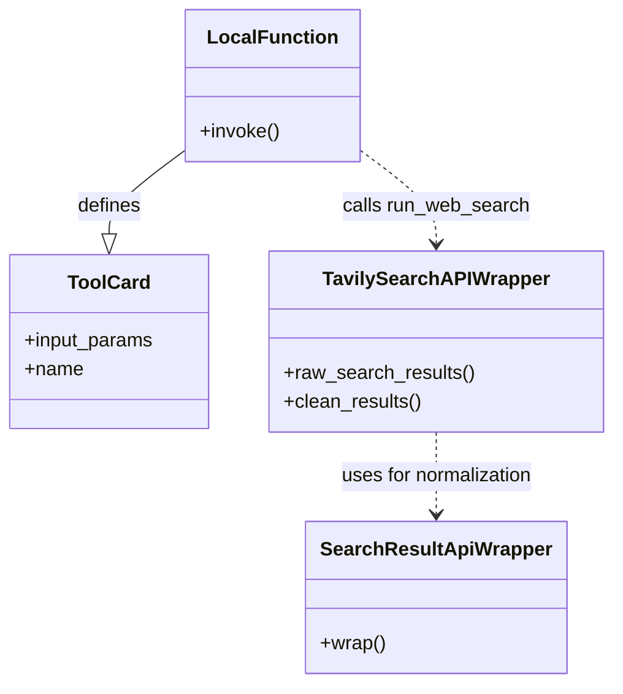

<!-- source: DeepWiki mcp.deepwiki.com · repo openJiuwen-ai/deepsearch · page 4.2 DeepSearch Search Agent (search/react modes) · fetched 2026-11-02 -->

# DeepSearch Search Agent (search/react modes)

Relevant source files

The following files were used as context for generating this wiki page:

- [deepsearch/openjiuwen_deepsearch/framework/openjiuwen/agent/collector_graph/graph_builder.py](deepsearch/openjiuwen_deepsearch/framework/openjiuwen/agent/collector_graph/graph_builder.py)
- [deepsearch/openjiuwen_deepsearch/framework/openjiuwen/tools/search_api/tavily/api_wrapper.py](deepsearch/openjiuwen_deepsearch/framework/openjiuwen/tools/search_api/tavily/api_wrapper.py)
- [deepsearch/openjiuwen_deepsearch/framework/openjiuwen/tools/web_search.py](deepsearch/openjiuwen_deepsearch/framework/openjiuwen/tools/web_search.py)
- [deepsearch/tests/info_collector/test_graph_builder.py](deepsearch/tests/info_collector/test_graph_builder.py)
- [deepsearch/tests/tools/search_api/test_tavily.py](deepsearch/tests/tools/search_api/test_tavily.py)
- [deepsearch/tests/tools/test_runtime_api.py](deepsearch/tests/tools/test_runtime_api.py)
- [deepsearch/tests/tools/test_web_search.py](deepsearch/tests/tools/test_web_search.py)

The DeepSearch Search Agent is the core orchestration component used when the system operates in `search` or `react` modes. Unlike the research mode collector which follows a predefined pipeline for complex report generation, the Search Agent utilizes a dynamic state machine to iteratively find, retrieve, and reason over information to answer user queries directly.

## Overview and State Machine

The Search Agent operates as a state machine where the LLM determines the next action based on the current state and previous results. This is implemented via a graph-based workflow that manages the transition between observation, thought, and action.

### State-Action-Result Cycle
The agent follows a standard ReAct (Reasoning and Acting) loop:
1.  **State**: Encapsulated in the `CollectorContext`, containing the conversation history, evidence gathered so far, and the current research loop count [openjiuwen_deepsearch/framework/openjiuwen/agent/collector_graph/graph_builder.py:155-162]().
2.  **Action**: The agent selects a tool or a search query from the available action pool [openjiuwen_deepsearch/framework/openjiuwen/agent/collector_graph/graph_builder.py:60-67]().
3.  **Result**: The tool execution output is recorded into the `EvidenceLedger` and fed back into the next iteration [openjiuwen_deepsearch/framework/openjiuwen/agent/collector_graph/evidence_ledger.py:33-34]().

**Sources:**
- [openjiuwen_deepsearch/framework/openjiuwen/agent/collector_graph/graph_builder.py:52-113]()
- [openjiuwen_deepsearch/framework/openjiuwen/agent/collector_graph/evidence_ledger.py:29-34]()

---

## Graph Architecture and Nodes

The search agent is built using the `Workflow` framework, organized into a sub-graph that handles the lifecycle of an information retrieval task.

### Key Nodes in Search/React Mode
| Node Name | Function/Class | Responsibility |
| :--- | :--- | :--- |
| **StartNode** | `StartNode` | Initializes the `CollectorContext` and resets the `EvidenceLedger` for a new step [openjiuwen_deepsearch/framework/openjiuwen/agent/collector_graph/graph_builder.py:113-162](). |
| **FindActionSpaceNode** | `GenerateQueryNode` | LLM generates specific search queries or identifies missing evidence requirements [openjiuwen_deepsearch/framework/openjiuwen/agent/collector_graph/graph_builder.py:199-211](). |
| **RunActionNode** | `InfoRetrievalNode` | Executes the generated queries against search engines or local retrieval tools [openjiuwen_deepsearch/framework/openjiuwen/agent/collector_graph/info_collector.py:27-27](). |
| **ToolNode** | `WebPageEnrichmentNode` | Fetches full content from URLs identified during search to provide deeper context [openjiuwen_deepsearch/framework/openjiuwen/agent/collector_graph/webpage_enrichment.py:28-28](). |
| **SupervisorNode** | `SupervisorNode` | Reflects on gathered evidence to decide if the search is sufficient or needs more loops [openjiuwen_deepsearch/framework/openjiuwen/agent/collector_graph/graph_builder.py:70-104](). |

### Search Agent Graph Logic
The following diagram illustrates the flow of the `collector_graph` used in Search/React modes:

**Search Agent Sub-Graph Flow**

**Sources:**
- [openjiuwen_deepsearch/framework/openjiuwen/agent/collector_graph/graph_builder.py:7-16]()
- [openjiuwen_deepsearch/tests/info_collector/test_graph_builder.py:7-15]()

---

## Action Pool and Tooling

The Search Agent draws from a pool of specialized tools. These tools are wrapped to ensure consistent input/output schemas for the LLM.

### Web Search and Fetch Tools
*   **web_search**: Utilizes wrappers like `TavilySearchAPIWrapper` or `GoogleSearchAPIWrapper`. It supports domain constraints (include/exclude) and temporal scoping (source_date boundaries) [openjiuwen_deepsearch/framework/openjiuwen/tools/web_search.py:34-45](), [openjiuwen_deepsearch/framework/openjiuwen/tools/web_search.py:81-122]().
*   **web_fetch**: Handled by the `WebPageEnrichmentNode`, which extracts clean text from raw HTML to bypass search snippet limitations.
*   **retrieve**: Interfaces with the local knowledge base via Milvus or native vector stores [openjiuwen_deepsearch/framework/openjiuwen/agent/collector_graph/info_collector.py:27-27]().

### Runtime API Integration
The agent can also invoke external "Runtime APIs" defined in the configuration. These are dynamically converted into tools using `build_runtime_api_tools` [deepsearch/tests/tools/test_runtime_api.py:36-52]().

**Tool Implementation Mapping**

**Sources:**
- [openjiuwen_deepsearch/framework/openjiuwen/tools/web_search.py:34-55]()
- [openjiuwen_deepsearch/framework/openjiuwen/tools/search_api/tavily/api_wrapper.py:24-43]()
- [deepsearch/tests/tools/test_runtime_api.py:9-14]()

---

## Search vs. Research Mode Differences

The Search Agent (Search/React) differs fundamentally from the Research Collector in its orchestration and termination logic.

| Feature | Search/React Mode Agent | Research Mode Collector |
| :--- | :--- | :--- |
| **Control Flow** | Dynamic ReAct loop (Supervisor reflection) | Structured Pipeline (Query Gen -> Fetch -> Score) |
| **Termination** | LLM-driven `is_sufficient` check [graph_builder.py:82]() | Predefined stages in `collector_function.py` |
| **Context Management** | Iterative `EvidenceLedger` updates [evidence_ledger.py:33]() | Batch evidence packaging for report sections |
| **Query Strategy** | `FindActionSpaceNode` generates follow-ups | `collector_gen_query.md` generates parallel queries |

### Context Limit Strategy
When the agent reaches the context limit of the underlying LLM, it employs the `context_limit_reached_strategy`. This involves summarizing the current `EvidenceLedger` to a "Brief" format via `build_ledger_brief` and clearing non-essential history to allow the loop to continue [openjiuwen_deepsearch/framework/openjiuwen/agent/collector_graph/evidence_ledger.py:31-31]().

**Sources:**
- [openjiuwen_deepsearch/framework/openjiuwen/agent/collector_graph/graph_builder.py:70-104]()
- [openjiuwen_deepsearch/framework/openjiuwen/agent/collector_graph/evidence_ledger.py:29-34]()

---

## Key Functions and Classes

### `CollectorContext`
A Pydantic model that tracks the state of the search process across iterations.
*   **Location**: `openjiuwen_deepsearch/framework/openjiuwen/agent/collector_graph/collector_context.py`
*   **Fields**: `research_loop_count`, `max_search_query_count`, `evidence_ledger` [openjiuwen_deepsearch/framework/openjiuwen/agent/collector_graph/graph_builder.py:155-162]().

### `Reflection`
The output schema for the `SupervisorNode`. It forces the LLM to explicitly state if the gathered information is enough.
*   **Location**: `openjiuwen_deepsearch/framework/openjiuwen/agent/collector_graph/graph_builder.py:70-102]()
*   **Key Field**: `is_sufficient: bool` [openjiuwen_deepsearch/framework/openjiuwen/agent/collector_graph/graph_builder.py:82-84]().

### `apply_web_search_temporal_scope`
Adjusts the search engine parameters (specifically Tavily) to respect time constraints identified in the user query [openjiuwen_deepsearch/framework/openjiuwen/tools/web_search.py:125-177]().

**Sources:**
- [openjiuwen_deepsearch/framework/openjiuwen/agent/collector_graph/graph_builder.py:52-113]()
- [openjiuwen_deepsearch/framework/openjiuwen/tools/web_search.py:125-141]()

---

