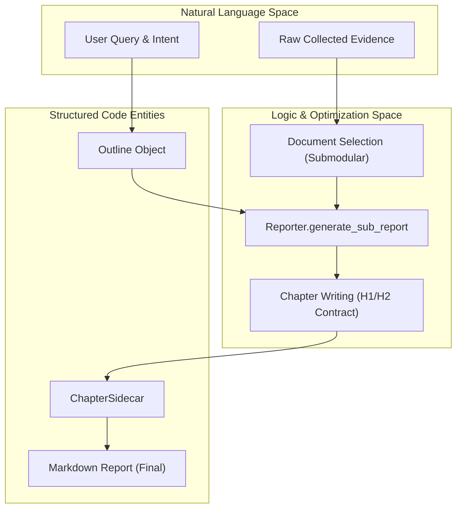
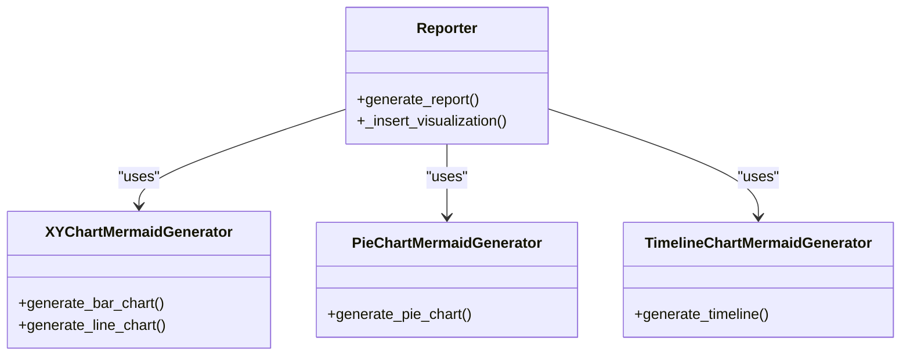

<!-- source: DeepWiki mcp.deepwiki.com · repo openJiuwen-ai/deepsearch · page 5 Report Generation · fetched 2026-11-02 -->

# Report Generation

Relevant source files

The following files were used as context for generating this wiki page:

- [deepsearch/docs/feature/algorithm/report-generation/sub-report-generation.md](deepsearch/docs/feature/algorithm/report-generation/sub-report-generation.md)
- [deepsearch/openjiuwen_deepsearch/algorithm/report/report.py](deepsearch/openjiuwen_deepsearch/algorithm/report/report.py)

The Report Generation subsystem is responsible for transforming raw research evidence and structured plans into a professional, cohesive Markdown report. This process involves sophisticated document selection using submodular optimization, structured chapter writing with strict formatting contracts, and the automated generation of data visualizations.

The primary entry point for this subsystem is the `Reporter` class [deepsearch/openjiuwen_deepsearch/algorithm/report/report.py:200-201](), which orchestrates the transition from information collection to final synthesis.

### Pipeline Overview

The transformation from "Natural Language Space" (user intent and raw text) to "Structured Report Space" follows a multi-stage pipeline managed by the `ReporterNode` [deepsearch/openjiuwen_deepsearch/framework/openjiuwen/node/report_node.py:22-23]().

**Sources:** [deepsearch/openjiuwen_deepsearch/algorithm/report/report.py:200-250](), [deepsearch/openjiuwen_deepsearch/framework/openjiuwen/node/report_node.py:22-45]()

---

### Document Selection and Information Coverage
Before writing begins, the system must select the most relevant and non-redundant documents from the collection. It uses an information dimension matrix to evaluate coverage gain against redundancy and noise.

*   **Rationale Generation:** The system identifies key information dimensions required for a specific chapter.
*   **Greedy Submodular Optimization:** Documents are selected to maximize a marginal value function: `marginal_value = coverage_gain - β×redundancy - γ×noise - δ×untrustworthy`.
*   **Doc Prefilter:** An initial screening step [deepsearch/openjiuwen_deepsearch/algorithm/report/doc_prefilter.py:37-39]() reduces the candidate pool before expensive matrix operations.

For details, see [Document Selection: Coverage Matrix and Greedy Submodular Optimization](#5.1).

**Sources:** [deepsearch/openjiuwen_deepsearch/algorithm/report/report.py:31-39](), [deepsearch/docs/feature/algorithm/report-generation/coverage-matrix-doc-selection.md:1-20]()

---

### Sub-Report Generation and Chapter Writing
The `Reporter.generate_sub_report` method [deepsearch/openjiuwen_deepsearch/algorithm/report/report.py:350-355]() processes each chapter independently. It enforces a "flat heading contract" where only H1 and H2 headers are permitted to ensure report consistency.

*   **Sub-Outline Generation:** LLM generates a detailed internal structure for the chapter based on the `Outline` [deepsearch/openjiuwen_deepsearch/framework/openjiuwen/agent/search_context.py:55-56]().
*   **Validation Loop:** The system uses a retry-with-feedback mechanism. If the LLM outputs forbidden H3 tags or Mermaid code blocks in the body, it receives a `<retry_feedback>` block [deepsearch/openjiuwen_deepsearch/algorithm/report/report.py:77-96]() and regenerates the content.
*   **ChapterSidecar:** Each generated chapter produces a `ChapterSidecar` [deepsearch/openjiuwen_deepsearch/framework/openjiuwen/agent/search_context.py:54-55]() containing metadata and source mappings for continuity.

For details, see [Sub-Report Generation and Chapter Writing](#5.2).

**Sources:** [deepsearch/openjiuwen_deepsearch/algorithm/report/report.py:77-96](), [deepsearch/docs/feature/algorithm/report-generation/sub-report-generation.md:14-30]()

---

### Report Assembly and Refinement
Once all sub-reports are generated, the `Reporter.generate_report` method [deepsearch/openjiuwen_deepsearch/algorithm/report/report.py:250-260]() assembles them into a final document.

*   **Global Synthesis:** Generation of the Abstract and Conclusion sections.
*   **Renumbering:** The `MarkdownOutlineRenumber` utility [deepsearch/openjiuwen_deepsearch/algorithm/report/report_utils.py:42-42]() ensures all headers follow a consistent numerical sequence across the merged document.
*   **Table Normalization:** Ensures all tables have proper captions and numbering (e.g., "Table 1-1") via `ensure_markdown_table_captions` [deepsearch/openjiuwen_deepsearch/algorithm/report/table_caption_utils.py:49-49]().

For details, see [Report Assembly: Abstract, Conclusion, References, and Table Captions](#5.3).

**Sources:** [deepsearch/openjiuwen_deepsearch/algorithm/report/report.py:250-300](), [deepsearch/openjiuwen_deepsearch/algorithm/report/report_utils.py:40-50]()

---

### Mermaid Visualization Pipeline
To enhance readability, the system includes an automated pipeline for generating and inserting Mermaid charts. This is handled separately from text generation to maintain strict control over chart syntax and data accuracy.

**Sources:** [deepsearch/openjiuwen_deepsearch/algorithm/report/report_utils.py:43-48](), [deepsearch/openjiuwen_deepsearch/algorithm/report/report.py:137-156]()

The pipeline extracts visualization content, validates it against a schema, and uses specific generators (e.g., `XYChartMermaidGenerator`) to produce compliant Mermaid code.

For details, see [Mermaid Visualization Pipeline](#5.4).

**Sources:** [deepsearch/openjiuwen_deepsearch/algorithm/report/report_utils.py:43-48](), [deepsearch/openjiuwen_deepsearch/algorithm/report/report.py:137-156]()

---

