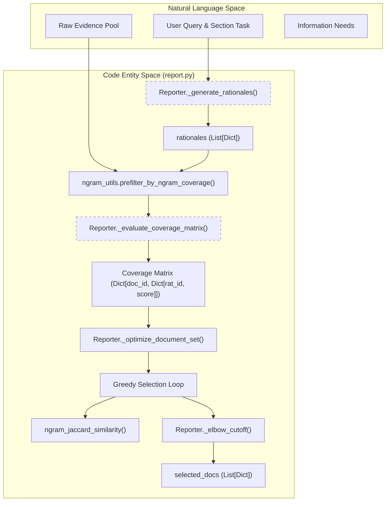
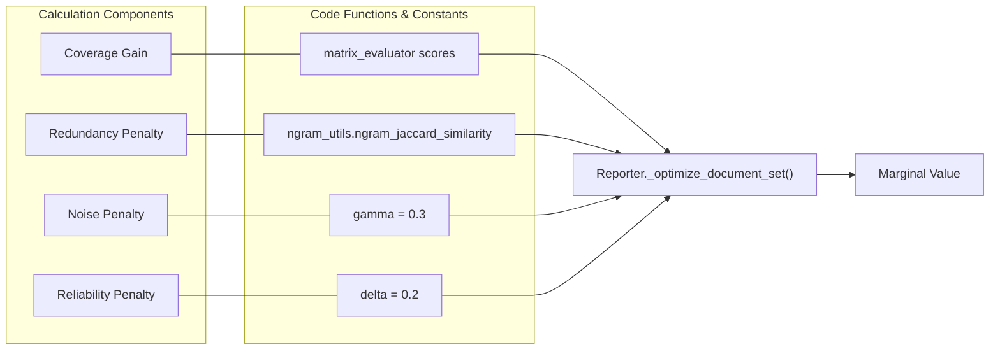

<!-- source: DeepWiki mcp.deepwiki.com · repo openJiuwen-ai/deepsearch · page 5.1 Document Selection: Coverage Matrix and Greedy Submodular Optimization · fetched 2026-11-02 -->

# Document Selection: Coverage Matrix and Greedy Submodular Optimization

<details>
<summary>Relevant source files</summary>

The following files were used as context for generating this wiki page:

- [deepsearch/docs/feature/algorithm/report-generation/coverage-matrix-doc-selection.md](deepsearch/docs/feature/algorithm/report-generation/coverage-matrix-doc-selection.md)
- [deepsearch/openjiuwen_deepsearch/algorithm/report/report.py](deepsearch/openjiuwen_deepsearch/algorithm/report/report.py)
- [deepsearch/tests/report/test_doc_selection.py](deepsearch/tests/report/test_doc_selection.py)
- [deepsearch/tests/report/test_sub_report.py](deepsearch/tests/report/test_sub_report.py)

</details>


The document selection system in DeepSearch identifies the most relevant, diverse, and high-quality evidence from a large pool of candidate documents gathered during the research phase. It replaces traditional multi-round LLM classification with a matrix-based approach that significantly reduces token consumption while improving information coverage and reducing redundancy.

### System Rationale and Architecture

The core philosophy of this subsystem is to treat document selection as a **Submodular Maximization** problem. Instead of asking an LLM to "pick the best documents," the system first defines what information is needed (Rationales), evaluates how well each document covers those needs (Coverage Matrix), and then uses a greedy algorithm to pick a set that maximizes total information gain while penalizing redundancy and noise.

#### High-Level Data Flow

1.  **Rationale Generation**: LLM generates 3-8 information dimensions based on the query and section task.
2.  **N-Gram Pre-filtering**: A zero-LLM-cost step to remove documents with no lexical overlap with rationales.
3.  **Coverage Matrix Evaluation**: Parallel LLM calls to score documents against rationales.
4.  **Greedy Optimization**: Iteratively selecting documents based on a marginal value formula.
5.  **Elbow Cutoff**: Automatically determining the optimal number of documents to include.

Sources: [deepsearch/docs/feature/algorithm/report-generation/coverage-matrix-doc-selection.md:9-24](), [deepsearch/algorithm/report/report.py:200-205]()

---

### Rationale Generation and Pre-filtering

Before scoring, the system narrows down the information requirements and the document pool.

#### Rationale Generation
The `Reporter` uses the `SUB_REPORTER_RATIONALE_GENERATOR` prompt to extract "rationales"—specific factual or analytical dimensions required for a report section [deepsearch/docs/feature/algorithm/report-generation/coverage-matrix-doc-selection.md:49-49]().
*   **Input**: User query, section task, step summaries, and the overall outline.
*   **Output**: A list of 3-8 rationale objects (ID, description, type).

#### N-Gram Jaccard Pre-filtering
To save costs, `prefilter_by_ngram_coverage` removes documents that have zero n-gram overlap with any generated rationale [deepsearch/algorithm/report/ngram_utils.py:34-35]().
*   **CJK Handling**: For Chinese/Japanese/Korean, it uses character-level bigrams since these languages lack space-based word boundaries [deepsearch/docs/feature/algorithm/report-generation/coverage-matrix-doc-selection.md:50-50]().
*   **English Handling**: Uses standard word-based n-grams.

Sources: [deepsearch/algorithm/report/report.py:31-35](), [deepsearch/docs/feature/algorithm/report-generation/coverage-matrix-doc-selection.md:49-50]()

---

### Coverage Matrix Evaluation

The `_evaluate_coverage_matrix` function performs the heavy lifting of scoring the filtered documents against the rationales [deepsearch/algorithm/report/report.py:2000-2050]().

#### Parallel Execution
Documents are processed in batches (default `BATCH_SIZE = 15`) with a concurrency limit of `MAX_CONCURRENT_BATCHES = 5` [deepsearch/algorithm/report/report.py:99-100](). Each batch is sent to an LLM using the `coverage_matrix_evaluator.md` prompt.

#### Scoring Dimensions
For every document-rationale pair, the LLM provides:
1.  **Coverage Score**: 0.0 to 1.0 (How well the doc explains the rationale).
2.  **Reliability Score**: 0.0 to 1.0 (Authority and trustworthiness).
3.  **Noise Score**: 0.0 to 1.0 (Irrelevant content density).

Sources: [deepsearch/algorithm/report/report.py:99-100](), [deepsearch/docs/feature/algorithm/report-generation/coverage-matrix-doc-selection.md:51-51]()

---

### Greedy Submodular Optimization

Once the matrix is populated, the `_optimize_document_set` function selects documents one by one [deepsearch/algorithm/report/report.py:2100-2150]().

#### Marginal Value Formula
In each iteration, the document with the highest **Marginal Value** is selected:

$$MarginalValue = \Delta Coverage - (\beta \times Redundancy) - (\gamma \times Noise) - (\delta \times Untrustworthy)$$

| Component | Code Entity / Logic | Description |
| :--- | :--- | :--- |
| **$\Delta$ Coverage** | `coverage_gain` | The increase in the total coverage score across all rationales. |
| **Redundancy** | `ngram_jaccard_similarity` | Penalty based on n-gram overlap with already selected documents [deepsearch/algorithm/report/ngram_utils.py:33-33](). |
| **Noise** | `noise_scores` | Penalty for documents marked as containing high noise by the LLM. |
| **Untrustworthy** | `1 - reliability_score` | Penalty for documents from low-authority or suspicious sources. |

**Hyperparameters**:
*   $\beta$ (Redundancy): 0.3
*   $\gamma$ (Noise): 0.3
*   $\delta$ (Untrustworthy): 0.2

Sources: [deepsearch/algorithm/report/report.py:2100-2150](), [deepsearch/docs/feature/algorithm/report-generation/coverage-matrix-doc-selection.md:82-82]()

---

### Elbow Cutoff and Coverage Verification

#### Elbow Cutoff
The system does not just pick a fixed number of documents. `_elbow_cutoff` looks for a sharp drop in the marginal value curve [deepsearch/algorithm/report/report.py:2180-2200]().
*   **Logic**: If the marginal value drops significantly (e.g., from 0.8 to 0.1), the system stops adding documents unless a document is the **sole provider** of a specific rationale (Coverage-Aware Extension) [deepsearch/docs/feature/algorithm/report-generation/coverage-matrix-doc-selection.md:53-53]().

#### Final Verification
`_verify_coverage` categorizes each rationale as:
*   **Covered**: Score $\ge$ 0.6
*   **Weak**: 0.3 $\le$ Score < 0.6
*   **Uncovered**: Score < 0.3

Uncovered rationales are included in the final report as "Limitations" or "Missing Information" notes.

Sources: [deepsearch/algorithm/report/report.py:2180-2220](), [deepsearch/docs/feature/algorithm/report-generation/coverage-matrix-doc-selection.md:53-54]()

---

### Implementation Mapping: Natural Language to Code Entities

The following diagrams illustrate how the abstract selection concepts map to specific classes and functions in the `openjiuwen_deepsearch` package.

#### Document Selection Pipeline Flow
"This diagram tracks a document's journey from the raw pool to the final selected set."


Sources: [deepsearch/algorithm/report/report.py:2000-2200](), [deepsearch/algorithm/report/ngram_utils.py:31-35]()

#### Greedy Optimization Logic
"Details the calculation of marginal value within the optimization loop."


Sources: [deepsearch/algorithm/report/report.py:2100-2150](), [deepsearch/docs/feature/algorithm/report-generation/coverage-matrix-doc-selection.md:82-82]()

---

### Key Data Structures

#### DocSelectionContext
Used for debugging and tracing the selection logic.
[deepsearch/algorithm/report/report.py:157-165]()
```python
@dataclass
class DocSelectionContext:
    rationales: list              # Generated information dimensions
    coverage_result: dict         # Full matrix with reliability/noise
    doc_infos: list               # Input candidate documents
    selected_docs: list           # Final output documents
    selected_marginal_values: list # Values at each greedy step
    verify_result: dict           # Final coverage status (covered/weak/uncovered)
```

#### Coverage Matrix Result
The output from the parallel LLM evaluation batches.
[deepsearch/docs/feature/algorithm/report-generation/coverage-matrix-doc-selection.md:65-69]()
```json
{
  "filtered_docs": [...],
  "coverage_matrix": {
    "doc_uuid_1": {"rationale_1": 0.9, "rationale_2": 0.2},
    "doc_uuid_2": {"rationale_1": 0.1, "rationale_2": 0.8}
  },
  "reliability_scores": {"doc_uuid_1": 0.95, "doc_uuid_2": 0.7},
  "noise_scores": {"doc_uuid_1": 0.05, "doc_uuid_2": 0.4}
}
```

Sources: [deepsearch/algorithm/report/report.py:157-165](), [deepsearch/docs/feature/algorithm/report-generation/coverage-matrix-doc-selection.md:65-69]()

---

