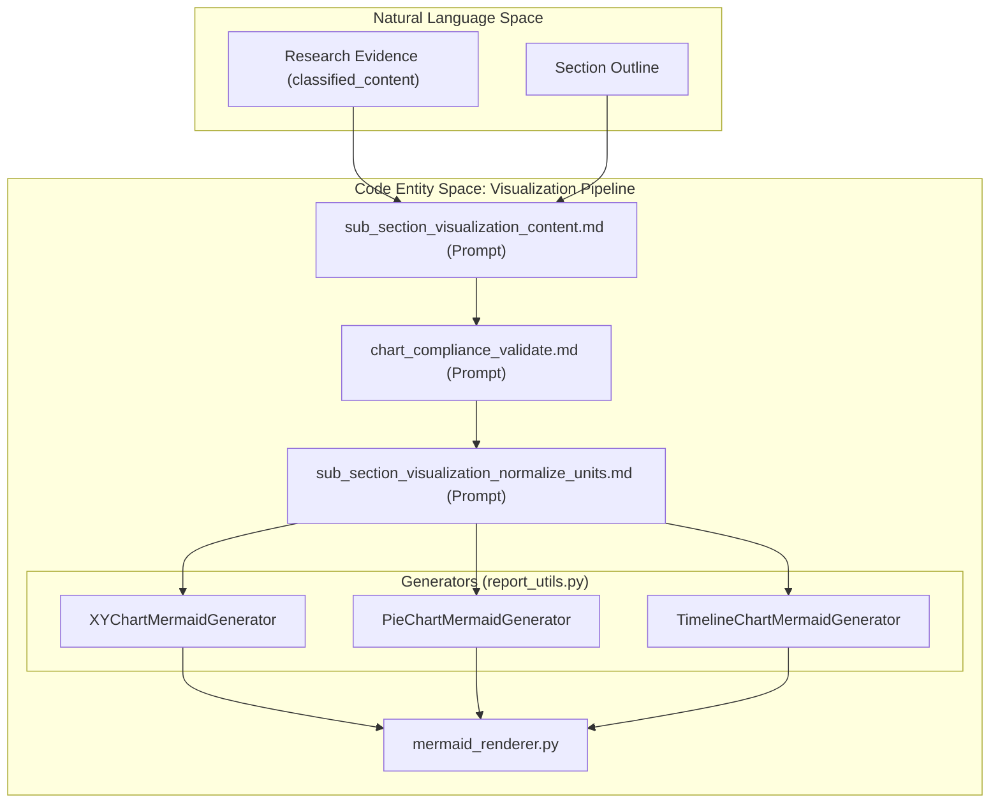
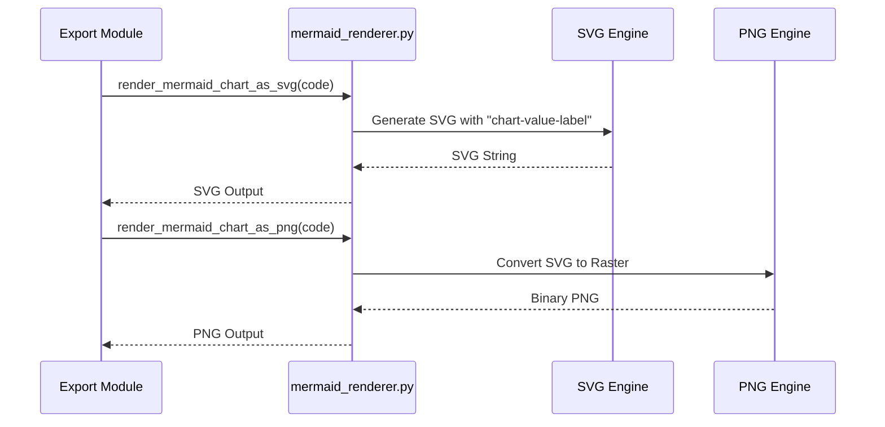

<!-- source: DeepWiki mcp.deepwiki.com · repo openJiuwen-ai/deepsearch · page 5.4 Mermaid Visualization Pipeline · fetched 2026-11-02 -->

# Mermaid Visualization Pipeline

Relevant source files

The following files were used as context for generating this wiki page:

- [deepsearch/docs/feature/algorithm/report-generation/visualization-markdown.md](deepsearch/docs/feature/algorithm/report-generation/visualization-markdown.md)
- [deepsearch/openjiuwen_deepsearch/algorithm/prompts/chart_compliance_validate.md](deepsearch/openjiuwen_deepsearch/algorithm/prompts/chart_compliance_validate.md)
- [deepsearch/openjiuwen_deepsearch/algorithm/prompts/sub_section_visualization_content.md](deepsearch/openjiuwen_deepsearch/algorithm/prompts/sub_section_visualization_content.md)
- [deepsearch/openjiuwen_deepsearch/algorithm/report/report_utils.py](deepsearch/openjiuwen_deepsearch/algorithm/report/report_utils.py)
- [deepsearch/tests/algorithm/report_export/test_mermaid_renderer.py](deepsearch/tests/algorithm/report_export/test_mermaid_renderer.py)
- [deepsearch/tests/report/test_sub_report.py](deepsearch/tests/report/test_sub_report.py)

The Mermaid Visualization Pipeline is a specialized subsystem within the report generation engine that transforms structured data extracted from research evidence into visual charts using Mermaid.js syntax. Unlike VLM-based image generation, this pipeline works directly with Markdown text, ensuring charts are lightweight, editable, and accessible.

## 1. Pipeline Overview

The visualization process is integrated into the `Reporter` lifecycle, specifically during sub-report (chapter) generation. It follows a strict sequence: extraction, validation, normalization, generation, and placement.

### Functional Scope
*   **Data Source**: Charts are strictly derived from the `classified_content` (retrieved evidence) assigned to a specific chapter [deepsearch/docs/feature/algorithm/report-generation/visualization-markdown.md:9-13]().
*   **Supported Types**: `bar`, `line`, `pie`, and `timeline` [deepsearch/openjiuwen_deepsearch/algorithm/prompts/sub_section_visualization_content.md:26]().
*   **Compliance**: Charts must pass semantic relevance checks against the chapter outline and schema validation before being included [deepsearch/openjiuwen_deepsearch/algorithm/prompts/chart_compliance_validate.md:2-24]().

### System Architecture Diagram

"Natural Language Space" (Evidence/Outlines) to "Code Entity Space" (Generators/Validators).

Sources: [deepsearch/docs/feature/algorithm/report-generation/visualization-markdown.md:38-48](), [deepsearch/openjiuwen_deepsearch/algorithm/report/report_utils.py:109-226]()

---

## 2. Extraction and Validation

### Data Extraction
The pipeline identifies high-data-density candidates from the `classified_content`. The `sub_section_visualization_content.md` prompt instructs the LLM to extract a JSON object containing an `image_title`, `image_type`, and `records` (a list of `[category, value, unit]`) [deepsearch/openjiuwen_deepsearch/algorithm/prompts/sub_section_visualization_content.md:23-30]().

### Schema and Compliance Validation
The extracted data undergoes two levels of validation:
1.  **Structural Validation**: `validate_visualization_extraction_schema` ensures the JSON contains non-empty titles, valid types, and consistent record lengths [deepsearch/openjiuwen_deepsearch/algorithm/report/report_utils.py:30-69]().
2.  **Semantic Compliance**: The `chart_compliance_validate.md` prompt checks if the chart is relevant to the `section_outline` and if the chosen `image_type` matches the data shape (e.g., ensuring `line` charts have continuous X-axis values) [deepsearch/openjiuwen_deepsearch/algorithm/prompts/chart_compliance_validate.md:25-54]().

**Validation Rules Table:**
| Chart Type | Core Requirement | Common Rejection Reason |
| :--- | :--- | :--- |
| **Bar** | Discrete categories, $\ge 3$ records | Mixing incompatible metrics (e.g., kWh and USD) |
| **Line** | Continuous/equal-granularity X-axis | Non-continuous time series |
| **Pie** | Whole-part/proportion semantics | Pure ranking data without 100% total |
| **Timeline** | Milestones with dates | Using numeric strings as events |

Sources: [deepsearch/openjiuwen_deepsearch/algorithm/report/report_utils.py:30-70](), [deepsearch/openjiuwen_deepsearch/algorithm/prompts/chart_compliance_validate.md:36-54]()

---

## 3. Mermaid Chart Generators

The `report_utils.py` file defines specialized generator classes that convert validated JSON into Mermaid code blocks.

### XYChartMermaidGenerator (Bar/Line)
This generator utilizes the `xychart-beta` syntax.
*   **Horizontal Orientation**: Automatically switches to `horizontal: true` if category labels are long or numerous to prevent crowding [deepsearch/tests/algorithm/report_export/test_mermaid_renderer.py:148-167]().
*   **Axis Scaling**: Implements "nice" scaling logic to determine `y-axis` bounds (e.g., `nice_ceil` and `nice_floor`) [deepsearch/tests/algorithm/report_export/test_mermaid_renderer.py:31]().
*   **Label Cleaning**: Uses `_strip_chart_markup` to remove citations and URLs from labels to ensure Mermaid renders correctly [deepsearch/openjiuwen_deepsearch/algorithm/report/report_utils.py:12-18]().

### PieChartMermaidGenerator
*   **Percent Mode**: Forces proportion visualization.
*   **'Other' Slice**: Automatically aggregates small slices into an "Other" (or "其他" in Chinese) category to maintain readability [deepsearch/tests/algorithm/report_export/test_mermaid_renderer.py:173-194]().

### TimelineChartMermaidGenerator
*   **Event Truncation**: Limits `event_text` length to `EVENT_MAX_LEN` to prevent the timeline from becoming overly vertical [deepsearch/tests/algorithm/report_export/test_mermaid_renderer.py:206-221]().

Sources: [deepsearch/openjiuwen_deepsearch/algorithm/report/report_utils.py:109-226](), [deepsearch/tests/algorithm/report_export/test_mermaid_renderer.py:148-221]()

---

## 4. Rendering and Placement

### Placement Planning
After the sub-report text is generated, the system uses `_insert_visualization` to plan where the Mermaid charts should be placed. The system avoids placing charts in the middle of lists or code blocks and ensures they are preceded by appropriate context. Charts are wrapped in managed captions that include original source citations [deepsearch/docs/feature/algorithm/report-generation/visualization-markdown.md:22-23]().

### Static Rendering (`mermaid_renderer.py`)
For exports (PDF/DOCX/PNG), the `mermaid_renderer.py` module converts Mermaid text into static images.

**Key Rendering Features:**
*   **Data Labels**: Strictly follows the `showDataLabel` config in the Mermaid frontmatter [deepsearch/tests/algorithm/report_export/test_mermaid_renderer.py:48-68]().
*   **ViewBox Expansion**: For horizontal charts, the renderer expands the SVG `viewBox` to accommodate long category labels, preventing text clipping [deepsearch/tests/algorithm/report_export/test_mermaid_renderer.py:115-146]().

Sources: [deepsearch/algorithm/report_export/mermaid_renderer.py](), [deepsearch/tests/algorithm/report_export/test_mermaid_renderer.py:18-46](), [deepsearch/docs/feature/algorithm/report-generation/visualization-markdown.md:65]()

---

