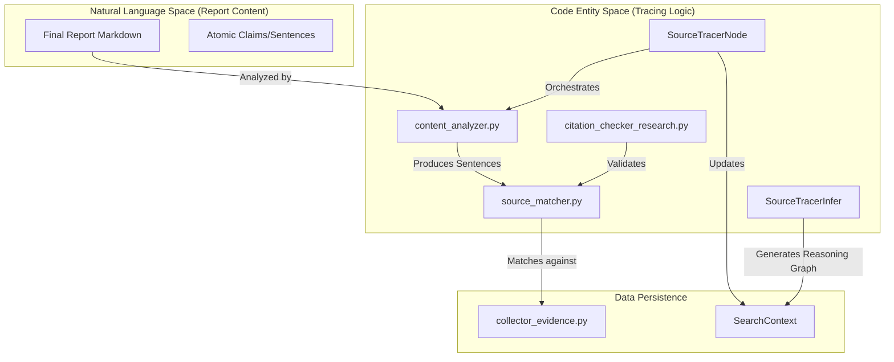
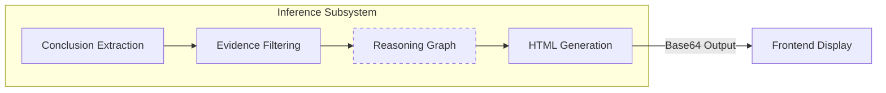

<!-- source: DeepWiki mcp.deepwiki.com · repo openJiuwen-ai/deepsearch · page 6 Source Tracing and Provenance · fetched 2026-11-02 -->

# Source Tracing and Provenance

Relevant source files

The following files were used as context for generating this wiki page:

- [deepsearch/openjiuwen_deepsearch/framework/openjiuwen/agent/main_graph_nodes.py](deepsearch/openjiuwen_deepsearch/framework/openjiuwen/agent/main_graph_nodes.py)

Source tracing and provenance ensure that every claim in a generated report is backed by verifiable evidence. The system employs two distinct subsystems to maintain transparency: **Global Source Tracing**, which handles citation matching and reference validation across the entire report, and **Inference-Chain Source Tracing**, which visualizes the logical steps taken from raw evidence to final conclusions.

## Architectural Overview

The provenance system operates at the end of the research workflow, primarily within the `SourceTracerNode` and `SourceTracerInferNode` components. These nodes process the generated report and the collected evidence to ensure factual grounding.

### Provenance Workflow
1.  **Sentence Identification**: Breaking down the generated report into atomic claims.
2.  **Citation Matching**: Mapping these claims back to the `collector_evidence` gathered during the research phase.
3.  **Validity Checking**: Verifying that the matched evidence actually supports the claim.
4.  **Inference Visualization**: Generating a logical graph showing how evidence was synthesized into conclusions.

**Sources:**
- `deepsearch/openjiuwen_deepsearch/framework/openjiuwen/agent/main_graph_nodes.py:60-64` (Importing source tracing components)
- `deepsearch/openjiuwen_deepsearch/framework/openjiuwen/agent/main_graph_nodes.py:1000-1050` (SourceTracerNode implementation)

---

## Global Source Tracer

The Global Source Tracer is responsible for the systematic verification of all citations within the final report. It ensures that every `[id]` marker in the text points to a valid, relevant source and generates the final reference list.

### Key Components
*   **Content Analyzer**: Segments the report into individual sentences for granular tracing [deepsearch/openjiuwen_deepsearch/algorithm/source_trace/content_analyzer.py]().
*   **Source Matcher**: Uses algorithms to align sentences with the evidence stored in the `SearchContext` [deepsearch/openjiuwen_deepsearch/algorithm/source_trace/source_matcher.py]().
*   **Citation Checker**: A research-specific validator that filters out hallucinations or weak matches [deepsearch/openjiuwen_deepsearch/algorithm/source_trace/citation_checker_research.py]().
*   **Marker Format**: Claims verified by this system are tagged with the `[checked_citation:id]` format to distinguish them from unverified text.

For technical details on the matching algorithms and marker formats, see **[Global Source Tracer](#6.1)**.

**Sources:**
- `deepsearch/openjiuwen_deepsearch/framework/openjiuwen/agent/main_graph_nodes.py:1010-1035` (SourceTracerNode execution logic)

---

## Inference-Chain Source Tracer

The Inference-Chain Source Tracer provides a "deep dive" into the reasoning process. While global tracing confirms *where* information came from, inference tracing explains *how* the AI arrived at specific conclusions.

### System Flow
The `SourceTracerInfer` class orchestrates the generation of a reasoning graph. This graph is delivered to the frontend as a base64-encoded HTML visualization, allowing users to interactively explore the evidence-to-conclusion path.

| Component | Responsibility | Code Entity |
| :--- | :--- | :--- |
| **Conclusion Extractor** | Identifies key findings in the report | `SourceTracerInfer` |
| **Graph Generator** | Builds a DAG of reasoning nodes | `supplement_graph.py` |
| **Node Numbering** | Assigns IDs to logical steps | `number_node.py` |
| **HTML Renderer** | Converts the graph to an interactive UI | `generate_html.py` |

For details on the graph patching logic and HTML output format, see **[Inference-Chain Source Tracer](#6.2)**.

**Sources:**
- `deepsearch/openjiuwen_deepsearch/framework/openjiuwen/agent/main_graph_nodes.py:1060-1095` (SourceTracerInferNode implementation)
- `deepsearch/openjiuwen_deepsearch/algorithm/source_tracer_infer/infer.py` (Core inference logic)

---

## Data Structures for Provenance

The tracing system relies on the `SearchContext` to maintain the link between raw search results and the final report.

| Entity | Role in Provenance |
| :--- | :--- |
| `collector_evidence` | The primary source of truth; contains snippets, URLs, and authority scores. |
| `checked_citation` | A validated link between a report sentence and a `collector_evidence` ID. |
| `infer_messages` | The container for the base64 reasoning graphs sent to the client. |

**Sources:**
- `deepsearch/openjiuwen_deepsearch/framework/openjiuwen/agent/search_context.py` (Definition of SearchContext and related data models)

---

